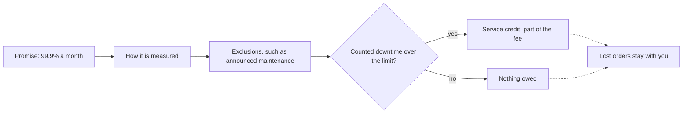

## Before you start

- [[management.l3.vendor-lock-in]] — you know a paid vendor adds a contract to the cost of leaving; this lesson reads one part of that contract.
- [[management.l2.non-functional-requirements]] — you know YC-7 and YC-10, the refund requirements on answering within 2 seconds and resending for at least 24 hours.
- [[backend.l3.circuit-breaker]] — you know Payments stops calling a failing gateway and keeps each due refund `pending` to try again later.
- [[devops.l3.rpo-and-rto]] — you know how to turn "how long may we be down" into a number; this lesson does the same with a vendor's promise.

## The situation

It is the first week of Sprint 15, and the team must choose a payment gateway before writing the refund job. Gateway A's offer promises 99.9% availability every month, and a teammate is pleased. "Three nines, 99.9%, means it is basically never down, and if it is, they pay. We can skip the retries when we write the job." Gateway B promises 99.5%, which sounds almost the same. You read the offer's details and find rules about measuring, exceptions and a partial refund of fees. What does this promise really guarantee Đơn Hàng, and what does the team get when it is broken?

## Core concepts

- **service-level agreement (SLA)** — the part of a vendor's contract that states measurable promises, such as monthly availability and support response times, and what the customer gets when one is missed.
- availability — the share of a period, here a 30-day month, during which the service counts as working by the SLA's own measurement.
- exclusion — a cause of downtime the SLA does not count against its promise, such as maintenance announced in advance.
- service credit — what the vendor gives back when it misses a promise; in Gateway A's offer it is 10% of that month's fee, and Gateway B gives nothing.

## How it works



In the situation above, Gateway A's offer is a service-level agreement, and the diagram reads it from left to right. The promise comes first. A percentage is hard to picture, so turn it into time: a 30-day month has 43,200 minutes, and 0.1% of that is about 43 minutes of allowed downtime. Gateway B's 99.5% allows about 3 hours 36 minutes.

The next two boxes decide what the number is worth. How availability is measured says whose view counts: the vendor's own record of API calls, a status page it runs (a web page where the vendor itself posts whether its service is up), or something you can check. A measurement on the vendor's side sees only what reaches the vendor. So calls from Đơn Hàng that fail before reaching the gateway may not count as downtime at all, while a measurement you can check gives you your own figure to hold against the vendor's. Exclusions then take causes out of the count, so a month can have more downtime than the percentage suggests and still meet the promise.

Only counted downtime over the limit breaks the promise. Then the SLA says what the customer gets: a service credit, something more, or nothing. Gateway A's credit returns 10% of that month's fee. It does not return the orders the business could not take, so an SLA moves little of an outage's cost onto the vendor. The dashed arrows show this: whichever branch the month takes, lost orders stay with you.

The support response time is a promise of the same kind. It says how soon the vendor answers during a serious incident, not how soon the cause is fixed.

## In the Đơn Hàng system

The team's evaluation of the two candidates, its SLA section:

```markdown file=docs/team/payment-gateway-evaluation.md tag=stage-3 lines=52-68
### Cam kết dịch vụ (SLA), quy ra thời gian

Phần trăm khó hình dung, nên mỗi cam kết được quy ra thời gian cổng được phép
không chạy trong một tháng 30 ngày (43.200 phút).

| | Cổng A | Cổng B |
|---|---|---|
| Khả dụng hằng tháng | 99,9%: tối đa khoảng 43 phút không chạy | 99,5%: tối đa khoảng 3 giờ 36 phút |
| Cách đo | Lời gọi API thành công, đo phía cổng | Trang trạng thái của cổng |
| Không tính | Bảo trì báo trước 72 giờ | Bảo trì báo trước 24 giờ, sự cố của ngân hàng |
| Khi không giữ lời | Trả lại 10% phí tháng đó | Không có |
| Trả lời hỗ trợ khi sự cố nặng | 1 giờ, mọi lúc | 1 ngày làm việc |

Tiền trả lại chỉ là một phần phí, không bù các đơn bị mất, nên SLA không
chuyển được bao nhiêu rủi ro sang vendor. Đơn Hàng không dựa vào SLA cho yêu
cầu của mình: yêu cầu hoàn tiền vẫn được nhận khi cổng lỗi và được gửi lại
trong 24 giờ (YC-7, YC-10), dù cổng hứa gì.
```

Lines 54–55 turn every promise into minutes of a 30-day month, and line 59 gives the result: about 43 minutes for Gateway A, about 3 hours 36 minutes for Gateway B. Line 60 shows how each is measured: Gateway A counts successful API calls on its own side, Gateway B uses its status page. Line 61 lists the exclusions: Gateway A excludes maintenance announced 72 hours ahead, Gateway B maintenance announced 24 hours ahead and incidents at the bank. Line 62 is the credit: Gateway A returns 10% of that month's fee, Gateway B nothing. Line 63 is the support promise: Gateway A answers within 1 hour at any time, Gateway B within 1 working day.

Lines 65–68 draw the conclusion this lesson teaches. The file says, before this excerpt, that every figure about the two gateways is assumed for teaching, not taken from a real vendor.

The requirements the last line points to:

```markdown file=docs/team/refund-requirements.md tag=stage-3 lines=43-50
- YC-7: Yêu cầu hoàn tiền của khách được nhận và trả lời trong 2 giây, kể cả
  khi cổng thanh toán không trả lời hoặc báo lỗi.
- YC-8: Mỗi yêu cầu hoàn tiền lưu người yêu cầu và thời điểm yêu cầu; hai thông
  tin này không bị sửa hay xóa về sau, để kế toán đối soát.
- YC-9: Một đơn không bao giờ được hoàn tiền hai lần, kể cả khi việc gửi sang
  cổng thanh toán phải thử lại.
- YC-10: Khi cổng thanh toán lỗi, yêu cầu được gửi lại tự động trong ít nhất 24
  giờ trước khi chuyển cho nhân viên xử lý.
```

YC-7 asks for an answer to the customer within 2 seconds even when the gateway does not answer. YC-10 asks for automatic resending for at least 24 hours before staff take over. Neither mentions the gateway's promise. They hold in a month within Gateway A's 43 minutes and in a month far outside it, because Đơn Hàng's own design keeps them, not the vendor.

## Seniors often assume…

- **"A 99.9% SLA means the service is practically never down."** → Actually it allows about 43 counted minutes a month, and excluded time such as announced maintenance comes on top. Gateway A can be unreachable for longer than that and still keep its word. You notice this when refunds wait as `pending` through an outage and the vendor's own count for that month still shows the target met.
- **"An SLA makes the vendor pay for our losses when their service fails."** → Actually Gateway A returns 10% of that month's fee and Gateway B returns nothing; neither pays for delayed refunds or lost orders. You notice this when the credit for a bad month is smaller than the customer care time spent answering calls about late refunds.
- **"A vendor with a strong SLA lets us skip timeouts and retries on our side."** → Actually an SLA only says how much failure the vendor may have and what it then owes; it does not stop one call from hanging or failing. YC-7 and YC-10 hold whatever the gateway promises, so Payments keeps its timeout, circuit breaker and retries. You notice this when one gateway call without a timeout hangs, and the refunds behind it wait while the gateway is well inside its 43 minutes.

## Try it (3 minutes)

1. Open `docs/team/payment-gateway-evaluation.md` in the `don-hang` repository at tag `stage-3` and read the rows `Không tính` (exclusions, line 61) and `Khi không giữ lời` (credit, line 62) of the SLA table.
2. Picture one 30-day month with Gateway A: 30 minutes of maintenance announced 4 days ahead, and 25 more minutes of an outage nobody announced. Work out the counted downtime and what Đơn Hàng gets.

Expected result: if Gateway A's own record shows the 25-minute outage, that is 25 counted minutes, under the 43 allowed, so the promise is kept and no credit is owed, although refunds could not reach the gateway for 55 minutes. If its record misses calls that never arrived, even fewer minutes count.

What changes with Gateway B in the same month, and what keeps the refunds safe in both cases?

<details><summary>Suggested answer</summary>

With Gateway B the maintenance is excluded as well, since it needs only 24 hours of notice, and 25 minutes are far under its 3 hours 36 minutes; it counts only what its own status page shows. Even a month over its limit would earn nothing, because its row `Khi không giữ lời` says `Không có`. In both cases the refunds are safe for the same reason: YC-10 makes Đơn Hàng resend them for at least 24 hours, so a 55-minute gap only delays them.

</details>

## Connections

- [[management.l3.vendor-lock-in]] — the contract adds to the cost of leaving a vendor; the SLA is the part of it about how well the vendor runs while you stay.
- [[management.l2.non-functional-requirements]] — the source of YC-7 and YC-10, the requirements this lesson holds against the gateway's promise.
- [[backend.l3.circuit-breaker]] — the design on Đơn Hàng's side that keeps refunds safe through the downtime an SLA allows.
- [[devops.l3.rpo-and-rto]] — the same kind of number asked of your own system: how long the business can be without it.
- [[backend.l3.graceful-degradation]] — what Đơn Hàng still does while a dependency is in its allowed downtime.
- [[management.l2.risk-responses]] — an SLA looks like transferring a risk to the vendor, but its credit transfers only a small part.
- [[management.l3.vendor-contract-terms]] — the other terms of the same contract an engineer reads before signing.

## Five-line summary

1. An SLA states a vendor's measurable promises and what you get when one is missed, which for both gateways here is far below your losses.
2. Its worth sits in the details: how availability is measured, what is excluded, and whether a miss pays anything.
3. 99.9% over a 30-day month still allows about 43 minutes without the service, before exclusions such as announced maintenance.
4. A service credit returns part of the fee, not lost orders, so an SLA moves little risk onto the vendor.
5. Đơn Hàng keeps YC-7 and YC-10 itself: refunds are accepted while the gateway is down and resent for at least 24 hours.
