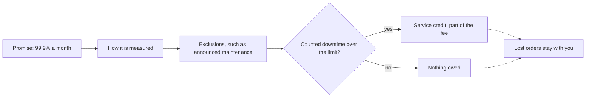

## Bạn cần biết trước

- [[management.l3.vendor-lock-in]] — bạn biết một vendor trả phí còn kèm hợp đồng vào cái giá rời đi. Bài này đọc một phần của hợp đồng đó.
- [[management.l2.non-functional-requirements]] — bạn biết YC-7 và YC-10, hai yêu cầu hoàn tiền về trả lời trong 2 giây và gửi lại trong ít nhất 24 giờ.
- [[backend.l3.circuit-breaker]] — bạn biết Payments ngừng gọi cổng thanh toán đang lỗi và giữ mỗi khoản hoàn tiền tới hạn ở `pending` để thử lại sau.
- [[devops.l3.rpo-and-rto]] — bạn biết cách biến câu "được phép ngừng bao lâu" thành một con số. Bài này làm điều tương tự với lời hứa của vendor.

## Tình huống

Tuần đầu Sprint 15, đội phải chọn cổng thanh toán trước khi viết job hoàn tiền. Bản chào của Cổng A hứa khả dụng 99,9% mỗi tháng, và một đồng đội rất hài lòng: "Ba số chín, 99,9%, tức là gần như không bao giờ sập, mà có sập thì họ đền. Viết job thì bỏ qua phần thử lại cũng được." Cổng B hứa 99,5%, nghe gần như ngang nhau. Bạn đọc kỹ bản chào và thấy các quy định về cách đo, các trường hợp không tính, và một khoản trả lại một phần phí. Lời hứa này thực sự bảo đảm gì cho Đơn Hàng, và đội nhận được gì khi nó bị phá?

## Khái niệm cốt lõi

- **thỏa thuận mức dịch vụ (SLA)** (service-level agreement) — phần hợp đồng của vendor nêu các cam kết đo được, như mức khả dụng hằng tháng hay thời gian trả lời hỗ trợ, và khách nhận được gì khi một cam kết bị lỡ.
- khả dụng — phần thời gian trong một kỳ, ở đây là một tháng 30 ngày, mà dịch vụ được tính là đang chạy theo chính cách đo của SLA.
- trường hợp không tính — một nguyên nhân ngừng chạy mà SLA không tính vào lời hứa, như bảo trì đã báo trước.
- tiền trả lại — thứ vendor trả lại khi lỡ một cam kết. Trong bản chào của Cổng A, đó là 10% phí tháng đó, còn Cổng B không trả gì.

## Cơ chế hoạt động



Trong tình huống trên, bản chào của Cổng A là một SLA, và sơ đồ đọc nó từ trái sang phải. Lời hứa đứng đầu. Phần trăm khó hình dung, nên hãy quy ra thời gian: một tháng 30 ngày có 43.200 phút, và 0,1% trong đó là khoảng 43 phút được phép ngừng. Mức 99,5% của Cổng B cho phép khoảng 3 giờ 36 phút.

Hai ô tiếp theo quyết định con số đáng giá bao nhiêu. Cách đo khả dụng cho biết góc nhìn của ai được tính: bản ghi lời gọi API của chính vendor, một trang trạng thái do họ chạy (trang web nơi chính vendor đăng dịch vụ đang chạy hay không), hay thứ bạn tự kiểm được. Đo ở phía vendor thì chỉ thấy những gì tới được vendor. Vì vậy các lời gọi từ Đơn Hàng hỏng trước khi tới cổng có thể hoàn toàn không bị tính là thời gian ngừng, còn cách đo mà bạn kiểm được cho bạn con số của riêng mình để đối chiếu với con số của vendor. Sau đó các trường hợp không tính loại bớt nguyên nhân khỏi phép đếm, nên một tháng có thể ngừng lâu hơn mức phần trăm gợi ý mà vẫn giữ đúng lời hứa.

Chỉ thời gian ngừng được tính và vượt giới hạn mới phá lời hứa. Khi đó SLA nói khách nhận được gì: tiền trả lại, thứ gì đó hơn thế, hoặc không gì cả. Cổng A trả lại 10% phí tháng đó. Khoản này không trả lại những đơn mà doanh nghiệp không nhận được, nên SLA chuyển được rất ít chi phí của một lần sập sang vendor. Các mũi tên nét đứt cho thấy điều đó: tháng đó rẽ nhánh nào thì đơn mất vẫn là của bạn.

Thời gian trả lời hỗ trợ là lời hứa cùng loại. Nó nói vendor trả lời nhanh đến đâu khi có sự cố nặng, không nói nguyên nhân được sửa nhanh đến đâu.

## Trong hệ thống Đơn Hàng

Bản đánh giá hai ứng viên của đội, phần SLA:

```markdown file=docs/team/payment-gateway-evaluation.md tag=stage-3 lines=52-68
### Cam kết dịch vụ (SLA), quy ra thời gian

Phần trăm khó hình dung, nên mỗi cam kết được quy ra thời gian cổng được phép
không chạy trong một tháng 30 ngày (43.200 phút).

| | Cổng A | Cổng B |
|---|---|---|
| Khả dụng hằng tháng | 99,9%: tối đa khoảng 43 phút không chạy | 99,5%: tối đa khoảng 3 giờ 36 phút |
| Cách đo | Lời gọi API thành công, đo phía cổng | Trang trạng thái của cổng |
| Không tính | Bảo trì báo trước 72 giờ | Bảo trì báo trước 24 giờ, sự cố của ngân hàng |
| Khi không giữ lời | Trả lại 10% phí tháng đó | Không có |
| Trả lời hỗ trợ khi sự cố nặng | 1 giờ, mọi lúc | 1 ngày làm việc |

Tiền trả lại chỉ là một phần phí, không bù các đơn bị mất, nên SLA không
chuyển được bao nhiêu rủi ro sang vendor. Đơn Hàng không dựa vào SLA cho yêu
cầu của mình: yêu cầu hoàn tiền vẫn được nhận khi cổng lỗi và được gửi lại
trong 24 giờ (YC-7, YC-10), dù cổng hứa gì.
```

Dòng 54–55 quy mỗi lời hứa ra số phút của một tháng 30 ngày, và dòng 59 cho kết quả: khoảng 43 phút với Cổng A, khoảng 3 giờ 36 phút với Cổng B. Dòng 60 cho biết mỗi bên đo thế nào: Cổng A đếm lời gọi API thành công ở phía mình, Cổng B dùng trang trạng thái của mình. Dòng 61 liệt kê các trường hợp không tính: Cổng A loại bảo trì báo trước 72 giờ, Cổng B loại bảo trì báo trước 24 giờ và sự cố ở ngân hàng. Dòng 62 là tiền trả lại: Cổng A trả 10% phí tháng đó, Cổng B không trả gì. Dòng 63 là lời hứa hỗ trợ: Cổng A trả lời trong 1 giờ bất kể lúc nào, Cổng B trong 1 ngày làm việc.

Dòng 65–68 rút ra kết luận mà bài này dạy. Trước đoạn trích này, file đã nói mọi con số về hai cổng đều là giả định để dạy, không lấy từ vendor thật.

Các yêu cầu mà dòng cuối nhắc tới:

```markdown file=docs/team/refund-requirements.md tag=stage-3 lines=43-50
- YC-7: Yêu cầu hoàn tiền của khách được nhận và trả lời trong 2 giây, kể cả
  khi cổng thanh toán không trả lời hoặc báo lỗi.
- YC-8: Mỗi yêu cầu hoàn tiền lưu người yêu cầu và thời điểm yêu cầu; hai thông
  tin này không bị sửa hay xóa về sau, để kế toán đối soát.
- YC-9: Một đơn không bao giờ được hoàn tiền hai lần, kể cả khi việc gửi sang
  cổng thanh toán phải thử lại.
- YC-10: Khi cổng thanh toán lỗi, yêu cầu được gửi lại tự động trong ít nhất 24
  giờ trước khi chuyển cho nhân viên xử lý.
```

YC-7 đòi trả lời khách trong 2 giây, kể cả khi cổng không trả lời. YC-10 đòi gửi lại tự động trong ít nhất 24 giờ trước khi nhân viên tiếp nhận. Không yêu cầu nào nhắc tới lời hứa của cổng. Chúng vẫn đúng trong một tháng nằm trong 43 phút của Cổng A lẫn một tháng vượt xa mức đó, vì chính thiết kế của Đơn Hàng giữ chúng, không phải vendor.

## Senior hay nhầm rằng…

- **"SLA 99,9% nghĩa là dịch vụ gần như không bao giờ sập."** → Thực ra nó cho phép khoảng 43 phút được tính mỗi tháng, và thời gian không tính như bảo trì báo trước còn cộng thêm vào. Cổng A có thể không gọi tới được lâu hơn thế mà vẫn giữ lời. Bạn sẽ nhận ra khi các khoản hoàn tiền nằm chờ ở `pending` suốt một lần sập, mà phép đếm của chính vendor cho tháng đó vẫn báo đạt mục tiêu.
- **"SLA buộc vendor đền thiệt hại cho mình khi dịch vụ của họ hỏng."** → Thực ra Cổng A trả lại 10% phí tháng đó còn Cổng B không trả gì. Không bên nào đền cho các khoản hoàn tiền bị trễ hay các đơn bị mất. Bạn sẽ nhận ra khi tiền trả lại của một tháng tệ còn nhỏ hơn thời gian chăm sóc khách hàng bỏ ra để nghe điện thoại hỏi về hoàn tiền trễ.
- **"Vendor có SLA mạnh thì phía mình bỏ được timeout và thử lại."** → Thực ra SLA chỉ nói vendor được phép hỏng bao nhiêu và khi đó nợ gì. Nó không ngăn một lời gọi bị treo hay thất bại. YC-7 và YC-10 vẫn phải đúng dù cổng hứa gì, nên Payments giữ timeout, circuit breaker và việc thử lại. Bạn sẽ nhận ra khi một lời gọi cổng không có timeout bị treo, và các khoản hoàn tiền phía sau nó nằm chờ trong khi cổng vẫn còn xa mới hết 43 phút.

## Thử ngay (3 phút)

1. Mở `docs/team/payment-gateway-evaluation.md` trong repository `don-hang` ở tag `stage-3` và đọc hai dòng `Không tính` (trường hợp không tính, dòng 61) và `Khi không giữ lời` (tiền trả lại, dòng 62) của bảng SLA.
2. Hình dung một tháng 30 ngày với Cổng A: 30 phút bảo trì báo trước 4 ngày, và thêm 25 phút sập không ai báo. Tính thời gian ngừng được tính và Đơn Hàng nhận được gì.

Kết quả mong đợi: nếu bản ghi của chính Cổng A thấy 25 phút sập, đó là 25 phút được tính, dưới mức 43 phút cho phép, nên lời hứa vẫn giữ và không có tiền trả lại, dù suốt 55 phút các khoản hoàn tiền không tới được cổng. Nếu bản ghi bỏ sót những lời gọi chưa bao giờ tới nơi, số phút được tính còn ít hơn.

Với Cổng B trong cùng tháng đó thì khác gì, và điều gì giữ cho các khoản hoàn tiền an toàn trong cả hai trường hợp?

<details><summary>Gợi ý đáp án</summary>

Với Cổng B, phần bảo trì cũng không bị tính, vì nó chỉ cần báo trước 24 giờ, còn 25 phút thì kém xa mức 3 giờ 36 phút. Cổng B chỉ tính những gì trang trạng thái của chính nó hiện. Kể cả một tháng vượt giới hạn cũng không được gì, vì dòng `Khi không giữ lời` của nó ghi `Không có`. Trong cả hai trường hợp, các khoản hoàn tiền an toàn vì cùng một lý do: YC-10 buộc Đơn Hàng gửi lại chúng trong ít nhất 24 giờ, nên khoảng trống 55 phút chỉ làm chúng trễ.

</details>

## Liên hệ

- [[management.l3.vendor-lock-in]] — hợp đồng cộng thêm vào cái giá rời một vendor. SLA là phần của nó nói vendor chạy tốt đến đâu trong lúc bạn còn ở lại.
- [[management.l2.non-functional-requirements]] — nơi YC-7 và YC-10 ra đời, hai yêu cầu bài này đặt cạnh lời hứa của cổng.
- [[backend.l3.circuit-breaker]] — thiết kế phía Đơn Hàng giữ các khoản hoàn tiền an toàn qua thời gian ngừng mà SLA cho phép.
- [[devops.l3.rpo-and-rto]] — cùng loại con số nhưng đặt cho hệ thống của chính bạn: doanh nghiệp chịu được bao lâu khi thiếu nó.
- [[backend.l3.graceful-degradation]] — những gì Đơn Hàng vẫn làm được trong lúc một phụ thuộc đang ở thời gian ngừng được phép.
- [[management.l2.risk-responses]] — SLA trông như chuyển rủi ro sang vendor, nhưng tiền trả lại chỉ chuyển được một phần nhỏ.
- [[management.l3.vendor-contract-terms]] — các điều khoản khác trong cùng hợp đồng mà kỹ sư cần đọc trước khi ký.

## Tóm tắt 5 dòng

1. SLA nêu các cam kết đo được của vendor và bạn nhận gì khi một cam kết bị lỡ, mà với cả hai cổng ở đây thì kém xa thiệt hại của bạn.
2. Giá trị của nó nằm ở chi tiết: khả dụng đo thế nào, cái gì không tính, và lỡ hẹn có được trả gì không.
3. 99,9% trong một tháng 30 ngày vẫn cho phép khoảng 43 phút không có dịch vụ, chưa kể các trường hợp không tính như bảo trì báo trước.
4. Tiền trả lại chỉ trả một phần phí, không trả đơn bị mất, nên SLA chuyển được rất ít rủi ro sang vendor.
5. Đơn Hàng tự giữ YC-7 và YC-10: yêu cầu hoàn tiền vẫn được nhận khi cổng sập và được gửi lại trong ít nhất 24 giờ.
