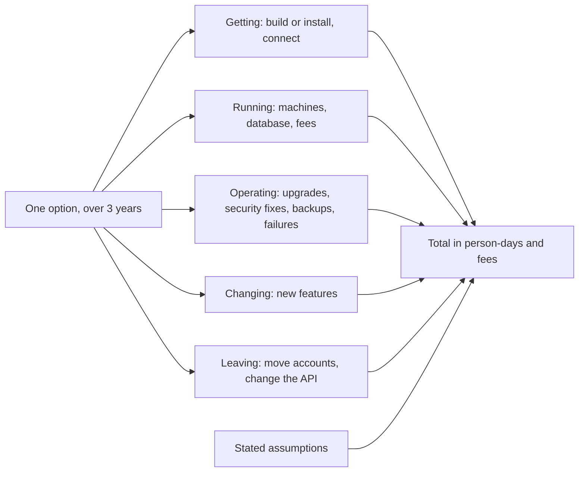

## Before you start

- [[management.l3.build-buy-or-adopt]] — you know stage-2 removed Đơn Hàng's own sign-in code and adopted Keycloak, and that open source charges no licence fee but costs the team's time.
- [[management.l2.three-point-estimation]] — you know a gap between an optimistic and a pessimistic figure shows how unsure the team is, and is information, not a bad estimate.
- [[management.l3.architecture-decision-record]] — you know an ADR keeps one decision with its context and consequences in a numbered file in `docs/adr/`.

## The situation

In Sprint 16 the team writes ADR `0009` for a choice it made at stage-2: Keycloak instead of its own sign-in code. At the time the options were compared only in words. Your draft lists three: keep the team's own code, run Keycloak, or pay for a sign-in service. A teammate comments on the pull request: "Our code and Keycloak cost nothing; the paid service has a yearly fee. Done." Another replies: "We cannot compare anything until a vendor sends us a quote." Both sound reasonable, and they point in opposite directions. How do you compare what three options cost when nobody has exact prices?

## Core concepts

- **total cost of ownership (TCO)** — everything an option costs over a stated period: getting it, running it, operating it, changing it and, at the end, leaving it.
- period — the stretch of time over which every option is counted; it must be the same for all of them, and ADR `0009` uses three years.
- person-day — one developer's work for one day, the unit ADR `0009` uses for people's time.
- assumption — a figure the team guesses and writes down, so a reader can see it and change it; where the team is unsure, it is a range.

## How it works



The diagram counts one option at a time. Each of the five lines asks a different question: what it takes to get the option working, what it costs to keep running, what work it needs each year, what each change costs, and what leaving it would take.

In the situation above, the teammate's "costs nothing" looks only at the fee. The fee is one part of one line. The other lines are mostly people's time, which is often the largest cost and appears on no quote: building, upgrading, handling failures and learning the tool. That is how an option with no fee can need the most work. In ADR `0009` time is the largest cost for the team's own code and for Keycloak; for the paid service it is the fee.

The period matters as much as the lines. Some lines are paid once, like getting and leaving; others repeat every year, like operating and a yearly fee. An option that is quick to get can still be the dearer one once three years of repeating lines are added, so every option is counted over the same period and needs.

The assumptions box feeds the total. In ADR `0009` every figure is a guess, written down with what it rests on, and a range where the team is unsure. Because the assumptions are named, a reader can change one, such as the price of a person-day, and see whether the order of the options changes. Precise numbers matter less than that: the comparison shows which assumption the choice depends on, and that is the one worth checking first.

## In the Đơn Hàng system

The cost section of ADR `0009`:

```markdown file=docs/adr/0009-dung-keycloak-thay-vi-tu-lam-dang-nhap.md tag=stage-3 lines=25-47
### Tổng chi phí sở hữu trong 3 năm

Mọi con số là giả định của đội, không phải báo giá. Công tính bằng ngày công
của một lập trình viên; chỗ đội không chắc ghi thành khoảng. Phí ghi bằng
triệu đồng.

| Khoản | A. Code tự làm | B. Keycloak tự chạy | C. Dịch vụ trả phí |
|---|---|---|---|
| Có được (làm hoặc cài, nối vào API) | 25–40 ngày cho phần còn thiếu | 8–12 ngày | 5–8 ngày |
| Chạy (máy chủ, database) | gần như 0, chạy trong API | 1 máy nhỏ và một database, 10–20 triệu/năm | 0 |
| Phí dịch vụ | 0 | 0 | 30–90 triệu/năm, tăng theo số người dùng |
| Vận hành (nâng cấp, bản vá bảo mật, sao lưu, sự cố) | 8–15 ngày/năm | 10–20 ngày/năm | 2–4 ngày/năm |
| Thay đổi (tính năng mới, như xác thực hai bước) | 10–20 ngày mỗi tính năng | 1–3 ngày, bật trong cấu hình | 1–3 ngày, nếu gói đang mua có |
| Rời đi (chuyển tài khoản, sửa API) | không áp dụng | 5–10 ngày | 5–15 ngày, tùy vendor cho xuất gì |
| Tổng 3 năm, ngày công | 79–145 | 46–91 | 19–44 |
| Tổng 3 năm, phí | 0 | 30–60 triệu | 90–270 triệu |

Giả định chính: ba năm, dưới 50.000 tài khoản khách, một tính năng đăng nhập
mới mỗi năm, một ngày công khoảng 2 triệu đồng. Quy hết ra tiền theo giả định
đó: A khoảng 160–290 triệu, B khoảng 120–240 triệu, C khoảng 130–360 triệu.
B và C chồng lên nhau: đổi giả định số người dùng (phí của C tăng theo nó)
hoặc giá một ngày công là đủ đổi thứ tự giữa hai phương án, nên đội ghi rõ
hai giả định này.
```

Lines 27–29 say every figure is the team's assumption, not a quote; time is in person-days of one developer, fees are in millions of Vietnamese đồng, and ranges mark where the team is unsure. Lines 33–38 are the five lines of the diagram, with the fee as a row of its own. Line 34 puts option A's running cost near zero, since the code runs inside the API, and line 38 says leaving does not apply to it.

Option A, the team's own code, has no fee in any row, yet line 39 gives it the most person-days: 79–145, against 46–91 for Keycloak and 19–44 for the paid service. Option C is the quickest to get, 5–8 days on line 33, but its fee on line 35 repeats every year and grows with the number of users. Over three years its fees reach 90–270 million, the highest of the three.

Lines 42–44 name the main assumptions: three years, fewer than 50,000 customer accounts, one new sign-in feature a year, and about 2 million đồng per person-day. Converted at that price, person-days times 2 million plus the three-year fees, rounded, A is about 160–290 million, B about 120–240 and C about 130–360. A and B overlap too, but B's range is lower at both ends, 120 against 160 and 240 against 290; that is what favouring B means here. Lines 45–47 add that B and C overlap: changing the number of users or the price of a person-day is enough to swap their order, so the team states both assumptions plainly.

## Seniors often assume…

- **"The cheapest option is the one with the lowest price on the quote."** → Actually a quote prices only the fee row, and in ADR `0009` the option with no fee at all, the team's own code, needs the most person-days. You notice this when an option picked for its zero fee keeps taking sprint time nobody planned for.
- **"A cost comparison is useless without exact prices from every vendor."** → Actually ADR `0009` has no quote at all, only named assumptions and ranges, and it still shows which two assumptions could change the order of B and C. Those two are what to check more closely, if anything. You notice the opposite habit when a choice waits weeks for quotes and is then made in words only, as the situation says the stage-2 choice was.
- **"The team's own time costs nothing, since salaries are paid anyway."** → Actually each person-day spent upgrading or fixing a sign-in component is a day not spent on the core domain, so it has a price even though salaries are paid anyway; ADR `0009` counts it at about 2 million đồng a day. This holds when the team has more work than people; a team with truly idle time pays less for it. You notice it when features slip while a "free" component takes a sprint of upgrades.

## Try it (3 minutes)

Open `docs/adr/0009-dung-keycloak-thay-vi-tu-lam-dang-nhap.md` in the `don-hang` repository at tag `stage-3`.

1. Using the table on lines 31–40, rebuild B's three-year total in person-days: getting once, operating three times, one change a year, and leaving once.
2. Keep every other assumption, but suppose a person-day costs about 1 million đồng instead of 2. Convert A and B to money again.

Expected result: B's total is 8–12 + 30–60 + 3–9 + 5–10 = 46–91 person-days, the figure on line 39. At 1 million per person-day, A is about 79–145 million and B about 76–151 million, since B also pays 30–60 million to run.

With the cheaper person-day, does the cost table still favour B over A? What else in ADR `0009` would have to carry the decision? Read the decision section after line 47 to answer.

<details><summary>Suggested answer</summary>

No. At that price A and B overlap almost completely, so the cost table no longer separates them. The price of a person-day was one of the assumptions the choice depended on. The decision would then rest on the other reason in the ADR's decision section, below the excerpt: option A carries a security risk the team has no expertise to handle.

</details>

## Connections

- [[management.l3.build-buy-or-adopt]] — the three ways to get a capability that this lesson now puts a cost on.
- [[management.l2.three-point-estimation]] — the same idea of ranges for uncertain work, used here for every line of a cost table.
- [[management.l3.architecture-decision-record]] — the record where ADR `0009` keeps its cost comparison next to the decision.
- [[management.l3.weighing-options-in-an-adr]] — the same options weighed against needs; this lesson adds what each one costs.
- [[management.l3.debt-as-a-portfolio]] — the same kind of thinking about a cost that repeats, applied to the interest on technical debt.
- [[management.l3.self-hosting-costs]] — the next step: the operating line of a self-run component, in detail.

## Five-line summary

1. Total cost of ownership adds up an option's cost over a stated period: getting, running, operating, changing and leaving it.
2. People's time is often the largest line, which is how an option with no fee can need the most work.
3. ADR `0009` compares the team's own sign-in code, Keycloak and a paid service over three years, every figure an assumption.
4. Each figure states its assumption and is a range where unsure, so a reader can change one and see if the choice changes.
5. Compare options over the same period and needs: an option quick to get can be the dearer one by the third year.
