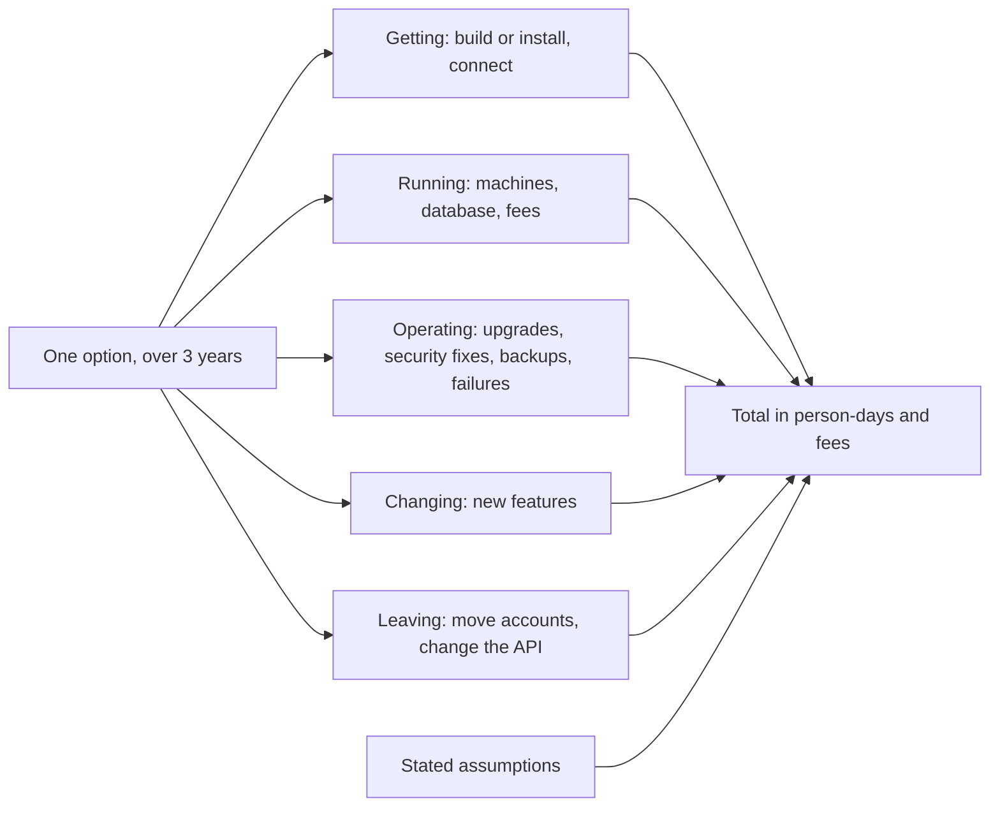

## Bạn cần biết trước

- [[management.l3.build-buy-or-adopt]] — bạn biết stage-2 đã bỏ phần code đăng nhập tự viết của Đơn Hàng để dùng Keycloak, và mã nguồn mở không thu phí bản quyền nhưng tốn thời gian của đội.
- [[management.l2.three-point-estimation]] — bạn biết khoảng cách giữa con số lạc quan và con số bi quan cho thấy đội chưa chắc tới đâu, và đó là thông tin chứ không phải một ước lượng tồi.
- [[management.l3.architecture-decision-record]] — bạn biết một ADR giữ một quyết định, kèm bối cảnh và hệ quả, trong một file đánh số ở `docs/adr/`.

## Tình huống

Trong Sprint 16, đội viết ADR `0009` cho một lựa chọn đã đưa ra ở stage-2: dùng Keycloak thay cho code đăng nhập tự viết. Hồi đó các phương án chỉ được so sánh bằng lời. Bản nháp của bạn liệt kê ba phương án: giữ code của đội, tự chạy Keycloak, hoặc trả tiền cho một dịch vụ đăng nhập. Một đồng đội bình luận trên pull request: "Code của mình và Keycloak đều không tốn gì, còn dịch vụ trả phí thì mất phí hằng năm. Xong." Người khác đáp: "Chưa so được gì đâu, phải đợi nhà cung cấp gửi báo giá đã." Cả hai nghe đều có lý, nhưng lại chỉ về hai hướng ngược nhau. Khi chưa ai có giá chính xác, bạn so chi phí của ba phương án bằng cách nào?

## Khái niệm cốt lõi

- **tổng chi phí sở hữu (TCO)** (total cost of ownership) — mọi thứ một phương án tốn trong một khoảng thời gian đã nêu rõ: để có được nó, chạy nó, vận hành nó, thay đổi nó, và cuối cùng là rời bỏ nó.
- khoảng thời gian — quãng thời gian dùng để đếm chi phí của mọi phương án. Nó phải giống nhau cho tất cả, và ADR `0009` dùng ba năm.
- ngày công — công việc của một lập trình viên trong một ngày, đơn vị ADR `0009` dùng để tính thời gian của người.
- giả định — một con số đội đoán rồi ghi lại, để người đọc thấy được và đổi được. Chỗ nào đội không chắc thì con số đó là một khoảng.

## Cơ chế hoạt động



Sơ đồ đếm từng phương án một. Mỗi khoản trong năm khoản đặt một câu hỏi riêng: cần gì để phương án chạy được, giữ nó chạy tốn bao nhiêu, mỗi năm nó đòi bao nhiêu công, mỗi lần thay đổi tốn bao nhiêu, và rời bỏ nó thì mất những gì.

Trong tình huống trên, câu "không tốn gì" của đồng đội chỉ nhìn vào phí. Phí chỉ là một phần của một khoản. Các khoản còn lại phần lớn là thời gian của người, thường là chi phí lớn nhất và không hề có trên báo giá nào: xây dựng, nâng cấp, xử lý sự cố và học công cụ. Vì thế một phương án không mất phí vẫn có thể tốn nhiều công nhất. Trong ADR `0009`, thời gian là chi phí lớn nhất với code tự viết và với Keycloak, còn với dịch vụ trả phí thì đó là phí.

Khoảng thời gian quan trọng không kém các khoản. Có khoản chỉ trả một lần, như có được và rời đi. Có khoản lặp lại mỗi năm, như vận hành và phí hằng năm. Một phương án có được nhanh vẫn có thể thành phương án đắt hơn khi cộng đủ ba năm các khoản lặp lại, nên mọi phương án phải được đếm trên cùng một khoảng thời gian và cùng những nhu cầu.

Ô giả định góp vào tổng. Trong ADR `0009`, mọi con số đều là phỏng đoán, được ghi kèm điều nó dựa vào, và là một khoảng ở chỗ đội không chắc. Vì các giả định có tên, người đọc có thể đổi một giả định, chẳng hạn giá một ngày công, rồi xem thứ tự các phương án có đổi không. Điều này quan trọng hơn con số chính xác: phép so sánh cho thấy lựa chọn phụ thuộc vào giả định nào, và đó là giả định nên kiểm tra trước tiên.

## Trong hệ thống Đơn Hàng

Phần chi phí của ADR `0009`:

```markdown file=docs/adr/0009-dung-keycloak-thay-vi-tu-lam-dang-nhap.md tag=stage-3 lines=25-47
### Tổng chi phí sở hữu trong 3 năm

Mọi con số là giả định của đội, không phải báo giá. Công tính bằng ngày công
của một lập trình viên; chỗ đội không chắc ghi thành khoảng. Phí ghi bằng
triệu đồng.

| Khoản | A. Code tự làm | B. Keycloak tự chạy | C. Dịch vụ trả phí |
|---|---|---|---|
| Có được (làm hoặc cài, nối vào API) | 25–40 ngày cho phần còn thiếu | 8–12 ngày | 5–8 ngày |
| Chạy (máy chủ, database) | gần như 0, chạy trong API | 1 máy nhỏ và một database, 10–20 triệu/năm | 0 |
| Phí dịch vụ | 0 | 0 | 30–90 triệu/năm, tăng theo số người dùng |
| Vận hành (nâng cấp, bản vá bảo mật, sao lưu, sự cố) | 8–15 ngày/năm | 10–20 ngày/năm | 2–4 ngày/năm |
| Thay đổi (tính năng mới, như xác thực hai bước) | 10–20 ngày mỗi tính năng | 1–3 ngày, bật trong cấu hình | 1–3 ngày, nếu gói đang mua có |
| Rời đi (chuyển tài khoản, sửa API) | không áp dụng | 5–10 ngày | 5–15 ngày, tùy vendor cho xuất gì |
| Tổng 3 năm, ngày công | 79–145 | 46–91 | 19–44 |
| Tổng 3 năm, phí | 0 | 30–60 triệu | 90–270 triệu |

Giả định chính: ba năm, dưới 50.000 tài khoản khách, một tính năng đăng nhập
mới mỗi năm, một ngày công khoảng 2 triệu đồng. Quy hết ra tiền theo giả định
đó: A khoảng 160–290 triệu, B khoảng 120–240 triệu, C khoảng 130–360 triệu.
B và C chồng lên nhau: đổi giả định số người dùng (phí của C tăng theo nó)
hoặc giá một ngày công là đủ đổi thứ tự giữa hai phương án, nên đội ghi rõ
hai giả định này.
```

Dòng 27–29 nói mọi con số là giả định của đội, không phải báo giá. Thời gian tính bằng ngày công của một lập trình viên, phí tính bằng triệu đồng, và khoảng số đánh dấu chỗ đội không chắc. Dòng 33–38 là năm khoản của sơ đồ, với phí tách thành một hàng riêng. Dòng 34 đặt chi phí chạy của phương án A gần bằng 0, vì code chạy bên trong API, còn dòng 38 nói khoản rời đi không áp dụng cho nó.

Phương án A, code tự viết của đội, không có phí ở hàng nào, vậy mà dòng 39 cho nó nhiều ngày công nhất: 79–145, so với 46–91 của Keycloak và 19–44 của dịch vụ trả phí. Phương án C có được nhanh nhất, 5–8 ngày ở dòng 33, nhưng phí ở dòng 35 lặp lại mỗi năm và tăng theo số người dùng. Sau ba năm, phí của nó lên tới 90–270 triệu, cao nhất trong ba phương án.

Dòng 42–44 nêu các giả định chính: ba năm, dưới 50.000 tài khoản khách, mỗi năm một tính năng đăng nhập mới, và khoảng 2 triệu đồng cho một ngày công. Quy ra tiền theo giá đó, tức số ngày công nhân 2 triệu cộng phí ba năm rồi làm tròn, A khoảng 160–290 triệu, B khoảng 120–240 và C khoảng 130–360. A và B cũng chồng lên nhau, nhưng khoảng của B thấp hơn ở cả hai đầu, 120 so với 160 và 240 so với 290. Nghiêng về B ở đây nghĩa là vậy. Dòng 45–47 nói thêm B và C chồng lên nhau: chỉ cần đổi số người dùng hoặc giá một ngày công là đủ đảo thứ tự của hai phương án, nên đội ghi rõ cả hai giả định này.

## Senior hay nhầm rằng…

- **"Phương án rẻ nhất là phương án có giá thấp nhất trên báo giá."** → Thực ra báo giá chỉ định giá cho hàng phí, và trong ADR `0009` phương án hoàn toàn không mất phí, code tự viết của đội, lại cần nhiều ngày công nhất. Bạn sẽ nhận ra khi một phương án được chọn vì phí bằng 0 cứ ngốn thời gian sprint mà không ai lên kế hoạch.
- **"So sánh chi phí là vô ích nếu không có giá chính xác từ mọi nhà cung cấp."** → Thực ra ADR `0009` không có báo giá nào, chỉ có các giả định được nêu tên và các khoảng số, mà vẫn cho thấy hai giả định nào có thể đảo thứ tự của B và C. Nếu cần kiểm tra kỹ hơn thì đó là hai giả định cần kiểm tra. Bạn sẽ nhận ra thói quen ngược lại khi một lựa chọn chờ báo giá hàng tuần rồi cuối cùng vẫn chỉ được quyết bằng lời, như tình huống kể về lựa chọn ở stage-2.
- **"Thời gian của chính đội không tốn gì, vì đằng nào cũng phải trả lương."** → Thực ra mỗi ngày công bỏ vào nâng cấp hay sửa một thành phần đăng nhập là một ngày không dành cho core domain, nên nó có giá dù lương đằng nào cũng phải trả. ADR `0009` tính nó khoảng 2 triệu đồng một ngày. Điều này đúng khi đội có nhiều việc hơn người. Một đội thật sự đang rảnh thì trả ít hơn cho thời gian đó. Bạn sẽ nhận ra khi các tính năng bị lùi lại trong lúc một thành phần "miễn phí" chiếm trọn một sprint để nâng cấp.

## Thử ngay (3 phút)

Mở `docs/adr/0009-dung-keycloak-thay-vi-tu-lam-dang-nhap.md` trong repository `don-hang` ở tag `stage-3`.

1. Dùng bảng ở dòng 31–40, tự tính lại tổng ba năm theo ngày công của B: có được một lần, vận hành ba lần, mỗi năm một thay đổi, và rời đi một lần.
2. Giữ nguyên mọi giả định khác, nhưng giả sử một ngày công chỉ khoảng 1 triệu đồng thay vì 2. Quy A và B ra tiền lại.

Kết quả mong đợi: tổng của B là 8–12 + 30–60 + 3–9 + 5–10 = 46–91 ngày công, đúng con số ở dòng 39. Với 1 triệu một ngày công, A khoảng 79–145 triệu và B khoảng 76–151 triệu, vì B còn trả thêm 30–60 triệu để chạy.

Với ngày công rẻ hơn, bảng chi phí còn nghiêng về B so với A không? Khi đó điều gì khác trong ADR `0009` phải gánh quyết định? Đọc phần quyết định sau dòng 47 để trả lời.

<details><summary>Gợi ý đáp án</summary>

Không. Ở mức giá đó, A và B gần như trùng nhau hoàn toàn, nên bảng chi phí không còn tách được hai phương án. Giá một ngày công là một trong những giả định mà lựa chọn phụ thuộc vào. Khi đó quyết định sẽ dựa vào lý do còn lại trong phần quyết định của ADR, nằm dưới đoạn trích: phương án A mang một rủi ro bảo mật mà đội không có chuyên môn để xử lý.

</details>

## Liên hệ

- [[management.l3.build-buy-or-adopt]] — ba cách có được một năng lực, giờ được bài này gắn chi phí.
- [[management.l2.three-point-estimation]] — cùng ý tưởng dùng khoảng số cho công việc chưa chắc, ở đây áp dụng cho mọi khoản của một bảng chi phí.
- [[management.l3.architecture-decision-record]] — nơi ADR `0009` giữ phần so sánh chi phí ngay cạnh quyết định.
- [[management.l3.weighing-options-in-an-adr]] — cùng các phương án đó được cân theo nhu cầu. Bài này thêm phần mỗi phương án tốn bao nhiêu.
- [[management.l3.debt-as-a-portfolio]] — cùng kiểu suy nghĩ về một chi phí lặp lại, áp dụng cho tiền lãi của nợ kỹ thuật.
- [[management.l3.self-hosting-costs]] — bước tiếp theo: khoản vận hành của một thành phần tự chạy, xem chi tiết.

## Tóm tắt 5 dòng

1. Tổng chi phí sở hữu cộng mọi chi phí của một phương án trong một khoảng thời gian đã nêu: có được, chạy, vận hành, thay đổi và rời bỏ nó.
2. Thời gian của người thường là khoản lớn nhất, vì thế một phương án không mất phí vẫn có thể tốn nhiều công nhất.
3. ADR `0009` so code đăng nhập tự viết của đội, Keycloak và một dịch vụ trả phí trong ba năm, mọi con số đều là giả định.
4. Mỗi con số nêu rõ giả định của nó và là một khoảng ở chỗ chưa chắc, để người đọc đổi một giả định rồi xem lựa chọn có đổi không.
5. So các phương án trên cùng khoảng thời gian và cùng nhu cầu: một phương án có được nhanh vẫn có thể thành phương án đắt hơn vào năm thứ ba.
