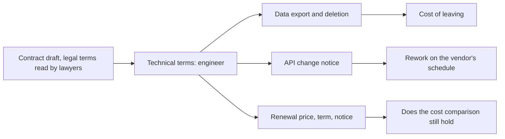

## Before you start

- [[management.l3.service-level-agreement]] — you know how to read one part of Gateway A's contract; this lesson reads the other parts that carry technical cost.
- [[management.l3.total-cost-of-ownership]] — you know a cost comparison covers a stated period of several years; this lesson checks whether the contract lets that comparison hold.

## The situation

It is the first week of Sprint 15, the team has chosen Gateway A for refunds, and its contract is waiting to be signed. A teammate shrugs: "Contracts are for the lawyers. We read the API documentation, they read the paperwork." You open the draft anyway. Between pages on law and liability you find a few lines about exporting data, about notice before an API changes, and about prices at renewal. Nobody on the legal side will know whether those lines are good enough for Đơn Hàng. Which terms in a vendor's contract should an engineer read before the team signs, and what does each one decide?

## Core concepts

- technical term (of a contract) — a term whose effect is a cost or a piece of work for the engineering team, which a lawyer can read but cannot price.
- data export term — what data the team can take out, in what format, when, and for how long after the contract ends before the vendor deletes it.
- API change notice — how long before changing or retiring a version of its API the vendor must tell you.
- renewal terms — how long the contract runs, whether it renews by itself, how much notice ends it, and how the price may change at each renewal.

## How it works



In the situation above, the draft splits into two kinds of terms. Lawyers judge the legal ones, such as liability and which law applies. The technical terms decide costs that only an engineer can estimate, so the diagram follows only them.

The data export term decides the cost of leaving. Leaving a vendor also means moving your data out of it. If the contract states that the refund history can be exported in a known format, also after the contract ends, moving it is a planned task. If it says nothing, the team has no written promise about the format, the time window or the deletion date, and learns the vendor's answer only after giving notice. How long the vendor keeps data after the end, and when it deletes it, sets the deadline for that task.

The API change notice decides how often the team reworks its integration on someone else's schedule. A retired API version is a breaking change for the code that calls it. Six months of notice usually leaves room to fit the rework into normal sprints; one month can force it ahead of planned work.

The renewal terms decide whether a cost comparison still holds after the first year. A total cost of ownership over three years assumes a fee for every year. A cap on price increases bounds that fee; no cap leaves the later years open. The term and its notice period say how long the team is bound and how early it must act to leave. Even a short term can be read more than one way, such as which year's fee a 10% cap counts on, so the reading the team relies on belongs in writing too.

## In the Đơn Hàng system

The contract section of the team's evaluation of the two gateways:

```markdown file=docs/team/payment-gateway-evaluation.md tag=stage-3 lines=70-81
### Điều khoản hợp đồng kỹ sư cần đọc

Luật sư xem phần pháp lý. Các điều khoản dưới đây quyết định chi phí kỹ thuật
nên đội tự đọc. Cột cuối đánh dấu điều phải có bằng văn bản trước khi ký.

| Điều khoản | Cổng A | Cổng B | Phải có văn bản trước khi ký |
|---|---|---|---|
| Xuất dữ liệu: gì, định dạng nào, khi nào | Lịch sử hoàn tiền dạng CSV, mọi lúc | CSV hằng tháng | Có: xuất được lịch sử hoàn tiền cả sau khi hợp đồng kết thúc |
| Giữ dữ liệu sau khi hợp đồng kết thúc, rồi xóa | 90 ngày, rồi xóa và gửi xác nhận | Không nói | Có |
| Báo trước khi đổi hoặc bỏ một phiên bản API | 6 tháng | 1 tháng | Có |
| Đổi giá khi gia hạn | Tăng tối đa 10% mỗi năm | Không giới hạn | Có |
| Thời hạn hợp đồng và thời gian báo trước khi chấm dứt | 1 năm, tự gia hạn, báo trước 60 ngày | 2 năm, báo trước 90 ngày | Không |
```

Lines 72–73 state the split: lawyers read the legal part, the team reads these terms itself, and the last column marks what must be in writing before signing. Line 77 is the export term: Gateway A offers the refund history as CSV (a plain-text table file, one row per line, values separated by commas) at any time, Gateway B a monthly CSV. The team asks in writing for one more thing: the export must still work after the contract ends.

Line 78 says Gateway A keeps data for 90 days after the end, then deletes it and sends a confirmation; Gateway B's offer says nothing. Line 79 gives the API change notice: 6 months for Gateway A, 1 month for Gateway B. Line 80 caps Gateway A's price increase at 10% a year; Gateway B has no limit. Line 81 gives the term and notice: Gateway A runs 1 year, renews by itself, and ends with 60 days' notice; Gateway B runs 2 years with 90 days' notice. It is the only row not marked `Có` (yes).

Earlier in the file, Gateway B is ruled out on another criterion, but its rows are kept so a later evaluation need not redo them. The file also says every figure about the two gateways is assumed for teaching, not taken from a real vendor.

## Seniors often assume…

- **"Contracts are the legal team's job, and engineers have nothing in them to check."** → Actually some terms decide technical cost, and only the team can price them. A lawyer cannot tell whether a monthly CSV is enough for accounting or whether one month is enough to rewrite `GatewayRefundClient`, the one class in Đơn Hàng that calls the gateway's API, and its tests. You notice this when a signed contract blocks a technical plan, such as moving the refund history, and nobody had read that clause with that plan in mind.
- **"Our data stays ours to take whenever we leave, so the contract need not say how."** → Actually a contract that says nothing gives the team no written promise about the format, the time window or the deletion date. Gateway B's offer says nothing about keeping data after the end. You notice this when the team gives notice and only then asks how to get the full refund history out.
- **"A vendor's API will stay stable because we pay for it."** → Actually paying buys the service the contract describes, and the notice before an API change is itself one of its terms. Gateway B promises one month. You notice this when the vendor announces that the API version your client calls will be retired within weeks, in the middle of planned work.

## Try it (3 minutes)

1. Open `docs/team/payment-gateway-evaluation.md` in the `don-hang` repository at tag `stage-3` and read lines 80 and 81 of the contract table.
2. Say Gateway A's fee in the first year is 100 units, and read the cap as 10% of the previous year's fee. Work out the highest fee in year two and in year three. Then, reading the 60 days as notice before the end of a term, work out the latest point at which the team must give notice to stop at the end of year one.

Expected result: reading the cap as 10% of the previous year's fee, at most 110 units in year two and 121 in year three. Reading the 60 days as notice before the end of a term, notice must reach the vendor at least 60 days before the end of year one, or the contract renews. Both readings are ones the team should confirm in writing.

What would the same exercise show for Gateway B, and what does that mean for a three-year cost comparison?

<details><summary>Suggested answer</summary>

Gateway B has no limit on price changes at renewal, so the fee after its first term cannot be bounded from the contract; a comparison over three years would need a range with an open upper end, or a cap asked for in writing. Its 2-year term with 90 days' notice also binds the team for longer before it can leave. This is why line 80 is a term the team must get in writing before signing.

</details>

## Connections

- [[management.l3.service-level-agreement]] — the SLA is one part of the same contract; this lesson reads the parts beside it.
- [[management.l3.total-cost-of-ownership]] — renewal terms decide whether the later years of that comparison still hold.
- [[management.l3.vendor-lock-in]] — the data export and notice terms set the contract part of the cost of leaving.
- [[management.l2.risk-responses]] — asking for a term in writing before signing reduces a risk while it is still cheap to do so.
- [[management.l3.evaluating-a-vendor]] — the next step: the same evaluation file, read for criteria and test results.

## Five-line summary

1. Some contract terms decide technical cost, so an engineer reads them before signing while lawyers read the legal terms.
2. Data export, its format, and how long the vendor keeps data after the end decide the cost of leaving.
3. Notice before an API changes or is retired decides how often the team reworks its integration on the vendor's schedule.
4. Price changes at renewal, the term and its notice period decide whether a cost comparison holds after year one.
5. `payment-gateway-evaluation.md` lists these terms for each gateway and marks those the team must get in writing first.
