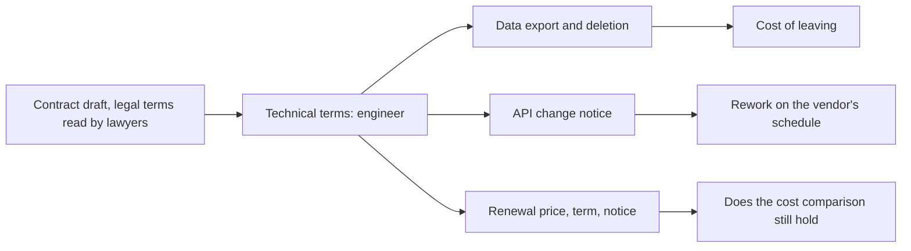

## Bạn cần biết trước

- [[management.l3.service-level-agreement]] — bạn biết cách đọc một phần trong hợp đồng của Cổng A. Bài này đọc những phần còn lại có kéo theo chi phí kỹ thuật.
- [[management.l3.total-cost-of-ownership]] — bạn biết một phép so sánh chi phí trải trên một khoảng thời gian nêu rõ, dài vài năm. Bài này kiểm xem hợp đồng có để phép so sánh đó đứng vững không.

## Tình huống

Tuần đầu Sprint 15, đội đã chọn Cổng A cho hoàn tiền, và hợp đồng của họ đang chờ ký. Một đồng đội nhún vai: "Hợp đồng là chuyện của luật sư. Mình đọc tài liệu API, họ đọc giấy tờ." Bạn vẫn mở bản nháp ra. Xen giữa những trang về luật và trách nhiệm pháp lý, bạn thấy vài dòng về xuất dữ liệu, về việc báo trước khi API thay đổi, và về giá khi gia hạn. Bên pháp lý không ai biết những dòng đó đã đủ tốt cho Đơn Hàng hay chưa. Trong hợp đồng của vendor, kỹ sư nên đọc những điều khoản nào trước khi đội ký, và mỗi điều khoản quyết định điều gì?

## Khái niệm cốt lõi

- điều khoản kỹ thuật (của hợp đồng) — điều khoản mà hệ quả là một khoản chi phí hay một phần việc cho đội kỹ thuật. Luật sư đọc được nhưng không định giá được.
- điều khoản xuất dữ liệu — đội lấy được dữ liệu gì ra, theo định dạng nào, vào lúc nào, và sau khi hợp đồng kết thúc thì vendor giữ bao lâu trước khi xóa.
- báo trước khi đổi API — vendor phải báo cho bạn trước bao lâu khi đổi hoặc bỏ một phiên bản API của họ.
- điều khoản gia hạn — hợp đồng kéo dài bao lâu, có tự gia hạn không, phải báo trước bao lâu để chấm dứt, và giá được thay đổi thế nào ở mỗi lần gia hạn.

## Cơ chế hoạt động



Trong tình huống trên, bản nháp tách thành hai loại điều khoản. Luật sư đánh giá phần pháp lý, như trách nhiệm bồi thường hay luật nào được áp dụng. Các điều khoản kỹ thuật quyết định những chi phí chỉ kỹ sư ước được, nên sơ đồ chỉ đi theo nhánh này.

Điều khoản xuất dữ liệu quyết định cái giá rời đi. Rời một vendor cũng có nghĩa là chuyển dữ liệu của mình ra khỏi đó. Nếu hợp đồng ghi lịch sử hoàn tiền xuất được theo một định dạng đã biết, kể cả sau khi hợp đồng kết thúc, thì chuyển dữ liệu là một đầu việc có kế hoạch. Nếu hợp đồng im lặng, đội không có lời hứa bằng văn bản nào về định dạng, khoảng thời gian hay ngày xóa, và chỉ biết câu trả lời của vendor sau khi đã báo chấm dứt. Vendor giữ dữ liệu bao lâu sau khi kết thúc và xóa lúc nào sẽ đặt hạn chót cho đầu việc đó.

Thời gian báo trước khi đổi API quyết định đội phải làm lại phần tích hợp theo lịch của người khác thường xuyên đến đâu. Một phiên bản API bị bỏ là breaking change với code đang gọi nó. Báo trước sáu tháng thường đủ chỗ để xếp phần làm lại vào các sprint bình thường. Báo trước một tháng có thể buộc đội làm nó trước cả việc đã lên kế hoạch.

Điều khoản gia hạn quyết định một phép so sánh chi phí còn đứng vững sau năm đầu hay không. Tổng chi phí sở hữu trong ba năm giả định một mức phí cho mỗi năm. Một mức trần tăng giá chặn được mức phí đó, còn không có trần thì các năm sau bỏ ngỏ. Thời hạn và thời gian báo trước cho biết đội bị ràng buộc bao lâu và phải hành động sớm đến đâu nếu muốn rời đi. Ngay một điều khoản ngắn cũng có thể hiểu theo nhiều cách, chẳng hạn trần 10% tính trên phí của năm nào, nên cách hiểu mà đội dựa vào cũng phải có bằng văn bản.

## Trong hệ thống Đơn Hàng

Phần hợp đồng trong bản đánh giá hai cổng thanh toán của đội:

```markdown file=docs/team/payment-gateway-evaluation.md tag=stage-3 lines=70-81
### Điều khoản hợp đồng kỹ sư cần đọc

Luật sư xem phần pháp lý. Các điều khoản dưới đây quyết định chi phí kỹ thuật
nên đội tự đọc. Cột cuối đánh dấu điều phải có bằng văn bản trước khi ký.

| Điều khoản | Cổng A | Cổng B | Phải có văn bản trước khi ký |
|---|---|---|---|
| Xuất dữ liệu: gì, định dạng nào, khi nào | Lịch sử hoàn tiền dạng CSV, mọi lúc | CSV hằng tháng | Có: xuất được lịch sử hoàn tiền cả sau khi hợp đồng kết thúc |
| Giữ dữ liệu sau khi hợp đồng kết thúc, rồi xóa | 90 ngày, rồi xóa và gửi xác nhận | Không nói | Có |
| Báo trước khi đổi hoặc bỏ một phiên bản API | 6 tháng | 1 tháng | Có |
| Đổi giá khi gia hạn | Tăng tối đa 10% mỗi năm | Không giới hạn | Có |
| Thời hạn hợp đồng và thời gian báo trước khi chấm dứt | 1 năm, tự gia hạn, báo trước 60 ngày | 2 năm, báo trước 90 ngày | Không |
```

Dòng 72–73 nêu cách chia việc: luật sư đọc phần pháp lý, đội tự đọc các điều khoản này, và cột cuối đánh dấu điều phải có bằng văn bản trước khi ký. Dòng 77 là điều khoản xuất dữ liệu: Cổng A cho xuất lịch sử hoàn tiền dạng CSV (file bảng dạng văn bản thuần, mỗi dòng một hàng, các giá trị cách nhau bằng dấu phẩy) bất cứ lúc nào, Cổng B cho một file CSV mỗi tháng. Đội đòi thêm một điều bằng văn bản: vẫn xuất được sau khi hợp đồng kết thúc.

Dòng 78 cho biết Cổng A giữ dữ liệu 90 ngày sau khi kết thúc, rồi xóa và gửi xác nhận, còn bản chào của Cổng B không nói gì. Dòng 79 là thời gian báo trước khi đổi API: 6 tháng với Cổng A, 1 tháng với Cổng B. Dòng 80 giới hạn mức tăng giá của Cổng A ở 10% mỗi năm, Cổng B không có giới hạn. Dòng 81 là thời hạn và thời gian báo trước: Cổng A chạy 1 năm, tự gia hạn, chấm dứt bằng báo trước 60 ngày, Cổng B chạy 2 năm với báo trước 90 ngày. Đây là dòng duy nhất không được đánh dấu `Có`.

Ở phần trước của file, Cổng B đã bị loại theo một tiêu chí khác, nhưng các dòng của nó được giữ lại để lần đánh giá sau khỏi làm lại. File cũng nói mọi con số về hai cổng đều là giả định để dạy, không lấy từ vendor thật.

## Senior hay nhầm rằng…

- **"Hợp đồng là việc của bên pháp lý, kỹ sư chẳng có gì trong đó để kiểm."** → Thực ra có những điều khoản quyết định chi phí kỹ thuật, và chỉ đội mới định giá được chúng. Luật sư không biết một file CSV hằng tháng có đủ cho kế toán không, hay một tháng có đủ để viết lại `GatewayRefundClient`, class duy nhất trong Đơn Hàng gọi API của cổng, cùng các test của nó. Bạn sẽ nhận ra khi một hợp đồng đã ký chặn một kế hoạch kỹ thuật, như chuyển lịch sử hoàn tiền đi, mà chưa ai đọc điều khoản đó với kế hoạch ấy trong đầu.
- **"Dữ liệu là của mình, lúc nào rời đi cũng lấy được, nên hợp đồng không cần ghi cách lấy."** → Thực ra hợp đồng im lặng thì đội không có lời hứa bằng văn bản nào về định dạng, khoảng thời gian hay ngày xóa. Bản chào của Cổng B không nói gì về việc giữ dữ liệu sau khi kết thúc. Bạn sẽ nhận ra khi đội đã báo chấm dứt rồi mới hỏi làm sao lấy được toàn bộ lịch sử hoàn tiền ra.
- **"API của vendor sẽ ổn định vì mình trả tiền."** → Thực ra trả tiền là mua dịch vụ mà hợp đồng mô tả, và thời gian báo trước khi đổi API chính là một điều khoản trong đó. Cổng B hứa một tháng. Bạn sẽ nhận ra khi vendor thông báo phiên bản API mà client của bạn đang gọi sẽ bị bỏ trong vài tuần nữa, giữa lúc đội đang làm việc đã lên kế hoạch.

## Thử ngay (3 phút)

1. Mở `docs/team/payment-gateway-evaluation.md` trong repository `don-hang` ở tag `stage-3` và đọc dòng 80 và 81 của bảng hợp đồng.
2. Giả sử phí năm đầu của Cổng A là 100 đơn vị, và hiểu mức trần là 10% phí năm trước. Tính mức phí cao nhất ở năm thứ hai và năm thứ ba. Sau đó, hiểu 60 ngày là báo trước tính tới cuối một kỳ hạn, tính thời điểm muộn nhất đội phải báo để dừng ở cuối năm đầu.

Kết quả mong đợi: hiểu mức trần là 10% phí năm trước thì năm thứ hai tối đa 110 đơn vị, năm thứ ba 121. Hiểu 60 ngày là báo trước tính tới cuối một kỳ hạn thì thông báo phải tới vendor ít nhất 60 ngày trước khi hết năm đầu, nếu không hợp đồng sẽ tự gia hạn. Cả hai cách hiểu này đội nên xác nhận bằng văn bản.

Cùng bài tập đó với Cổng B sẽ cho thấy gì, và điều đó có ý nghĩa gì với một phép so sánh chi phí ba năm?

<details><summary>Gợi ý đáp án</summary>

Cổng B không giới hạn mức đổi giá khi gia hạn, nên từ hợp đồng không thể chặn được mức phí sau kỳ hạn đầu. Một phép so sánh ba năm sẽ cần một khoảng giá không có cận trên, hoặc phải đòi một mức trần bằng văn bản. Kỳ hạn 2 năm với báo trước 90 ngày cũng ràng buộc đội lâu hơn trước khi có thể rời đi. Vì vậy dòng 80 là điều khoản đội phải có bằng văn bản trước khi ký.

</details>

## Liên hệ

- [[management.l3.service-level-agreement]] — SLA là một phần của cùng hợp đồng. Bài này đọc những phần nằm cạnh nó.
- [[management.l3.total-cost-of-ownership]] — điều khoản gia hạn quyết định các năm sau của phép so sánh đó còn đứng vững không.
- [[management.l3.vendor-lock-in]] — điều khoản xuất dữ liệu và báo trước tạo nên phần hợp đồng trong cái giá rời đi.
- [[management.l2.risk-responses]] — đòi một điều khoản bằng văn bản trước khi ký là giảm rủi ro lúc làm vậy còn rẻ.
- [[management.l3.evaluating-a-vendor]] — bước tiếp theo: cùng file đánh giá đó, đọc phần tiêu chí và kết quả thử.

## Tóm tắt 5 dòng

1. Một số điều khoản hợp đồng quyết định chi phí kỹ thuật, nên kỹ sư đọc chúng trước khi ký, còn luật sư đọc phần pháp lý.
2. Xuất dữ liệu, định dạng của nó, và vendor giữ dữ liệu bao lâu sau khi kết thúc quyết định cái giá rời đi.
3. Thời gian báo trước khi đổi hoặc bỏ API quyết định đội phải làm lại phần tích hợp theo lịch của vendor thường xuyên đến đâu.
4. Mức đổi giá khi gia hạn, thời hạn và thời gian báo trước quyết định phép so sánh chi phí còn đứng vững sau năm đầu hay không.
5. `payment-gateway-evaluation.md` liệt kê các điều khoản này cho từng cổng và đánh dấu những điều đội phải có bằng văn bản trước.
