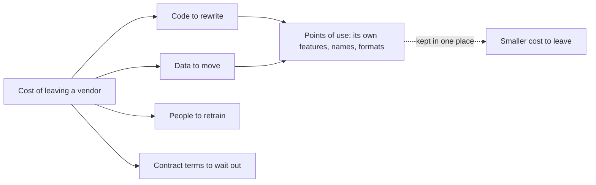

## Before you start

- [[management.l3.self-hosting-costs]] — you know Đơn Hàng runs Keycloak itself and what that keeps costing; this lesson asks what leaving it would cost.
- [[design.l3.conformist]] — you know `DonHang.Api` keeps Keycloak's claim names, such as `roles`, as Keycloak wrote them.
- [[backend.l3.safe-to-repeat-saga-steps]] — you know `RefundSender` asks `GatewayRefundClient` for a refund and gets back one of three outcomes.

## The situation

At stage-3 the team plans the next quarter, and one risk comes up: what if the payment gateway raises its fees, or Keycloak stops shipping security fixes for the version in use? A teammate answers quickly. "Signing in goes through OpenID Connect, a standard, so changing Keycloak takes a day. The gateway is a paid vendor, so that is the dangerous one." You are not sure. The gateway is called from one place, while Keycloak holds every customer's account. What would moving away from each one actually cost, and where in the code and the data does that cost sit?

## Core concepts

- **vendor lock-in** — how much it would cost to move away from a product, service or project: code to rewrite, data to move, people to retrain and contract terms to wait out.
- point of use — one place in your code, configuration or data that depends on something only that vendor has: its own feature, name or data format.
- open standard — a published specification that several providers follow, such as OpenID Connect, so code written to it keeps working with any of them for the parts the standard defines.

## How it works



In the situation above, the teammate is weighing vendor lock-in, and the diagram splits it into four parts. Code to rewrite is every line that talks to the vendor in its own terms; a configuration file in the vendor's own format counts here too, because it must be written again for the next one. Data to move is what the vendor holds for you, such as Keycloak's customer accounts. People to retrain covers what the team learned about one tool. Contract terms belong to paid vendors: notice periods or a minimum term to wait out before you can stop paying.

The code and data parts are sums over points of use. Each new place that reads a vendor's own claim, calls its own endpoint or stores data in its own format adds one more thing to change on the day you leave. So lock-in grows with every use, and it is cheapest to limit while there are few points of use to move or gather.

The dashed arrow is the main way to limit it. When only one class or one file knows a vendor's terms, leaving means rewriting that one place. An open standard helps in a different way: the parts it defines, the same for every provider, are not points of use at all.

Neither removes lock-in. A standard leaves some things open, and vendors fill them in their own way. Open source has no contract to wait out, and the team can keep running it if its maintainers stop, but its configuration and data are still in its own formats. Some lock-in is worth accepting when a vendor's own features save more than leaving would cost, as long as the decision says so.

## In the Đơn Hàng system

How `DonHang.Api` trusts the tokens Keycloak issues:

```csharp file=DonHang.Api/Program.cs tag=stage-3 lines=54-74
// Keycloak issues the tokens; the api only checks them. AddJwtBearer fetches
// Keycloak's metadata and public keys before checking the first token, keeps
// them, and fetches them again from time to time. It checks each token's
// signature, issuer, audience and expiry itself, without calling Keycloak.
var authority = builder.Configuration["Keycloak:Authority"]
    ?? throw new InvalidOperationException("Keycloak:Authority is not set");
builder.Services.AddAuthentication(JwtBearerDefaults.AuthenticationScheme)
    .AddJwtBearer(options =>
    {
        options.Authority = authority;
        options.MetadataAddress = builder.Configuration["Keycloak:MetadataAddress"]
            ?? $"{authority}/.well-known/openid-configuration";
        // Access tokens for this api carry "donhang-api" in `aud`; an ID token
        // carries the app's client id there instead, so it is rejected.
        options.Audience = "donhang-api";
        options.RequireHttpsMetadata = false; // the lab reaches Keycloak over plain HTTP
        // Keep claim names as Keycloak wrote them ("sub", "roles"), and read
        // the caller's roles from the flat "roles" claim the realm adds.
        options.MapInboundClaims = false;
        options.TokenValidationParameters.RoleClaimType = "roles";
    });
```

A token carries claims, named values in its payload such as `sub`, `roles` or `aud`. Lines 58–65 name only an authority, the address of the provider that issues the tokens, and a metadata address, where an OpenID Connect provider publishes its settings, including where to fetch its signing keys. Lines 66–69 accept only tokens whose `aud` claim names `donhang-api`. Pointing these lines at another provider is a change of configuration, as long as it issues JWT access tokens signed with the keys its metadata lists and puts `donhang-api` in `aud`. Lines 70–73 are different: the comment says the flat `roles` claim is one the realm, Keycloak's word for the space that holds its users, roles and sign-in settings, adds to each token. That is a point of use.

ADR `0009`, in its lock-in section outside these excerpts, lists three: this `roles` line, `keycloak/donhang-realm.json` in Keycloak's own format, and the customer accounts with their hashed passwords in Keycloak's database. It ends by accepting that lock-in, because changing all three still costs less than what running Keycloak saves.

How Payments asks the gateway for a refund:

```csharp file=DonHang.Payments/GatewayRefundClient.cs tag=stage-3 lines=49-73
    // The same key on every call for one refund row, so the gateway refunds
    // once however many times a timeout makes RefundSender ask again.
    public static string IdempotencyKeyFor(Payment refund) => $"refund-{refund.Id}";

    // lesson: backend.l3.resilience-pipeline
    // lesson: backend.l3.circuit-breaker
    // 200: refunded. 422: the gateway refuses this refund for good, and says
    // why. Anything else may succeed on a later try: an error status, a broken
    // connection, a call the pipeline's timeout ended, or a call the open
    // circuit refused without sending it.
    public async Task<GatewayRefundResult> RefundAsync(Payment refund, CancellationToken cancellationToken)
    {
        using var request = new HttpRequestMessage(HttpMethod.Post, "v1/refunds")
        {
            Content = JsonContent.Create(new { orderId = refund.OrderId, amountVnd = refund.AmountVnd }),
        };
        request.Headers.Add("Idempotency-Key", IdempotencyKeyFor(refund));
        try
        {
            using var response = await http.SendAsync(request, cancellationToken);
            if (response.IsSuccessStatusCode) return new(RefundOutcome.Refunded);
            if (response.StatusCode == HttpStatusCode.UnprocessableEntity)
                return new(RefundOutcome.Refused, await ReadReasonAsync(response, cancellationToken));
            return new(RefundOutcome.TryAgainLater, $"the gateway answered {(int)response.StatusCode}");
        }
```

Almost every gateway term sits here: the path `v1/refunds`, the JSON fields, the `Idempotency-Key` header and the meaning of `422`. The address and the API key, sent as a `Bearer` header, are set where `DonHang.Payments/Program.cs` registers this client. The class comment, lines 40–43 of the file, says nothing else in Đơn Hàng ever sees a gateway response. `RefundSender` reads only the `GatewayRefundResult` it returns: one of three `RefundOutcome` values and a reason text it stores but never parses. A new gateway means rewriting this class and the tests that stand in for the gateway, plus the lines in `Program.cs` that register it if the new gateway authenticates differently, but not the refund saga.

So the teammate's ranking is doubtful. The gateway's code cost sits in one class and its registration, though as a paid vendor it adds a contract part. Leaving Keycloak means moving every customer's account.

## Seniors often assume…

- **"Using an open standard removes lock-in completely."** → Actually a standard fixes only what it defines. OpenID Connect fixes how `Program.cs` finds the provider's keys, not where roles go, so line 73 still names the realm's `roles` claim, and the accounts still sit in Keycloak's database. You notice this when a new provider's tokens pass every check and every staff request still gets `403`, because the roles arrive under another name.
- **"Lock-in is a risk only with paid vendors, never with open source."** → Actually open source has no contract to wait out, but its configuration and data are in its own formats. Đơn Hàng's realm lives in `keycloak/donhang-realm.json`, a file in Keycloak's own format, and the accounts are in Keycloak's database. You notice this when the plan for leaving Keycloak has to export every customer account, and may make each customer reset a password, not only change code.
- **"The way to avoid lock-in is to wrap every library in an abstraction of our own."** → Actually a wrapper pays where a vendor's terms would otherwise spread, as the gateway's would through the saga without `GatewayRefundClient`. `Program.cs` calls `AddJwtBearer` with no wrapper of its own, because OpenID Connect already keeps most of it provider-neutral. Wrapping everything adds code to maintain, and a wrapper shaped like its one library still has to change when you leave it. You notice this when an interface of your own has exactly the methods of the library behind it, and changes each time the library does.

## Try it (3 minutes)

1. Open `docs/adr/0009-dung-keycloak-thay-vi-tu-lam-dang-nhap.md` in the `don-hang` repository at tag `stage-3`, and find the section `### Lock-in`.
2. Sort its three points of use into the four parts of the diagram: code, data, people, contract.

Expected result: the ADR lists one line of code (`DonHang.Api/Program.cs`, the `roles` claim), one file in Keycloak's own format, which also goes under code, and one set of data (the accounts); nothing under contract, because Keycloak is open source.

Which of the three would cost the most to move, and why?

<details><summary>Suggested answer</summary>

The accounts. The code is in fact two lines: `DonHang.Payments/Program.cs` line 56 repeats the `roles` line, a point of use the ADR's list does not count. The realm file is settings the team could set up again, but the accounts belong to every customer. The section `### Kế hoạch rời đi` of the same ADR adds that if the new provider cannot take the hashed passwords, customers reset their password at their first sign-in.

</details>

## Connections

- [[management.l3.self-hosting-costs]] — counts what running Keycloak keeps costing; this lesson counts what leaving it would cost.
- [[design.l3.conformist]] — the same choice seen from the model: keeping Keycloak's names is cheap today and is where its points of use build up.
- [[backend.l3.safe-to-repeat-saga-steps]] — the saga step that the gateway's lock-in never reaches, because `GatewayRefundClient` stops it.
- [[design.l3.anti-corruption-layer]] — the pattern that keeps the gateway's terms in one class.
- [[backend.l2.openid-connect-id-token]] — the open standard that keeps most of Đơn Hàng's sign-in code provider-neutral.
- [[management.l3.vendor-contract-terms]] — details the contract part of the diagram.
- [[management.l3.exit-plan]] — writing down, before you need it, how you would leave a vendor.

## Five-line summary

1. Vendor lock-in is the cost of leaving a vendor: code to rewrite, data to move, people to retrain and contract terms to wait out.
2. It grows with every point of use of a vendor's own features, names or formats, so limit it while the dependency is small.
3. OpenID Connect keeps most sign-in code provider-neutral, but `Program.cs` still reads the `roles` claim Keycloak's realm adds.
4. Only `GatewayRefundClient` and its registration know the gateway's terms, so a new gateway means rewriting that class and its tests, not the saga.
5. Open source locks you in through its formats and data too; accept lock-in when its savings exceed the cost, and say so in the ADR.
