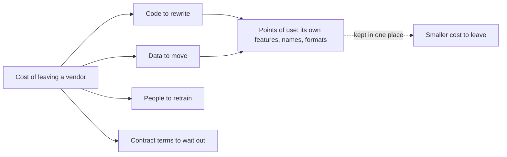

## Bạn cần biết trước

- [[management.l3.self-hosting-costs]] — bạn biết Đơn Hàng tự chạy Keycloak và việc đó tốn gì đều đặn. Bài này hỏi rời bỏ nó thì tốn gì.
- [[design.l3.conformist]] — bạn biết `DonHang.Api` giữ nguyên tên claim của Keycloak, như `roles`, đúng như Keycloak đã viết.
- [[backend.l3.safe-to-repeat-saga-steps]] — bạn biết `RefundSender` nhờ `GatewayRefundClient` hoàn tiền và nhận lại một trong ba kết quả.

## Tình huống

Ở stage-3, đội lên kế hoạch cho quý tới và một rủi ro được nêu ra: nếu cổng thanh toán tăng phí, hoặc Keycloak ngừng ra bản vá bảo mật cho phiên bản đang dùng thì sao? Một đồng đội trả lời ngay: "Đăng nhập đi qua OpenID Connect, là chuẩn chung, nên đổi Keycloak mất một ngày thôi. Cổng thanh toán là nhà cung cấp trả phí, cái đó mới nguy." Bạn không chắc. Cổng thanh toán chỉ được gọi từ một chỗ, còn Keycloak giữ tài khoản của mọi khách hàng. Rời bỏ từng cái thực sự tốn bao nhiêu, và khoản đó nằm ở đâu trong code và trong dữ liệu?

## Khái niệm cốt lõi

- **vendor lock-in** (cái giá phải trả để rời một vendor hay dự án, lớn dần theo mỗi chỗ dùng tính năng hay định dạng riêng của nó) — chuyển khỏi một sản phẩm, dịch vụ hay dự án sẽ tốn bao nhiêu: code phải viết lại, dữ liệu phải chuyển, người phải học lại, và điều khoản hợp đồng phải chờ cho hết.
- chỗ dùng — một chỗ trong code, cấu hình hay dữ liệu phụ thuộc vào thứ chỉ nhà cung cấp đó có: tính năng, tên gọi hay định dạng dữ liệu riêng của họ.
- chuẩn mở — một đặc tả được công bố mà nhiều nhà cung cấp cùng làm theo, như OpenID Connect. Code viết theo nó vẫn chạy được với bất kỳ nhà cung cấp nào, ở những phần chuẩn có quy định.

## Cơ chế hoạt động



Trong tình huống trên, đồng đội của bạn đang cân vendor lock-in, và sơ đồ chia nó thành bốn phần. Code phải viết lại là mọi dòng nói chuyện với nhà cung cấp bằng ngôn ngữ riêng của họ. File cấu hình theo định dạng riêng của nhà cung cấp cũng tính vào đây, vì phải viết lại cho bên mới. Dữ liệu phải chuyển là những gì nhà cung cấp giữ hộ bạn, như tài khoản khách hàng trong Keycloak. Người phải học lại là những gì đội đã học về một công cụ. Điều khoản hợp đồng là chuyện của nhà cung cấp trả phí: thời hạn báo trước, hay thời hạn tối thiểu phải chờ hết rồi mới ngừng trả tiền được.

Phần code và phần dữ liệu là tổng của các chỗ dùng. Mỗi chỗ mới đọc claim riêng của nhà cung cấp, gọi endpoint riêng của họ hay lưu dữ liệu theo định dạng riêng của họ là thêm một thứ phải sửa vào ngày bạn rời đi. Vì vậy lock-in lớn dần theo mỗi lần dùng, và giới hạn nó rẻ nhất khi còn ít chỗ dùng phải chuyển hay gom lại.

Mũi tên nét đứt là cách chính để giới hạn nó. Khi chỉ một class hay một file biết ngôn ngữ riêng của nhà cung cấp, rời đi nghĩa là viết lại đúng chỗ đó. Chuẩn mở giúp theo kiểu khác: những phần chuẩn quy định, giống nhau ở mọi nhà cung cấp, hoàn toàn không phải chỗ dùng.

Không cách nào xóa hẳn lock-in. Chuẩn nào cũng để ngỏ vài thứ, và mỗi nhà cung cấp lấp chúng theo cách riêng. Mã nguồn mở không có hợp đồng phải chờ hết, và đội vẫn chạy tiếp được nếu người duy trì dừng lại, nhưng cấu hình và dữ liệu của nó vẫn theo định dạng riêng. Có những lock-in đáng chấp nhận, khi tính năng riêng của nhà cung cấp tiết kiệm nhiều hơn cái giá rời đi, miễn là quyết định ghi rõ điều đó.

## Trong hệ thống Đơn Hàng

Cách `DonHang.Api` tin token do Keycloak cấp:

```csharp file=DonHang.Api/Program.cs tag=stage-3 lines=54-74
// Keycloak issues the tokens; the api only checks them. AddJwtBearer fetches
// Keycloak's metadata and public keys before checking the first token, keeps
// them, and fetches them again from time to time. It checks each token's
// signature, issuer, audience and expiry itself, without calling Keycloak.
var authority = builder.Configuration["Keycloak:Authority"]
    ?? throw new InvalidOperationException("Keycloak:Authority is not set");
builder.Services.AddAuthentication(JwtBearerDefaults.AuthenticationScheme)
    .AddJwtBearer(options =>
    {
        options.Authority = authority;
        options.MetadataAddress = builder.Configuration["Keycloak:MetadataAddress"]
            ?? $"{authority}/.well-known/openid-configuration";
        // Access tokens for this api carry "donhang-api" in `aud`; an ID token
        // carries the app's client id there instead, so it is rejected.
        options.Audience = "donhang-api";
        options.RequireHttpsMetadata = false; // the lab reaches Keycloak over plain HTTP
        // Keep claim names as Keycloak wrote them ("sub", "roles"), and read
        // the caller's roles from the flat "roles" claim the realm adds.
        options.MapInboundClaims = false;
        options.TokenValidationParameters.RoleClaimType = "roles";
    });
```

Token mang các claim, tức các giá trị có tên trong payload của nó, như `sub`, `roles` hay `aud`. Dòng 58–65 chỉ nêu một authority, địa chỉ của bên cấp token, và một metadata address, nơi nhà cung cấp OpenID Connect công bố các cài đặt của mình, trong đó có chỗ lấy khóa ký. Dòng 66–69 chỉ nhận token có claim `aud` ghi `donhang-api`. Trỏ các dòng này sang nhà cung cấp khác chỉ là đổi cấu hình, miễn bên đó cấp access token dạng JWT, ký bằng các khóa metadata của họ liệt kê, và ghi `donhang-api` vào `aud`. Dòng 70–73 thì khác: comment nói claim `roles` dạng phẳng là do realm thêm vào mỗi token. Realm là từ Keycloak dùng để gọi không gian chứa người dùng, vai trò và cài đặt đăng nhập của nó. Đó là một chỗ dùng.

ADR `0009`, ở mục lock-in nằm ngoài các đoạn trích này, liệt kê ba chỗ: dòng `roles` này, file `keycloak/donhang-realm.json` theo định dạng riêng của Keycloak, và tài khoản khách hàng cùng mật khẩu đã hash trong database của Keycloak. Cuối mục, ADR chấp nhận lock-in này, vì sửa cả ba vẫn rẻ hơn khoản mà tự chạy Keycloak tiết kiệm được.

Cách Payments nhờ cổng thanh toán hoàn tiền:

```csharp file=DonHang.Payments/GatewayRefundClient.cs tag=stage-3 lines=49-73
    // The same key on every call for one refund row, so the gateway refunds
    // once however many times a timeout makes RefundSender ask again.
    public static string IdempotencyKeyFor(Payment refund) => $"refund-{refund.Id}";

    // lesson: backend.l3.resilience-pipeline
    // lesson: backend.l3.circuit-breaker
    // 200: refunded. 422: the gateway refuses this refund for good, and says
    // why. Anything else may succeed on a later try: an error status, a broken
    // connection, a call the pipeline's timeout ended, or a call the open
    // circuit refused without sending it.
    public async Task<GatewayRefundResult> RefundAsync(Payment refund, CancellationToken cancellationToken)
    {
        using var request = new HttpRequestMessage(HttpMethod.Post, "v1/refunds")
        {
            Content = JsonContent.Create(new { orderId = refund.OrderId, amountVnd = refund.AmountVnd }),
        };
        request.Headers.Add("Idempotency-Key", IdempotencyKeyFor(refund));
        try
        {
            using var response = await http.SendAsync(request, cancellationToken);
            if (response.IsSuccessStatusCode) return new(RefundOutcome.Refunded);
            if (response.StatusCode == HttpStatusCode.UnprocessableEntity)
                return new(RefundOutcome.Refused, await ReadReasonAsync(response, cancellationToken));
            return new(RefundOutcome.TryAgainLater, $"the gateway answered {(int)response.StatusCode}");
        }
```

Gần như mọi thứ riêng của cổng thanh toán nằm ở đây: đường dẫn `v1/refunds`, các trường JSON, header `Idempotency-Key` và ý nghĩa của `422`. Địa chỉ và API key, gửi trong header `Bearer`, được đặt ở chỗ `DonHang.Payments/Program.cs` đăng ký client này. Comment của class, dòng 40–43 của file, nói không chỗ nào khác trong Đơn Hàng nhìn thấy response của cổng thanh toán. `RefundSender` chỉ đọc `GatewayRefundResult` mà class trả về: một trong ba giá trị `RefundOutcome` và một đoạn lý do nó lưu lại nhưng không bao giờ phân tích. Đổi cổng thanh toán nghĩa là viết lại class này và các test đóng vai cổng thanh toán, thêm các dòng đăng ký nó trong `Program.cs` nếu cổng mới xác thực theo cách khác, nhưng không đụng tới saga hoàn tiền.

Vậy thứ hạng của đồng đội bạn đáng ngờ. Phần code của cổng thanh toán gói trong một class và chỗ đăng ký nó, dù là nhà cung cấp trả phí nên nó có thêm phần hợp đồng. Rời Keycloak thì phải chuyển tài khoản của mọi khách hàng.

## Senior hay nhầm rằng…

- **"Dùng chuẩn mở là hết hẳn lock-in."** → Thực ra một chuẩn chỉ cố định những gì nó quy định. OpenID Connect quy định cách `Program.cs` tìm khóa của nhà cung cấp, không quy định vai trò nằm ở đâu, nên dòng 73 vẫn ghi claim `roles` của realm, và tài khoản vẫn nằm trong database của Keycloak. Bạn sẽ nhận ra khi token của nhà cung cấp mới qua mọi bước kiểm tra mà mọi request của nhân viên vẫn bị `403`, vì vai trò tới dưới một tên khác.
- **"Lock-in chỉ là rủi ro với nhà cung cấp trả phí, không bao giờ với mã nguồn mở."** → Thực ra mã nguồn mở không có hợp đồng phải chờ hết, nhưng cấu hình và dữ liệu của nó theo định dạng riêng. Realm của Đơn Hàng nằm trong `keycloak/donhang-realm.json`, một file theo định dạng riêng của Keycloak, và tài khoản nằm trong database của Keycloak. Bạn sẽ nhận ra khi kế hoạch rời Keycloak phải xuất mọi tài khoản khách hàng, có khi bắt từng khách đặt lại mật khẩu, chứ không chỉ sửa code.
- **"Cách tránh lock-in là bọc mọi thư viện trong một lớp trừu tượng của riêng mình."** → Thực ra lớp bọc có lợi ở chỗ mà ngôn ngữ riêng của nhà cung cấp lẽ ra sẽ lan rộng, như ngôn ngữ của cổng thanh toán sẽ lan khắp saga nếu không có `GatewayRefundClient`. `Program.cs` gọi `AddJwtBearer` mà không có lớp bọc riêng nào, vì OpenID Connect đã giữ phần lớn đoạn đó không phụ thuộc nhà cung cấp. Bọc mọi thứ là thêm code phải duy trì, và một lớp bọc mang đúng hình dạng thư viện duy nhất của nó vẫn phải sửa khi bạn rời thư viện đó. Bạn sẽ nhận ra khi một interface của chính mình có đúng các method của thư viện phía sau, và đổi theo mỗi lần thư viện đổi.

## Thử ngay (3 phút)

1. Mở `docs/adr/0009-dung-keycloak-thay-vi-tu-lam-dang-nhap.md` trong repository `don-hang` ở tag `stage-3`, tìm mục `### Lock-in`.
2. Xếp ba chỗ dùng trong đó vào bốn phần của sơ đồ: code, dữ liệu, người, hợp đồng.

Kết quả mong đợi: ADR liệt kê một dòng code (`DonHang.Api/Program.cs`, claim `roles`), một file theo định dạng riêng của Keycloak, cũng xếp vào code, và một khối dữ liệu (các tài khoản). Không có gì ở phần hợp đồng, vì Keycloak là mã nguồn mở.

Trong ba thứ, thứ nào tốn nhất khi chuyển, và vì sao?

<details><summary>Gợi ý đáp án</summary>

Các tài khoản. Phần code thực ra có hai dòng: dòng 56 của `DonHang.Payments/Program.cs` lặp lại dòng `roles`, một chỗ dùng mà danh sách của ADR không tính. File realm là cài đặt đội có thể dựng lại, còn tài khoản là của từng khách hàng. Mục `### Kế hoạch rời đi` trong cùng ADR nói thêm: nếu nhà cung cấp mới không nhận được mật khẩu đã hash, khách sẽ đặt lại mật khẩu ở lần đăng nhập đầu tiên.

</details>

## Liên hệ

- [[management.l3.self-hosting-costs]] — tính khoản tự chạy Keycloak tốn đều đặn. Bài này tính khoản rời bỏ nó.
- [[design.l3.conformist]] — cùng lựa chọn đó nhìn từ phía model: giữ tên của Keycloak hôm nay thì rẻ, và đó cũng là nơi các chỗ dùng của nó dồn lại.
- [[backend.l3.safe-to-repeat-saga-steps]] — bước saga mà lock-in của cổng thanh toán không bao giờ chạm tới, vì `GatewayRefundClient` chặn nó lại.
- [[design.l3.anti-corruption-layer]] — pattern giữ ngôn ngữ của cổng thanh toán trong một class.
- [[backend.l2.openid-connect-id-token]] — chuẩn mở giữ phần lớn code đăng nhập của Đơn Hàng không phụ thuộc nhà cung cấp.
- [[management.l3.vendor-contract-terms]] — đi vào chi tiết phần hợp đồng trong sơ đồ.
- [[management.l3.exit-plan]] — ghi lại trước, khi chưa cần, cách bạn sẽ rời một nhà cung cấp.

## Tóm tắt 5 dòng

1. Vendor lock-in là cái giá rời một nhà cung cấp: code phải viết lại, dữ liệu phải chuyển, người phải học lại và điều khoản hợp đồng phải chờ hết.
2. Nó lớn dần theo mỗi chỗ dùng tính năng, tên gọi hay định dạng riêng của nhà cung cấp, nên hãy giới hạn nó khi phụ thuộc còn nhỏ.
3. OpenID Connect giữ phần lớn code đăng nhập không phụ thuộc nhà cung cấp, nhưng `Program.cs` vẫn đọc claim `roles` mà realm của Keycloak thêm vào.
4. Chỉ `GatewayRefundClient` và chỗ đăng ký nó biết ngôn ngữ của cổng thanh toán, nên đổi cổng nghĩa là viết lại class đó và test của nó, không phải saga.
5. Mã nguồn mở cũng khóa bạn qua định dạng và dữ liệu. Chấp nhận lock-in khi khoản tiết kiệm lớn hơn cái giá rời đi, và ghi rõ trong ADR.
