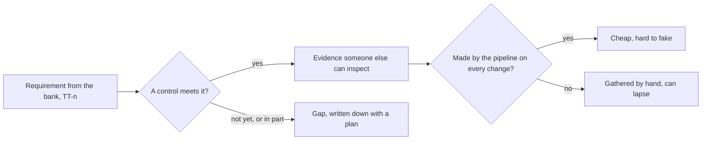

## Before you start

- [[management.l4.lightweight-governance]] — you know Đơn Hàng's principles, such as "every production change is a commit to the config repository", are written down with their reasons; this lesson shows them to someone outside the team.
- [[backend.l4.audit-log]] — you know an audit log counts as evidence only if those it records cannot change it unseen, and that Đơn Hàng's is still a design.
- [[devops.l3.verifying-before-deploy]] — you know a check protects a deploy only when the deploy step itself runs it.
- [[backend.l4.signing-key-custody]] — you know ADR `0015` keeps the invoice signing key in an HSM only Payments may call.

## The situation

A chain of shops owned by a bank wants to sign with Đơn Hàng, and before it signs it sends seven rules. The first says every change to production has a reviewer other than the person who made it. A developer answers quickly: "We review every pull request, and we sign our images." Then you remember how the lab promotes the api: `gitops-promote.sh` makes one commit to `envs/production`, and nobody else looks at it. The bank will not take the developer's word, or yours. It wants to see. How do you show an outside customer which of its rules Đơn Hàng meets, with what proof, and which it does not meet yet?

## Core concepts

- **compliance** — meeting rules set from outside, by a regulator or a large customer's contract, and being able to show it with evidence rather than only say so.
- **control (compliance)** — a specific practice or mechanism that meets one requirement, such as "every production change is a commit to the config repository".
- evidence — a record someone outside the team can inspect to see that a control actually ran: Git history, an SBOM, a script's output.
- **separation of duties** — no single person can both make a change and approve that same change.
- gap — a requirement that no control meets yet, or meets only in part, written down with a plan to close it.

## How it works



In the situation above, the bank's list is the outside rule, so meeting it is compliance. The developer's answer named practices but no proof, and the bank cannot check a sentence. Signing images also answers a different rule, TT-5, not who approves a production change.

Start with each requirement. A control is what Đơn Hàng does to meet it. For the first rule, the control is that every production change is a commit to `envs/production` in the config repository, and nobody edits the cluster by hand. The evidence is the history of that repository: who committed, when, and what changed.

Then ask whether the control fully meets the requirement. Here it does not. The rule asks for separation of duties, and in the lab one commit by `gitops-promote.sh` is enough to move the api to production, so the author is also the approver. That is a gap, and it goes in the table with its plan: a required second reviewer on the production config repository.

Next, ask where the evidence comes from. Evidence the pipeline makes on every change, such as SBOMs, scan results, signatures and Git history, costs nothing extra to collect. Đơn Hàng's principles prefer it as cheaper and harder to fake, because nobody assembles it afterwards. Evidence gathered by hand before an audit depends on someone remembering.

Finally, a requirement with no control is still listed. The team's rule is that a gap it states first costs less trust than one the bank's inspector finds.

## In the Đơn Hàng system

What the bank asked for, from `docs/team/compliance-controls.md`:

```markdown file=docs/team/compliance-controls.md tag=stage-4 lines=1-21
# Biện pháp kiểm soát cho yêu cầu của khách hàng ngân hàng

Tài liệu ghi cách Đơn Hàng đáp ứng một danh sách yêu cầu từ bên ngoài, bằng
chứng cho từng điều, và chỗ chưa đáp ứng. Tuân thủ là đáp ứng những yêu cầu do
bên ngoài đặt ra (cơ quan quản lý, hay hợp đồng của một khách lớn) và chỉ ra
được bằng bằng chứng, không chỉ nói là đã làm. Tài liệu này không phải ý kiến
pháp lý.

### Bối cảnh

Một khách hàng là chuỗi cửa hàng thuộc một ngân hàng (giả định) gửi danh sách
yêu cầu trước khi ký hợp đồng:

- TT-1: Mọi thay đổi lên production có một người duyệt khác người làm.
- TT-2: Truy được ai đã làm gì với đơn và với hoàn tiền.
- TT-3: Khóa ký hóa đơn không rời thiết bị bảo vệ khóa.
- TT-4: Sao lưu dữ liệu và thử khôi phục định kỳ, mỗi lần có biên bản.
- TT-5: Biết mọi thành phần phần mềm đang chạy và các lỗ hổng đã biết của
  chúng.
- TT-6: Dữ liệu nằm ở nơi hợp đồng quy định.
- TT-7: Rà soát quyền truy cập định kỳ.
```

Lines 3–7 define compliance the way this lesson does and say the document is not legal advice. Lines 14–21 list the seven requirements, which the bank is assumed to send:

- TT-1: a second reviewer for production changes.
- TT-2: tracing who did what to orders and refunds.
- TT-3: the invoice key never leaves its protected device.
- TT-4: backups with regular restore tests.
- TT-5: knowing every running component and its known vulnerabilities.
- TT-6: data where the contract says.
- TT-7: regular access reviews.

How Đơn Hàng answers each one:

```markdown file=docs/team/compliance-controls.md tag=stage-4 lines=23-45
### Bảng kiểm soát

Mỗi yêu cầu được đáp ứng bằng một biện pháp kiểm soát (một cách làm hay một cơ
chế cụ thể), và mỗi biện pháp cần bằng chứng người khác kiểm được. Bảng ghi
đúng hiện trạng ở stage-4.

| Yêu cầu | Biện pháp kiểm soát | Bằng chứng | Sinh tự động hay làm tay | Khoảng trống và kế hoạch |
|---|---|---|---|---|
| TT-1 | Mọi thay đổi production là một commit vào `envs/production` của repo cấu hình; không ai sửa tay trên cluster (NT4 của `architecture-governance.md`) | Lịch sử Git của repo cấu hình: ai commit, lúc nào, đổi gì | Tự động | Trong lab, một commit của `scripts/devops/gitops-promote.sh` là đủ để đưa api lên production: người làm cũng là người duyệt. Kế hoạch: repo cấu hình production bắt buộc pull request có một người duyệt khác tác giả trước khi merge (H6 của `technical-strategy.md`) |
| TT-2 | Nhật ký kiểm toán theo `docs/design/audit-log.md`: mỗi lần giao đơn, yêu cầu hoàn tiền, đổi giá, cấp role, xin ký hóa đơn ghi một entry có chuỗi hash | Chưa có | Sẽ tự động | `audit-log.md` mới là thiết kế, chưa dựng. Hôm nay `requested_by` của dòng hoàn tiền sửa được mà không để lại dấu vết. Kế hoạch: dựng nhật ký theo thiết kế (mục "Sau đó" của `roadmap.md`) |
| TT-3 | Khóa ký hóa đơn nằm trong dịch vụ HSM của nhà cung cấp, chỉ ServiceAccount của Payments được ký (ADR 0015, 0023) | ADR 0015, 0023; khi dựng: log mỗi lần dùng khóa của dịch vụ quản lý khóa | Sẽ tự động | Đã quyết, chưa dựng: stage-4 chưa có hóa đơn, chưa có HSM, chỉ có sample với khóa phần mềm cho lab |
| TT-4 | Dump logic, base backup và WAL lưu liên tục; thử khôi phục bằng `scripts/devops/restore-test.sh`; dựng lại staging bằng `scripts/devops/dr-drill.sh` | Output của `restore-test.sh` (số dòng so với lúc dump, thời gian khôi phục) và của `dr-drill.sh` (thời gian từng bước) | Script tự chạy, nhưng được khởi động bằng tay, chưa theo lịch | Bản sao lưu và WAL chưa rời máy đang chạy database (ADR 0020). Kế hoạch: sao sang region thứ hai (H4), chạy thử khôi phục theo lịch và lưu output làm biên bản |
| TT-5 | Mỗi lần chạy `ci.yml` viết SBOM cho từng image và quét lỗ hổng trên SBOM đó; lỗ hổng mức High hoặc Critical đã có bản sửa làm hỏng lần chạy, trừ những lỗ hổng `.grype.yaml` chấp nhận kèm lý do. Image được đẩy từ master còn được ký và có attestation về nguồn build và SBOM | SBOM (artifact `sboms` của lần chạy), kết quả quét trong log của lần chạy, chữ ký và attestation lưu cạnh image; `scripts/devops/verify-image.sh` kiểm chữ ký và nguồn build | Tự động | SBOM và kết quả quét giữ theo thời hạn lưu artifact của lần chạy; image của các thành phần tự chạy trong `self-run-components.md` không đi qua `ci.yml`. Kế hoạch: lưu SBOM của mỗi bản đã lên production cùng commit deploy |
| TT-6 | Đơn Hàng chạy ở một region (ADR 0020), trên Kubernetes managed của một nhà cung cấp (ADR 0022) | ADR 0020, 0022 | Làm tay | Hợp đồng đòi dữ liệu ở một nơi xác định là điều kiện mở lại của ADR 0022 và ADR 0020 (bảng "Giả định cần theo dõi" của `architecture-governance.md`): ký hợp đồng này thì mở lại hai ADR đó trước |
| TT-7 | Chưa có | Chưa có | Chưa có | Chưa ai rà soát role trong Keycloak hay quyền trên repo cấu hình theo lịch. Kế hoạch: rà soát mỗi quý, xuất danh sách role và người có quyền làm biên bản (mục "Sau đó" của `roadmap.md`) |

### Nguyên tắc

- Bằng chứng do pipeline sinh ra trên mỗi thay đổi (SBOM, kết quả quét, chữ
  ký, lịch sử Git) được ưu tiên hơn bằng chứng gom tay trước một lần kiểm tra:
  nó rẻ hơn và khó làm giả hơn.
- Khoảng trống được ghi ra kèm kế hoạch, không giấu. Một khoảng trống người
  kiểm tra tìm ra trước tốn nhiều lòng tin hơn một khoảng trống đội đã tự ghi.
```

Each row has the same five columns: the requirement, the control, the evidence, whether that evidence is made automatically or by hand, and the gap with its plan. Line 27 says the table records what is true at stage-4.

Line 31 (TT-1) is the situation's answer. Git history is the evidence, made automatically, but one commit by `gitops-promote.sh` reaches production with no second person, so the plan is a required pull request reviewed by someone other than its author (action H6 of `technical-strategy.md`). The script itself, outside this excerpt, commits to `envs/production` with no review step, and its comment says that at work the commit would be a pull request.

Line 35 (TT-5) is the strongest row: every run of `ci.yml` that passes the tests writes an SBOM for each image and scans it, and the service images pushed from master are also signed and get attestations (the lab's `fake-gateway` image is pushed unsigned). Even here the table names a gap: SBOMs last only as long as the run's artifacts are kept.

Line 36 (TT-6): ADR `0020` and ADR `0022` decided where Đơn Hàng runs, and the governance document's table of assumptions to watch lists a contract that names a data location as a reason to look at both again.

Lines 32 (TT-2) and 37 (TT-7) are the honest rows. The audit log of `audit-log.md` is only a design, and nobody reviews access on a schedule. Both are listed with a plan.

## Trade-offs

| How you answer a requirement | What the customer can check | What it costs | Fits when |
|---|---|---|---|
| A control whose evidence the pipeline makes on every change | every change, at any time, with records nobody assembled by hand | building the step once; the evidence lasts only as long as it is stored | the control is a step a machine already runs, such as a build or a commit |
| A control whose evidence a person gathers before each audit | what was collected; months with no record are invisible | someone's time on every audit, and it lapses when nobody remembers | the control is a human act, such as reviewing who has access |
| A statement that the team does it, with no evidence | nothing | nothing at first; trust, once an inspector asks for proof | not when an outside rule asks for proof; at most for an informal question |
| A gap written down with a plan | that the team knows its weak point and when it will close | admitting it before signing | the control does not exist yet, as for TT-2 and TT-7 |

## What would you choose if…

…the bank made TT-1 a condition of signing next month? A sensible answer moves the TT-1 part of H6 forward: production config changes go through a pull request that someone other than the author must approve. Until then the table keeps saying that one commit reaches production in the lab (line 31).

…the contract required the data to stay in one stated place? Line 36 already decides the first step: that clause is a reopen signal for ADRs `0020` and `0022`, so you reopen those two decisions before signing, not after.

…an inspector asked for the SBOM of what ran in production three months ago? Line 35 says SBOMs are kept only as long as the run's artifacts. The honest answer may be that it is gone, and the plan in the same row, an SBOM stored with each production deploy commit, is what fixes it.

## Seniors often assume…

- **"Compliance is a document written once for the auditor and then filed away."** → Actually the table records what is true at stage-4, and the evidence for TT-1 and TT-5 is made again on every change. A filed document stops matching the system as soon as a control or a gap changes. You notice this belief when the next audit finds the document still describes a control the team removed.
- **"Passing an audit proves the system is secure."** → Actually the bank's inspector checks the controls for the requirements on the bank's list, and that list comes from the customer, not from your threats. A risk the threat model found can sit outside all seven rules. You notice this belief when an incident hits a part no requirement mentioned, and the team points to the passed audit.
- **"Compliance is the legal team's job, not the engineers'."** → Actually every control in this table is an engineering mechanism, a commit path, a CI step, an HSM, a restore script, and only engineers can say whether it runs. The file itself says it is not legal advice. You notice this belief when the contract promises a control nobody on the team has built.

## Try it (3 minutes)

Use the second excerpt. Pick TT-4, backups and restore tests, on line 34.

1. Say which part of its evidence a machine makes and which part depends on a person.
2. Say which weakness an inspector would find first, and what the plan is.

Expected result: the scripts make the evidence, but a person starts them; the backups have not yet left the database's machine, and the plan copies them to a second location and runs restore tests on a schedule.

<details><summary>Suggested answer</summary>

The evidence is the output of `restore-test.sh`, row counts against the dump and restore time, and of `dr-drill.sh`, the time of each step. The scripts run by themselves but are started by hand, so a month with no run leaves no record. The gap column names the first weakness: backups and WAL have not left the machine that runs the database (ADR `0020`). The plan copies them to a second location away from that machine (action H4 of `technical-strategy.md`), runs restore tests on a schedule and keeps each output as the record.

</details>

## Connections

- [[management.l4.lightweight-governance]] — the principles and decision rights inside the team; this lesson shows them to an outside customer as controls.
- [[backend.l4.audit-log]] — the design that would close the TT-2 gap.
- [[devops.l3.verifying-before-deploy]] — the check that turns TT-5's signatures and attestations into something a deploy relies on.
- [[backend.l4.signing-key-custody]] — the decision behind TT-3's control.
- [[backend.l4.threat-modeling]] — the other list: the risks the team finds itself, which an outside rule may not cover.
- [[devops.l3.build-provenance]] — where TT-5's attestations about the build come from.
- [[devops.l3.restore-testing]] — the scripts whose output is TT-4's evidence.
- [[k8s.l4.keys-stay-in-the-key-service]] — where the HSM of TT-3 runs, decided with the hosting.
- [[k8s.l4.choosing-managed-kubernetes]] — the decision TT-6 may reopen.

## Five-line summary

1. Compliance means meeting rules set from outside and showing it with evidence, by mapping each requirement to a control that someone else can inspect.
2. `compliance-controls.md` gives each of the bank's seven requirements a control, its evidence, how that evidence is made, and its gap.
3. Separation of duties means no one both makes and approves a change; in the lab one `gitops-promote.sh` commit still does both.
4. Evidence the pipeline makes on every change, such as SBOMs, scans, signatures and Git history, is cheaper and harder to fake.
5. A missing control is listed as a gap with a plan, because a gap the inspector finds first costs more trust.
