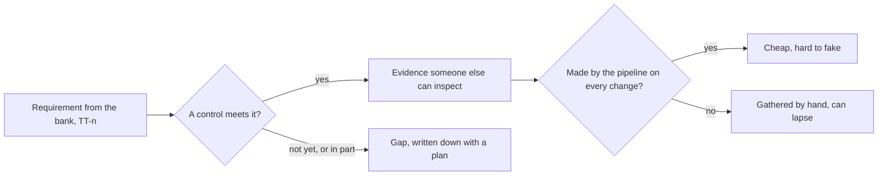

## Bạn cần biết trước

- [[management.l4.lightweight-governance]] — bạn biết các nguyên tắc của Đơn Hàng, như "mọi thay đổi production là một commit vào repo cấu hình", được viết ra kèm lý do. Bài này đưa chúng ra cho người ngoài đội xem.
- [[backend.l4.audit-log]] — bạn biết nhật ký kiểm toán chỉ tính là bằng chứng khi những người được nó ghi lại không sửa được nó mà không ai thấy, và nhật ký của Đơn Hàng vẫn mới là thiết kế.
- [[devops.l3.verifying-before-deploy]] — bạn biết một bước kiểm tra chỉ bảo vệ lần deploy khi chính bước deploy chạy nó.
- [[backend.l4.signing-key-custody]] — bạn biết ADR `0015` giữ khóa ký hóa đơn trong một HSM mà chỉ Payments được gọi.

## Tình huống

Một chuỗi cửa hàng thuộc một ngân hàng muốn ký hợp đồng với Đơn Hàng, và trước khi ký, họ gửi bảy quy định. Điều đầu tiên: mọi thay đổi lên production phải có một người duyệt khác người làm. Một lập trình viên trả lời ngay: "Mình review mọi pull request, và mình ký image." Rồi bạn nhớ ra lab đưa api lên production thế nào: `gitops-promote.sh` tạo một commit vào `envs/production`, và không ai khác nhìn vào commit đó. Ngân hàng sẽ không tin lời lập trình viên kia, cũng không tin lời bạn. Họ muốn thấy tận mắt. Làm sao chỉ cho một khách hàng bên ngoài thấy Đơn Hàng đáp ứng những quy định nào, bằng chứng là gì, và quy định nào chưa đáp ứng?

## Khái niệm cốt lõi

- **tuân thủ** (compliance) — đáp ứng những quy định do bên ngoài đặt ra, từ cơ quan quản lý hay hợp đồng của một khách lớn, và chỉ ra được bằng bằng chứng, không chỉ nói là đã làm.
- **biện pháp kiểm soát** (control) — cách làm hay cơ chế cụ thể đáp ứng một yêu cầu, như "mọi thay đổi production là một commit vào repo cấu hình".
- bằng chứng — một bản ghi mà người ngoài đội kiểm được để thấy biện pháp kiểm soát thật sự đã chạy: lịch sử Git, một SBOM, output của một script.
- **tách biệt nhiệm vụ** (separation of duties) — không một người nào vừa làm một thay đổi vừa tự duyệt chính thay đổi đó.
- khoảng trống — một yêu cầu chưa có biện pháp kiểm soát nào đáp ứng, hoặc mới đáp ứng một phần, được ghi ra kèm kế hoạch lấp nó.

## Cơ chế hoạt động



Trong tình huống trên, danh sách của ngân hàng là quy định từ bên ngoài, nên đáp ứng nó là tuân thủ. Câu trả lời của lập trình viên kể ra cách làm nhưng không kèm bằng chứng, và ngân hàng không kiểm được một câu nói. Ký image còn là câu trả lời cho một quy định khác, TT-5, chứ không phải cho câu hỏi ai duyệt thay đổi lên production.

Bắt đầu từ từng yêu cầu. Biện pháp kiểm soát là điều Đơn Hàng làm để đáp ứng yêu cầu đó. Với quy định đầu tiên, biện pháp là mọi thay đổi production đều là một commit vào `envs/production` trong repo cấu hình, và không ai sửa tay trên cluster. Bằng chứng là lịch sử của repo đó: ai commit, lúc nào, đổi gì.

Rồi hỏi biện pháp đó có đáp ứng trọn yêu cầu không. Ở đây thì không. Quy định đòi tách biệt nhiệm vụ, mà trong lab chỉ một commit của `gitops-promote.sh` là đủ đưa api lên production, nên người làm cũng là người duyệt. Đó là một khoảng trống, và nó vào bảng cùng kế hoạch: repo cấu hình production bắt buộc có người duyệt thứ hai.

Tiếp theo, hỏi bằng chứng từ đâu ra. Bằng chứng do pipeline sinh ra trên mỗi thay đổi, như SBOM, kết quả quét, chữ ký và lịch sử Git, không tốn thêm gì để thu. Các nguyên tắc của Đơn Hàng ưu tiên loại này vì rẻ hơn và khó làm giả hơn, bởi không ai phải ghép nó lại sau. Bằng chứng gom tay trước một đợt kiểm tra thì phụ thuộc vào chuyện có người nhớ làm.

Cuối cùng, yêu cầu chưa có biện pháp kiểm soát nào vẫn được ghi vào danh sách. Quy tắc của đội là: một khoảng trống đội tự nêu trước tốn ít lòng tin hơn một khoảng trống người kiểm tra của ngân hàng tìm ra.

## Trong hệ thống Đơn Hàng

Những gì ngân hàng yêu cầu, lấy từ `docs/team/compliance-controls.md`:

```markdown file=docs/team/compliance-controls.md tag=stage-4 lines=1-21
# Biện pháp kiểm soát cho yêu cầu của khách hàng ngân hàng

Tài liệu ghi cách Đơn Hàng đáp ứng một danh sách yêu cầu từ bên ngoài, bằng
chứng cho từng điều, và chỗ chưa đáp ứng. Tuân thủ là đáp ứng những yêu cầu do
bên ngoài đặt ra (cơ quan quản lý, hay hợp đồng của một khách lớn) và chỉ ra
được bằng bằng chứng, không chỉ nói là đã làm. Tài liệu này không phải ý kiến
pháp lý.

### Bối cảnh

Một khách hàng là chuỗi cửa hàng thuộc một ngân hàng (giả định) gửi danh sách
yêu cầu trước khi ký hợp đồng:

- TT-1: Mọi thay đổi lên production có một người duyệt khác người làm.
- TT-2: Truy được ai đã làm gì với đơn và với hoàn tiền.
- TT-3: Khóa ký hóa đơn không rời thiết bị bảo vệ khóa.
- TT-4: Sao lưu dữ liệu và thử khôi phục định kỳ, mỗi lần có biên bản.
- TT-5: Biết mọi thành phần phần mềm đang chạy và các lỗ hổng đã biết của
  chúng.
- TT-6: Dữ liệu nằm ở nơi hợp đồng quy định.
- TT-7: Rà soát quyền truy cập định kỳ.
```

Dòng 3–7 định nghĩa tuân thủ giống như bài này và nói rõ tài liệu không phải ý kiến pháp lý. Dòng 14–21 liệt kê bảy yêu cầu, giả định là do ngân hàng gửi:

- TT-1: người duyệt thứ hai cho thay đổi lên production.
- TT-2: truy được ai đã làm gì với đơn và hoàn tiền.
- TT-3: khóa ký hóa đơn không bao giờ rời thiết bị bảo vệ nó.
- TT-4: sao lưu, kèm kiểm thử khôi phục định kỳ.
- TT-5: biết mọi thành phần đang chạy và các lỗ hổng đã biết của chúng.
- TT-6: dữ liệu nằm ở nơi hợp đồng quy định.
- TT-7: rà soát quyền truy cập định kỳ.

Đơn Hàng trả lời từng yêu cầu thế nào:

```markdown file=docs/team/compliance-controls.md tag=stage-4 lines=23-45
### Bảng kiểm soát

Mỗi yêu cầu được đáp ứng bằng một biện pháp kiểm soát (một cách làm hay một cơ
chế cụ thể), và mỗi biện pháp cần bằng chứng người khác kiểm được. Bảng ghi
đúng hiện trạng ở stage-4.

| Yêu cầu | Biện pháp kiểm soát | Bằng chứng | Sinh tự động hay làm tay | Khoảng trống và kế hoạch |
|---|---|---|---|---|
| TT-1 | Mọi thay đổi production là một commit vào `envs/production` của repo cấu hình; không ai sửa tay trên cluster (NT4 của `architecture-governance.md`) | Lịch sử Git của repo cấu hình: ai commit, lúc nào, đổi gì | Tự động | Trong lab, một commit của `scripts/devops/gitops-promote.sh` là đủ để đưa api lên production: người làm cũng là người duyệt. Kế hoạch: repo cấu hình production bắt buộc pull request có một người duyệt khác tác giả trước khi merge (H6 của `technical-strategy.md`) |
| TT-2 | Nhật ký kiểm toán theo `docs/design/audit-log.md`: mỗi lần giao đơn, yêu cầu hoàn tiền, đổi giá, cấp role, xin ký hóa đơn ghi một entry có chuỗi hash | Chưa có | Sẽ tự động | `audit-log.md` mới là thiết kế, chưa dựng. Hôm nay `requested_by` của dòng hoàn tiền sửa được mà không để lại dấu vết. Kế hoạch: dựng nhật ký theo thiết kế (mục "Sau đó" của `roadmap.md`) |
| TT-3 | Khóa ký hóa đơn nằm trong dịch vụ HSM của nhà cung cấp, chỉ ServiceAccount của Payments được ký (ADR 0015, 0023) | ADR 0015, 0023; khi dựng: log mỗi lần dùng khóa của dịch vụ quản lý khóa | Sẽ tự động | Đã quyết, chưa dựng: stage-4 chưa có hóa đơn, chưa có HSM, chỉ có sample với khóa phần mềm cho lab |
| TT-4 | Dump logic, base backup và WAL lưu liên tục; thử khôi phục bằng `scripts/devops/restore-test.sh`; dựng lại staging bằng `scripts/devops/dr-drill.sh` | Output của `restore-test.sh` (số dòng so với lúc dump, thời gian khôi phục) và của `dr-drill.sh` (thời gian từng bước) | Script tự chạy, nhưng được khởi động bằng tay, chưa theo lịch | Bản sao lưu và WAL chưa rời máy đang chạy database (ADR 0020). Kế hoạch: sao sang region thứ hai (H4), chạy thử khôi phục theo lịch và lưu output làm biên bản |
| TT-5 | Mỗi lần chạy `ci.yml` viết SBOM cho từng image và quét lỗ hổng trên SBOM đó; lỗ hổng mức High hoặc Critical đã có bản sửa làm hỏng lần chạy, trừ những lỗ hổng `.grype.yaml` chấp nhận kèm lý do. Image được đẩy từ master còn được ký và có attestation về nguồn build và SBOM | SBOM (artifact `sboms` của lần chạy), kết quả quét trong log của lần chạy, chữ ký và attestation lưu cạnh image; `scripts/devops/verify-image.sh` kiểm chữ ký và nguồn build | Tự động | SBOM và kết quả quét giữ theo thời hạn lưu artifact của lần chạy; image của các thành phần tự chạy trong `self-run-components.md` không đi qua `ci.yml`. Kế hoạch: lưu SBOM của mỗi bản đã lên production cùng commit deploy |
| TT-6 | Đơn Hàng chạy ở một region (ADR 0020), trên Kubernetes managed của một nhà cung cấp (ADR 0022) | ADR 0020, 0022 | Làm tay | Hợp đồng đòi dữ liệu ở một nơi xác định là điều kiện mở lại của ADR 0022 và ADR 0020 (bảng "Giả định cần theo dõi" của `architecture-governance.md`): ký hợp đồng này thì mở lại hai ADR đó trước |
| TT-7 | Chưa có | Chưa có | Chưa có | Chưa ai rà soát role trong Keycloak hay quyền trên repo cấu hình theo lịch. Kế hoạch: rà soát mỗi quý, xuất danh sách role và người có quyền làm biên bản (mục "Sau đó" của `roadmap.md`) |

### Nguyên tắc

- Bằng chứng do pipeline sinh ra trên mỗi thay đổi (SBOM, kết quả quét, chữ
  ký, lịch sử Git) được ưu tiên hơn bằng chứng gom tay trước một lần kiểm tra:
  nó rẻ hơn và khó làm giả hơn.
- Khoảng trống được ghi ra kèm kế hoạch, không giấu. Một khoảng trống người
  kiểm tra tìm ra trước tốn nhiều lòng tin hơn một khoảng trống đội đã tự ghi.
```

Mỗi dòng có cùng năm cột: yêu cầu, biện pháp kiểm soát, bằng chứng, bằng chứng sinh tự động hay làm tay, và khoảng trống kèm kế hoạch. Dòng 27 nói bảng ghi đúng hiện trạng ở stage-4.

Dòng 31 (TT-1) là câu trả lời cho tình huống. Bằng chứng là lịch sử Git, sinh tự động, nhưng một commit của `gitops-promote.sh` lên tới production mà không cần người thứ hai, nên kế hoạch là bắt buộc pull request do một người khác tác giả duyệt (hành động H6 của `technical-strategy.md`). Bản thân script, nằm ngoài đoạn trích, commit vào `envs/production` mà không có bước review nào, và comment của nó nói ở nơi làm việc thật, commit đó sẽ là một pull request.

Dòng 35 (TT-5) là dòng mạnh nhất: mỗi lần chạy `ci.yml` qua được test đều viết SBOM cho từng image và quét nó, còn image của các service được đẩy từ master thì được ký và có attestation (image `fake-gateway` của lab được đẩy lên mà không ký). Ngay ở đây, bảng vẫn nêu một khoảng trống: SBOM chỉ còn chừng nào artifact của lần chạy còn được giữ.

Dòng 36 (TT-6): ADR `0020` và ADR `0022` đã quyết Đơn Hàng chạy ở đâu, và bảng giả định cần theo dõi trong tài liệu quản trị kiến trúc ghi rằng một hợp đồng chỉ định nơi đặt dữ liệu là lý do để xem lại cả hai.

Dòng 32 (TT-2) và 37 (TT-7) là những dòng thẳng thắn. Nhật ký kiểm toán của `audit-log.md` mới là thiết kế, và không ai rà soát quyền truy cập theo lịch. Cả hai đều được ghi kèm kế hoạch.

## Đánh đổi

| Cách trả lời một yêu cầu | Khách kiểm được gì | Tốn gì | Hợp khi |
|---|---|---|---|
| Một biện pháp kiểm soát có bằng chứng do pipeline sinh trên mỗi thay đổi | mọi thay đổi, vào bất kỳ lúc nào, với bản ghi không ai ghép tay | dựng bước đó một lần, bằng chứng chỉ còn chừng nào còn được lưu | biện pháp là một bước máy đã chạy sẵn, như build hay commit |
| Một biện pháp kiểm soát có bằng chứng do người gom trước mỗi đợt kiểm tra | những gì đã gom được, các tháng không có bản ghi thì không thấy | thời gian của một người ở mỗi đợt kiểm tra, và đứt khi không ai nhớ | biện pháp là việc con người làm, như rà soát ai có quyền truy cập |
| Một câu nói rằng đội có làm, không kèm bằng chứng | không gì cả | lúc đầu không tốn gì, sau đó tốn lòng tin khi người kiểm tra đòi bằng chứng | không dùng khi quy định từ bên ngoài đòi bằng chứng, cùng lắm cho một câu hỏi không chính thức |
| Một khoảng trống ghi ra kèm kế hoạch | đội biết điểm yếu của mình và khi nào sẽ lấp | phải thừa nhận nó trước khi ký | biện pháp kiểm soát chưa có, như với TT-2 và TT-7 |

## Bạn sẽ chọn gì nếu…

…ngân hàng đặt TT-1 làm điều kiện để ký vào tháng sau? Một câu trả lời hợp lý là đẩy sớm phần TT-1 của H6: thay đổi cấu hình production đi qua một pull request mà một người khác tác giả phải duyệt. Tới lúc đó, bảng vẫn ghi rằng trong lab một commit là lên tới production (dòng 31).

…hợp đồng đòi dữ liệu nằm yên ở một nơi ghi rõ? Dòng 36 đã quyết bước đầu tiên: điều khoản đó là tín hiệu mở lại ADR `0020` và `0022`, nên bạn mở lại hai quyết định đó trước khi ký, không phải sau.

…người kiểm tra đòi SBOM của bản đã chạy ở production ba tháng trước? Dòng 35 nói SBOM chỉ được giữ chừng nào artifact của lần chạy còn. Câu trả lời thật có thể là nó đã mất, và kế hoạch ở cùng dòng, lưu SBOM cùng mỗi commit deploy lên production, là thứ sửa được chuyện này.

## Senior hay nhầm rằng…

- **"Tuân thủ là một tài liệu viết một lần cho người kiểm toán rồi cất đi."** → Thực ra bảng ghi đúng hiện trạng ở stage-4, và bằng chứng cho TT-1 và TT-5 được sinh lại trên mỗi thay đổi. Một tài liệu đã cất đi sẽ lệch khỏi hệ thống ngay khi một biện pháp kiểm soát hay một khoảng trống thay đổi. Bạn sẽ nhận ra khi đợt kiểm tra sau thấy tài liệu vẫn tả một biện pháp mà đội đã bỏ.
- **"Qua được kiểm toán là chứng minh hệ thống an toàn."** → Thực ra người kiểm tra của ngân hàng chỉ xem các biện pháp kiểm soát cho những yêu cầu trong danh sách của ngân hàng, và danh sách đó đến từ khách hàng, không đến từ các mối đe dọa của bạn. Một rủi ro mà mô hình mối đe dọa tìm ra có thể nằm ngoài cả bảy quy định. Bạn sẽ nhận ra khi một sự cố đánh vào chỗ không yêu cầu nào nhắc tới, và đội chỉ vào lần kiểm toán đã qua.
- **"Tuân thủ là việc của bộ phận pháp lý, không phải của kỹ sư."** → Thực ra mọi biện pháp kiểm soát trong bảng này là một cơ chế kỹ thuật, một đường commit, một bước CI, một HSM, một script khôi phục, và chỉ kỹ sư mới nói được nó có chạy hay không. Chính file cũng nói nó không phải ý kiến pháp lý. Bạn sẽ nhận ra khi hợp đồng hứa một biện pháp kiểm soát mà chưa ai trong đội dựng.

## Thử ngay (3 phút)

Dùng đoạn trích thứ hai. Chọn TT-4, sao lưu và kiểm thử khôi phục, ở dòng 34.

1. Nói phần nào của bằng chứng do máy sinh ra, phần nào phụ thuộc vào con người.
2. Nói điểm yếu nào người kiểm tra sẽ thấy đầu tiên, và kế hoạch là gì.

Kết quả mong đợi: script sinh ra bằng chứng, nhưng một người phải khởi động chúng. Bản sao lưu chưa rời máy chạy database, và kế hoạch là sao chúng sang nơi thứ hai rồi chạy kiểm thử khôi phục theo lịch.

<details><summary>Gợi ý đáp án</summary>

Bằng chứng là output của `restore-test.sh`, gồm số dòng so với bản dump và thời gian khôi phục, và output của `dr-drill.sh`, gồm thời gian từng bước. Script tự chạy nhưng được khởi động bằng tay, nên một tháng không ai chạy là một tháng không có bản ghi. Cột khoảng trống nêu điểm yếu đầu tiên: base backup và WAL chưa rời máy đang chạy database (ADR `0020`). Kế hoạch sao chúng sang một nơi thứ hai, tách khỏi máy đó (hành động H4 của `technical-strategy.md`), chạy kiểm thử khôi phục theo lịch và giữ mỗi output làm biên bản.

</details>

## Liên hệ

- [[management.l4.lightweight-governance]] — các nguyên tắc và quyền quyết định bên trong đội. Bài này đưa chúng ra cho khách bên ngoài dưới dạng biện pháp kiểm soát.
- [[backend.l4.audit-log]] — thiết kế sẽ lấp khoảng trống TT-2.
- [[devops.l3.verifying-before-deploy]] — bước kiểm tra biến chữ ký và attestation của TT-5 thành thứ mà một lần deploy dựa vào.
- [[backend.l4.signing-key-custody]] — quyết định đứng sau biện pháp kiểm soát của TT-3.
- [[backend.l4.threat-modeling]] — danh sách còn lại: những rủi ro đội tự tìm ra, mà một quy định từ bên ngoài có thể không bao gồm.
- [[devops.l3.build-provenance]] — nơi attestation về bản build của TT-5 đến từ.
- [[devops.l3.restore-testing]] — các script có output là bằng chứng của TT-4.
- [[k8s.l4.keys-stay-in-the-key-service]] — nơi HSM của TT-3 chạy, được quyết cùng với chỗ chạy hệ thống.
- [[k8s.l4.choosing-managed-kubernetes]] — quyết định mà TT-6 có thể mở lại.

## Tóm tắt 5 dòng

1. Tuân thủ là đáp ứng quy định từ bên ngoài và chỉ ra bằng bằng chứng, bằng cách gắn mỗi yêu cầu với một biện pháp kiểm soát mà người khác kiểm được.
2. `compliance-controls.md` cho mỗi yêu cầu trong bảy yêu cầu của ngân hàng một biện pháp kiểm soát, bằng chứng, cách bằng chứng được sinh ra, và khoảng trống.
3. Tách biệt nhiệm vụ nghĩa là không ai vừa làm vừa duyệt một thay đổi, nhưng trong lab một commit của `gitops-promote.sh` vẫn làm cả hai.
4. Bằng chứng do pipeline sinh ra trên mỗi thay đổi, như SBOM, kết quả quét, chữ ký và lịch sử Git, rẻ hơn và khó làm giả hơn.
5. Biện pháp kiểm soát còn thiếu được ghi thành khoảng trống kèm kế hoạch, vì khoảng trống để người kiểm tra tìm ra trước tốn nhiều lòng tin hơn.
