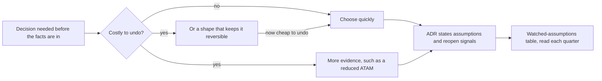

## Before you start

- [[management.l4.weighted-scoring-matrix]] — you know the email-service evaluation behind ADR `0024`, and that its matrix called Dịch vụ A and Dịch vụ B close.
- [[management.l4.lightweight-governance]] — you know `architecture-governance.md`: its principles and its decision-rights table.
- [[design.l4.reduced-atam]] — you know the one-session review for a decision that is expensive to reverse.
- [[k8s.l4.when-a-mesh-pays-off]] — you know ADR `0021`: no service mesh yet, and the three conditions that would reopen it.

## The situation

At stage-4, two decisions sit side by side in `docs/adr/`. ADR `0012` serves every shop from one deployment, chosen before anyone knew how many shops would really join, or whether a large shop's contract would demand its own copy. ADR `0024` picks an email service, Dịch vụ A, before a single real customer has received an email. Neither could wait for the facts. Yet the email choice was proposed and decided within the first week of Sprint 23, while ADR `0012` was followed by a reduced ATAM session before anything was built on it. If both rest on guesses, why did one get so much more care than the other?

## Core concepts

- **reversible decision** — a decision that can be undone later at a small cost, so it deserves a quick choice; in the situation above, the email service is one.
- decision that is costly to undo — one that other work is built on, so undoing it means redoing that work.
- assumption — something a decision takes as true without being able to prove it yet.
- reopen signal — an event you can observe that would show an assumption has stopped holding, written in the ADR's review conditions.
- table of watched assumptions — the section of `architecture-governance.md` headed "Giả định cần theo dõi" that lists the assumptions of the ADRs it covers, their reopen signals, where each signal would show up and who watches for it.

## How it works



In the situation above, neither decision could wait. If the team waited to see how many shops sign, the first shop would arrive on whatever shape the system had then, a decision taken by default. Waiting is a choice too, one nobody writes down, so the diagram leaves it out.

So the first question is not "do we know enough?" but "what does it cost to be wrong?" The email service is a reversible decision: if Dịch vụ A disappoints, the team moves to another service and loses little. It deserves a quick choice, and it got one: the matrix, a week, an ADR.

One deployment for every shop is costly to undo. ADR `0013` keeps every shop's rows in shared tables and ADR `0019`'s release strategy starts from `0012`; both build on it. A wrong guess there means redoing work across the system. That is when more evidence pays: the reduced ATAM tested the chosen shape before anything was built on it.

The third way is to give a decision a shape that keeps it reversible, so a costly choice becomes a cheap one. The email choice is cheap to undo partly because of its shape: Notifications hands over email by SMTP, the standard protocol a program uses to pass an email to a mail server, and the evaluation required every option to accept it.

Whichever way it goes, the decision ends in an ADR that states its assumptions and the signals that would reopen it. Those signals are added to the table of watched assumptions at the next quarterly review, where the table is read.

## In the Đơn Hàng system

What keeps ADR `0024` reversible, from its "Hệ quả" section. `IEmailSender` is the interface Notifications sends through; `MailKitEmailSender` implements it with the MailKit library over SMTP, and `SmtpSettings` holds where the SMTP server is. Mailpit is the lab's stand-in mail server: it catches every email and sends nothing out.

```markdown file=docs/adr/0024-dich-vu-gui-email-ben-ngoai.md tag=stage-4 lines=47-63
### Hệ quả

- Notifications giữ `IEmailSender` và `MailKitEmailSender`. Hôm nay lớp này
  nối tới Mailpit không TLS và không đăng nhập; nối tới A cần thêm hai mục cấu
  hình đó trong `SmtpSettings`, không đổi thư viện. Từ đó đổi dịch vụ gửi email
  chỉ là đổi cấu hình SMTP.
- Lab vẫn dùng Mailpit; không gì trong lab gửi email ra ngoài.
- Stage-4 không đổi code: chưa có production để nối A vào.
- A báo từng email bị trả lại bằng cách gọi ngược vào hệ thống; Notifications
  dùng nó để ngừng gửi tới địa chỉ đó. Việc này làm cùng lần nối A.

Đội xem lại quyết định khi:

- Tỉ lệ email tới hộp thư khách thấp hơn mức giả định trong
  `email-service-evaluation.md`.
- Giá của A vượt TCO giả định trong `email-service-evaluation.md`.
- A ngừng nhận email qua SMTP.
```

Lines 49–52 are the shape: for sending, connecting to A adds only TLS and login settings, with no library change, and from then on changing service is a change of SMTP settings. Lines 55–56 add work that comes with connecting A: A calls back into the system for each bounced email. The ADR does not say what a new service would need there; in this lesson's reading, its bounce report would have to be wired to Notifications again. Lines 58–63 turn the assumptions into reopen signals: delivery to the inbox below the assumed rate, a price above the assumed TCO, A no longer accepting email over SMTP.

The table of watched assumptions and its review. The lines just above it (55–57) set two rules: each signal is copied from the ADR's own review conditions, nothing added, and a signal leads to a new ADR, never an edit to the old one.

```markdown file=docs/team/architecture-governance.md tag=stage-4 lines=59-81
| ADR | Giả định | Tín hiệu mở lại | Thấy tín hiệu ở đâu | Người theo dõi (vai trò) |
|---|---|---|---|---|
| 0012 | Mọi cửa hàng dùng chung một bản triển khai | Một cửa hàng có hợp đồng đòi một bản hệ thống riêng | Hợp đồng với cửa hàng trước khi ký | Product owner |
| 0012 | Một đội sửa được mọi module mà không phải chờ ai | Số đội tăng tới mức các đội phải chờ nhau để sửa cùng một module | Sprint planning, pull request bị chặn vì chờ đội khác | Trưởng nhóm |
| 0019 | Mọi cửa hàng dùng chung một bản triển khai | Một cửa hàng cần một bản triển khai riêng (mở lại cả ADR 0012) | Hợp đồng với cửa hàng trước khi ký | Product owner |
| 0019 | Bản cũ và bản mới luôn chạy cùng lúc được | Một thay đổi không thể làm tương thích với bản trước, nên bản cũ và bản mới không chạy cùng lúc được | Review thiết kế, mục thay đổi schema và message của `backend-review-checklist.md` | Lập trình viên backend |
| 0019 | Notifications và Payments nhận việc chủ yếu qua queue | Notifications hoặc Payments bắt đầu nhận phần lớn việc qua Gateway | HTTPRoute mới trỏ tới hai service đó | Lập trình viên phụ trách nền tảng |
| 0020 | Không hợp đồng nào đòi phục hồi nhanh hơn số đo của DR drill | Một hợp đồng hoặc SLA đòi RTO hoặc RPO thấp hơn số đo của DR drill | Hợp đồng với cửa hàng trước khi ký; số đo của mỗi lần DR drill | Product owner |
| 0020 | Dữ liệu cửa hàng được nằm ở bất kỳ region nào | Dữ liệu của một số cửa hàng phải nằm ở một vùng xác định | Hợp đồng với cửa hàng trước khi ký | Product owner |
| 0021 | Không yêu cầu nào đòi mã hóa trong cluster | Một hợp đồng đòi mã hóa lời gọi bên trong cluster | Hợp đồng với cửa hàng, danh sách yêu cầu như `compliance-controls.md` | Product owner |
| 0021 | Một nhóm, ba service .NET | Service đến từ nhiều nhóm hoặc nhiều ngôn ngữ, nên mỗi codebase tự làm mutual TLS, retry và số đo theo lời gọi trở nên đắt hơn một mesh | Service mới đề xuất bằng ADR, đội mới thành lập | Trưởng nhóm |
| 0021 | Service chỉ gọi nhau trong một cluster | Service bắt đầu gọi nhau giữa các cluster | ADR hoặc thay đổi cluster qua `cluster-review-checklist.md` | Lập trình viên phụ trách nền tảng |
| 0022 | Không khách nào đòi nơi chạy riêng | Hợp đồng của một khách đòi máy riêng hoặc dữ liệu ở một nơi xác định | Hợp đồng với cửa hàng trước khi ký | Product owner |
| 0022 | Managed rẻ hơn tự chạy cluster | Phí của nhà cung cấp vượt chi phí giả định của việc đội tự chạy cluster (cột A của bảng) | Hóa đơn hằng tháng của nhà cung cấp | Trưởng nhóm |
| 0024 | Dịch vụ A đưa email tới hộp thư khách | Tỉ lệ email tới hộp thư khách thấp hơn mức giả định trong `email-service-evaluation.md` | Báo cáo gửi của Dịch vụ A | Lập trình viên backend |
| 0024 | Giá của Dịch vụ A nằm trong TCO đã tính | Giá của A vượt TCO giả định trong `email-service-evaluation.md` | Hóa đơn của Dịch vụ A | Trưởng nhóm |
| 0024 | Dịch vụ A nhận email qua SMTP | A ngừng nhận email qua SMTP | Thông báo thay đổi API của Dịch vụ A | Lập trình viên backend |

### Xem lại

Mỗi quý, cùng `technical-strategy.md` và `roadmap.md`: thêm ADR mới có điều
kiện mở lại vào bảng trên, xem tín hiệu nào đã xuất hiện, và xem bảng "Ai
quyết định gì" còn đúng với số đội hiện có không.
```

Lines 68–70 are ADR `0021`'s three conditions: a contract that requires encryption of calls inside the cluster, services from several teams or languages, and services calling each other across clusters. Line 61 does the same for ADR `0012`, seen in a shop's contract before it is signed. Lines 79–81 set the rhythm: each quarter the team adds new ADRs that have reopen conditions and checks which signals have appeared.

## Trade-offs

| How to handle a decision whose facts are not in | What it costs | What it risks | Fits when |
|---|---|---|---|
| Choose quickly, then watch its signals, as ADR `0024` does | a short evaluation and an ADR | a wrong choice, paid for when you switch | undoing the choice is cheap |
| Gather more evidence first, such as the reduced ATAM after ADR `0012` | a session of the whole team and the product owner | time spent before building | other work will be built on the decision |
| Give the decision a shape that keeps it reversible, as SMTP does for ADR `0024` | a constraint on every option: one that cannot take email over SMTP with TLS is dropped | work outside the shared protocol still comes with a provider, such as wiring A's call back for bounced email | a common interface exists that the options share |
| Wait for the facts | nothing now | the decision is taken by default, on whatever shape exists when the facts arrive | nothing is being built on any one option in the meantime |

The rows combine: ADR `0024` is both quick and shaped to stay reversible.

## What would you choose if…

…a shop's draft contract demands its own copy of the system? That is ADR `0012`'s first reopen signal, line 61, seen by the product owner before signing. A new ADR is proposed, and ADR `0012` already says what it expects: that shop gets its own copy of the same system, the other shops are served as before.

…a contract demands encryption inside the cluster, and nothing else? That is ADR `0021`'s first condition. A mesh is the bigger step: ADR `0021` lists a proxy in every Pod and a controller to upgrade, and a bad mesh change can break calls between every service at once. ADR `0021` already names a smaller first step, option C, which encrypts only the hop from the Gateway to the api. Take the step that is cheap to undo before the one that is not.

…someone asks for a reduced ATAM before choosing between two email services? The choice is reversible: switching is mostly a change of SMTP settings. Keep the session for decisions that other work is built on.

## Seniors often assume…

- **"A careful architect waits until all the facts are known before deciding."** → Actually some facts, such as how many shops join or what a large customer's contract demands, arrive only after the system has to work. Waiting lets the decision happen by default. Care means stating the assumptions and their signals, not delaying. You notice this belief when a decision stays "pending more information" for several sprints while code keeps being written around one of the options.
- **"Every architecture decision deserves the same depth of analysis."** → Actually the depth should follow the cost of undoing. A reduced ATAM for the email service would spend a team session on a choice that changes mostly by settings; a one-week decision on one deployment for every shop would leave ADR `0013` and `0019` built on an untested guess. You notice this belief when cheap-to-reverse choices wait in review as long as the ones that shape the system.
- **"A decision whose assumptions later prove wrong was a bad decision."** → Actually a decision is judged by what was known and written when it was taken. If A's price later passes the assumed TCO, ADR `0024` did its job: it named that signal, and a new ADR takes over. You notice this belief when people avoid writing assumptions down, because a written assumption can later turn out wrong.

## Try it (3 minutes)

Open `docs/team/architecture-governance.md` in the `don-hang` repository at tag `stage-4` and find the "Giả định cần theo dõi" table.

1. A new shop sends a draft contract that requires calls inside the cluster to be encrypted, and asks for nothing else. Find the row this touches, and say who should notice it and when.
2. Say what the team does next, and whether ADR `0021` was a bad decision.

Expected result: the ADR `0021` row on encryption, the product owner reading the draft before anything is signed, a new ADR that starts with option C, and a reason why ADR `0021` was not a bad decision.

<details><summary>Suggested answer</summary>

The row is ADR `0021`, "Không yêu cầu nào đòi mã hóa trong cluster", line 68. Its signal shows up in the shop's contract, watched by the product owner. Since this is a draft, the product owner can catch it before anything is signed.

The product owner raises it and a new ADR is proposed; ADR `0021` is not rewritten. Because the contract asks only for encryption, ADR `0021` itself says to do option C before considering a mesh.

ADR `0021` was not a bad decision. When it was taken, no requirement asked for encryption inside the cluster. It wrote that assumption down with the signal that would end it, and the signal is now doing its job.

</details>

## Connections

- [[management.l4.weighted-scoring-matrix]] — the evaluation behind ADR `0024`.
- [[management.l4.lightweight-governance]] — the same `architecture-governance.md`; this lesson adds its last table.
- [[design.l4.reduced-atam]] — the extra evidence a decision that is costly to undo gets.
- [[k8s.l4.when-a-mesh-pays-off]] — ADR `0021`, read here for its reopen conditions.
- [[design.l4.evolutionary-architecture]] — the same idea in the system itself: small, checked steps.
- [[design.l4.one-deployment-for-all-shops]] — where ADR `0012`, the costly decision here, was weighed.
- [[k8s.l4.choosing-managed-kubernetes]] — ADR `0022`, whose reopen signals sit in the same table.
- [[k8s.l4.data-decides-failover]] — ADR `0020`, another row of the same table.
- [[management.l3.superseding-an-adr]] — how the new ADR takes over when a signal appears.
- [[management.l4.technical-strategy]] — next: the document read with this table each quarter.

## Five-line summary

1. Under uncertainty, match the care a decision gets to how costly it is to undo, instead of waiting for facts that arrive too late.
2. A reversible decision, like the email service in ADR `0024`, deserves a quick choice; switching is mostly a change of SMTP settings.
3. A decision other work builds on, like one deployment for every shop in ADR `0012`, deserves more evidence, such as a reduced ATAM.
4. Every such decision states its assumptions and reopen signals; ADR `0021` names three.
5. `architecture-governance.md` lists the signals of the ADRs it covers, where it shows and who watches, and the team reads that table at each quarterly review.
