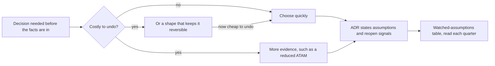

## Bạn cần biết trước

- [[management.l4.weighted-scoring-matrix]] — bạn biết bản đánh giá dịch vụ gửi email đứng sau ADR `0024`, và ma trận của nó gọi Dịch vụ A và Dịch vụ B là sát nhau.
- [[management.l4.lightweight-governance]] — bạn biết `architecture-governance.md`: các nguyên tắc và bảng quyền quyết định của nó.
- [[design.l4.reduced-atam]] — bạn biết buổi đánh giá gói trong một phiên dành cho quyết định tốn kém khi đảo ngược.
- [[k8s.l4.when-a-mesh-pays-off]] — bạn biết ADR `0021`: chưa dùng service mesh, và ba điều kiện sẽ mở lại quyết định đó.

## Tình huống

Ở stage-4, trong `docs/adr/` có hai quyết định nằm cạnh nhau. ADR `0012` phục vụ mọi cửa hàng từ một bản triển khai, được chọn khi chưa ai biết thật sự sẽ có bao nhiêu cửa hàng tham gia, hay hợp đồng của một cửa hàng lớn có đòi một bản hệ thống riêng không. ADR `0024` chọn một dịch vụ gửi email, Dịch vụ A, khi chưa có khách thật nào nhận được email. Cả hai đều không chờ được sự thật. Thế nhưng lựa chọn email được đề xuất và chốt ngay trong tuần đầu của Sprint 23, còn ADR `0012` được theo sau bằng một buổi reduced ATAM trước khi có gì được xây trên nó. Nếu cả hai đều dựa trên ước đoán, vì sao một quyết định được cân nhắc kỹ hơn hẳn quyết định kia?

## Khái niệm cốt lõi

- **quyết định đảo ngược được** (reversible decision) — quyết định có thể làm lại sau với chi phí nhỏ, nên đáng được chọn nhanh. Trong tình huống trên, dịch vụ gửi email là một quyết định như vậy.
- quyết định tốn kém khi đảo ngược — quyết định mà việc khác được xây lên trên, nên đảo ngược nó nghĩa là làm lại cả phần việc đó.
- giả định — điều một quyết định coi là đúng khi chưa chứng minh được.
- tín hiệu mở lại — một sự kiện quan sát được, cho thấy một giả định đã không còn đúng, được ghi trong điều kiện xem lại của ADR.
- bảng giả định cần theo dõi — mục "Giả định cần theo dõi" trong `architecture-governance.md`, liệt kê giả định của các ADR mà nó bao quát, tín hiệu mở lại của từng giả định, nơi tín hiệu sẽ hiện ra và ai theo dõi.

## Cơ chế hoạt động



Trong tình huống trên, không quyết định nào chờ được. Nếu đội đợi xem có bao nhiêu cửa hàng ký, cửa hàng đầu tiên sẽ tới trên đúng hình dạng hệ thống lúc đó, tức là một quyết định tự xảy ra mà không ai chọn. Chờ đợi cũng là một lựa chọn, chỉ là không ai ghi lại, nên sơ đồ không vẽ nó.

Vì vậy câu hỏi đầu tiên không phải "đã biết đủ chưa?" mà là "sai thì tốn bao nhiêu?". Dịch vụ gửi email là một quyết định đảo ngược được: nếu Dịch vụ A làm đội thất vọng, đội chuyển sang dịch vụ khác và mất ít. Nó đáng được chọn nhanh, và đã được chọn nhanh: ma trận, một tuần, một ADR.

Một bản triển khai cho mọi cửa hàng thì tốn kém khi đảo ngược. ADR `0013` giữ dòng dữ liệu của mọi cửa hàng trong các bảng chung, còn chiến lược phát hành của ADR `0019` xuất phát từ `0012`. Cả hai đều xây trên nó. Đoán sai ở đây nghĩa là làm lại việc trên khắp hệ thống. Đó là lúc thêm bằng chứng đáng tiền: buổi reduced ATAM đã thử hình dạng được chọn trước khi có gì được xây lên.

Cách thứ ba là cho quyết định một hình dạng giữ nó đảo ngược được, để một lựa chọn đắt trở thành lựa chọn rẻ. Lựa chọn email rẻ khi đảo ngược một phần nhờ hình dạng của nó: Notifications chuyển email đi bằng SMTP, giao thức chuẩn mà một chương trình dùng để chuyển email cho máy chủ gửi, và bản đánh giá bắt mọi phương án phải nhận được nó.

Đi theo cách nào thì quyết định cũng kết thúc bằng một ADR nêu giả định của nó và các tín hiệu sẽ mở lại nó. Những tín hiệu đó được thêm vào bảng giả định cần theo dõi ở lần xem lại hằng quý kế tiếp, nơi bảng được đọc.

## Trong hệ thống Đơn Hàng

Điều giữ ADR `0024` đảo ngược được, trong mục "Hệ quả" của nó. `IEmailSender` là interface mà Notifications gửi email qua. `MailKitEmailSender` cài đặt interface này bằng thư viện MailKit qua SMTP, và `SmtpSettings` giữ địa chỉ máy chủ SMTP. Mailpit là máy chủ email thay thế trong lab: nó giữ lại mọi email và không gửi gì ra ngoài.

```markdown file=docs/adr/0024-dich-vu-gui-email-ben-ngoai.md tag=stage-4 lines=47-63
### Hệ quả

- Notifications giữ `IEmailSender` và `MailKitEmailSender`. Hôm nay lớp này
  nối tới Mailpit không TLS và không đăng nhập; nối tới A cần thêm hai mục cấu
  hình đó trong `SmtpSettings`, không đổi thư viện. Từ đó đổi dịch vụ gửi email
  chỉ là đổi cấu hình SMTP.
- Lab vẫn dùng Mailpit; không gì trong lab gửi email ra ngoài.
- Stage-4 không đổi code: chưa có production để nối A vào.
- A báo từng email bị trả lại bằng cách gọi ngược vào hệ thống; Notifications
  dùng nó để ngừng gửi tới địa chỉ đó. Việc này làm cùng lần nối A.

Đội xem lại quyết định khi:

- Tỉ lệ email tới hộp thư khách thấp hơn mức giả định trong
  `email-service-evaluation.md`.
- Giá của A vượt TCO giả định trong `email-service-evaluation.md`.
- A ngừng nhận email qua SMTP.
```

Dòng 49–52 là hình dạng đó: về phần gửi, nối tới A chỉ thêm cấu hình TLS và đăng nhập, không đổi thư viện, và từ đó đổi dịch vụ chỉ là đổi cấu hình SMTP. Dòng 55–56 thêm phần việc đi kèm lần nối A: A gọi ngược vào hệ thống cho từng email bị trả lại. ADR không nói một dịch vụ mới sẽ cần gì ở chỗ này. Theo cách đọc của bài này, báo cáo email bị trả lại của dịch vụ mới sẽ phải nối lại vào Notifications. Dòng 58–63 biến các giả định thành tín hiệu mở lại: tỉ lệ email tới hộp thư thấp hơn mức giả định, giá vượt TCO giả định, A không còn nhận email qua SMTP.

Bảng giả định cần theo dõi và lần xem lại của nó. Các dòng ngay phía trên bảng (55–57) đặt hai quy tắc: mỗi tín hiệu được chép từ chính điều kiện xem lại của ADR, không thêm gì, và một tín hiệu dẫn tới một ADR mới, không bao giờ sửa ADR cũ.

```markdown file=docs/team/architecture-governance.md tag=stage-4 lines=59-81
| ADR | Giả định | Tín hiệu mở lại | Thấy tín hiệu ở đâu | Người theo dõi (vai trò) |
|---|---|---|---|---|
| 0012 | Mọi cửa hàng dùng chung một bản triển khai | Một cửa hàng có hợp đồng đòi một bản hệ thống riêng | Hợp đồng với cửa hàng trước khi ký | Product owner |
| 0012 | Một đội sửa được mọi module mà không phải chờ ai | Số đội tăng tới mức các đội phải chờ nhau để sửa cùng một module | Sprint planning, pull request bị chặn vì chờ đội khác | Trưởng nhóm |
| 0019 | Mọi cửa hàng dùng chung một bản triển khai | Một cửa hàng cần một bản triển khai riêng (mở lại cả ADR 0012) | Hợp đồng với cửa hàng trước khi ký | Product owner |
| 0019 | Bản cũ và bản mới luôn chạy cùng lúc được | Một thay đổi không thể làm tương thích với bản trước, nên bản cũ và bản mới không chạy cùng lúc được | Review thiết kế, mục thay đổi schema và message của `backend-review-checklist.md` | Lập trình viên backend |
| 0019 | Notifications và Payments nhận việc chủ yếu qua queue | Notifications hoặc Payments bắt đầu nhận phần lớn việc qua Gateway | HTTPRoute mới trỏ tới hai service đó | Lập trình viên phụ trách nền tảng |
| 0020 | Không hợp đồng nào đòi phục hồi nhanh hơn số đo của DR drill | Một hợp đồng hoặc SLA đòi RTO hoặc RPO thấp hơn số đo của DR drill | Hợp đồng với cửa hàng trước khi ký; số đo của mỗi lần DR drill | Product owner |
| 0020 | Dữ liệu cửa hàng được nằm ở bất kỳ region nào | Dữ liệu của một số cửa hàng phải nằm ở một vùng xác định | Hợp đồng với cửa hàng trước khi ký | Product owner |
| 0021 | Không yêu cầu nào đòi mã hóa trong cluster | Một hợp đồng đòi mã hóa lời gọi bên trong cluster | Hợp đồng với cửa hàng, danh sách yêu cầu như `compliance-controls.md` | Product owner |
| 0021 | Một nhóm, ba service .NET | Service đến từ nhiều nhóm hoặc nhiều ngôn ngữ, nên mỗi codebase tự làm mutual TLS, retry và số đo theo lời gọi trở nên đắt hơn một mesh | Service mới đề xuất bằng ADR, đội mới thành lập | Trưởng nhóm |
| 0021 | Service chỉ gọi nhau trong một cluster | Service bắt đầu gọi nhau giữa các cluster | ADR hoặc thay đổi cluster qua `cluster-review-checklist.md` | Lập trình viên phụ trách nền tảng |
| 0022 | Không khách nào đòi nơi chạy riêng | Hợp đồng của một khách đòi máy riêng hoặc dữ liệu ở một nơi xác định | Hợp đồng với cửa hàng trước khi ký | Product owner |
| 0022 | Managed rẻ hơn tự chạy cluster | Phí của nhà cung cấp vượt chi phí giả định của việc đội tự chạy cluster (cột A của bảng) | Hóa đơn hằng tháng của nhà cung cấp | Trưởng nhóm |
| 0024 | Dịch vụ A đưa email tới hộp thư khách | Tỉ lệ email tới hộp thư khách thấp hơn mức giả định trong `email-service-evaluation.md` | Báo cáo gửi của Dịch vụ A | Lập trình viên backend |
| 0024 | Giá của Dịch vụ A nằm trong TCO đã tính | Giá của A vượt TCO giả định trong `email-service-evaluation.md` | Hóa đơn của Dịch vụ A | Trưởng nhóm |
| 0024 | Dịch vụ A nhận email qua SMTP | A ngừng nhận email qua SMTP | Thông báo thay đổi API của Dịch vụ A | Lập trình viên backend |

### Xem lại

Mỗi quý, cùng `technical-strategy.md` và `roadmap.md`: thêm ADR mới có điều
kiện mở lại vào bảng trên, xem tín hiệu nào đã xuất hiện, và xem bảng "Ai
quyết định gì" còn đúng với số đội hiện có không.
```

Dòng 68–70 là ba điều kiện của ADR `0021`: một hợp đồng đòi mã hóa lời gọi bên trong cluster, service đến từ nhiều nhóm hoặc nhiều ngôn ngữ, và service gọi nhau giữa các cluster. Dòng 61 làm điều tương tự cho ADR `0012`, thấy được trong hợp đồng của một cửa hàng trước khi ký. Dòng 79–81 đặt nhịp: mỗi quý đội thêm các ADR mới có điều kiện mở lại và xem tín hiệu nào đã xuất hiện.

## Đánh đổi

| Cách xử lý một quyết định khi chưa có đủ sự thật | Tốn gì | Rủi ro gì | Hợp khi |
|---|---|---|---|
| Chọn nhanh rồi theo dõi tín hiệu, như ADR `0024` làm | một bản đánh giá ngắn và một ADR | chọn sai, trả giá lúc chuyển đổi | đảo ngược lựa chọn thì rẻ |
| Thu thêm bằng chứng trước, như buổi reduced ATAM sau ADR `0012` | một buổi của cả đội và product owner | thời gian bỏ ra trước khi xây | việc khác sẽ được xây trên quyết định đó |
| Cho quyết định một hình dạng giữ nó đảo ngược được, như SMTP làm cho ADR `0024` | một ràng buộc lên mọi phương án: phương án không nhận email qua SMTP có TLS thì bị loại | phần việc nằm ngoài giao thức chung vẫn đi kèm nhà cung cấp, như nối lời gọi ngược của A cho email bị trả lại | có một interface chung mà các phương án cùng hỗ trợ |
| Chờ có sự thật | không tốn gì lúc này | quyết định tự xảy ra, trên đúng hình dạng đang có khi sự thật tới | trong lúc chờ, không có gì đang được xây trên một phương án cụ thể |

Các dòng kết hợp được với nhau: ADR `0024` vừa được chọn nhanh vừa có hình dạng giữ nó đảo ngược được.

## Bạn sẽ chọn gì nếu…

…bản hợp đồng nháp của một cửa hàng đòi một bản hệ thống riêng? Đó là tín hiệu mở lại thứ nhất của ADR `0012`, dòng 61, product owner thấy trước khi ký. Một ADR mới được đề xuất, và ADR `0012` đã nói trước điều nó trông đợi: cửa hàng đó có bản riêng của cùng hệ thống, các cửa hàng khác được phục vụ như cũ.

…một hợp đồng đòi mã hóa bên trong cluster, và không đòi gì khác? Đó là điều kiện thứ nhất của ADR `0021`. Mesh là bước lớn hơn: ADR `0021` kể ra một proxy trong mỗi Pod và một controller phải nâng cấp, và một thay đổi mesh lỗi có thể làm hỏng lời gọi giữa mọi service cùng lúc. ADR `0021` đã nêu một bước đầu nhỏ hơn, phương án C, chỉ mã hóa chặng từ Gateway tới api. Hãy đi bước rẻ khi đảo ngược trước bước đắt.

…có người đề nghị một buổi reduced ATAM trước khi chọn giữa hai dịch vụ gửi email? Lựa chọn này đảo ngược được: chuyển đổi chủ yếu là đổi cấu hình SMTP. Hãy để buổi đánh giá cho những quyết định mà việc khác được xây lên trên.

## Senior hay nhầm rằng…

- **"Một architect cẩn thận sẽ chờ biết đủ mọi sự thật rồi mới quyết định."** → Thực ra có những sự thật, như bao nhiêu cửa hàng tham gia hay hợp đồng của một khách lớn đòi gì, chỉ tới sau khi hệ thống đã phải chạy. Chờ đợi để quyết định tự xảy ra. Cẩn thận nghĩa là nêu giả định và tín hiệu của chúng, không phải trì hoãn. Bạn sẽ nhận ra khi một quyết định nằm ở trạng thái "chờ thêm thông tin" qua nhiều sprint, trong khi code vẫn tiếp tục được viết quanh một trong các phương án.
- **"Mọi quyết định kiến trúc đều đáng được phân tích sâu như nhau."** → Thực ra độ sâu nên theo chi phí đảo ngược. Một buổi reduced ATAM cho dịch vụ gửi email sẽ tốn một buổi của cả đội cho một lựa chọn chủ yếu đổi bằng cấu hình. Quyết định trong một tuần về một bản triển khai cho mọi cửa hàng sẽ để ADR `0013` và `0019` xây trên một ước đoán chưa được thử. Bạn sẽ nhận ra khi những lựa chọn rẻ khi đảo ngược phải chờ review lâu như những lựa chọn định hình hệ thống.
- **"Quyết định có giả định về sau thành sai là một quyết định tồi."** → Thực ra một quyết định được đánh giá theo những gì đã biết và đã ghi lại lúc nó được đưa ra. Nếu về sau giá của A vượt TCO giả định, ADR `0024` đã làm đúng việc của nó: nó gọi tên tín hiệu đó, và một ADR mới tiếp quản. Bạn sẽ nhận ra khi mọi người né ghi giả định ra, vì một giả định đã viết có thể về sau thành sai.

## Thử ngay (3 phút)

Mở `docs/team/architecture-governance.md` trong repository `don-hang` ở tag `stage-4` và tìm bảng "Giả định cần theo dõi".

1. Một cửa hàng mới gửi bản hợp đồng nháp yêu cầu mã hóa lời gọi bên trong cluster, và không đòi gì khác. Tìm dòng mà yêu cầu này chạm tới, và nói ai nên nhận ra nó và vào lúc nào.
2. Nói đội làm gì tiếp theo, và ADR `0021` có phải là một quyết định tồi không.

Kết quả mong đợi: dòng của ADR `0021` về mã hóa, product owner đọc bản nháp trước khi ký bất cứ gì, một ADR mới bắt đầu bằng phương án C, và một lý do vì sao ADR `0021` không phải quyết định tồi.

<details><summary>Gợi ý đáp án</summary>

Đó là dòng ADR `0021`, "Không yêu cầu nào đòi mã hóa trong cluster", dòng 68. Tín hiệu của nó hiện ra trong hợp đồng của cửa hàng, do product owner theo dõi. Vì đây là bản nháp, product owner có thể nhận ra trước khi ký bất cứ gì.

Product owner nêu vấn đề và một ADR mới được đề xuất. ADR `0021` không bị viết lại. Vì hợp đồng chỉ đòi mã hóa, chính ADR `0021` nói hãy làm phương án C trước khi tính tới mesh.

ADR `0021` không phải quyết định tồi. Lúc nó được đưa ra, chưa yêu cầu nào đòi mã hóa bên trong cluster. Nó đã ghi giả định đó ra, kèm tín hiệu sẽ chấm dứt giả định, và giờ tín hiệu đang làm đúng việc của mình.

</details>

## Liên hệ

- [[management.l4.weighted-scoring-matrix]] — bản đánh giá đứng sau ADR `0024`.
- [[management.l4.lightweight-governance]] — cùng file `architecture-governance.md`. Bài này thêm bảng cuối cùng của nó.
- [[design.l4.reduced-atam]] — phần bằng chứng thêm mà một quyết định tốn kém khi đảo ngược nhận được.
- [[k8s.l4.when-a-mesh-pays-off]] — ADR `0021`, ở đây được đọc vì các điều kiện mở lại.
- [[design.l4.evolutionary-architecture]] — cùng ý tưởng đó trong chính hệ thống: những bước nhỏ, có kiểm tra.
- [[design.l4.one-deployment-for-all-shops]] — nơi ADR `0012`, quyết định tốn kém trong bài này, được cân nhắc.
- [[k8s.l4.choosing-managed-kubernetes]] — ADR `0022`, có tín hiệu mở lại nằm trong cùng bảng.
- [[k8s.l4.data-decides-failover]] — ADR `0020`, một dòng khác của cùng bảng.
- [[management.l3.superseding-an-adr]] — cách ADR mới tiếp quản khi một tín hiệu xuất hiện.
- [[management.l4.technical-strategy]] — bài tiếp theo: tài liệu được đọc cùng bảng này mỗi quý.

## Tóm tắt 5 dòng

1. Khi chưa chắc chắn, mức cân nhắc dành cho một quyết định nên theo chi phí đảo ngược nó, thay vì chờ những sự thật tới quá muộn.
2. Một quyết định đảo ngược được, như dịch vụ gửi email trong ADR `0024`, đáng được chọn nhanh. Chuyển đổi chủ yếu là đổi cấu hình SMTP.
3. Một quyết định mà việc khác xây lên trên, như một bản triển khai cho mọi cửa hàng trong ADR `0012`, đáng được thu thêm bằng chứng, chẳng hạn một buổi reduced ATAM.
4. Mỗi quyết định như vậy nêu giả định và tín hiệu mở lại của nó. ADR `0021` nêu ba tín hiệu.
5. `architecture-governance.md` liệt kê tín hiệu của các ADR mà nó bao quát, nơi tín hiệu hiện ra và ai theo dõi, và đội đọc bảng đó ở mỗi lần xem lại hằng quý.
