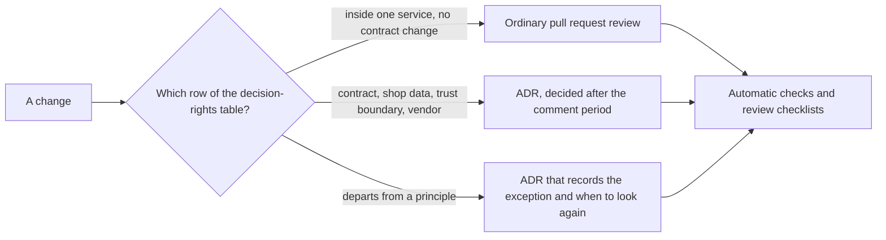

## Before you start

- [[management.l3.proposing-an-adr]] — you know that a new ADR is a pull request with a comment deadline, and that the named decider decides when it ends.
- [[design.l4.mapping-fitness-functions]] — you know that `fitness-functions.md` lists each quality attribute next to the check that guards it, and records what no check guards.
- [[backend.l4.backend-review-checklist]] — you know that each question in `backend-review-checklist.md` names the document or ADR holding the expected answer, or the check that answers it.
- [[k8s.l4.cluster-review-checklist]] — you know the same idea for cluster changes.

## The situation

At stage-4, two pull requests wait on the same morning. In yours, you split one class inside Payments; nothing outside Payments changes. In a colleague's, Notifications reads a table in Payments' database directly, to avoid adding a message. Someone proposes that the team lead approve the design of every change before it merges, so a change like the second never slips through. The team lead answers that your pull request would then wait for an approval it does not need, and that a hurried approval might still miss the second. How does Đơn Hàng keep its architecture on course without one person approving every change?

## Core concepts

- **architecture governance** — how an organisation makes sure architecture decisions are taken by the right people, recorded and followed; lightweight governance does it with a few written rules, not an approval step for every change.
- **architecture principle** — a short rule drawn from the architectural drivers, through the decisions already taken because of them, stated with its reason and what it implies, such as Đơn Hàng's NT1: each service owns its data.
- decision rights — a table saying, for each kind of decision, who takes it, whether it needs an ADR, and whom it must ask.
- checks in place of approval — the automatic checks of `fitness-functions.md`, run on every change, plus the review checklists, used when a backend design or a cluster change is reviewed, for what no check sees.
- an exception — an ADR that records which principle a change departs from, why, and when to look at it again.

## How it works



In the situation above, both pull requests start at the same question: which row of the decision-rights table does this change fall in? Neither starts at "who approves it".

Your change sits on the top branch. It stays inside Payments and changes no contract, so the person doing it decides, through an ordinary pull request review.

The middle branch takes changes to a contract, such as dropping a field of `POST /api/v1/orders`, and changes to shop data, permissions, keys or a trust boundary, or adding a vendor or paid service. Each needs an ADR and names whom to ask; the table below shows who decides.

Your colleague's change goes down the bottom branch. Reading another service's table departs from NT1, and the decision-rights table (shown below) has a row saying that takes an ADR recording the exception and when to look at it again. The team lead decides it after the comment period, and asks whoever owns the affected part. An accepted exception is listed in the governance document's "Ngoại lệ" table, which names the principle, so the rule and its exceptions are seen together.

All three branches end in the same place. Whatever a machine can check is checked on every change. Whatever no check sees, the review checklists ask when the design is reviewed. NT1 is of the second kind: `fitness-functions.md` records that `ModuleBoundaryTests`, which reads the references between assemblies, cannot see a database connection. Your colleague's change touches data across a boundary, so its backend design is reviewed, and `backend-review-checklist.md` asks that question there.

## In the Đơn Hàng system

The principles and the decision rights:

```markdown file=docs/team/architecture-governance.md tag=stage-4 lines=8-29
### Nguyên tắc kiến trúc

Mỗi nguyên tắc là một luật ngắn, rút từ các quyết định đã có, kèm lý do và điều
nó kéo theo. Muốn làm khác một nguyên tắc thì theo mục Ngoại lệ.

| Số | Nguyên tắc | Lý do | Hệ quả | Nguồn |
|---|---|---|---|---|
| NT1 | Mỗi service sở hữu dữ liệu của mình; không service nào đọc hay ghi bảng của service khác | Dữ liệu có đúng một chủ thì khi các bản sao lệch nhau, biết tin ai | Cần dữ liệu của service khác thì hỏi qua lời gọi hoặc message, hoặc giữ một bản sao có cách cập nhật nói rõ | `docs/design/data-ownership.md`, ADR 0002, 0003 |
| NT2 | Service nói chuyện với nhau qua message có hợp đồng được test, không qua một project chung chứa domain | Một project domain dùng chung buộc các service deploy cùng nhau mỗi khi nó đổi | Mỗi service giữ bản sao hình dạng message của mình; `OrderMessageContractTests` hỏng ngay trong pull request đổi một bên mà không đổi bên kia | `DonHang.Tests/Messaging/OrderMessageContractTests.cs` |
| NT3 | Mọi cửa hàng được phục vụ từ một bản triển khai; cô lập giữa cửa hàng nằm trong dữ liệu | Mở cửa hàng và cấu hình cửa hàng không cần deploy, chi phí vận hành không nhân theo số cửa hàng | Mỗi request, mỗi dòng dữ liệu và mỗi message phải biết nó thuộc cửa hàng nào | ADR 0012, 0013 |
| NT4 | Mọi thay đổi production đi qua repo cấu hình, theo chiến lược phát hành của thành phần đó | Một bản phát hành hỏng chạm tới mọi cửa hàng cùng lúc, nên thay đổi phải có dấu vết và quay lại được | Không sửa tay trên cluster production; api phát hành bằng canary, Notifications và Payments bằng rolling update | ADR 0019 |
| NT5 | Không thêm lớp trừu tượng cho một nhu cầu chưa có | Lớp thêm vào có giá trả ngay ở mỗi lần đọc và sửa code, còn nhu cầu có thể không bao giờ tới | Đề xuất một lớp như vậy cần chỉ ra nhu cầu đang có, không phải nhu cầu có thể có | ADR 0011 |

### Ai quyết định gì

| Loại quyết định | Ví dụ | Ai quyết (vai trò) | Cần ADR? | Phải hỏi ai |
|---|---|---|---|---|
| Thay đổi bên trong một module hay một service, không đổi hợp đồng | Đổi cách Catalog đọc cache, tách một lớp trong Payments | Người làm, qua review pull request như thường | Không | Người review pull request |
| Đổi hợp đồng của API công khai hoặc của một message | Bỏ một field của `POST /api/v1/orders`, đổi tên một thuộc tính của `OrderMessage` | Trưởng nhóm, sau thời gian góp ý | Có | Người phụ trách mỗi bên đọc hợp đồng đó (app, service nhận message) |
| Đổi dữ liệu của cửa hàng, quyền, khóa hoặc trust boundary | Thêm `shop_id` vào một bảng, thêm role ở Keycloak, đổi nơi giữ khóa ký | Trưởng nhóm | Có, đối chiếu `docs/design/threat-model.md` | Lập trình viên phụ trách nền tảng, product owner nếu cửa hàng thấy được |
| Thêm một thành phần tự chạy, một vendor hoặc một dịch vụ trả phí | Dịch vụ gửi email (ADR 0024) | Trưởng nhóm, cùng product owner | Có, kèm một lần đánh giá như `payment-gateway-evaluation.md` | Product owner |
| Làm khác một nguyên tắc ở trên | Một service đọc thẳng bảng của service khác trong một thời gian | Trưởng nhóm | Có: ADR ghi ngoại lệ và thời điểm xem lại | Người phụ trách phần bị ảnh hưởng |
```

Lines 10–11 ("Mỗi nguyên tắc là một luật ngắn…") give the form of a principle: a short rule drawn from decisions already made, which were themselves taken because of the drivers, with its reason and what it implies. Each row NT1–NT5 has all three, plus its source. NT1's reason is the useful part: with exactly one owner, you know whose copy to trust when copies disagree. Its "Hệ quả" column follows from that: another service may keep a copy, as long as it states how the copy is updated. NT5's source is ADR `0011`, a rejected ADR.

Lines 25–29 are the decision rights. Line 25 ("Thay đổi bên trong…") is your pull request: no ADR. Lines 26–28 need an ADR and name whom to ask. Line 28 ("Thêm một thành phần…") makes the product owner, the person who answers for what the product offers shops, a second decider next to the team lead; it points to `payment-gateway-evaluation.md`, the earlier comparison of payment gateways. Line 27 ("Đổi dữ liệu của cửa hàng…") also asks the product owner when shops can see the change. Line 29 ("Làm khác một nguyên tắc…") is your colleague's change.

What replaces approval, and where exceptions go:

```markdown file=docs/team/architecture-governance.md tag=stage-4 lines=31-51
### Phép kiểm thay cho duyệt

Luật nào máy kiểm được thì để máy kiểm, trên mọi thay đổi, không chờ một người
duyệt từng lần:

- Các phép kiểm tự động trong `fitness-functions.md`.
- `docs/design/backend-review-checklist.md` khi review thiết kế backend.
- `docs/design/cluster-review-checklist.md` khi review thay đổi tới cluster.

Đội không có hội đồng duyệt kiến trúc riêng: quyết định cần ADR đi theo quy
trình trong `docs/adr/README.md`. Khi có nhiều đội, bảng "Ai quyết định gì"
được xem lại, vì "người phụ trách bên đọc" khi đó có thể là một đội khác.

### Ngoại lệ

Mỗi ngoại lệ là một ADR ghi nguyên tắc bị làm khác, lý do và hạn xem lại, và
được liệt kê ở đây để luật và ngoại lệ của nó cùng nhìn thấy.

| ADR | Nguyên tắc | Ngoại lệ | Hạn xem lại |
|---|---|---|---|
| (chưa có ngoại lệ nào) | | | |
```

Lines 33–38 ("Luật nào máy kiểm được…") hand rules to the checks in `fitness-functions.md`, run on every change, and to the two review checklists, each used for its kind of review. Lines 40–42 ("Đội không có hội đồng…") say there is no separate architecture review board, and the decision-rights table is looked at again when there are several teams. Lines 46–47 ("Mỗi ngoại lệ…") give an exception its three parts and list it in this "Ngoại lệ" table. Line 51 shows that, at stage-4, none is recorded yet.

## Trade-offs

| Way to keep the architecture on course | Wait added to an ordinary change | What holds a principle on every change | Where exceptions are seen | Fits when |
|---|---|---|---|---|
| A board approves every design before work starts | every change waits for the board | the board's attention, which thins as changes pile up | in the board's notes, if it keeps any | very few changes, each costly to get wrong |
| Principles, decision rights and checks, as in Đơn Hàng | none for changes inside one service; an ADR's comment period for the rest | automatic checks, and checklist questions for what no check sees | in the governance document's "Ngoại lệ" table | many small changes, a few kinds that are costly |
| Nothing written; each reviewer judges | none | each reviewer's memory and taste | nowhere | a very small team that shares every decision in conversation |

The board is slow on the changes that do not need it, and still depends on someone noticing. Writing nothing is fast, but a rule nobody wrote down is easy to break without anyone noticing, and nobody can say later which breaks were agreed. The written rules spend a person's time only where the table asks for an ADR.

## What would you choose if…

…a principle can be stated exactly enough for a machine, as NT2 can? Leave it to the check. `OrderMessageContractTests` fails in the pull request that changes one side of a message without the other, so nobody has to check by hand that both sides changed together; a change to the message contract itself still takes the contract row's ADR.

…a kind of change is costly to get wrong and no check sees it, such as moving a trust boundary? Give that kind of change its own row needing an ADR, as line 27 (the "Đổi dữ liệu của cửa hàng…" row) does, and keep the other rows light.

…a second team starts changing the same modules? Look at the decision-rights table again, as lines 41–42 ("Khi có nhiều đội…") say: "whoever owns the side that reads the contract" may now be another team, and whom to ask changes with it.

## Seniors often assume…

- **"Governance means a board of architects that approves every design before work starts."** → Actually governance is making sure decisions are taken by the right people, recorded and followed; a board is one way, and Đơn Hàng has none. You notice this belief when small pull requests queue for days behind a design meeting while the risky ones still get through.
- **"Architecture principles are slogans, so they need no reasons attached."** → Actually a principle without its reason is hard to apply to a case nobody foresaw. NT1's reason, knowing whom to trust when copies disagree, is why its "Hệ quả" allows a cached copy only with a stated way to update it from the owner. You notice this belief when two people quote the same principle to argue opposite sides.
- **"A principle that allows exceptions is not worth writing down."** → Actually exceptions happen either way; writing them as ADRs, with a date to look again, keeps the rule and its exceptions both visible. You notice this belief when a principle is quietly broken in several places and nobody can say which breaks were agreed.

## Try it (3 minutes)

Open `docs/team/architecture-governance.md` in the `don-hang` repository at tag `stage-4`. For each change, write the row of "Ai quyết định gì" it falls in, who decides, whether it needs an ADR, and whom to ask:

1. Change how Catalog reads its cache.
2. Drop a field of `POST /api/v1/orders`.
3. Let Payments read a table of Notifications for one month.
4. Add a paid service that sends text messages to customers.

Expected result: four lines; only the first needs no ADR, and the third also names the section where its ADR is listed.

<details><summary>Suggested answer</summary>

1. Change inside a module, no contract change: the person doing it, through an ordinary pull request review; no ADR; ask the pull request's reviewer.
2. Change to a public API's contract: the team lead, after the comment period; ADR; ask the owners of each side that reads it, here the app.
3. Departing from NT1: the team lead; an ADR recording the exception and when to look again; ask whoever owns the affected part. Once accepted, it is listed under "Ngoại lệ".
4. A paid service: the team lead with the product owner; an ADR with an evaluation like `payment-gateway-evaluation.md`, the comparison of payment gateways; ask the product owner.

</details>

## Connections

- [[management.l3.proposing-an-adr]] — the process every ADR row follows.
- [[design.l4.mapping-fitness-functions]] — the checks machine-checkable rules are handed to.
- [[backend.l4.backend-review-checklist]] — where rules no check sees are asked in review.
- [[k8s.l4.cluster-review-checklist]] — the same role for cluster changes.
- [[backend.l4.data-ownership]] — the idea behind NT1, one layer down.
- [[design.l4.over-abstraction]] — the problem NT5 guards against.
- [[management.l3.superseding-an-adr]] — how a principle's source changes: a new ADR, never a rewritten one.
- [[design.l4.conways-law]] — why the decision-rights table is looked at again when teams change.
- [[management.l4.weighted-scoring-matrix]] — next: comparing options once a decision needs an ADR.

## Five-line summary

1. Lightweight architecture governance keeps decisions with the right people through a few written rules, not an approval for every change.
2. An architecture principle is a short rule drawn from the drivers through decisions already made, stated with its reason and what it implies.
3. A decision-rights table says which changes need only a pull request review, which need an ADR, and whom each must ask.
4. Checks on every change hold what a machine can check; review checklists ask the rest when a backend design or cluster change is reviewed.
5. Breaking a principle takes an ADR that records the exception and when to look again, listed in the same document as the rule.
