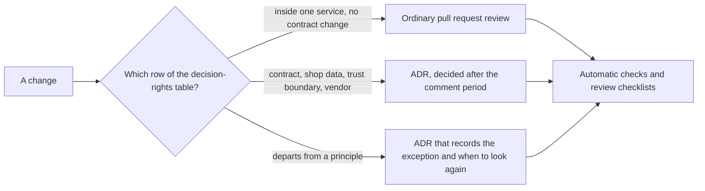

## Bạn cần biết trước

- [[management.l3.proposing-an-adr]] — bạn biết một ADR mới là một pull request có hạn góp ý, và khi hết hạn thì người quyết định được ghi tên sẽ chốt.
- [[design.l4.mapping-fitness-functions]] — bạn biết `fitness-functions.md` đặt mỗi thuộc tính chất lượng cạnh phép kiểm canh giữ nó, và ghi lại cả những gì chưa phép kiểm nào canh.
- [[backend.l4.backend-review-checklist]] — bạn biết mỗi câu hỏi trong `backend-review-checklist.md` chỉ ra tài liệu hay ADR chứa câu trả lời mong đợi, hoặc phép kiểm trả lời nó.
- [[k8s.l4.cluster-review-checklist]] — bạn biết cùng ý đó cho các thay đổi tới cluster.

## Tình huống

Ở stage-4, có hai pull request cùng chờ trong một buổi sáng. Pull request của bạn tách một lớp bên trong Payments, ngoài Payments không có gì đổi. Pull request của một đồng nghiệp cho Notifications đọc thẳng một bảng trong database của Payments, để khỏi phải thêm một message. Có người đề xuất rằng trưởng nhóm duyệt thiết kế của mọi thay đổi trước khi merge, để một thay đổi như cái thứ hai không lọt qua. Trưởng nhóm trả lời rằng như thế thì pull request của bạn phải chờ một lần duyệt nó không cần, còn một lần duyệt vội vẫn có thể bỏ sót cái thứ hai. Vậy Đơn Hàng giữ kiến trúc đi đúng hướng bằng cách nào, khi không có một người duyệt từng thay đổi?

## Khái niệm cốt lõi

- **quản trị kiến trúc** (architecture governance) — cách một tổ chức bảo đảm các quyết định kiến trúc do đúng người đưa ra, được ghi lại và được tuân theo. Quản trị kiến trúc nhẹ làm điều đó bằng vài luật viết ra, không phải bằng một bước duyệt cho mỗi thay đổi.
- **nguyên tắc kiến trúc** (architecture principle) — một luật ngắn rút từ các yếu tố định hình kiến trúc, thông qua những quyết định đã đưa ra vì chúng, ghi kèm lý do và điều nó kéo theo, chẳng hạn NT1 của Đơn Hàng: mỗi service sở hữu dữ liệu của mình.
- quyền quyết định — một bảng nói, với mỗi loại quyết định, ai quyết, có cần ADR không, và phải hỏi ai.
- phép kiểm thay cho duyệt — các phép kiểm tự động trong `fitness-functions.md`, chạy trên mọi thay đổi, cộng với các review checklist, dùng khi review thiết kế backend hay thay đổi tới cluster, cho những gì không phép kiểm nào thấy.
- ngoại lệ — một ADR ghi thay đổi làm khác nguyên tắc nào, vì sao, và khi nào xem lại.

## Cơ chế hoạt động



Trong tình huống trên, cả hai pull request bắt đầu từ cùng một câu hỏi: thay đổi này rơi vào dòng nào của bảng quyền quyết định? Không cái nào bắt đầu từ câu "ai duyệt nó".

Thay đổi của bạn đi nhánh trên cùng. Nó nằm gọn trong Payments và không đổi hợp đồng nào, nên người làm tự quyết, qua một lần review pull request như thường.

Nhánh giữa nhận các thay đổi hợp đồng, như bỏ một field của `POST /api/v1/orders`, các thay đổi về dữ liệu của cửa hàng, quyền, khóa hay một ranh giới tin cậy, và việc thêm một vendor hay dịch vụ trả phí. Mỗi loại cần một ADR và ghi rõ phải hỏi ai. Bảng bên dưới cho biết ai quyết.

Thay đổi của đồng nghiệp đi nhánh dưới. Đọc bảng của service khác là làm khác NT1, và bảng quyền quyết định (xem bên dưới) có một dòng nói trường hợp này cần một ADR ghi ngoại lệ và thời điểm xem lại. Trưởng nhóm quyết sau thời gian góp ý, và hỏi người phụ trách phần bị ảnh hưởng. Ngoại lệ đã được chấp nhận thì được liệt kê trong bảng "Ngoại lệ" của tài liệu quản trị kiến trúc, bảng này ghi tên nguyên tắc, nên luật và các ngoại lệ của nó được nhìn thấy cùng nhau.

Cả ba nhánh kết thúc ở cùng một chỗ. Điều gì máy kiểm được thì được kiểm trên mọi thay đổi. Điều gì không phép kiểm nào thấy thì review checklist hỏi khi review thiết kế. NT1 thuộc loại thứ hai: `fitness-functions.md` ghi rằng `ModuleBoundaryTests`, phép kiểm đọc các tham chiếu giữa các assembly, không thấy được một kết nối database. Thay đổi của đồng nghiệp chạm vào dữ liệu vượt qua một ranh giới, nên thiết kế backend của nó được review, và `backend-review-checklist.md` hỏi đúng câu đó ở đấy.

## Trong hệ thống Đơn Hàng

Các nguyên tắc và quyền quyết định:

```markdown file=docs/team/architecture-governance.md tag=stage-4 lines=8-29
### Nguyên tắc kiến trúc

Mỗi nguyên tắc là một luật ngắn, rút từ các quyết định đã có, kèm lý do và điều
nó kéo theo. Muốn làm khác một nguyên tắc thì theo mục Ngoại lệ.

| Số | Nguyên tắc | Lý do | Hệ quả | Nguồn |
|---|---|---|---|---|
| NT1 | Mỗi service sở hữu dữ liệu của mình; không service nào đọc hay ghi bảng của service khác | Dữ liệu có đúng một chủ thì khi các bản sao lệch nhau, biết tin ai | Cần dữ liệu của service khác thì hỏi qua lời gọi hoặc message, hoặc giữ một bản sao có cách cập nhật nói rõ | `docs/design/data-ownership.md`, ADR 0002, 0003 |
| NT2 | Service nói chuyện với nhau qua message có hợp đồng được test, không qua một project chung chứa domain | Một project domain dùng chung buộc các service deploy cùng nhau mỗi khi nó đổi | Mỗi service giữ bản sao hình dạng message của mình; `OrderMessageContractTests` hỏng ngay trong pull request đổi một bên mà không đổi bên kia | `DonHang.Tests/Messaging/OrderMessageContractTests.cs` |
| NT3 | Mọi cửa hàng được phục vụ từ một bản triển khai; cô lập giữa cửa hàng nằm trong dữ liệu | Mở cửa hàng và cấu hình cửa hàng không cần deploy, chi phí vận hành không nhân theo số cửa hàng | Mỗi request, mỗi dòng dữ liệu và mỗi message phải biết nó thuộc cửa hàng nào | ADR 0012, 0013 |
| NT4 | Mọi thay đổi production đi qua repo cấu hình, theo chiến lược phát hành của thành phần đó | Một bản phát hành hỏng chạm tới mọi cửa hàng cùng lúc, nên thay đổi phải có dấu vết và quay lại được | Không sửa tay trên cluster production; api phát hành bằng canary, Notifications và Payments bằng rolling update | ADR 0019 |
| NT5 | Không thêm lớp trừu tượng cho một nhu cầu chưa có | Lớp thêm vào có giá trả ngay ở mỗi lần đọc và sửa code, còn nhu cầu có thể không bao giờ tới | Đề xuất một lớp như vậy cần chỉ ra nhu cầu đang có, không phải nhu cầu có thể có | ADR 0011 |

### Ai quyết định gì

| Loại quyết định | Ví dụ | Ai quyết (vai trò) | Cần ADR? | Phải hỏi ai |
|---|---|---|---|---|
| Thay đổi bên trong một module hay một service, không đổi hợp đồng | Đổi cách Catalog đọc cache, tách một lớp trong Payments | Người làm, qua review pull request như thường | Không | Người review pull request |
| Đổi hợp đồng của API công khai hoặc của một message | Bỏ một field của `POST /api/v1/orders`, đổi tên một thuộc tính của `OrderMessage` | Trưởng nhóm, sau thời gian góp ý | Có | Người phụ trách mỗi bên đọc hợp đồng đó (app, service nhận message) |
| Đổi dữ liệu của cửa hàng, quyền, khóa hoặc trust boundary | Thêm `shop_id` vào một bảng, thêm role ở Keycloak, đổi nơi giữ khóa ký | Trưởng nhóm | Có, đối chiếu `docs/design/threat-model.md` | Lập trình viên phụ trách nền tảng, product owner nếu cửa hàng thấy được |
| Thêm một thành phần tự chạy, một vendor hoặc một dịch vụ trả phí | Dịch vụ gửi email (ADR 0024) | Trưởng nhóm, cùng product owner | Có, kèm một lần đánh giá như `payment-gateway-evaluation.md` | Product owner |
| Làm khác một nguyên tắc ở trên | Một service đọc thẳng bảng của service khác trong một thời gian | Trưởng nhóm | Có: ADR ghi ngoại lệ và thời điểm xem lại | Người phụ trách phần bị ảnh hưởng |
```

Dòng 10–11 ("Mỗi nguyên tắc là một luật ngắn…") cho hình dạng của một nguyên tắc: một luật ngắn rút từ các quyết định đã có, mà chính các quyết định ấy được đưa ra vì các yếu tố định hình kiến trúc, kèm lý do và điều nó kéo theo. Mỗi dòng NT1–NT5 có đủ ba phần, cộng thêm nguồn. Lý do của NT1 là phần đáng chú ý: dữ liệu có đúng một chủ thì khi các bản sao lệch nhau, bạn biết tin bản nào. Cột "Hệ quả" của nó đi ra từ đó: service khác được giữ một bản sao, miễn là nói rõ bản sao được cập nhật thế nào. Nguồn của NT5 là ADR `0011`, một ADR bị từ chối.

Dòng 25–29 là quyền quyết định. Dòng 25 ("Thay đổi bên trong…") là pull request của bạn: không cần ADR. Dòng 26–28 cần ADR và ghi rõ phải hỏi ai. Dòng 28 ("Thêm một thành phần…") đặt product owner, người chịu trách nhiệm về những gì sản phẩm mang tới cho các cửa hàng, làm người quyết thứ hai bên cạnh trưởng nhóm. Dòng này trỏ tới `payment-gateway-evaluation.md`, bản so sánh trước đây giữa các dịch vụ bên ngoài nhận thanh toán. Dòng 27 ("Đổi dữ liệu của cửa hàng…") cũng hỏi product owner khi cửa hàng thấy được thay đổi. Dòng 29 ("Làm khác một nguyên tắc…") là thay đổi của đồng nghiệp.

Thứ thay cho duyệt, và nơi ghi ngoại lệ:

```markdown file=docs/team/architecture-governance.md tag=stage-4 lines=31-51
### Phép kiểm thay cho duyệt

Luật nào máy kiểm được thì để máy kiểm, trên mọi thay đổi, không chờ một người
duyệt từng lần:

- Các phép kiểm tự động trong `fitness-functions.md`.
- `docs/design/backend-review-checklist.md` khi review thiết kế backend.
- `docs/design/cluster-review-checklist.md` khi review thay đổi tới cluster.

Đội không có hội đồng duyệt kiến trúc riêng: quyết định cần ADR đi theo quy
trình trong `docs/adr/README.md`. Khi có nhiều đội, bảng "Ai quyết định gì"
được xem lại, vì "người phụ trách bên đọc" khi đó có thể là một đội khác.

### Ngoại lệ

Mỗi ngoại lệ là một ADR ghi nguyên tắc bị làm khác, lý do và hạn xem lại, và
được liệt kê ở đây để luật và ngoại lệ của nó cùng nhìn thấy.

| ADR | Nguyên tắc | Ngoại lệ | Hạn xem lại |
|---|---|---|---|
| (chưa có ngoại lệ nào) | | | |
```

Dòng 33–38 ("Luật nào máy kiểm được…") giao luật cho các phép kiểm trong `fitness-functions.md`, chạy trên mọi thay đổi, và cho hai review checklist, mỗi cái dùng cho loại review của nó. Dòng 40–42 ("Đội không có hội đồng…") nói không có hội đồng duyệt kiến trúc riêng, và bảng quyền quyết định được xem lại khi có nhiều đội. Dòng 46–47 ("Mỗi ngoại lệ…") cho một ngoại lệ ba phần của nó và liệt kê nó trong bảng "Ngoại lệ" này. Dòng 51 cho thấy ở stage-4 chưa có ngoại lệ nào được ghi.

## Đánh đổi

| Cách giữ kiến trúc đi đúng hướng | Thời gian chờ thêm cho một thay đổi bình thường | Thứ giữ một nguyên tắc trên mọi thay đổi | Ngoại lệ được nhìn thấy ở đâu | Hợp khi |
|---|---|---|---|---|
| Một hội đồng duyệt mọi thiết kế trước khi bắt tay làm | mọi thay đổi chờ hội đồng | sự chú ý của hội đồng, càng loãng khi thay đổi dồn lại | trong biên bản của hội đồng, nếu có ghi | rất ít thay đổi, mỗi cái làm sai đều tốn kém |
| Nguyên tắc, quyền quyết định và phép kiểm, như ở Đơn Hàng | không có với thay đổi bên trong một service, thời gian góp ý của ADR với phần còn lại | phép kiểm tự động, và câu hỏi trong checklist cho những gì không phép kiểm nào thấy | trong bảng "Ngoại lệ" của tài liệu quản trị kiến trúc | nhiều thay đổi nhỏ, vài loại tốn kém |
| Không viết gì, mỗi người review tự phán đoán | không có | trí nhớ và khẩu vị của từng người review | không ở đâu cả | một đội rất nhỏ, chia sẻ mọi quyết định qua trò chuyện |

Hội đồng chậm với những thay đổi không cần tới nó, mà vẫn phụ thuộc vào chuyện có ai đó để ý. Không viết gì thì nhanh, nhưng một luật không ai viết ra rất dễ bị phá mà không ai nhận thấy, và về sau không ai nói được lần phá nào đã được đồng ý. Luật viết ra chỉ tốn thời gian của người ở đúng những chỗ bảng đòi một ADR.

## Bạn sẽ chọn gì nếu…

…một nguyên tắc nói được đủ chính xác để máy kiểm, như NT2? Để phép kiểm lo. `OrderMessageContractTests` hỏng ngay trong pull request đổi một bên của message mà không đổi bên kia, nên không ai phải kiểm bằng tay rằng hai bên đã đổi cùng nhau. Còn đổi chính hợp đồng message thì vẫn cần ADR của dòng hợp đồng.

…một loại thay đổi làm sai thì tốn kém mà không phép kiểm nào thấy, như dời một ranh giới tin cậy? Cho loại thay đổi đó một dòng riêng cần ADR, như dòng 27 (dòng "Đổi dữ liệu của cửa hàng…"), và giữ các dòng khác nhẹ.

…một đội thứ hai bắt đầu sửa cùng các module? Xem lại bảng quyền quyết định, như dòng 41–42 ("Khi có nhiều đội…") nói: "người phụ trách bên đọc hợp đồng" giờ có thể là một đội khác, và người phải hỏi cũng đổi theo.

## Senior hay nhầm rằng…

- **"Quản trị kiến trúc nghĩa là một hội đồng kiến trúc sư duyệt mọi thiết kế trước khi bắt tay làm."** → Thực ra quản trị kiến trúc là bảo đảm quyết định do đúng người đưa ra, được ghi lại và được tuân theo. Hội đồng chỉ là một lựa chọn, và Đơn Hàng không có hội đồng nào. Bạn sẽ nhận ra niềm tin này khi các pull request nhỏ xếp hàng nhiều ngày sau một buổi họp thiết kế, trong khi những cái rủi ro vẫn lọt qua.
- **"Nguyên tắc kiến trúc là khẩu hiệu, nên không cần kèm lý do."** → Thực ra một nguyên tắc thiếu lý do thì khó áp vào trường hợp không ai lường trước. Lý do của NT1, biết tin ai khi các bản sao lệch nhau, là điều khiến cột "Hệ quả" của nó chỉ cho phép một bản sao cache khi nói rõ cách cập nhật nó từ chủ dữ liệu. Bạn sẽ nhận ra niềm tin này khi hai người trích cùng một nguyên tắc để bảo vệ hai phía ngược nhau.
- **"Nguyên tắc mà cho phép ngoại lệ thì không đáng viết ra."** → Thực ra ngoại lệ đằng nào cũng xảy ra. Ghi chúng thành ADR, kèm ngày xem lại, giữ cho cả luật lẫn ngoại lệ của nó đều được nhìn thấy. Bạn sẽ nhận ra niềm tin này khi một nguyên tắc lặng lẽ bị phá ở nhiều chỗ và không ai nói được lần phá nào đã được đồng ý.

## Thử ngay (3 phút)

Mở `docs/team/architecture-governance.md` trong repository `don-hang` ở tag `stage-4`. Với mỗi thay đổi dưới đây, ghi nó rơi vào dòng nào của "Ai quyết định gì", ai quyết, có cần ADR không, và phải hỏi ai:

1. Đổi cách Catalog đọc cache.
2. Bỏ một field của `POST /api/v1/orders`.
3. Cho Payments đọc một bảng của Notifications trong một tháng.
4. Thêm một dịch vụ trả phí gửi tin nhắn điện thoại cho khách hàng.

Kết quả mong đợi: bốn dòng. Chỉ thay đổi đầu tiên không cần ADR, và dòng thứ ba còn ghi mục nơi ADR của nó được liệt kê.

<details><summary>Gợi ý đáp án</summary>

1. Thay đổi bên trong một module, không đổi hợp đồng: người làm quyết, qua review pull request như thường. Không cần ADR. Hỏi người review pull request.
2. Đổi hợp đồng của API công khai: trưởng nhóm, sau thời gian góp ý. Cần ADR. Hỏi người phụ trách mỗi bên đọc hợp đồng đó, ở đây là app.
3. Làm khác NT1: trưởng nhóm. Cần một ADR ghi ngoại lệ và thời điểm xem lại. Hỏi người phụ trách phần bị ảnh hưởng. Khi được chấp nhận, nó được liệt kê ở mục "Ngoại lệ".
4. Một dịch vụ trả phí: trưởng nhóm cùng product owner. Cần ADR kèm một lần đánh giá như `payment-gateway-evaluation.md`, bản so sánh các dịch vụ bên ngoài nhận thanh toán. Hỏi product owner.

</details>

## Liên hệ

- [[management.l3.proposing-an-adr]] — quy trình mà mọi dòng cần ADR đi theo.
- [[design.l4.mapping-fitness-functions]] — các phép kiểm nhận những luật máy kiểm được.
- [[backend.l4.backend-review-checklist]] — nơi những luật không phép kiểm nào thấy được hỏi khi review.
- [[k8s.l4.cluster-review-checklist]] — cùng vai trò đó cho thay đổi tới cluster.
- [[backend.l4.data-ownership]] — ý tưởng đứng sau NT1, ở tầng thấp hơn một bậc.
- [[design.l4.over-abstraction]] — vấn đề mà NT5 canh giữ.
- [[management.l3.superseding-an-adr]] — cách nguồn của một nguyên tắc thay đổi: một ADR mới, không bao giờ viết lại ADR cũ.
- [[design.l4.conways-law]] — vì sao bảng quyền quyết định được xem lại khi các đội thay đổi.
- [[management.l4.weighted-scoring-matrix]] — bài tiếp: so sánh các phương án khi một quyết định cần ADR.

## Tóm tắt 5 dòng

1. Quản trị kiến trúc nhẹ giữ quyết định ở đúng người bằng vài luật viết ra, không phải bằng một lần duyệt cho mỗi thay đổi.
2. Một nguyên tắc kiến trúc là luật ngắn rút từ các yếu tố định hình kiến trúc, qua những quyết định đã có, ghi kèm lý do và điều nó kéo theo.
3. Bảng quyền quyết định nói thay đổi nào chỉ cần review pull request, thay đổi nào cần ADR, và mỗi cái phải hỏi ai.
4. Phép kiểm trên mọi thay đổi giữ những gì máy kiểm được, còn review checklist hỏi phần còn lại khi review thiết kế backend hay thay đổi tới cluster.
5. Làm khác một nguyên tắc cần một ADR ghi ngoại lệ và thời điểm xem lại, được liệt kê trong cùng tài liệu với luật.
