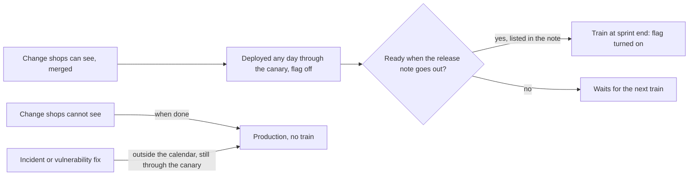

## Before you start

- [[management.l4.roadmap]] — you know the roadmap orders outcomes by horizon; this lesson decides when a finished outcome actually reaches the shops.
- [[devops.l4.feature-flags]] — you know a feature flag lets code reach production switched off and be turned on later without a deploy.
- [[devops.l4.release-strategy-per-component]] — you know ADR `0019` sends every api change through canary steps and puts changes customers see behind a flag.
- [[devops.l2.changelog]] — you know a changelog tells the people using the software what changed, in their terms.

## The situation

Suppose shops have started to see the first features built after stage-4. The team deploys through the canary several times a week, but every shop has staff to brief before a change appears on its screens. A developer asks to switch a finished change on today. Another change, more important, is two days from done, and the person who decides what the team builds next asks whether everything else can wait for it. The shops ask one thing: when. What rule tells the 1,000 shops Đơn Hàng assumes it will serve when changes reach them, without one late change holding back the rest?

## Core concepts

- **release train** — releasing changes on fixed, published dates: whatever is ready when the train leaves goes, and anything not ready waits for the next train instead of delaying it.
- train — one of those dates; in Đơn Hàng, the end of every two-week sprint.
- release, in this lesson — turning on the flag of a change shops can see; deploying its code is a separate step.
- release note — the message telling shops what a train will turn on, sent a set number of working days before the train.
- out-of-calendar release — a fix for an incident or a vulnerability that does not wait for a train, made by a role the calendar names.

## How it works



At stage-4 this is still a convention: the Đơn Hàng API has no flag yet, and `FeatureFlags` from the feature-flags lesson lives in the samples project. The calendar sets the rule for the first feature shops will see.

Start with the code. Both changes in the situation can reach production on any day, through the canary of ADR `0019` (for the api; Notifications and Payments roll out with a rolling update), behind a flag that is off. Deploying is the team's business.

Releasing is the shops' business, so it follows the calendar. A train leaves at the end of every two-week sprint and turns flags on. Five working days earlier, the release note goes to the shops so they can brief their staff and their own customers. A change not ready by then, meaning not in production, not through every canary step, or not in the note, takes the next train.

The train cannot wait, because the shops have planned around its date. Moving it for one change breaks that plan for every change on the train and for every shop.

Not everything rides the train. Changes shops cannot see, such as internal fixes and library upgrades, go to production when done. Fixes for an incident or a vulnerability do not wait either. Shops need a fix as soon as it exists, not behind a flag until a train, so the calendar calls shipping one a release outside the calendar and names who may make it.

The price is speed. A change that misses a train waits two weeks for the next one; because readiness is judged when the note goes out, five working days earlier, a change finished just after a note can wait close to three weeks.

## In the Đơn Hàng system

The rule and the train itself, from `docs/team/release-calendar.md`:

```markdown file=docs/team/release-calendar.md tag=stage-4 lines=7-29
Lịch này chạy theo kiểu release train: phát hành vào những ngày cố định, công
bố trước. Thay đổi nào sẵn sàng khi chuyến khởi hành thì đi; thay đổi chưa sẵn
sàng chờ chuyến sau, chuyến không chờ nó.

### Chuyến phát hành

- Một chuyến vào cuối mỗi sprint hai tuần.
- Chuyến chỉ dành cho thay đổi cửa hàng thấy được. Phát hành ở đây nghĩa là
  bật feature flag của thay đổi đó theo `feature-flags.md`, không phải deploy.
- Code vẫn lên production bất kỳ ngày nào, qua canary của ADR 0019, với flag
  đang tắt. Deploy và phát hành tách nhau: deploy là việc của đội, phát hành là
  việc cửa hàng được báo trước.
- Thay đổi cửa hàng không thấy (sửa bên trong, nâng thư viện, thay đổi nền
  tảng) không đi theo chuyến; chúng lên production khi xong.

### Trước mỗi chuyến

- Ghi chú phát hành của chuyến tới cửa hàng trước ngày chuyến 5 ngày làm việc,
  để cửa hàng chuẩn bị nhân viên và khách của mình.
- Thay đổi chưa sẵn sàng vào lúc đó (code chưa lên production, chưa qua đủ
  bước canary, chưa có trong ghi chú) đi chuyến sau. Chuyến không lùi ngày để
  chờ nó, vì cửa hàng đã được báo ngày đó.
- Product owner chốt danh sách thay đổi của chuyến.
```

Lines 7–9 state the rule: ready changes go, the rest wait, and the train never waits. Lines 13–20 (under "Chuyến phát hành") split deploy from release: a train is for changes shops can see, and releasing means turning on the change's flag. Lines 24–28 (under "Trước mỗi chuyến") give the five working days and the three tests of "ready", and say why the date does not move: the shops were told it. On line 29, the product owner, the person who decides what the team builds next, fixes the list for each train.

The rest of the file:

```markdown file=docs/team/release-calendar.md tag=stage-4 lines=31-54
### Ngoài lịch

Sửa một sự cố hoặc một lỗ hổng bảo mật không chờ chuyến:

- Ai được phát hành ngoài lịch: người chỉ huy sự cố trong lúc có sự cố, theo
  `incident-response.md`; trưởng nhóm với bản vá lỗ hổng không gắn với sự cố
  nào.
- Bản sửa vẫn đi qua canary của ADR 0019, kể cả khi error budget đã hết theo
  `slo.md`.
- Cách báo cửa hàng: thông báo trong ngày cho các cửa hàng bị ảnh hưởng, nói
  điều đã sửa và cửa hàng có phải làm gì không; thay đổi đó được ghi lại trong
  ghi chú của chuyến kế tiếp.

### Đổi phá vỡ

Thay đổi buộc cửa hàng phải làm khác đi (bỏ một tính năng, đổi cách dùng một
màn hình hay một API cửa hàng gọi) được báo trước ít nhất hai chuyến, trong
ghi chú phát hành của cả hai chuyến đó.

### Cái giá

Chuyến đổi tốc độ lấy sự dễ đoán: một thay đổi đã xong có thể chờ tới hai tuần
mới được bật. Cái giá đó hợp với thay đổi mà 1.000 cửa hàng (giả định) phải biết trước,
không hợp với thay đổi bên trong, nên thay đổi bên trong không đi theo chuyến.
```

Lines 33–42 (under "Ngoài lịch") cover fixes outside the calendar. During an incident the incident commander of `incident-response.md` may release; for a vulnerability fix not tied to an incident, the team lead may. An api fix still goes through the canary of ADR `0019`, even when the error budget in `slo.md` is spent. Affected shops hear the same day what was fixed and whether they must do anything, and the next train's note records it. Lines 46–48 (under "Đổi phá vỡ") add one rule for a breaking change: shops hear of it at least two trains ahead, in both notes. Lines 52–54 (under "Cái giá") name the price, which the file counts as up to two weeks from the missed train, and which changes it suits.

## Trade-offs

| How changes reach shops | What shops get | What it costs | Fits when |
|---|---|---|---|
| A train on fixed dates, deploy separate, behind flags | a known date and a note days before it | a change that misses a train waits two weeks for the next, longer if it was finished just after a note; flags to keep and remove | many users must prepare for what changes, and deploys can run apart from releases |
| Each change turned on as soon as it is done | changes as early as possible, with no set date | shops cannot plan; a surprise on a busy day may land on their staff | users need no preparation, or the change is internal |
| A release date that waits for a chosen feature | the feature they were promised, when it is done | if the feature runs late, the date moves, and every other ready change moves with it | rarely; perhaps one launch whose date is set from outside the team |

## What would you choose if…

…a change two days from done were the one a large shop was waiting for? A sensible answer keeps the train and tells the shop the change is on the next one, with its date. Lines 26–28 already decide this: it was not in the note, so it waits.

…a vulnerability were found on the morning of a train? It does not wait for the train, and the train does not wait for it. If no incident is open, the team lead releases the fix outside the calendar (during an incident it would be the incident commander), through the canary, and tells affected shops the same day (lines 35–42).

…the team switched its sprints to three weeks? The calendar ties trains to sprint ends, so a change that misses a train waits three weeks instead of two, and one finished just after a note waits nearly four. Đơn Hàng's file does not discuss this; a sensible team checks with the shops whether that wait is still acceptable before changing it.

## Seniors often assume…

- **"A release train means code is deployed only once per train."** → Actually, in Đơn Hàng's calendar the code reaches production any day through the canary, with its flag off; the train only decides when the flag is turned on. You notice this belief when a team piles two weeks of changes into one deploy on train day, and one failure blocks every change at once.
- **"The train should wait for an important feature that is nearly done."** → Actually the shops planned around the date when the release note reached them five working days earlier, so moving it breaks their plan for every change on the train. The late feature takes the next train. You notice this belief when the date slips twice and shops stop preparing for any date the team gives.
- **"Release trains only make sense for large organisations with many teams."** → Actually Đơn Hàng has a single team, and the train is there because its users, many shops, need to prepare, not because teams need to line up their work. You notice this belief when a small team turns features on whenever they are done and shops learn about changes from their own customers.

## Try it (3 minutes)

Use both excerpts. For each change, decide whether it waits for a train, and if not, who releases it.

1. A new column shops see on their order list, through every canary step, but missing from the release note sent this morning.
2. A library upgrade with no change shops can see.
3. A fix for a vulnerability found today, not tied to any incident.

Expected result: 1 waits for the next train; 2 goes to production when done, with no train; 3 does not wait, and the team lead releases it.

<details><summary>Suggested answer</summary>

1. Lines 26–28: a change not in the note takes the next train, even if its code is ready. The train keeps its date.
2. Lines 19–20: changes shops cannot see do not ride the train; they go to production when done.
3. Lines 33–37: a vulnerability fix not tied to an incident is released outside the calendar by the team lead. Lines 38–42 add that it still goes through the canary, affected shops hear about it the same day, and the next train's note records it.

</details>

## Connections

- [[management.l4.roadmap]] — the roadmap says which outcomes come first; the train says on which date a finished one reaches the shops.
- [[devops.l4.feature-flags]] — the mechanism that lets deploy and release happen on different days.
- [[devops.l4.release-strategy-per-component]] — the canary api changes go through (other components roll out with a rolling update), before and outside the train.
- [[devops.l2.changelog]] — the same idea for developers using a version; the release note is its counterpart for shops.
- [[devops.l2.semantic-versioning]] — another way to tell users what a change means for them, by its version number.
- [[devops.l4.delivery-metrics]] — under this calendar a train need not lower how often the team deploys, because code still reaches production any day.
- [[devops.l4.incident-command]] — the role that may release a fix outside the calendar during an incident.
- [[management.l2.stakeholder-communication]] — how to tell a shop its change moved to the next train.

## Five-line summary

1. A release train releases changes on fixed, published dates: what is ready goes, and what is not waits for the next train.
2. `release-calendar.md` runs a train at the end of every two-week sprint; code still reaches production any day, flag off.
3. Shops get the release note five working days before the train, which is why the train cannot wait for a late change.
4. Incident and vulnerability fixes do not wait; the calendar names who releases them and how shops are told.
5. A train trades speed for predictability, which suits changes many shops must learn about, not internal ones.
