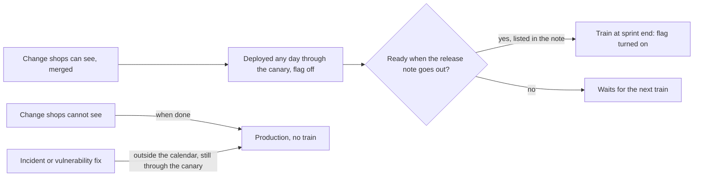

## Bạn cần biết trước

- [[management.l4.roadmap]] — bạn biết roadmap xếp các kết quả theo tầm thời gian. Bài này quyết định khi nào một kết quả đã xong thật sự tới tay cửa hàng.
- [[devops.l4.feature-flags]] — bạn biết feature flag cho code lên production ở trạng thái tắt, rồi bật sau mà không cần deploy.
- [[devops.l4.release-strategy-per-component]] — bạn biết ADR `0019` cho mọi thay đổi của api đi qua các bước canary, và đặt thay đổi khách thấy được sau một flag.
- [[devops.l2.changelog]] — bạn biết changelog cho người dùng phần mềm biết điều gì đã đổi, bằng ngôn ngữ của họ.

## Tình huống

Giả sử các cửa hàng bắt đầu thấy những tính năng đầu tiên được xây sau stage-4. Đội deploy qua canary vài lần mỗi tuần, nhưng cửa hàng nào cũng có nhân viên cần được dặn trước khi một thay đổi hiện trên màn hình. Một lập trình viên xin bật ngay hôm nay một thay đổi đã xong. Một thay đổi khác, quan trọng hơn, còn hai ngày nữa mới xong, và người quyết định đội làm gì tiếp theo hỏi liệu mọi thứ khác có chờ nó được không. Các cửa hàng chỉ hỏi một điều: khi nào. Quy tắc nào cho 1.000 cửa hàng mà Đơn Hàng giả định sẽ phục vụ biết lúc nào thay đổi tới với họ, mà không để một thay đổi trễ giữ chân mọi thay đổi còn lại?

## Khái niệm cốt lõi

- **release train** (phát hành vào những ngày cố định đã công bố; việc chưa xong chờ chuyến sau) — phát hành thay đổi vào những ngày cố định, công bố trước: thay đổi nào sẵn sàng khi chuyến khởi hành thì đi, thay đổi chưa sẵn sàng chờ chuyến sau chứ không bắt chuyến chờ nó.
- chuyến — một trong những ngày đó. Ở Đơn Hàng, đó là cuối mỗi sprint hai tuần.
- phát hành, trong bài này — bật flag của một thay đổi cửa hàng thấy được. Deploy code của nó là một bước riêng.
- ghi chú phát hành — thông báo cho cửa hàng biết chuyến tới sẽ bật những gì, gửi trước ngày chuyến một số ngày làm việc cố định.
- phát hành ngoài lịch — bản sửa cho một sự cố hoặc một lỗ hổng bảo mật, không chờ chuyến, do một vai trò mà lịch đã nêu tên thực hiện.

## Cơ chế hoạt động



Ở stage-4 đây vẫn là một quy ước: API của Đơn Hàng chưa có flag nào, và `FeatureFlags` trong bài feature flag nằm ở project mẫu. Lịch đặt sẵn quy tắc cho tính năng đầu tiên mà cửa hàng sẽ thấy.

Bắt đầu từ code. Cả hai thay đổi trong tình huống đều lên production được vào bất kỳ ngày nào, qua canary của ADR `0019` (với api; Notifications và Payments triển khai bằng rolling update), sau một flag đang tắt. Deploy là chuyện của đội.

Phát hành là chuyện của cửa hàng, nên nó theo lịch. Một chuyến khởi hành vào cuối mỗi sprint hai tuần và bật các flag. Năm ngày làm việc trước đó, ghi chú phát hành tới cửa hàng để họ dặn nhân viên và khách của mình. Thay đổi chưa sẵn sàng vào lúc ấy, tức là chưa lên production, chưa qua đủ bước canary, hoặc chưa có trong ghi chú, sẽ đi chuyến sau.

Chuyến không thể chờ, vì cửa hàng đã lên kế hoạch quanh ngày của nó. Lùi ngày vì một thay đổi sẽ phá kế hoạch đó cho mọi thay đổi trên chuyến và cho mọi cửa hàng.

Không phải thứ gì cũng đi theo chuyến. Thay đổi cửa hàng không thấy, như sửa bên trong hay nâng thư viện, lên production khi xong. Bản sửa cho sự cố hoặc lỗ hổng bảo mật cũng không chờ. Cửa hàng cần bản sửa ngay khi nó có, chứ không phải nằm sau flag đến tận chuyến tới, nên lịch gọi việc đưa nó ra là phát hành ngoài lịch và nêu tên ai được làm.

Cái giá là tốc độ. Thay đổi lỡ một chuyến phải chờ hai tuần cho chuyến sau. Vì sự sẵn sàng được xét lúc ghi chú gửi đi, sớm hơn năm ngày làm việc, nên một thay đổi xong ngay sau khi ghi chú gửi có thể chờ gần ba tuần.

## Trong hệ thống Đơn Hàng

Quy tắc và chính chuyến phát hành, trong `docs/team/release-calendar.md`:

```markdown file=docs/team/release-calendar.md tag=stage-4 lines=7-29
Lịch này chạy theo kiểu release train: phát hành vào những ngày cố định, công
bố trước. Thay đổi nào sẵn sàng khi chuyến khởi hành thì đi; thay đổi chưa sẵn
sàng chờ chuyến sau, chuyến không chờ nó.

### Chuyến phát hành

- Một chuyến vào cuối mỗi sprint hai tuần.
- Chuyến chỉ dành cho thay đổi cửa hàng thấy được. Phát hành ở đây nghĩa là
  bật feature flag của thay đổi đó theo `feature-flags.md`, không phải deploy.
- Code vẫn lên production bất kỳ ngày nào, qua canary của ADR 0019, với flag
  đang tắt. Deploy và phát hành tách nhau: deploy là việc của đội, phát hành là
  việc cửa hàng được báo trước.
- Thay đổi cửa hàng không thấy (sửa bên trong, nâng thư viện, thay đổi nền
  tảng) không đi theo chuyến; chúng lên production khi xong.

### Trước mỗi chuyến

- Ghi chú phát hành của chuyến tới cửa hàng trước ngày chuyến 5 ngày làm việc,
  để cửa hàng chuẩn bị nhân viên và khách của mình.
- Thay đổi chưa sẵn sàng vào lúc đó (code chưa lên production, chưa qua đủ
  bước canary, chưa có trong ghi chú) đi chuyến sau. Chuyến không lùi ngày để
  chờ nó, vì cửa hàng đã được báo ngày đó.
- Product owner chốt danh sách thay đổi của chuyến.
```

Dòng 7–9 nêu quy tắc: thay đổi sẵn sàng thì đi, phần còn lại chờ, và chuyến không bao giờ chờ. Dòng 13–20 (mục "Chuyến phát hành") tách deploy khỏi phát hành: chuyến dành cho thay đổi cửa hàng thấy được, và phát hành nghĩa là bật flag của thay đổi đó. Dòng 24–28 (mục "Trước mỗi chuyến") đưa ra năm ngày làm việc và ba phép thử của "sẵn sàng", rồi nói vì sao ngày không đổi: cửa hàng đã được báo ngày đó. Ở dòng 29, product owner, người quyết định đội làm gì tiếp theo, chốt danh sách cho mỗi chuyến.

Phần còn lại của file:

```markdown file=docs/team/release-calendar.md tag=stage-4 lines=31-54
### Ngoài lịch

Sửa một sự cố hoặc một lỗ hổng bảo mật không chờ chuyến:

- Ai được phát hành ngoài lịch: người chỉ huy sự cố trong lúc có sự cố, theo
  `incident-response.md`; trưởng nhóm với bản vá lỗ hổng không gắn với sự cố
  nào.
- Bản sửa vẫn đi qua canary của ADR 0019, kể cả khi error budget đã hết theo
  `slo.md`.
- Cách báo cửa hàng: thông báo trong ngày cho các cửa hàng bị ảnh hưởng, nói
  điều đã sửa và cửa hàng có phải làm gì không; thay đổi đó được ghi lại trong
  ghi chú của chuyến kế tiếp.

### Đổi phá vỡ

Thay đổi buộc cửa hàng phải làm khác đi (bỏ một tính năng, đổi cách dùng một
màn hình hay một API cửa hàng gọi) được báo trước ít nhất hai chuyến, trong
ghi chú phát hành của cả hai chuyến đó.

### Cái giá

Chuyến đổi tốc độ lấy sự dễ đoán: một thay đổi đã xong có thể chờ tới hai tuần
mới được bật. Cái giá đó hợp với thay đổi mà 1.000 cửa hàng (giả định) phải biết trước,
không hợp với thay đổi bên trong, nên thay đổi bên trong không đi theo chuyến.
```

Dòng 33–42 (mục "Ngoài lịch") lo các bản sửa ngoài lịch. Trong lúc có sự cố, người chỉ huy sự cố theo `incident-response.md` được phát hành. Với bản vá lỗ hổng không gắn với sự cố nào, trưởng nhóm được phát hành. Bản sửa của api vẫn đi qua canary của ADR `0019`, kể cả khi error budget trong `slo.md` đã hết. Cửa hàng bị ảnh hưởng được báo ngay trong ngày điều gì đã sửa và họ có phải làm gì không, và ghi chú của chuyến kế tiếp ghi lại thay đổi đó. Dòng 46–48 (mục "Đổi phá vỡ") thêm một quy tắc cho breaking change: cửa hàng được báo trước ít nhất hai chuyến, trong cả hai ghi chú. Dòng 52–54 (mục "Cái giá") gọi tên cái giá, mà file tính là tới hai tuần kể từ chuyến bị lỡ, và nói nó hợp với loại thay đổi nào.

## Đánh đổi

| Cách thay đổi tới cửa hàng | Cửa hàng nhận được gì | Tốn gì | Hợp khi |
|---|---|---|---|
| Chuyến vào ngày cố định, deploy tách riêng, sau flag | một ngày biết trước và một ghi chú gửi trước vài ngày | thay đổi lỡ chuyến chờ hai tuần cho chuyến sau, lâu hơn nếu xong ngay sau khi ghi chú gửi đi; phải giữ và gỡ các flag | nhiều người dùng phải chuẩn bị cho điều thay đổi, và deploy chạy tách khỏi phát hành được |
| Bật từng thay đổi ngay khi xong | thay đổi sớm nhất có thể, không có ngày định trước | cửa hàng không lên kế hoạch được; một bất ngờ vào ngày đông khách có thể đổ lên nhân viên | người dùng không cần chuẩn bị, hoặc thay đổi nằm bên trong |
| Ngày phát hành chờ một tính năng được chọn | đúng tính năng đã được hứa, khi nó xong | nếu tính năng trễ, ngày bị lùi, và mọi thay đổi khác đã sẵn sàng cũng lùi theo | hiếm khi; có lẽ một lần ra mắt có ngày do bên ngoài đội đặt |

## Bạn sẽ chọn gì nếu…

…thay đổi còn hai ngày nữa mới xong lại chính là thay đổi một cửa hàng lớn đang chờ? Một câu trả lời hợp lý là giữ chuyến và báo cửa hàng rằng thay đổi nằm trên chuyến sau, kèm ngày của chuyến đó. Dòng 26–28 đã quyết điều này: nó không có trong ghi chú, nên nó chờ.

…một lỗ hổng bảo mật được phát hiện vào sáng ngày có chuyến? Nó không chờ chuyến, và chuyến cũng không chờ nó. Nếu không có sự cố nào đang mở, trưởng nhóm phát hành bản vá ngoài lịch (trong lúc có sự cố thì là người chỉ huy sự cố), qua canary, và báo các cửa hàng bị ảnh hưởng ngay trong ngày (dòng 35–42).

…đội chuyển sprint sang ba tuần? Lịch gắn chuyến với cuối sprint, nên thay đổi lỡ chuyến sẽ chờ ba tuần thay vì hai, và thay đổi xong ngay sau khi ghi chú gửi đi chờ gần bốn tuần. File của Đơn Hàng không bàn chuyện này. Một đội hợp lý sẽ hỏi lại cửa hàng xem khoảng chờ đó còn chấp nhận được không trước khi đổi.

## Senior hay nhầm rằng…

- **"Release train nghĩa là code chỉ được deploy mỗi chuyến một lần."** → Thực ra trong lịch của Đơn Hàng, code lên production bất kỳ ngày nào qua canary, với flag đang tắt. Chuyến chỉ quyết định khi nào flag được bật. Bạn sẽ nhận ra khi một đội dồn thay đổi của hai tuần vào một lần deploy đúng ngày chuyến, và một lỗi chặn mọi thay đổi cùng lúc.
- **"Chuyến nên chờ một tính năng quan trọng sắp xong."** → Thực ra cửa hàng đã lên kế hoạch quanh ngày đó từ lúc ghi chú phát hành tới tay họ, năm ngày làm việc trước, nên lùi ngày sẽ phá kế hoạch của họ cho mọi thay đổi trên chuyến. Tính năng trễ đi chuyến sau. Bạn sẽ nhận ra khi ngày bị lùi hai lần và cửa hàng thôi chuẩn bị cho bất kỳ ngày nào đội đưa ra.
- **"Release train chỉ hợp với tổ chức lớn có nhiều đội."** → Thực ra Đơn Hàng chỉ có một đội, và chuyến tồn tại vì người dùng của nó, rất nhiều cửa hàng, cần chuẩn bị, chứ không phải vì các đội cần xếp việc khớp nhau. Bạn sẽ nhận ra khi một đội nhỏ bật tính năng bất cứ lúc nào xong, và cửa hàng biết về thay đổi qua chính khách của mình.

## Thử ngay (3 phút)

Dùng cả hai đoạn trích. Với mỗi thay đổi, quyết định nó có chờ chuyến không, và nếu không thì ai phát hành nó.

1. Một cột mới cửa hàng thấy trong danh sách đơn hàng, đã qua đủ bước canary, nhưng không có trong ghi chú phát hành gửi sáng nay.
2. Một lần nâng thư viện, không có thay đổi nào cửa hàng thấy được.
3. Bản vá cho một lỗ hổng bảo mật phát hiện hôm nay, không gắn với sự cố nào.

Kết quả mong đợi: 1 chờ chuyến sau; 2 lên production khi xong, không theo chuyến; 3 không chờ, và trưởng nhóm phát hành nó.

<details><summary>Gợi ý đáp án</summary>

1. Dòng 26–28: thay đổi không có trong ghi chú đi chuyến sau, kể cả khi code đã sẵn sàng. Chuyến giữ nguyên ngày.
2. Dòng 19–20: thay đổi cửa hàng không thấy không đi theo chuyến. Chúng lên production khi xong.
3. Dòng 33–37: bản vá lỗ hổng không gắn với sự cố được trưởng nhóm phát hành ngoài lịch. Dòng 38–42 nói thêm rằng nó vẫn đi qua canary, cửa hàng bị ảnh hưởng được báo ngay trong ngày, và ghi chú của chuyến kế tiếp ghi lại nó.

</details>

## Liên hệ

- [[management.l4.roadmap]] — roadmap nói kết quả nào đi trước. Chuyến nói kết quả đã xong tới cửa hàng vào ngày nào.
- [[devops.l4.feature-flags]] — cơ chế cho phép deploy và phát hành diễn ra vào những ngày khác nhau.
- [[devops.l4.release-strategy-per-component]] — canary mà thay đổi của api đi qua (các thành phần khác triển khai bằng rolling update), trước chuyến và ngoài chuyến.
- [[devops.l2.changelog]] — cùng ý tưởng đó cho lập trình viên dùng một phiên bản. Ghi chú phát hành là bản tương ứng dành cho cửa hàng.
- [[devops.l2.semantic-versioning]] — thêm một lối khác để báo người dùng một thay đổi có ý nghĩa gì với họ, bằng số phiên bản.
- [[devops.l4.delivery-metrics]] — theo lịch này, chuyến không nhất thiết làm đội deploy thưa đi, vì code vẫn lên production bất kỳ ngày nào.
- [[devops.l4.incident-command]] — vai trò được phát hành bản sửa ngoài lịch trong lúc có sự cố.
- [[management.l2.stakeholder-communication]] — cách báo một cửa hàng rằng thay đổi của họ đã chuyển sang chuyến sau.

## Tóm tắt 5 dòng

1. Release train phát hành thay đổi vào những ngày cố định, công bố trước: cái gì sẵn sàng thì đi, cái gì chưa thì chờ chuyến sau.
2. `release-calendar.md` cho một chuyến chạy vào cuối mỗi sprint hai tuần. Code vẫn lên production bất kỳ ngày nào, với flag tắt.
3. Cửa hàng nhận ghi chú phát hành năm ngày làm việc trước chuyến, nên chuyến không thể chờ một thay đổi trễ.
4. Bản sửa cho sự cố và lỗ hổng bảo mật không chờ. Lịch nêu tên ai phát hành chúng và cửa hàng được báo thế nào.
5. Chuyến đổi tốc độ lấy sự dễ đoán, hợp với thay đổi mà nhiều cửa hàng phải biết trước, không hợp với thay đổi bên trong.
