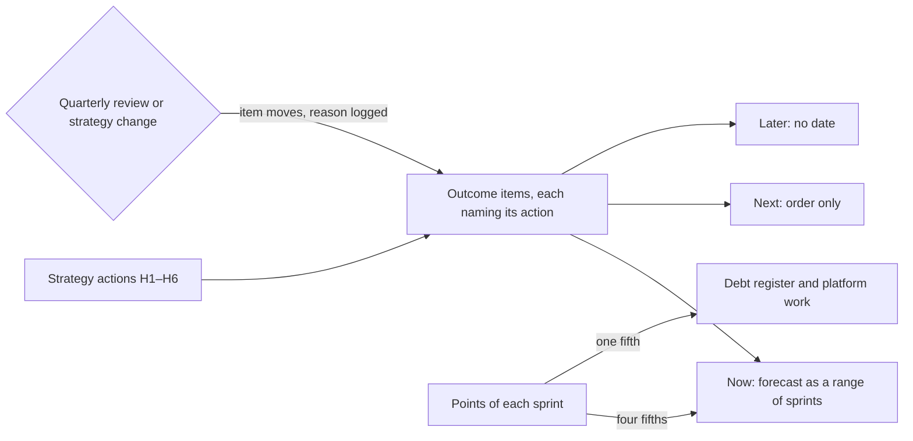

## Before you start

- [[management.l4.technical-strategy]] — you know the six actions H1 to H6 of `technical-strategy.md` and that it leaves their order and timing to `roadmap.md`.
- [[management.l2.forecasting-with-velocity]] — you can turn a range of recent velocities into a range of sprints, rounding up.
- [[design.l4.quantifying-technical-debt]] — you know how the debt register estimates interest and principal in hours.
- [[management.l2.stakeholder-communication]] — you know that stakeholders get a range, the risks that move it, and news of a change as soon as the team knows.

## The situation

Suppose it is Sprint 23 at stage-4, and the technical strategy has just been agreed. A stakeholder asks you for "the plan for the year": a spreadsheet with one row per feature and a delivery date in each. You can forecast the first release of the `shop_id` work, because it is estimated. Release 3, row-level security for every shop, is designed in `multi-shop-data-rollout.md` but nobody has estimated it. And every debt in the register still has to win against a feature at each planning to be repaid. What should a plan for the coming year show, so that it is honest about what nobody knows yet and still leaves room for debt?

## Core concepts

- **roadmap** — a plan of the outcomes a team intends to achieve over the coming periods, firm for the near ones and looser the further out they are.
- outcome — a change a shop or the team can see, such as "a new shop opens without a deploy", rather than a feature with a date.
- horizon — one of three groups on the roadmap, now, next and later; each item sits in exactly one.
- fixed share — the part of every sprint's points kept for the debt register and platform work, whatever the features ask for.
- moved-items log — a table that records each item that changed horizon, with its reason and the sprint.

## How it works



Start from the strategy. In the situation above, the actions H1 to H6 say what must happen this year; the roadmap says in what order and how firmly. Each item is an outcome and names the action it serves. An item that serves no action is questioned before it takes a place.

Items then go into a horizon. Only items now get a forecast, a range of sprints worked out from velocity, because the team has estimated them. Items next have an order but no forecast. Items later have no date. Uncertainty grows with distance, so the roadmap claims less the further out it looks.

The points of each sprint are split before any item competes for them. Four fifths go to roadmap items; one fifth is the fixed share for the debt register and platform work. The fraction is the team's own choice, not a rule. A platform item can sit in now and still be paid from the fixed share. Repayment then never has to beat a feature at planning time.

Finally, the roadmap changes on purpose. At each quarterly review, and whenever the strategy changes, items can move between horizons. Each move is logged with its reason, so stakeholders see a decision, not a slip. The forecasts of items now are worked out again at every sprint planning.

## In the Đơn Hàng system

The top of `docs/team/roadmap.md`, with the items now and how their forecast is computed:

```markdown file=docs/team/roadmap.md tag=stage-4 lines=1-24
# Roadmap của Đơn Hàng

Lập ở Sprint 23 (giả định), xếp theo ba tầm: bây giờ, tiếp theo, sau đó. Mỗi
mục là một kết quả cửa hàng hay đội thấy được, không phải một tính năng có
ngày cố định, và mỗi mục ghi hành động của `technical-strategy.md` mà nó phục
vụ. Mục không phục vụ hành động nào thì bị hỏi lại trước khi được xếp vào.

Chỉ mục "Bây giờ" có dự báo. Càng xa thì càng ít biết, nên "Tiếp theo" chỉ có
thứ tự và "Sau đó" không có ngày.

### Bây giờ

| Kết quả | Hành động phục vụ | Dự báo |
|---|---|---|
| Mọi dòng dữ liệu mang `shop_id`, code cũ vẫn chạy (release 1 của `multi-shop-data-rollout.md`) | H1 | 2 tới 3 sprint |
| Mất máy chạy database không còn là mất bản sao lưu: base backup và WAL có bản ở region thứ hai | H4 | 3 tới 4 sprint, trong phần cố định bên dưới |

Cách tính dự báo: velocity của bốn sprint đủ người trong `velocity-history.md`
là 8 tới 11 điểm; bốn phần năm số đó (6,4 tới 8,8 điểm) dành cho các mục của
roadmap, phần còn lại là phần cố định bên dưới. Release 1 ước lượng 13 điểm
(giả định): 13 / 8,8 ≈ 1,5 → 2 sprint và 13 / 6,4 ≈ 2,03 → 3 sprint. Sao lưu
sang region thứ hai ước lượng 5 điểm (giả định), làm bằng phần cố định 1,6 tới
2,2 điểm mỗi sprint: 3 tới 4 sprint. Dự báo được tính lại ở mỗi sprint
planning với velocity mới nhất.
```

Lines 3–6 set the rules described above, and lines 8–9 keep forecasts for items now. The two items now are release 1 of the `shop_id` work (H1) and backups in a second region, a location away from the machine that runs the database (H4). The backup item is platform work done inside the fixed share.

Lines 18–24 show the arithmetic. Four full-staffed sprints gave 8 to 11 points; four fifths of that, 6.4 to 8.8, go to roadmap items. Release 1, estimated at 13 points, takes 2 to 3 sprints. The backup work, 5 points, uses the fixed share of 1.6 to 2.2 points and takes 3 to 4. While it runs, it takes the whole fixed share, so register debts wait for it: inside the share, debt competes with platform work, not with features.

Between the excerpts, lines 26–34 list five items next, in order and without forecasts; line 30 is "a new shop opens without a deploy: the code knows the shop of each request", which is release 2 of the `shop_id` work. Lines 36–42 list three items later, with no date, such as row-level security as release 3.

The rest of the file:

```markdown file=docs/team/roadmap.md tag=stage-4 lines=44-64
### Phần cố định cho nợ và nền tảng

Mỗi sprint dành một phần năm số điểm cho các món trong `tech-debt-register.md`
và việc nền tảng (như sao lưu sang region thứ hai). Món nợ được chọn theo lãi
mỗi lần sửa và chi phí trả ghi trong sổ, món đắt lãi nhất và rẻ trả nhất đi
trước. Phần này cố định để việc trả nợ không phải thắng một tính năng ở mỗi
lần lập kế hoạch: so từng lần, tính năng gần như luôn thắng.

### Đã dời

Mỗi lần một mục đổi tầm, đội ghi lại lý do, để người theo dõi roadmap thấy một
quyết định chứ không thấy một lần trễ.

| Mục | Từ → sang | Lý do | Sprint |
|---|---|---|---|
| Khách nhận email thật qua Dịch vụ A | Bây giờ → Tiếp theo | Chưa có production để nối vào; ADR 0024 không đổi code ở stage-4 | 23 |

### Xem lại

Mỗi quý, cùng `technical-strategy.md`, và mỗi khi chiến lược đổi. Ngoài ra dự
báo của mục "Bây giờ" được tính lại ở mỗi sprint planning.
```

Lines 46–50 keep one fifth of every sprint for `tech-debt-register.md` and platform work. Debts are picked by the interest and principal written in the register, highest interest and cheapest repayment first. The reason is plain: compared one planning at a time, the feature almost always wins. Lines 54–59 are the moved-items log; its one row moves real email for customers from now to next, because there is no production to connect it to yet. Dịch vụ A is the outside email-sending service that ADR 0024 chose; at stage-4 that decision changes no code. Lines 63–64 set the review: each quarter with the strategy, whenever the strategy changes, and the forecasts again at every sprint planning.

## Trade-offs

| What the team shares | What a stakeholder learns | What it costs | Fits when |
|---|---|---|---|
| Outcomes by horizon, forecast only for now, a fixed share for debt | what changes for them, in which order, and how sure the team is | a quarterly review, a forecast redone each sprint planning, a log of moves | the work spans many sprints and the far items are not yet estimated |
| A release schedule with a date per feature | a date for everything, most of them guesses | little up front; a missed date tends to read as a slip and can cost trust | the work is short, already estimated and unlikely to change |
| A list of features with no order | what might come, not what comes first | almost nothing; nobody can plan around it | rarely; at most as raw input before ordering |
| No roadmap, only the next sprint | what happens in two weeks | nothing extra; stakeholders cannot see past one sprint | one small team with no outside stakeholders |
## What would you choose if…

…a large shop asked for a date for row-level security, an item later? Not a date the team cannot back. A sensible answer says it comes after release 2, as `multi-shop-data-rollout.md` builds it on release 2, and says when a forecast becomes possible: once release 3 is estimated. Đơn Hàng's file does not write this answer down; it follows from lines 8–9.

…a feature request arrived that serves none of H1 to H6? Line 6 says it is questioned before it takes a place. If it answers a weak point of the diagnosis, the strategy changes first and the roadmap follows.

…an incident took several sprints of the team's time? A sensible choice keeps the fixed share and lets the forecasts of items now move, redone at the next sprint planning. Shrinking the fixed share instead brings back the contest it was made to stop.

## Seniors often assume…

- **"A roadmap is a release schedule with a date for every feature."** → Actually it lists outcomes by horizon, and only items now carry a forecast, as a range of sprints. Release 3 of the `shop_id` work is designed but not estimated, so any date for it would be a guess that reads like a promise. You notice this belief when a far-off date is missed and stakeholders hear it as the team failing, not as the plan learning.
- **"Debt gets repaid in whatever time the features leave over."** → Actually features leave almost no time over, because each planning compares one feature with one debt and the feature almost always wins. Đơn Hàng keeps one fifth of every sprint for the register and platform work, chosen by interest and principal. You notice this belief when debts sit in the register sprint after sprint while their interest keeps being paid.
- **"A roadmap, once shared, must not change."** → Actually it is revised each quarter and whenever the strategy changes, and each move between horizons is logged with its reason. Moving real email from now to next, because there is no production yet, is a decision recorded in Sprint 23. You notice this belief when a team keeps an item in now long after it stopped being possible, and the forecast becomes a quiet promise.

## Try it (3 minutes)

Use the first excerpt.

1. Suppose that at the next sprint planning the four latest full-staffed sprints gave 5 to 8 points, not 8 to 11. Redo the forecast for release 1 (13 points) the way lines 18–24 do.
2. Decide whether this change needs a row in the moved-items log.

Expected result: 3 to 4 sprints, and no row in the log, because the item stays in now; the stakeholders still hear the new range.

<details><summary>Suggested answer</summary>

Four fifths of 5 to 8 points is 4 to 6.4 points for roadmap items. 13 / 6.4 ≈ 2.03, rounded up to 3 sprints; 13 / 4 = 3.25, rounded up to 4 sprints. The forecast becomes 3 to 4 sprints.

Line 54 logs an item when it changes horizon. Release 1 stays in now, so the log rule does not apply. The new range still goes to stakeholders as soon as the team knows it, with the reason.

</details>

## Connections

- [[management.l4.technical-strategy]] — the actions every roadmap item must name; the roadmap is their order over time.
- [[management.l2.forecasting-with-velocity]] — the method behind the forecasts of items now.
- [[design.l4.quantifying-technical-debt]] — the interest and principal that pick which debt the fixed share pays.
- [[management.l2.stakeholder-communication]] — how a moved item or a new range reaches the people who follow the roadmap.
- [[management.l1.estimates-are-not-commitments]] — the same idea one level down: a range of sprints is a forecast, not a promise.
- [[management.l3.debt-as-a-portfolio]] — why debt is weighed as a set, which the fixed share puts into every sprint.
- [[management.l2.schedule-buffer]] — a related way to hold room in a plan for what cannot be foreseen.
- [[devops.l4.platform-engineering]] — the platform work that shares the fixed share with debt.
- [[management.l4.release-train]] — next: when finished work actually reaches the shops.

## Five-line summary

1. A roadmap shows the outcomes a team intends over the coming periods by horizon, firm when near and loose when far.
2. `roadmap.md` sorts items into now, next and later; only items now carry a forecast, a range of sprints from velocity.
3. Every item names the strategy action it serves; an item serving none is questioned before it takes a place.
4. One fifth of every sprint goes to the debt register and platform work, so repayment never competes with each feature.
5. The roadmap is revised each quarter and when the strategy changes, and each moved item is logged with its reason.
