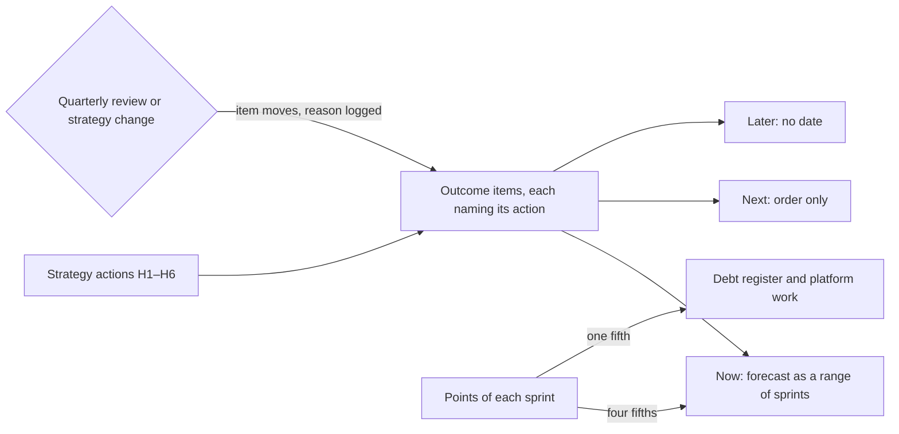

## Bạn cần biết trước

- [[management.l4.technical-strategy]] — bạn biết sáu hành động H1 tới H6 của `technical-strategy.md`, và rằng file đó để thứ tự cùng thời điểm của chúng cho `roadmap.md`.
- [[management.l2.forecasting-with-velocity]] — bạn biết đổi một khoảng velocity gần đây thành một khoảng sprint, làm tròn lên.
- [[design.l4.quantifying-technical-debt]] — bạn biết sổ nợ ước lượng tiền lãi và gốc bằng giờ ra sao.
- [[management.l2.stakeholder-communication]] — bạn biết bên liên quan nhận một khoảng, những rủi ro có thể làm khoảng dịch đi, và tin về thay đổi ngay khi đội biết.

## Tình huống

Giả sử đang ở Sprint 23 của stage-4, và chiến lược kỹ thuật vừa được thống nhất. Một bên liên quan xin bạn "kế hoạch cả năm": một bảng tính mỗi dòng là một tính năng, mỗi dòng có một ngày giao. Bạn dự báo được lần phát hành đầu của việc `shop_id`, vì nó đã được ước lượng. Lần phát hành 3, row-level security cho mọi cửa hàng, đã được thiết kế trong `multi-shop-data-rollout.md` nhưng chưa ai ước lượng. Còn mỗi món nợ trong sổ vẫn phải thắng một tính năng ở mỗi lần lập kế hoạch thì mới được trả. Kế hoạch cho năm tới nên cho thấy gì, để vừa thành thật về những điều chưa ai biết, vừa còn chỗ để trả nợ?

## Khái niệm cốt lõi

- **roadmap** (kế hoạch các kết quả đội định đạt qua các giai đoạn tới, càng xa càng ít chắc chắn) — kế hoạch các kết quả một đội định đạt được trong những giai đoạn sắp tới, chắc chắn với giai đoạn gần và lỏng dần khi càng xa.
- kết quả — một thay đổi mà cửa hàng hay đội thấy được, như "mở cửa hàng mới không cần deploy", thay vì một tính năng kèm ngày.
- tầm — một trong ba nhóm trên roadmap: bây giờ, tiếp theo và sau đó. Mỗi mục nằm đúng ở một tầm.
- phần cố định — phần điểm của mỗi sprint giữ riêng cho sổ nợ và việc nền tảng, bất kể tính năng đòi bao nhiêu.
- bảng mục đã dời — bảng ghi mỗi mục đã đổi tầm, kèm lý do và sprint.

## Cơ chế hoạt động



Bắt đầu từ chiến lược. Trong tình huống trên, các hành động H1 tới H6 nói điều gì phải xảy ra trong năm nay, còn roadmap nói theo thứ tự nào và chắc chắn tới đâu. Mỗi mục là một kết quả và ghi hành động nó phục vụ. Mục không phục vụ hành động nào thì bị hỏi lại trước khi được xếp chỗ.

Sau đó các mục được xếp vào tầm. Chỉ mục ở tầm bây giờ có dự báo, một khoảng sprint tính từ velocity, vì đội đã ước lượng chúng. Mục ở tầm tiếp theo có thứ tự nhưng không có dự báo. Mục ở tầm sau đó không có ngày. Càng xa thì càng ít biết, nên roadmap càng nhìn xa càng hứa ít.

Điểm của mỗi sprint được chia trước khi mục nào tranh phần. Bốn phần năm dành cho các mục của roadmap, một phần năm là phần cố định cho sổ nợ và việc nền tảng. Tỉ lệ này do đội tự chọn, không phải một quy tắc. Một mục nền tảng có thể nằm ở tầm bây giờ mà vẫn lấy điểm từ phần cố định. Nhờ vậy, trả nợ không bao giờ phải thắng một tính năng lúc lập kế hoạch.

Cuối cùng, roadmap thay đổi có chủ đích. Ở mỗi buổi xem xét hằng quý, và mỗi khi chiến lược đổi, các mục có thể chuyển giữa các tầm. Mỗi lần chuyển được ghi kèm lý do, để bên liên quan thấy một quyết định chứ không thấy một lần trễ. Dự báo của các mục ở tầm bây giờ được tính lại ở mỗi sprint planning.

## Trong hệ thống Đơn Hàng

Phần đầu `docs/team/roadmap.md`, với các mục ở tầm bây giờ và cách tính dự báo của chúng:

```markdown file=docs/team/roadmap.md tag=stage-4 lines=1-24
# Roadmap của Đơn Hàng

Lập ở Sprint 23 (giả định), xếp theo ba tầm: bây giờ, tiếp theo, sau đó. Mỗi
mục là một kết quả cửa hàng hay đội thấy được, không phải một tính năng có
ngày cố định, và mỗi mục ghi hành động của `technical-strategy.md` mà nó phục
vụ. Mục không phục vụ hành động nào thì bị hỏi lại trước khi được xếp vào.

Chỉ mục "Bây giờ" có dự báo. Càng xa thì càng ít biết, nên "Tiếp theo" chỉ có
thứ tự và "Sau đó" không có ngày.

### Bây giờ

| Kết quả | Hành động phục vụ | Dự báo |
|---|---|---|
| Mọi dòng dữ liệu mang `shop_id`, code cũ vẫn chạy (release 1 của `multi-shop-data-rollout.md`) | H1 | 2 tới 3 sprint |
| Mất máy chạy database không còn là mất bản sao lưu: base backup và WAL có bản ở region thứ hai | H4 | 3 tới 4 sprint, trong phần cố định bên dưới |

Cách tính dự báo: velocity của bốn sprint đủ người trong `velocity-history.md`
là 8 tới 11 điểm; bốn phần năm số đó (6,4 tới 8,8 điểm) dành cho các mục của
roadmap, phần còn lại là phần cố định bên dưới. Release 1 ước lượng 13 điểm
(giả định): 13 / 8,8 ≈ 1,5 → 2 sprint và 13 / 6,4 ≈ 2,03 → 3 sprint. Sao lưu
sang region thứ hai ước lượng 5 điểm (giả định), làm bằng phần cố định 1,6 tới
2,2 điểm mỗi sprint: 3 tới 4 sprint. Dự báo được tính lại ở mỗi sprint
planning với velocity mới nhất.
```

Dòng 3–6 đặt các quy tắc vừa mô tả ở trên, dòng 8–9 chỉ cho mục ở tầm bây giờ có dự báo. Hai mục ở tầm bây giờ là lần phát hành 1 của việc `shop_id` (H1) và sao lưu sang region thứ hai, một vị trí cách xa máy đang chạy database (H4). Mục sao lưu là việc nền tảng, làm trong phần cố định.

Dòng 18–24 là phần tính toán. Bốn sprint đủ người cho 8 tới 11 điểm, bốn phần năm số đó, 6,4 tới 8,8, dành cho các mục của roadmap. Lần phát hành 1, ước lượng 13 điểm, mất 2 tới 3 sprint. Việc sao lưu, 5 điểm, dùng phần cố định 1,6 tới 2,2 điểm và mất 3 tới 4 sprint. Trong lúc nó chạy, nó chiếm trọn phần cố định, nên các món nợ trong sổ phải chờ: bên trong phần cố định, nợ tranh với việc nền tảng chứ không tranh với tính năng.

Giữa hai đoạn trích, dòng 26–34 liệt kê năm mục ở tầm tiếp theo, có thứ tự và không có dự báo. Dòng 30 là "mở cửa hàng mới không cần deploy: code biết mỗi request thuộc cửa hàng nào", tức lần phát hành 2 của việc `shop_id`. Dòng 36–42 liệt kê ba mục ở tầm sau đó, không có ngày, chẳng hạn row-level security là lần phát hành 3.

Phần còn lại của file:

```markdown file=docs/team/roadmap.md tag=stage-4 lines=44-64
### Phần cố định cho nợ và nền tảng

Mỗi sprint dành một phần năm số điểm cho các món trong `tech-debt-register.md`
và việc nền tảng (như sao lưu sang region thứ hai). Món nợ được chọn theo lãi
mỗi lần sửa và chi phí trả ghi trong sổ, món đắt lãi nhất và rẻ trả nhất đi
trước. Phần này cố định để việc trả nợ không phải thắng một tính năng ở mỗi
lần lập kế hoạch: so từng lần, tính năng gần như luôn thắng.

### Đã dời

Mỗi lần một mục đổi tầm, đội ghi lại lý do, để người theo dõi roadmap thấy một
quyết định chứ không thấy một lần trễ.

| Mục | Từ → sang | Lý do | Sprint |
|---|---|---|---|
| Khách nhận email thật qua Dịch vụ A | Bây giờ → Tiếp theo | Chưa có production để nối vào; ADR 0024 không đổi code ở stage-4 | 23 |

### Xem lại

Mỗi quý, cùng `technical-strategy.md`, và mỗi khi chiến lược đổi. Ngoài ra dự
báo của mục "Bây giờ" được tính lại ở mỗi sprint planning.
```

Dòng 46–50 giữ một phần năm mỗi sprint cho `tech-debt-register.md` và việc nền tảng. Món nợ được chọn theo tiền lãi và gốc ghi trong sổ, lãi cao nhất và trả rẻ nhất đi trước. Lý do rất đơn giản: so từng lần lập kế hoạch, tính năng gần như luôn thắng. Dòng 54–59 là bảng mục đã dời. Dòng duy nhất của nó chuyển việc gửi email thật cho khách từ tầm bây giờ sang tầm tiếp theo, vì chưa có production để nối vào. Dịch vụ A là dịch vụ gửi email bên ngoài mà ADR 0024 đã chọn, và ở stage-4 quyết định đó không đổi dòng code nào. Dòng 63–64 đặt lịch xem lại: mỗi quý cùng với chiến lược, mỗi khi chiến lược đổi, và dự báo thì tính lại ở mỗi sprint planning.

## Đánh đổi

| Đội chia sẻ gì | Bên liên quan biết được gì | Tốn gì | Hợp khi |
|---|---|---|---|
| Kết quả theo tầm, chỉ tầm bây giờ có dự báo, một phần cố định cho nợ | điều gì thay đổi với họ, theo thứ tự nào, và đội chắc tới đâu | một buổi xem xét mỗi quý, dự báo tính lại ở mỗi sprint planning, một bảng ghi các lần dời | công việc kéo dài nhiều sprint và các mục xa chưa được ước lượng |
| Lịch phát hành với một ngày cho mỗi tính năng | một ngày cho mọi thứ, phần lớn là đoán | ban đầu tốn ít, nhưng một ngày bị lỡ dễ bị đọc thành trễ hẹn và có thể làm mất lòng tin | công việc ngắn, đã ước lượng và khó thay đổi |
| Một danh sách tính năng không có thứ tự | những gì có thể tới, không phải cái gì tới trước | gần như không tốn gì, nhưng không ai lên kế hoạch dựa vào nó được | hiếm khi, cùng lắm là đầu vào thô trước khi sắp thứ tự |
| Không có roadmap, chỉ có sprint kế tiếp | chuyện gì xảy ra trong hai tuần | không tốn thêm gì, nhưng bên liên quan không nhìn được xa hơn một sprint | một đội nhỏ không có bên liên quan nào ở ngoài |

## Bạn sẽ chọn gì nếu…

…một cửa hàng lớn đòi ngày cho row-level security, một mục ở tầm sau đó? Đừng đưa một ngày mà đội không bảo đảm được. Một câu trả lời hợp lý nói nó tới sau lần phát hành 2, vì `multi-shop-data-rollout.md` xây nó trên lần phát hành 2, và nói khi nào có thể dự báo: khi lần phát hành 3 được ước lượng. File của Đơn Hàng không ghi câu trả lời này, nó suy ra từ dòng 8–9.

…một yêu cầu tính năng tới mà không phục vụ hành động nào trong H1 tới H6? Dòng 6 nói nó bị hỏi lại trước khi được xếp chỗ. Nếu nó trả lời một điểm yếu của chẩn đoán, chiến lược đổi trước rồi roadmap mới theo sau.

…một sự cố lấy mất của đội vài sprint? Một lựa chọn hợp lý là giữ phần cố định và để dự báo của các mục ở tầm bây giờ dịch đi, tính lại ở sprint planning kế tiếp. Thu nhỏ phần cố định thay vào đó sẽ đưa lại đúng cuộc tranh giành mà nó được lập ra để chấm dứt.

## Senior hay nhầm rằng…

- **"Roadmap là lịch phát hành với một ngày cho mỗi tính năng."** → Thực ra nó liệt kê kết quả theo tầm, và chỉ mục ở tầm bây giờ có dự báo, dưới dạng một khoảng sprint. Lần phát hành 3 của việc `shop_id` đã thiết kế nhưng chưa ước lượng, nên mọi ngày đưa ra cho nó đều là đoán mà nghe như một lời hứa. Bạn sẽ nhận ra khi một ngày ở xa bị lỡ và bên liên quan hiểu đó là đội thất bại, chứ không phải kế hoạch đang học thêm.
- **"Nợ sẽ được trả bằng thời gian tính năng còn chừa lại."** → Thực ra tính năng gần như không chừa lại thời gian nào, vì mỗi lần lập kế hoạch so một tính năng với một món nợ và tính năng gần như luôn thắng. Đơn Hàng giữ một phần năm mỗi sprint cho sổ nợ và việc nền tảng, chọn theo tiền lãi và gốc. Bạn sẽ nhận ra khi các món nợ nằm trong sổ hết sprint này tới sprint khác trong lúc tiền lãi của chúng vẫn tiếp tục bị trả.
- **"Roadmap đã chia sẻ rồi thì không được đổi."** → Thực ra nó được xem lại mỗi quý và mỗi khi chiến lược đổi, và mỗi lần một mục chuyển tầm đều được ghi kèm lý do. Chuyển việc gửi email thật từ tầm bây giờ sang tầm tiếp theo, vì chưa có production, là một quyết định được ghi ở Sprint 23. Bạn sẽ nhận ra khi một đội giữ một mục ở tầm bây giờ rất lâu sau khi nó không còn làm được, và dự báo lặng lẽ biến thành một lời hứa.

## Thử ngay (3 phút)

Dùng đoạn trích đầu tiên.

1. Giả sử ở sprint planning kế tiếp, bốn sprint đủ người gần nhất cho 5 tới 8 điểm, không phải 8 tới 11. Tính lại dự báo cho lần phát hành 1 (13 điểm) theo cách dòng 18–24 làm.
2. Quyết định xem thay đổi này có cần một dòng trong bảng mục đã dời không.

Kết quả mong đợi: 3 tới 4 sprint, và không thêm dòng nào vào bảng, vì mục vẫn ở tầm bây giờ. Bên liên quan vẫn được báo khoảng mới.

<details><summary>Gợi ý đáp án</summary>

Bốn phần năm của 5 tới 8 điểm là 4 tới 6,4 điểm cho các mục của roadmap. 13 / 6,4 ≈ 2,03, làm tròn lên thành 3 sprint. 13 / 4 = 3,25, làm tròn lên thành 4 sprint. Dự báo thành 3 tới 4 sprint.

Dòng 54 ghi một mục khi nó đổi tầm. Lần phát hành 1 vẫn ở tầm bây giờ, nên quy tắc ghi bảng không áp dụng. Khoảng mới vẫn tới bên liên quan ngay khi đội biết, kèm lý do.

</details>

## Liên hệ

- [[management.l4.technical-strategy]] — các hành động mà mỗi mục của roadmap phải ghi tên, roadmap là thứ tự của chúng theo thời gian.
- [[management.l2.forecasting-with-velocity]] — phương pháp đứng sau dự báo của các mục ở tầm bây giờ.
- [[design.l4.quantifying-technical-debt]] — tiền lãi và gốc quyết định phần cố định trả món nợ nào.
- [[management.l2.stakeholder-communication]] — cách một mục bị dời hay một khoảng mới tới được những người theo dõi roadmap.
- [[management.l1.estimates-are-not-commitments]] — cùng ý đó ở một tầng thấp hơn: một khoảng sprint là dự báo, không phải lời hứa.
- [[management.l3.debt-as-a-portfolio]] — vì sao nợ được cân như một tập hợp, điều mà phần cố định đưa vào mỗi sprint.
- [[management.l2.schedule-buffer]] — cách làm gần với bài này để giữ chỗ trong kế hoạch cho những gì không đoán trước được.
- [[devops.l4.platform-engineering]] — việc nền tảng dùng chung phần cố định với nợ.
- [[management.l4.release-train]] — bài tiếp theo: khi nào việc đã xong thực sự tới tay các cửa hàng.

## Tóm tắt 5 dòng

1. Roadmap cho thấy các kết quả đội định đạt trong những giai đoạn tới, xếp theo tầm, rõ khi gần và lỏng khi xa.
2. `roadmap.md` xếp mục vào bây giờ, tiếp theo và sau đó, chỉ mục ở tầm bây giờ có dự báo, một khoảng sprint tính từ velocity.
3. Mỗi mục ghi hành động của chiến lược mà nó phục vụ, mục không phục vụ hành động nào bị hỏi lại trước khi được xếp chỗ.
4. Một phần năm mỗi sprint dành cho sổ nợ và việc nền tảng, nên trả nợ không bao giờ phải tranh với từng tính năng.
5. Roadmap được xem lại mỗi quý và khi chiến lược đổi, và mỗi mục bị dời đều được ghi kèm lý do.
