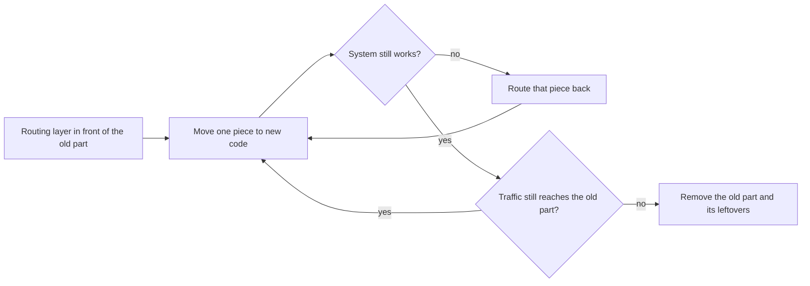

## Before you start

- [[design.l4.evolutionary-architecture]] — you know that Đơn Hàng changes in small, checked steps, and that the email split left the old `notifications` table behind as debt N1.
- [[k8s.l2.gateway-api]] — you know how an HTTPRoute on staging matches paths and sends them to a Service.
- [[backend.l3.payments-service]] — you know that `DonHang.Payments` owns the money records in its own database, `donhang_payments`.
- [[management.l3.proposing-an-adr]] — you know ADR `0008` and why accounting's objection moved dropping the old `payments` table later.

## The situation

At stage-3 you open the `Caddyfile` to add a route and notice something. Staff list failed refunds at `/api/v1/refunds`, a path that looks like any other path of the api. Yet the answer comes from `DonHang.Payments`, a separate program with its own database, and nothing that calls the path needs to know. Meanwhile ADR `0008` says the old `payments` table still sits in `donhang`, unused. Now suppose the order part of the api had to be replaced one day, and someone proposed rebuilding it beside the old one and switching everything over on one night. Is there a way to replace an old part without that one big switch, and without clients noticing?

## Core concepts

- **strangler fig (pattern)** — a way to replace an old system gradually: a routing layer in front of it sends one piece of the traffic at a time to new code, until nothing reaches the old part and it can be removed.
- routing layer — the program in front of the system that decides, for each request, which code answers it; in the situation above, Caddy, which reads its rules from the `Caddyfile`, in the lab (the Compose setup you run yourself), and the HTTPRoute `api` on staging.
- piece — a slice of the traffic the routing layer can tell apart, here a path prefix such as `/api/v1/refunds`.
- rewrite from scratch — building a whole new system beside the old one and switching every client to it at once, when it is finished.
- leftovers — what the old part keeps after its traffic is gone, such as tables, configuration or test setup that still mention it.

## How it works



In the situation above, the first box is already done. Caddy has stood in front of the api since stage-1, and the api publishes no port of its own, so every request from outside the Compose network under `/api/v1/` passes through Caddy before any .NET code runs. Adding a routing layer changes nothing for clients when they already call its address.

The second box moves one piece. Payments' refunds list shows the shape: one rule for one path prefix sends those requests to the new code, while every other path still reaches the api. You repeat that step for the next path, then the next, each as its own change.

After each step you check that the system still works, for example that the moved path answers real requests correctly. If the new code misbehaves, you change the routing layer again and send that piece back; once the new code is fixed, you move the same piece again. Clients keep calling the same addresses throughout, so neither move needs a client release. Moving back works only while the old code still answers that path, which is why the old part stays until the end.

When no request reaches the old part, it can go. The work is finished only when its leftovers go too: code, tables and the configuration that mentions them.

A rewrite from scratch, by contrast, delivers nothing until all of it is finished, and its switch-over moves every piece at once, with no small step to undo.

## In the Đơn Hàng system

A `Caddyfile` holds one block per site, an address Caddy listens on; at stage-3 two of them serve the api, the lab site `:8080` and the HTTPS site `donhang.local:8443`. Part of the `:8080` site, inside its `route` block:

```caddyfile file=Caddyfile tag=stage-3 lines=25-30
		handle /api/v1/refunds* {
			reverse_proxy payments:8080
		}
		handle /api/v1/* {
			reverse_proxy api:8080
		}
```

Lines 25–27 send a request whose path starts with `/api/v1/refunds` to the service `payments` on port 8080; lines 28–30 send the rest of `/api/v1/` to `api`. Inside a `route` block Caddy keeps the blocks in the order they are written and runs only the first `handle` that matches, so the refunds block wins because it comes first. Moving another piece would mean one more block like lines 25–27, placed before line 28, in every site that serves `/api/v1/`, and no change to any client. At stage-3 the HTTPS site has no refunds block yet.

On staging, the HTTPRoute `api` in `deploy/gitops/config-repo/platform/edge/httproutes.yaml` also sends `/api/v1/refunds` and the paths below it to `payments`, beside the rule that sends `/api/v1`, `/api/v2` and `/openapi` to `api`. Gateway API gives the longer matching path precedence.

One honest limit: refunds were new code at stage-3, a path the api never answered. What did leave the api is the money records. Up to stage-2 its `DonHangDbContext` mapped the `payments` table in `donhang`; at stage-3 that mapping is gone, the records belong to Payments in `donhang_payments`, and the old table stays, unread. The `notifications` table was left the same way.

ADR `0008` plans the end of the work:

```markdown file=docs/adr/0008-xoa-bang-cu-trong-donhang.md tag=stage-3 lines=25-35
### Quyết định

Xuất rồi xóa, theo thứ tự:

1. Dump hai bảng bằng `pg_dump -Fc --table`, lưu cùng các bản sao lưu khác.
2. Migration xóa `notifications` trước, cùng pull request bỏ bảng đó khỏi
   lệnh `TRUNCATE` của `PostgresFixture`.
3. Migration xóa `payments` sau khi kế toán xác nhận đã đối chiếu xong với
   `donhang_payments`, cũng sửa `PostgresFixture` như bước 2.

Ở tag stage-3 hai bảng vẫn còn; các bước trên làm trong sprint sau.
```

Line 29 dumps both tables to a file first, kept with the other backups, so the old data survives. Lines 30–33 drop them one migration at a time: `notifications` first, `payments` only after accounting confirms its check against `donhang_payments`. Each pull request also removes the table from the `TRUNCATE` command that `PostgresFixture` uses to empty every table between tests, so the test setup stops naming a table that no longer exists. Line 35 says both tables are still there at stage-3. Until those steps run, debts N1 (the `notifications` table) and N2 (the `payments` table) in `docs/team/tech-debt-register.md` stay open: a reader of the schema still thinks the api sends email and keeps money records.

## Trade-offs

| Way to replace an old part | What you get before the end | Undoing a step | What it costs | Fits when |
|---|---|---|---|---|
| Strangler fig: one piece at a time behind the routing layer | each moved piece working for real users | route that piece back, while the old code still answers it | old and new run side by side for a while; one more routing rule per piece | the old part's traffic can be split, for example by path |
| Rewrite from scratch and one switch-over | nothing until the whole new system is finished | switch everything back at once, if the old system still runs | two systems built in parallel; every difference found on the same day | the old part is small enough to rebuild in one short step |
| Change the old code in place | each change, in the same program | an ordinary revert of that change | no second program, but the old part's shape limits what can change | the part should stay where it is and only its inside changes |

The strangler fig needs two things the others do not: a routing layer, and pieces it can tell apart.

## What would you choose if…

…the part to replace had no routing layer in front of it, and clients called it directly? Add the routing layer first, as a step of its own that sends everything to the old code. Clients reach it either because it takes over the address they already call, so they change nothing, or by one client change, made once, before any piece moves. Only then does moving a piece become a routing change. At Đơn Hàng that step is already done.

…the piece you want to move writes data that the old code also reads? A routing change moves requests, not data. Keeping old and new data in step during the move is the job of expand and contract, a separate lesson.

…a moved piece misbehaves in production? Route it back while the old code still answers that path. For `/api/v1/refunds` there is nothing to go back to: the api never had that path. That is why a strangler fig removes old code last.

## Seniors often assume…

- **"Replacing a legacy system means a full rewrite and one big switch-over."** → Actually a routing layer lets you move one piece at a time, each a small step that leaves the system working. A rewrite delivers nothing until it is finished, and its switch-over has no small step to undo. You notice this belief when a replacement plan has one date on which everything changes, and no working piece before it.
- **"The migration is finished once the new code takes all the traffic."** → Actually the old part leaves things behind: tables, configuration, test setup. At stage-3 Payments answers every request to `/api/v1/refunds`, yet the old `payments` table still sits in `donhang`, and ADR `0008` plans its dump and drop as steps of their own. You notice this belief when a schema keeps tables nobody reads, and new team members ask whether they are still used.
- **"Clients must change the addresses they call when part of a system moves to a new service."** → Actually the routing layer keeps the address and changes only where it leads. Staff call `/api/v1/refunds` on the same host as every other path of the api, and Caddy sends it to Payments. You notice this belief when a service split is planned together with a release of every client.

## Try it (3 minutes)

Open `Caddyfile` in the `don-hang` repository at tag `stage-3`.

1. Compare the `:8080` site (lines 11–74) with the `donhang.local:8443` site (lines 80–90). Where does each send a request for `/api/v1/refunds`?
2. Say what that means for the claim "the refunds piece has moved", and what change would close the gap.

Expected result: `:8080` sends it to `payments`; `:8443` sends all of `/api/v1/*` to `api`; a piece has moved only where every routing layer in front of the system sends it to the new code.

<details><summary>Suggested answer</summary>

On `:8080`, lines 25–27 send the request to `payments`. The `donhang.local:8443` site has a single `handle /api/v1/*` block, lines 84–86, so over HTTPS the same request reaches `api`, which has no code for that path.

So the piece has moved on the lab site at `:8080` and on staging's HTTPRoute `api`, but not on the HTTPS site. Closing the gap is a routing change alone: a block like lines 25–27 in the `:8443` site, with no change to Payments or to any client.

</details>

## Connections

- [[design.l4.evolutionary-architecture]] — the same idea for the whole system.
- [[k8s.l2.gateway-api]] — the HTTPRoute that serves as the routing layer on staging.
- [[backend.l3.payments-service]] — the new code behind `/api/v1/refunds`.
- [[management.l3.proposing-an-adr]] — how ADR `0008`, the last step here, was decided.
- [[devops.l1.reverse-proxy-basics]] — the reverse proxy that serves as the routing layer in the lab.
- [[backend.l4.expand-and-contract]] — the companion for data: keeping old and new data in step while pieces move.
- [[devops.l4.canary-release]] — moving a share of the requests instead of a whole path.
- [[k8s.l4.moving-to-a-new-cluster]] — a different move: a whole platform rebuilt beside the old one, then switched over.
- [[design.l4.merging-a-service-back]] — the opposite direction: a service returns into one process.
- [[management.l4.technical-strategy]] — next: a document that names the strangler fig as the way old parts are replaced.

## Five-line summary

1. A strangler fig replaces an old part gradually: a routing layer moves traffic piece by piece to new code, then the old part goes.
2. Đơn Hàng has that layer: Caddy's `:8080` site sends `/api/v1/refunds` to Payments and the rest of `/api/v1/` to the api; staging's HTTPRoute `api` agrees.
3. Clients keep the same addresses, so a piece moves to new code, or back, by a routing change alone, with no client release.
4. Each step leaves the system working and can be undone, unlike a rewrite that delivers nothing until it is finished.
5. The work ends when the leftovers go too: ADR `0008` dumps and drops the tables the api stopped using.
