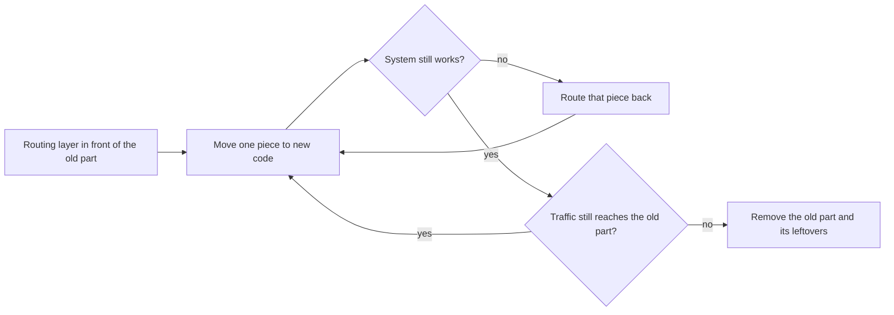

## Bạn cần biết trước

- [[design.l4.evolutionary-architecture]] — bạn biết Đơn Hàng thay đổi bằng những bước nhỏ, có kiểm tra, và lần tách email đã để lại bảng `notifications` cũ thành nợ N1.
- [[k8s.l2.gateway-api]] — bạn biết một HTTPRoute trên staging so khớp path và gửi chúng tới một Service thế nào.
- [[backend.l3.payments-service]] — bạn biết `DonHang.Payments` sở hữu các bản ghi tiền trong database riêng của nó, `donhang_payments`.
- [[management.l3.proposing-an-adr]] — bạn biết ADR `0008`, và vì sao phản đối của kế toán đã đẩy việc xóa bảng `payments` cũ về sau.

## Tình huống

Ở stage-3, bạn mở `Caddyfile` để thêm một route và để ý thấy một điều. Nhân viên xem danh sách hoàn tiền thất bại ở `/api/v1/refunds`, một path trông như mọi path khác của api. Thế nhưng câu trả lời lại đến từ `DonHang.Payments`, một chương trình riêng có database riêng, và không ai gọi path đó cần biết điều này. Trong khi đó ADR `0008` nói bảng `payments` cũ vẫn nằm trong `donhang`, không ai dùng. Giờ giả sử một ngày nào đó phần đơn hàng của api phải được thay, và có người đề xuất xây lại nó bên cạnh phần cũ rồi chuyển mọi thứ sang trong một đêm. Có cách nào thay một phần cũ mà không cần một lần chuyển lớn như vậy, và client không nhận ra không?

## Khái niệm cốt lõi

- **strangler fig (pattern)** (thay hệ thống cũ từng phần: lớp định tuyến chuyển dần từng mảng traffic sang code mới rồi bỏ phần cũ) — cách thay một hệ thống cũ dần dần: một lớp định tuyến đứng trước nó gửi từng mảnh traffic một sang code mới, cho tới khi không còn gì tới phần cũ và phần đó bỏ đi được.
- lớp định tuyến — chương trình đứng trước hệ thống, quyết định với mỗi request thì code nào trả lời. Trong tình huống trên, đó là Caddy, đọc quy tắc từ `Caddyfile`, trong lab (bộ Compose bạn tự chạy), và HTTPRoute `api` trên staging.
- mảnh — một phần traffic mà lớp định tuyến phân biệt được, ở đây là một tiền tố path như `/api/v1/refunds`.
- viết lại từ đầu — xây cả một hệ thống mới bên cạnh hệ thống cũ, rồi chuyển mọi client sang nó cùng lúc khi nó đã xong.
- phần sót lại — những gì phần cũ còn giữ sau khi traffic đã đi hết, như bảng, cấu hình hay thiết lập test vẫn nhắc tới nó.

## Cơ chế hoạt động



Trong tình huống trên, ô đầu tiên đã xong. Caddy đứng trước api từ stage-1, và api không mở port nào của riêng nó, nên mọi request từ ngoài mạng Compose dưới `/api/v1/` đều đi qua Caddy trước khi bất kỳ code .NET nào chạy. Thêm một lớp định tuyến không đổi gì với client khi họ vốn đã gọi tới địa chỉ của nó.

Ô thứ hai chuyển một mảnh. Danh sách hoàn tiền của Payments cho thấy hình dạng đó: một quy tắc cho một tiền tố path gửi các request ấy sang code mới, còn mọi path khác vẫn tới api. Bạn lặp lại bước này cho path tiếp theo, rồi path sau nữa, mỗi lần là một thay đổi riêng.

Sau mỗi bước, bạn kiểm tra hệ thống vẫn chạy, chẳng hạn path vừa chuyển trả lời đúng các request thật. Nếu code mới chạy sai, bạn sửa lớp định tuyến lần nữa và gửi mảnh đó về chỗ cũ. Khi code mới đã được sửa, bạn chuyển lại đúng mảnh ấy. Suốt quá trình, client vẫn gọi những địa chỉ cũ, nên cả hai lần chuyển đều không cần phát hành lại client. Chuyển về chỉ làm được khi code cũ vẫn còn trả lời path đó, và vì thế phần cũ ở lại tới cuối.

Khi không còn request nào tới phần cũ, nó có thể đi. Công việc chỉ xong khi phần sót lại cũng đi theo: code, bảng, và cấu hình nhắc tới chúng.

Ngược lại, viết lại từ đầu không mang lại gì cho tới khi xong toàn bộ, và lần chuyển của nó dời mọi mảnh cùng lúc, không có bước nhỏ nào để hoàn tác.

## Trong hệ thống Đơn Hàng

Một `Caddyfile` có một khối cho mỗi site, tức một địa chỉ Caddy lắng nghe. Ở stage-3, hai site phục vụ api: site lab `:8080` và site HTTPS `donhang.local:8443`. Đây là một phần của site `:8080`, bên trong khối `route` của nó:

```caddyfile file=Caddyfile tag=stage-3 lines=25-30
		handle /api/v1/refunds* {
			reverse_proxy payments:8080
		}
		handle /api/v1/* {
			reverse_proxy api:8080
		}
```

Dòng 25–27 gửi request có path bắt đầu bằng `/api/v1/refunds` tới service `payments` ở port 8080. Dòng 28–30 gửi phần còn lại của `/api/v1/` tới `api`. Bên trong một khối `route`, Caddy giữ các khối theo đúng thứ tự viết và chỉ chạy `handle` đầu tiên khớp, nên khối refunds thắng vì nó đứng trước. Chuyển thêm một mảnh nghĩa là thêm một khối như dòng 25–27, đặt trước dòng 28, trong mọi site phục vụ `/api/v1/`, và không đổi client nào. Ở stage-3, site HTTPS chưa có khối refunds.

Trên staging, HTTPRoute `api` trong `deploy/gitops/config-repo/platform/edge/httproutes.yaml` cũng gửi `/api/v1/refunds` và các path bên dưới nó tới `payments`, bên cạnh quy tắc gửi `/api/v1`, `/api/v2` và `/openapi` tới `api`. Gateway API ưu tiên path khớp dài hơn.

Có một giới hạn cần nói thẳng: ở stage-3, refunds là code mới, một path api chưa từng trả lời. Thứ thật sự rời khỏi api là các bản ghi tiền. Tới stage-2, `DonHangDbContext` của api còn ánh xạ bảng `payments` trong `donhang`. Ở stage-3, ánh xạ đó không còn, các bản ghi thuộc về Payments trong `donhang_payments`, còn bảng cũ ở lại, không ai đọc. Bảng `notifications` cũng bị bỏ lại theo cách đó.

ADR `0008` lên kế hoạch cho phần cuối của công việc:

```markdown file=docs/adr/0008-xoa-bang-cu-trong-donhang.md tag=stage-3 lines=25-35
### Quyết định

Xuất rồi xóa, theo thứ tự:

1. Dump hai bảng bằng `pg_dump -Fc --table`, lưu cùng các bản sao lưu khác.
2. Migration xóa `notifications` trước, cùng pull request bỏ bảng đó khỏi
   lệnh `TRUNCATE` của `PostgresFixture`.
3. Migration xóa `payments` sau khi kế toán xác nhận đã đối chiếu xong với
   `donhang_payments`, cũng sửa `PostgresFixture` như bước 2.

Ở tag stage-3 hai bảng vẫn còn; các bước trên làm trong sprint sau.
```

Dòng 29 dump cả hai bảng ra một file trước, lưu cùng các bản sao lưu khác, nên dữ liệu cũ vẫn còn. Dòng 30–33 xóa chúng, mỗi migration một bảng: `notifications` trước, `payments` chỉ sau khi kế toán xác nhận đã đối chiếu với `donhang_payments`. Mỗi pull request cũng bỏ bảng khỏi lệnh `TRUNCATE` mà `PostgresFixture` dùng để làm rỗng mọi bảng giữa các test, để thiết lập test không còn nhắc tới một bảng đã không tồn tại. Dòng 35 nói ở stage-3 cả hai bảng vẫn còn. Cho tới khi các bước đó chạy, nợ N1 (bảng `notifications`) và N2 (bảng `payments`) trong `docs/team/tech-debt-register.md` vẫn mở: người đọc schema vẫn tưởng api gửi email và giữ bản ghi tiền.

## Đánh đổi

| Cách thay một phần cũ | Có được gì trước khi xong | Hoàn tác một bước | Tốn gì | Hợp khi |
|---|---|---|---|---|
| Strangler fig: từng mảnh một, phía sau lớp định tuyến | mỗi mảnh đã chuyển chạy thật cho người dùng thật | định tuyến mảnh đó về, khi code cũ còn trả lời nó | cũ và mới chạy song song một thời gian, mỗi mảnh thêm một quy tắc định tuyến | traffic của phần cũ chia ra được, chẳng hạn theo path |
| Viết lại từ đầu và chuyển một lần | không có gì cho tới khi cả hệ thống mới xong | chuyển mọi thứ về cùng lúc, nếu hệ thống cũ còn chạy | hai hệ thống xây song song, mọi khác biệt lộ ra trong cùng một ngày | phần cũ đủ nhỏ để xây lại trong một bước ngắn |
| Sửa code cũ tại chỗ | từng thay đổi, ngay trong chương trình đó | revert thay đổi đó như bình thường | không có chương trình thứ hai, nhưng hình dạng của phần cũ giới hạn những gì đổi được | phần đó nên ở nguyên chỗ, chỉ bên trong thay đổi |

Strangler fig cần hai thứ mà các cách kia không cần: một lớp định tuyến, và những mảnh mà lớp đó phân biệt được.

## Bạn sẽ chọn gì nếu…

…phần cần thay không có lớp định tuyến nào đứng trước, và client gọi thẳng vào nó? Hãy thêm lớp định tuyến trước, như một bước riêng gửi mọi thứ tới code cũ. Client tới được lớp đó theo một trong hai cách: lớp đó tiếp quản đúng địa chỉ client vốn đang gọi, nên client không đổi gì, hoặc client đổi một lần duy nhất, trước khi mảnh nào được chuyển. Chỉ khi đó, chuyển một mảnh mới trở thành một thay đổi định tuyến. Ở Đơn Hàng, bước này đã xong.

…mảnh bạn muốn chuyển ghi dữ liệu mà code cũ cũng đọc? Thay đổi định tuyến chuyển request, không chuyển dữ liệu. Giữ dữ liệu cũ và mới khớp nhau trong lúc chuyển là việc của expand and contract, một bài khác.

…một mảnh đã chuyển chạy sai trên production? Định tuyến nó về, khi code cũ còn trả lời path đó. Với `/api/v1/refunds` thì không có gì để quay về: api chưa bao giờ có path này. Đó là lý do strangler fig bỏ code cũ sau cùng.

## Senior hay nhầm rằng…

- **"Thay một hệ thống legacy nghĩa là viết lại toàn bộ và chuyển một lần thật lớn."** → Thực ra một lớp định tuyến cho phép chuyển từng mảnh một, mỗi mảnh là một bước nhỏ để hệ thống vẫn chạy. Viết lại từ đầu không mang lại gì cho tới khi xong, và lần chuyển của nó không có bước nhỏ nào để hoàn tác. Bạn sẽ nhận ra khi một kế hoạch thay thế có đúng một ngày mọi thứ cùng đổi, và trước ngày đó không có mảnh nào chạy được.
- **"Cuộc chuyển đổi đã xong khi code mới nhận toàn bộ traffic."** → Thực ra phần cũ để lại nhiều thứ: bảng, cấu hình, thiết lập test. Ở stage-3, Payments trả lời mọi request tới `/api/v1/refunds`, vậy mà bảng `payments` cũ vẫn nằm trong `donhang`, và ADR `0008` lên kế hoạch dump rồi xóa nó thành những bước riêng. Bạn sẽ nhận ra khi một schema giữ những bảng không ai đọc, và người mới vào đội hỏi chúng còn được dùng không.
- **"Khi một phần của hệ thống chuyển sang service mới, client phải đổi địa chỉ họ gọi."** → Thực ra lớp định tuyến giữ nguyên địa chỉ và chỉ đổi nơi địa chỉ đó dẫn tới. Nhân viên gọi `/api/v1/refunds` trên cùng host với mọi path khác của api, và Caddy gửi nó tới Payments. Bạn sẽ nhận ra khi một lần tách service được lên kế hoạch cùng với việc phát hành lại mọi client.

## Thử ngay (3 phút)

Mở `Caddyfile` trong repository `don-hang` ở tag `stage-3`.

1. So sánh site `:8080` (dòng 11–74) với site `donhang.local:8443` (dòng 80–90). Mỗi site gửi request tới `/api/v1/refunds` đi đâu?
2. Nói điều đó có nghĩa gì với khẳng định "mảnh refunds đã được chuyển", và thay đổi nào sẽ lấp khoảng hở.

Kết quả mong đợi: `:8080` gửi nó tới `payments`, `:8443` gửi toàn bộ `/api/v1/*` tới `api`, và một mảnh chỉ được coi là đã chuyển khi mọi lớp định tuyến đứng trước hệ thống đều gửi nó tới code mới.

<details><summary>Gợi ý đáp án</summary>

Ở `:8080`, dòng 25–27 gửi request tới `payments`. Site `donhang.local:8443` chỉ có một khối `handle /api/v1/*`, dòng 84–86, nên qua HTTPS cùng request đó tới `api`, nơi không có code nào cho path này.

Vậy mảnh đó đã chuyển trên site lab ở `:8080` và trên HTTPRoute `api` của staging, nhưng chưa chuyển trên site HTTPS. Lấp khoảng hở chỉ cần một thay đổi định tuyến: một khối như dòng 25–27 trong site `:8443`, không đổi Payments hay client nào.

</details>

## Liên hệ

- [[design.l4.evolutionary-architecture]] — cùng ý tưởng đó cho cả hệ thống.
- [[k8s.l2.gateway-api]] — HTTPRoute làm lớp định tuyến trên staging.
- [[backend.l3.payments-service]] — code mới đứng sau `/api/v1/refunds`.
- [[management.l3.proposing-an-adr]] — ADR `0008`, bước cuối ở đây, đã được quyết định thế nào.
- [[devops.l1.reverse-proxy-basics]] — reverse proxy làm lớp định tuyến trong lab.
- [[backend.l4.expand-and-contract]] — người bạn đồng hành về dữ liệu: giữ dữ liệu cũ và mới khớp nhau trong lúc các mảnh được chuyển.
- [[devops.l4.canary-release]] — chuyển một tỉ lệ request thay vì cả một path.
- [[k8s.l4.moving-to-a-new-cluster]] — một kiểu chuyển khác: cả nền tảng được xây lại bên cạnh nền tảng cũ, rồi chuyển sang.
- [[design.l4.merging-a-service-back]] — chiều ngược lại: một service quay về trong một process.
- [[management.l4.technical-strategy]] — bài tiếp theo: tài liệu gọi tên strangler fig là cách thay các phần cũ.

## Tóm tắt 5 dòng

1. Strangler fig thay một phần cũ dần dần: lớp định tuyến chuyển traffic từng mảnh sang code mới, rồi phần cũ đi.
2. Đơn Hàng có lớp đó: site `:8080` của Caddy gửi `/api/v1/refunds` tới Payments và phần còn lại của `/api/v1/` tới api, HTTPRoute `api` của staging cũng vậy.
3. Client giữ nguyên địa chỉ, nên một mảnh chuyển sang code mới, hay chuyển về, chỉ bằng một thay đổi định tuyến, không cần phát hành lại client.
4. Mỗi bước để hệ thống vẫn chạy và hoàn tác được, khác với viết lại từ đầu, vốn không mang lại gì cho tới khi xong.
5. Công việc kết thúc khi phần sót lại cũng đi: ADR `0008` dump rồi xóa các bảng mà api đã thôi dùng.
