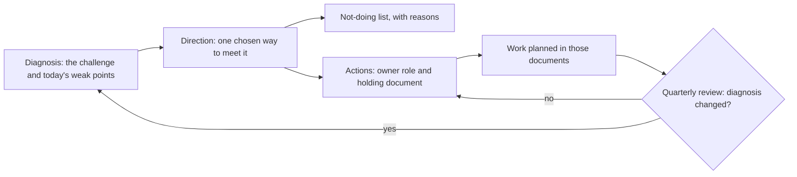

## Before you start

- [[management.l4.strangler-fig]] — you know how Đơn Hàng replaces an old part piece by piece behind a routing layer, instead of a rewrite from scratch.
- [[management.l4.deciding-under-uncertainty]] — you know that stage-4 ADRs state their assumptions and reopen signals, and that the team reads them at a quarterly review.
- [[design.l4.a-thousand-shops]] — you know `multi-shop-requirements.md` and the drivers that change when Đơn Hàng serves 1,000 shops.
- [[backend.l4.shop-id-rollout]] — you know the plan to add `shop_id` to live tables over three releases.

## The situation

Suppose that at stage-4, early in a sprint, two pull requests arrive in the same week. One moves Catalog into its own service and adds a service mesh, "to get ready for 1,000 shops"; the other runs a copy of production on a second cloud. Each sounds careful on its own. `docs/adr/` already holds 33 decisions, and somewhere in them both ideas were answered, but nobody on the review remembers where. Meanwhile no row of production data knows which shop it belongs to. What tells the team which problem this year's work must solve, and which reasonable ideas it has already chosen not to pursue?

## Core concepts

- **technical strategy** — a short document that names the main challenge a system faces, the direction chosen to meet it and the few actions that follow, for a stated period.
- diagnosis — the part that says what the challenge is and which weak points of today's system stand in its way; in the situation above, growing from one shop to 1,000.
- direction — the one way the team has chosen to meet the challenge, often by pointing at decisions already taken rather than taking new ones.
- not-doing list — ideas the team has chosen not to pursue in the period, each with its reason and the decision it comes from.
- action — a piece of work that follows from the direction, with an owner named by role and the document that holds the details.
- review — the fixed moment when the team checks whether the diagnosis still holds; in Đơn Hàng, every quarter.

## How it works



The diagnosis comes first, because every other part is judged against it. In the situation above it is the move from one shop to 1,000, plus the weak points that block it today: no isolation between shops, no monitoring in production, backups that do not yet leave the machine running the database, and one team doing all the work.

The direction answers the diagnosis with one chosen shape, not a menu. It mostly points at decisions that already exist, so a reader sees several ADRs as parts of one plan instead of separate answers. The strategy does not take those decisions again; each ADR keeps its own reasons. An accepted ADR is never edited; a changed decision gets a new ADR.

The not-doing list follows from the direction. Once one shape is chosen, some ideas stop fitting it, and writing them down with their reasons saves the team from deciding them again in every review. In the situation above, both pull requests land on that list.

Actions turn the direction into work. Each names who carries it, by role, and the document where the work is planned. Without actions, a direction is a wish: nobody's sprint changes because of it.

The review closes the loop. Each quarter the team asks whether the diagnosis still holds. If it does, the actions continue. If it changed, the strategy is written again first, and the plans that depend on it follow.

## In the Đơn Hàng system

`docs/team/technical-strategy.md` opens, above the excerpts, with its period, one year from Sprint 23 (an assumption of the example), and its authors, the team lead with the product owner, the person who decides what the product does next. It also says it does not decide again the ADRs it points to. The diagnosis and the direction:

```markdown file=docs/team/technical-strategy.md tag=stage-4 lines=8-32
### Chẩn đoán

Đơn Hàng phải đi từ một cửa hàng lên 1.000 cửa hàng trên một nền tảng
(`multi-shop-requirements.md`; 1.000 là giả định cho ba năm). Những điểm yếu
nhất của hệ thống hôm nay cho mục tiêu đó:

- Cô lập giữa cửa hàng chưa có: không dòng dữ liệu nào biết nó thuộc cửa hàng
  nào; `multi-shop-data-rollout.md` mới là kế hoạch.
- Production chưa có giám sát: không Prometheus nào chạy ở production, nên SLO
  trong `slo.md` chưa đo được ở đó và không alert nào báo khi error budget bị
  tiêu nhanh.
- Bản sao lưu và WAL chưa rời máy đang chạy database: mất máy đó là mất cả bản
  sao lưu (ADR 0020).
- Chỉ một đội làm toàn bộ hệ thống, trong khi 1.000 cửa hàng cần ba tới bốn
  đội (giả định trong `multi-shop-requirements.md`).

### Hướng đi

- Một bản triển khai chung cho mọi cửa hàng (ADR 0012), dữ liệu của mọi cửa
  hàng trong bảng chung có `shop_id` và row-level security (ADR 0013), chạy
  trên Kubernetes managed của một nhà cung cấp (ADR 0022). Mở cửa hàng mới là
  thêm dữ liệu, không thêm một bản hệ thống.
- Một bản triển khai chung nghĩa là một bản phát hành hỏng chạm tới mọi cửa
  hàng, nên mỗi thay đổi nhỏ của api đi qua canary, và thay đổi cửa hàng thấy
  được nằm sau feature flag (ADR 0019).
```

Lines 10–12 state the challenge: from one shop to 1,000 on one platform, with 1,000 marked as an assumption for three years. Lines 14–22 list four weak points: no row knows its shop, no Prometheus in production so the SLOs in `slo.md` cannot be measured there, backups and WAL that do not yet leave the database machine, and one team where 1,000 shops would need three to four.

Lines 26–29 are the direction: one shared deployment (ADR `0012`), every shop's rows in shared tables with `shop_id` and row-level security (ADR `0013`), on managed Kubernetes from one provider (ADR `0022`). Opening a shop then means adding data, not another copy of the system. Lines 30–32 name the price of that choice, a bad release reaches every shop, and point to ADR `0019` for how releases contain it.

What the team will not do, and what it will:

```markdown file=docs/team/technical-strategy.md tag=stage-4 lines=34-55
### Không làm

| Không làm | Lý do | Nguồn |
|---|---|---|
| Không tách thêm service | Tách Ordering hay Catalog không trả lời yêu cầu nhiều cửa hàng nào; cùng một đội vẫn sửa chúng cùng lúc | ADR 0012 |
| Không dùng service mesh | Với ba service .NET và một nhóm, mesh lấp hai khoảng trống chưa ai yêu cầu lấp, và cái giá trả ở mọi Pod, mọi lời gọi | ADR 0021 |
| Không chạy trên cloud thứ hai | Gấp đôi platform để tránh một rủi ro mà kế hoạch rời đi đã giữ | ADR 0022 |
| Không viết lại từ đầu | Viết lại dừng giao tính năng trong lúc hệ thống cũ vẫn phải chạy; phần cũ cần thay được thay từng bước sau một lớp định tuyến, như route `/api/v1/refunds` trong `Caddyfile` và `httproutes.yaml` đưa một đường đi tới Payments trong khi phần còn lại vẫn tới api | `Caddyfile`, `deploy/gitops/config-repo/platform/edge/httproutes.yaml` |

### Hành động

| Số | Hành động | Người phụ trách (vai trò) | Tài liệu |
|---|---|---|---|
| H1 | Đưa `shop_id` vào dữ liệu qua ba lần phát hành | Lập trình viên backend | `docs/design/multi-shop-data-rollout.md` |
| H2 | Dựng production trên Kubernetes managed | Lập trình viên phụ trách nền tảng | ADR 0022, `docs/design/cluster-migration-plan.md` |
| H3 | Giám sát production: Prometheus và alert theo error budget | Lập trình viên phụ trách nền tảng | `docs/design/slo.md`, mục Chưa có |
| H4 | Sao base backup và WAL sang region thứ hai | Lập trình viên phụ trách nền tảng | ADR 0020 |
| H5 | Nối Notifications với dịch vụ gửi email | Lập trình viên backend | ADR 0024 |
| H6 | Lấp các khoảng trống trong bảng kiểm soát tuân thủ | Trưởng nhóm | `compliance-controls.md` |

Một chiến lược không có hành động chỉ là một mong muốn. Thứ tự và thời điểm
của các hành động nằm trong `roadmap.md`.
```

Lines 36–41 are the not-doing list, each row with a reason and a source. No further split into services: splitting Ordering or Catalog answers no multi-shop requirement, and one team would still change them together (ADR `0012`). No service mesh: with three .NET services and one team, it fills two gaps nobody has asked to fill, at a cost paid at every Pod and every call (ADR `0021`). No second cloud: it doubles the platform to cover the risk of being tied to one provider, which the exit plan already holds (ADR `0022`). No rewrite from scratch: old parts are replaced step by step behind a routing layer, as `/api/v1/refunds` was; that is a strangler fig, though the file does not use the name.

Lines 45–52 are six actions, each with a role rather than a person, and a document. H1 points to `multi-shop-data-rollout.md`, which splits the `shop_id` work into three releases. H4 copies backups to a second region, another area of the same provider, so it is not the second cloud the table turns down. Lines 54–55 call a strategy without actions only a wish, and leave order and timing to `roadmap.md`. Below the excerpt, lines 57–61 set the review: every quarter, together with `roadmap.md` and the watched-assumptions table of `architecture-governance.md`.

## Trade-offs

| What the team writes | What it tells you when a new idea arrives | What it costs | Fits when |
|---|---|---|---|
| A technical strategy: diagnosis, direction, not-doing list, actions | whether the idea serves the diagnosis, or was already ruled out, and why | a few pages, and a review each quarter | one challenge is larger than any single decision, such as 1,000 shops |
| A list of technologies to adopt | which tools are wanted, not which problem they solve | little to write; ideas pile up with no way to say no | rarely on its own; a tool can appear inside an action |
| ADRs only, no strategy | the reasons for each decision, one at a time | nothing extra, but nobody sees which decisions belong together | no large shared challenge, and few decisions |
| A long vision with no actions | where the team would like to be | time to write; nobody's work changes | as a first draft, if actions follow soon |

Only the first option puts every ruled-out idea for the period in one place, each tied to the diagnosis and to the decision that holds its reason.

## What would you choose if…

…a shop's contract demanded its own copy of the system? That changes the diagnosis, not just one action: the direction of one shared deployment no longer covers every shop. The review lines below the excerpt say what to do: write the strategy again first, then the plan that orders its actions.

…an idea serves no action and is not on the not-doing list? A sensible rule: it waits for the next review, unless its proposer shows that it answers a point of the diagnosis. Đơn Hàng's file does not write this rule down. A strategy filters work for its period; it does not ban an idea forever.

…the team served one shop and expected no large change? Then ADRs taken one at a time may be enough. A strategy earns its cost when many decisions must pull in the same direction.

## Seniors often assume…

- **"A technical strategy is a list of technologies the team wants to adopt."** → Actually it starts from a problem: the diagnosis names what the system must achieve and what stands in the way, and tools appear only as part of the direction or of an action that answers it, as Prometheus does in H3. Đơn Hàng's direction names managed Kubernetes because of a diagnosis about 1,000 shops, not as a wish for a tool. You notice this belief when a strategy lists tools and nobody can say which problem each one solves.
- **"Listing what the team will not do is negative and better left out."** → Actually the not-doing list is where the direction becomes a choice, because an idea never turned down returns at every review. In Đơn Hàng each row gives its reason and its source, an ADR for three of the four rows, so a proposal for a service mesh is answered by pointing to ADR `0021`, not argued again. You notice this belief when the same proposal comes back every few sprints with no new reason.
- **"A strategy is set once by leadership and then left alone."** → Actually it has a stated period and a fixed review. Đơn Hàng's covers one year and is reviewed every quarter; if the diagnosis changes, it is rewritten first. You notice this belief when a strategy still describes last year's problem while the team works on a different one.

## Try it (3 minutes)

Use the two excerpts above.

1. Take the two pull requests from the situation: Catalog in its own service with a service mesh, and a copy of production on a second cloud. For each, find the line or lines of `technical-strategy.md` that answer it and the ADRs they name. The first table row is line 38.
2. Then find the action that follows from the weak point "no row knows its shop", and the document that holds it.

Expected result: lines 38 and 39 (ADRs `0012` and `0021`) answer the first pull request, line 40 (ADR `0022`) answers the second, and the action is H1 on line 47, held in `docs/design/multi-shop-data-rollout.md`.

<details><summary>Suggested answer</summary>

The first pull request hits two rows: line 38 rules out more services and line 39 rules out a mesh. The second hits line 40, the second cloud.

The weak point on lines 14–15 leads to action H1 on line 47, owned by a backend developer, with its details in `docs/design/multi-shop-data-rollout.md`.

</details>

## Connections

- [[management.l4.strangler-fig]] — how old parts are replaced instead of a rewrite.
- [[management.l4.deciding-under-uncertainty]] — the assumptions and reopen signals read at the same quarterly review.
- [[design.l4.a-thousand-shops]] — the requirements the diagnosis starts from.
- [[backend.l4.shop-id-rollout]] — the work behind action H1.
- [[design.l4.one-deployment-for-all-shops]] — ADR `0012`, the first part of the direction.
- [[backend.l4.shop-data-layout]] — ADR `0013`, the second part of the direction.
- [[k8s.l4.choosing-managed-kubernetes]] — ADR `0022`, the third part, also the source for no second cloud.
- [[k8s.l4.when-a-mesh-pays-off]] — the reasoning behind the row on service mesh.
- [[management.l4.roadmap]] — next: putting the actions in order over time.

## Five-line summary

1. A technical strategy names the main challenge, the one direction chosen to meet it and the few actions that follow, for a stated period.
2. Đơn Hàng's diagnosis: grow from one shop to 1,000, while shops are not isolated, production is unmonitored and backups stay on one machine.
3. Its direction ties ADRs `0012`, `0013` and `0022` into one plan: one shared deployment, shared tables with `shop_id`, managed Kubernetes.
4. It turns down, with reasons, more services, a service mesh, a second cloud and a rewrite from scratch, replacing old parts by strangler fig.
5. Each action names an owner by role and its document, such as `multi-shop-data-rollout.md`, and the strategy is reviewed every quarter.
