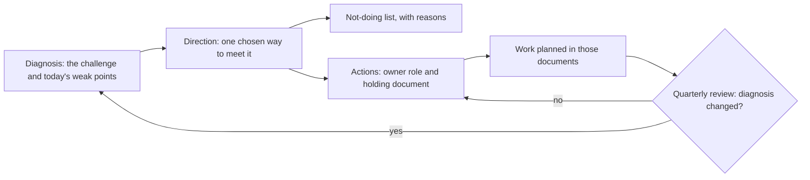

## Bạn cần biết trước

- [[management.l4.strangler-fig]] — bạn biết Đơn Hàng thay một phần cũ từng mảnh một phía sau lớp định tuyến, thay vì viết lại từ đầu.
- [[management.l4.deciding-under-uncertainty]] — bạn biết các ADR ở stage-4 ghi rõ giả định và tín hiệu mở lại, và đội đọc lại chúng ở buổi xem xét mỗi quý.
- [[design.l4.a-thousand-shops]] — bạn biết `multi-shop-requirements.md` và những yếu tố thay đổi khi Đơn Hàng phục vụ 1.000 cửa hàng.
- [[backend.l4.shop-id-rollout]] — bạn biết kế hoạch thêm `shop_id` vào các bảng đang chạy qua ba lần phát hành.

## Tình huống

Giả sử ở stage-4, đầu một sprint, hai pull request tới trong cùng một tuần. Một cái tách Catalog thành service riêng và thêm service mesh, "để sẵn sàng cho 1.000 cửa hàng". Cái kia chạy một bản sao production trên cloud thứ hai. Riêng từng cái nghe đều cẩn thận. `docs/adr/` đã có 33 quyết định, và đâu đó trong số đó cả hai ý tưởng đã được trả lời, nhưng không ai trong buổi review nhớ ở đâu. Trong khi đó, không dòng dữ liệu production nào biết nó thuộc cửa hàng nào. Cái gì cho đội biết công việc năm nay phải giải vấn đề nào, và những ý tưởng hợp lý nào đội đã chọn không theo?

## Khái niệm cốt lõi

- **chiến lược kỹ thuật** (technical strategy) — một tài liệu ngắn nêu thách thức chính mà hệ thống đang gặp, hướng đi đã chọn để gặp nó và vài hành động theo sau, cho một kỳ hạn ghi rõ.
- chẩn đoán — phần nói thách thức là gì và những điểm yếu nào của hệ thống hôm nay cản đường. Trong tình huống trên, đó là đi từ một cửa hàng lên 1.000.
- hướng đi — con đường duy nhất đội đã chọn để gặp thách thức, thường bằng cách trỏ tới những quyết định đã có thay vì đưa ra quyết định mới.
- danh sách không làm — những ý tưởng đội chọn không theo trong kỳ hạn, mỗi ý kèm lý do và quyết định mà lý do đó đến từ.
- hành động — một phần việc đi ra từ hướng đi, có người phụ trách gọi theo vai trò và tài liệu giữ chi tiết.
- buổi xem xét — thời điểm cố định đội kiểm tra chẩn đoán còn đúng không. Ở Đơn Hàng là mỗi quý.

## Cơ chế hoạt động



Chẩn đoán đứng đầu, vì mọi phần khác đều được đo theo nó. Trong tình huống trên, đó là bước từ một cửa hàng lên 1.000, cộng với những điểm yếu đang chặn bước đó: chưa cô lập giữa các cửa hàng, production chưa có giám sát, bản sao lưu chưa rời khỏi máy đang chạy database, và chỉ một đội làm hết mọi việc.

Hướng đi trả lời chẩn đoán bằng một hình dạng đã chọn, không phải một thực đơn. Phần lớn nó trỏ tới những quyết định đã có, nên người đọc thấy nhiều ADR là các phần của một kế hoạch, thay vì những câu trả lời rời rạc. Chiến lược không quyết lại các quyết định đó, mỗi ADR vẫn giữ lý do riêng. ADR đã chấp nhận thì không bao giờ bị sửa. Quyết định đổi thì có ADR mới.

Danh sách không làm đi ra từ hướng đi. Một khi đã chọn một hình dạng, vài ý tưởng không còn khớp với nó, và ghi chúng xuống kèm lý do giúp đội khỏi phải quyết lại ở mỗi buổi review. Trong tình huống trên, cả hai pull request đều rơi vào danh sách này.

Hành động biến hướng đi thành việc. Mỗi hành động nêu ai gánh nó, theo vai trò, và tài liệu nơi việc đó được lên kế hoạch. Không có hành động, hướng đi chỉ là mong muốn: sprint của không ai thay đổi vì nó.

Buổi xem xét khép vòng lặp. Mỗi quý, đội hỏi chẩn đoán còn đúng không. Nếu còn, các hành động tiếp tục. Nếu đã đổi, chiến lược được viết lại trước, rồi các kế hoạch dựa vào nó mới theo sau.

## Trong hệ thống Đơn Hàng

`docs/team/technical-strategy.md` mở đầu, phía trên các đoạn trích, bằng kỳ hạn của nó, một năm kể từ Sprint 23 (giả định của ví dụ), và người viết, trưởng nhóm cùng product owner, người quyết định sản phẩm làm gì tiếp theo. Nó cũng nói nó không quyết lại các ADR mà nó trỏ tới. Phần chẩn đoán và hướng đi:

```markdown file=docs/team/technical-strategy.md tag=stage-4 lines=8-32
### Chẩn đoán

Đơn Hàng phải đi từ một cửa hàng lên 1.000 cửa hàng trên một nền tảng
(`multi-shop-requirements.md`; 1.000 là giả định cho ba năm). Những điểm yếu
nhất của hệ thống hôm nay cho mục tiêu đó:

- Cô lập giữa cửa hàng chưa có: không dòng dữ liệu nào biết nó thuộc cửa hàng
  nào; `multi-shop-data-rollout.md` mới là kế hoạch.
- Production chưa có giám sát: không Prometheus nào chạy ở production, nên SLO
  trong `slo.md` chưa đo được ở đó và không alert nào báo khi error budget bị
  tiêu nhanh.
- Bản sao lưu và WAL chưa rời máy đang chạy database: mất máy đó là mất cả bản
  sao lưu (ADR 0020).
- Chỉ một đội làm toàn bộ hệ thống, trong khi 1.000 cửa hàng cần ba tới bốn
  đội (giả định trong `multi-shop-requirements.md`).

### Hướng đi

- Một bản triển khai chung cho mọi cửa hàng (ADR 0012), dữ liệu của mọi cửa
  hàng trong bảng chung có `shop_id` và row-level security (ADR 0013), chạy
  trên Kubernetes managed của một nhà cung cấp (ADR 0022). Mở cửa hàng mới là
  thêm dữ liệu, không thêm một bản hệ thống.
- Một bản triển khai chung nghĩa là một bản phát hành hỏng chạm tới mọi cửa
  hàng, nên mỗi thay đổi nhỏ của api đi qua canary, và thay đổi cửa hàng thấy
  được nằm sau feature flag (ADR 0019).
```

Dòng 10–12 nêu thách thức: từ một cửa hàng lên 1.000 trên một nền tảng, trong đó 1.000 được đánh dấu là giả định cho ba năm. Dòng 14–22 liệt kê bốn điểm yếu: không dòng nào biết cửa hàng của nó, production không có Prometheus nên SLO trong `slo.md` không đo được ở đó, bản sao lưu và WAL chưa rời máy database, và chỉ một đội trong khi 1.000 cửa hàng sẽ cần ba tới bốn đội.

Dòng 26–29 là hướng đi: một bản triển khai chung (ADR `0012`), dữ liệu mọi cửa hàng trong bảng chung có `shop_id` và row-level security (ADR `0013`), chạy trên Kubernetes managed của một nhà cung cấp (ADR `0022`). Khi đó, mở một cửa hàng là thêm dữ liệu, không thêm một bản hệ thống. Dòng 30–32 nói cái giá của lựa chọn này, một bản phát hành hỏng chạm tới mọi cửa hàng, và trỏ tới ADR `0019` cho cách các lần phát hành giới hạn nó.

Những gì đội sẽ không làm, và những gì sẽ làm:

```markdown file=docs/team/technical-strategy.md tag=stage-4 lines=34-55
### Không làm

| Không làm | Lý do | Nguồn |
|---|---|---|
| Không tách thêm service | Tách Ordering hay Catalog không trả lời yêu cầu nhiều cửa hàng nào; cùng một đội vẫn sửa chúng cùng lúc | ADR 0012 |
| Không dùng service mesh | Với ba service .NET và một nhóm, mesh lấp hai khoảng trống chưa ai yêu cầu lấp, và cái giá trả ở mọi Pod, mọi lời gọi | ADR 0021 |
| Không chạy trên cloud thứ hai | Gấp đôi platform để tránh một rủi ro mà kế hoạch rời đi đã giữ | ADR 0022 |
| Không viết lại từ đầu | Viết lại dừng giao tính năng trong lúc hệ thống cũ vẫn phải chạy; phần cũ cần thay được thay từng bước sau một lớp định tuyến, như route `/api/v1/refunds` trong `Caddyfile` và `httproutes.yaml` đưa một đường đi tới Payments trong khi phần còn lại vẫn tới api | `Caddyfile`, `deploy/gitops/config-repo/platform/edge/httproutes.yaml` |

### Hành động

| Số | Hành động | Người phụ trách (vai trò) | Tài liệu |
|---|---|---|---|
| H1 | Đưa `shop_id` vào dữ liệu qua ba lần phát hành | Lập trình viên backend | `docs/design/multi-shop-data-rollout.md` |
| H2 | Dựng production trên Kubernetes managed | Lập trình viên phụ trách nền tảng | ADR 0022, `docs/design/cluster-migration-plan.md` |
| H3 | Giám sát production: Prometheus và alert theo error budget | Lập trình viên phụ trách nền tảng | `docs/design/slo.md`, mục Chưa có |
| H4 | Sao base backup và WAL sang region thứ hai | Lập trình viên phụ trách nền tảng | ADR 0020 |
| H5 | Nối Notifications với dịch vụ gửi email | Lập trình viên backend | ADR 0024 |
| H6 | Lấp các khoảng trống trong bảng kiểm soát tuân thủ | Trưởng nhóm | `compliance-controls.md` |

Một chiến lược không có hành động chỉ là một mong muốn. Thứ tự và thời điểm
của các hành động nằm trong `roadmap.md`.
```

Dòng 36–41 là danh sách không làm, mỗi dòng có lý do và nguồn. Không tách thêm service: tách Ordering hay Catalog không trả lời yêu cầu nhiều cửa hàng nào, và một đội vẫn sẽ sửa chúng cùng lúc (ADR `0012`). Không dùng service mesh: với ba service .NET và một đội, nó lấp hai khoảng trống chưa ai yêu cầu lấp, với cái giá trả ở mọi Pod và mọi lời gọi (ADR `0021`). Không chạy trên cloud thứ hai: nó gấp đôi platform chỉ để che rủi ro bị buộc vào một nhà cung cấp, rủi ro mà kế hoạch rời đi đã giữ (ADR `0022`). Không viết lại từ đầu: phần cũ được thay từng bước sau một lớp định tuyến, như `/api/v1/refunds` đã được thay. Đó là strangler fig, dù file không dùng tên này.

Dòng 45–52 là sáu hành động, mỗi hành động có một vai trò thay vì một người, và một tài liệu. H1 trỏ tới `multi-shop-data-rollout.md`, nơi chia việc `shop_id` thành ba lần phát hành. H4 sao bản sao lưu sang region thứ hai, một khu vực khác của cùng nhà cung cấp, nên đó không phải cloud thứ hai mà bảng đã từ chối. Dòng 54–55 gọi chiến lược không có hành động chỉ là mong muốn, và để thứ tự cùng thời điểm cho `roadmap.md`. Phía dưới đoạn trích, dòng 57–61 đặt lịch xem xét: mỗi quý, cùng với `roadmap.md` và bảng giả định cần theo dõi trong `architecture-governance.md`.

## Đánh đổi

| Đội viết gì | Nó cho bạn biết gì khi có ý tưởng mới | Tốn gì | Hợp khi |
|---|---|---|---|
| Một chiến lược kỹ thuật: chẩn đoán, hướng đi, danh sách không làm, hành động | ý tưởng có phục vụ chẩn đoán không, hay đã bị loại, và vì sao | vài trang, và một buổi xem xét mỗi quý | một thách thức lớn hơn bất kỳ quyết định đơn lẻ nào, như 1.000 cửa hàng |
| Một danh sách công nghệ muốn dùng | công cụ nào được muốn, không phải nó giải vấn đề nào | viết ít, ý tưởng chồng chất mà không có cách nói không | hiếm khi đứng một mình, một công cụ có thể nằm trong một hành động |
| Chỉ có ADR, không có chiến lược | lý do của từng quyết định, từng cái một | không tốn thêm gì, nhưng không ai thấy quyết định nào đi cùng nhau | không có thách thức chung lớn, và ít quyết định |
| Một tầm nhìn dài, không có hành động | đội muốn tới đâu | thời gian viết, công việc của không ai thay đổi | làm bản nháp đầu, nếu hành động theo sau sớm |

Chỉ cách đầu tiên đặt mọi ý tưởng bị loại trong kỳ hạn vào một chỗ, mỗi ý gắn với chẩn đoán và với quyết định giữ lý do của nó.

## Bạn sẽ chọn gì nếu…

…hợp đồng của một cửa hàng đòi một bản hệ thống riêng? Điều đó đổi chẩn đoán, không chỉ một hành động: hướng đi một bản triển khai chung không còn bao được mọi cửa hàng. Các dòng về buổi xem xét bên dưới đoạn trích nói phải làm gì: viết lại chiến lược trước, rồi tới kế hoạch sắp thứ tự các hành động của nó.

…một ý tưởng không phục vụ hành động nào và cũng không nằm trong danh sách không làm? Một quy tắc hợp lý: nó chờ buổi xem xét tiếp theo, trừ khi người đề xuất cho thấy nó trả lời một điểm của chẩn đoán. File của Đơn Hàng không ghi quy tắc này. Chiến lược lọc công việc cho kỳ hạn của nó, không cấm một ý tưởng mãi mãi.

…đội chỉ phục vụ một cửa hàng và không chờ thay đổi lớn nào? Khi đó, các ADR từng cái một có thể là đủ. Chiến lược đáng cái giá của nó khi nhiều quyết định phải cùng kéo về một hướng.

## Senior hay nhầm rằng…

- **"Chiến lược kỹ thuật là danh sách công nghệ đội muốn dùng."** → Thực ra nó bắt đầu từ một vấn đề: chẩn đoán nêu hệ thống phải đạt được gì và cái gì đang cản đường, còn công cụ chỉ xuất hiện như một phần của hướng đi hay của một hành động trả lời vấn đề đó, như Prometheus trong H3. Hướng đi của Đơn Hàng nhắc Kubernetes managed vì một chẩn đoán về 1.000 cửa hàng, không phải vì muốn có một công cụ. Bạn sẽ nhận ra khi một chiến lược liệt kê công cụ mà không ai nói được mỗi công cụ giải vấn đề nào.
- **"Liệt kê những việc đội sẽ không làm là tiêu cực, tốt hơn nên bỏ."** → Thực ra danh sách không làm là chỗ hướng đi trở thành một lựa chọn, vì ý tưởng chưa bao giờ bị từ chối sẽ quay lại ở mỗi buổi review. Ở Đơn Hàng, mỗi dòng nêu lý do và nguồn, với ba trong bốn dòng là một ADR, nên đề xuất dùng service mesh được trả lời bằng cách trỏ tới ADR `0021`, không phải tranh luận lại. Bạn sẽ nhận ra khi cùng một đề xuất quay lại sau vài sprint mà không có lý do mới.
- **"Chiến lược do lãnh đạo đặt một lần rồi để yên."** → Thực ra nó có kỳ hạn ghi rõ và buổi xem xét cố định. Chiến lược của Đơn Hàng kéo dài một năm và được xem xét mỗi quý. Nếu chẩn đoán đổi, nó được viết lại trước. Bạn sẽ nhận ra khi một chiến lược vẫn tả vấn đề của năm ngoái trong lúc đội làm một vấn đề khác.

## Thử ngay (3 phút)

Dùng hai đoạn trích ở trên.

1. Lấy hai pull request trong tình huống: Catalog thành service riêng kèm service mesh, và bản sao production trên cloud thứ hai. Với mỗi cái, tìm dòng hoặc các dòng của `technical-strategy.md` trả lời nó, và các ADR mà những dòng đó nêu. Dòng đầu của bảng là dòng 38.
2. Sau đó tìm hành động đi ra từ điểm yếu "không dòng nào biết cửa hàng của nó", và tài liệu giữ hành động đó.

Kết quả mong đợi: dòng 38 và 39 (ADR `0012` và `0021`) trả lời pull request thứ nhất, dòng 40 (ADR `0022`) trả lời pull request thứ hai, và hành động là H1 ở dòng 47, nằm trong `docs/design/multi-shop-data-rollout.md`.

<details><summary>Gợi ý đáp án</summary>

Pull request thứ nhất chạm hai dòng: dòng 38 loại việc tách thêm service, dòng 39 loại mesh. Pull request thứ hai chạm dòng 40, cloud thứ hai.

Điểm yếu ở dòng 14–15 dẫn tới hành động H1 ở dòng 47, do một lập trình viên backend phụ trách, chi tiết nằm trong `docs/design/multi-shop-data-rollout.md`.

</details>

## Liên hệ

- [[management.l4.strangler-fig]] — cách thay phần cũ thay vì viết lại.
- [[management.l4.deciding-under-uncertainty]] — các giả định và tín hiệu mở lại được đọc ở cùng buổi xem xét mỗi quý.
- [[design.l4.a-thousand-shops]] — các yêu cầu mà chẩn đoán xuất phát từ đó.
- [[backend.l4.shop-id-rollout]] — công việc đứng sau hành động H1.
- [[design.l4.one-deployment-for-all-shops]] — ADR `0012`, phần đầu của hướng đi.
- [[backend.l4.shop-data-layout]] — ADR `0013`, phần thứ hai của hướng đi.
- [[k8s.l4.choosing-managed-kubernetes]] — ADR `0022`, phần thứ ba, cũng là nguồn cho việc không dùng cloud thứ hai.
- [[k8s.l4.when-a-mesh-pays-off]] — lập luận đứng sau dòng về service mesh.
- [[management.l4.roadmap]] — bài tiếp theo: sắp các hành động theo thời gian.

## Tóm tắt 5 dòng

1. Chiến lược kỹ thuật nêu thách thức chính, một hướng đi đã chọn để gặp nó và vài hành động theo sau, cho một kỳ hạn ghi rõ.
2. Chẩn đoán của Đơn Hàng: đi từ một cửa hàng lên 1.000, trong khi các cửa hàng chưa được cô lập, production chưa có giám sát và bản sao lưu nằm trên một máy.
3. Hướng đi nối ADR `0012`, `0013` và `0022` thành một kế hoạch: một bản triển khai chung, bảng chung có `shop_id`, Kubernetes managed.
4. Nó từ chối, kèm lý do, việc tách thêm service, service mesh, cloud thứ hai và viết lại từ đầu, phần cũ được thay bằng strangler fig.
5. Mỗi hành động nêu người phụ trách theo vai trò và tài liệu của nó, như `multi-shop-data-rollout.md`, và chiến lược được xem xét mỗi quý.
