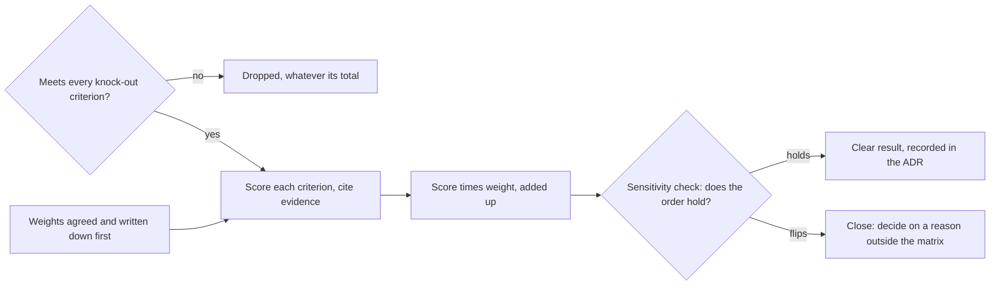

## Before you start

- [[management.l3.evaluating-a-vendor]] — you know that criteria come from your own requirements and risks, and that a knock-out criterion is checked before anything is compared.
- [[management.l3.total-cost-of-ownership]] — you know how to add up an option's cost over a stated period, people's time included, every figure an assumption.
- [[management.l3.vendor-contract-terms]] — you know which contract terms decide technical cost: data export, notice before an API changes, the cost of leaving.
- [[design.l4.reduced-atam]] — you know an evaluation that keeps each scenario separate instead of adding scores into one total per option.

## The situation

At stage-4, Đơn Hàng still cannot email real customers, and the team must pick a sending service before the first real customer arrives. Three options are on the table: two outside services, A and B, and running its own mail server. You ran the test send, and B stayed out of the spam folder more often than A. Yet once every criterion was added up, A came out on top, by five points out of five hundred. A colleague suggests raising the weight of delivery a little, which would put B first. Which option should win, and when can you trust the number that says so?

## Core concepts

- **weighted scoring matrix** — a table that scores each option on each criterion, multiplies each score by that criterion's weight and adds the results, so options strong in different places land on one scale.
- knock-out criterion — a condition checked first that carries no weight; an option that fails it is dropped, whatever its total would have been.
- weight — how much one criterion counts, agreed and written down before any option is scored.
- evidence for a score — the test send, contract clause or cost figure a score rests on, written next to it so one score can be disputed alone.
- sensitivity check — moving each weight within a range the team finds believable and watching whether the order of the options changes.

## How it works



In the situation above, every option first meets the knock-out criteria: sending over SMTP, the standard protocol a program uses to hand an email to a sending server, with TLS and a login; a test environment; and exporting the list of bounced or blocked addresses. A bounced email comes back as undeliverable; a blocked address is one the service no longer sends to. These criteria carry no weight: an option that fails one is dropped, so a low price cannot make up for a missing must-have. All three options pass.

Before the first test send, the product owner and the team lead wrote down five criteria and their weights, adding to 100. Nobody had seen a score yet, so nobody could lean the weights toward a favourite.

Then each option is scored from 1 to 5 on each criterion, and each score names its evidence, such as a test-send result or a sample contract clause. Each score is multiplied by its weight and the products are added; with scores up to 5 and weights adding to 100, the highest possible total is 500. A scores 4 on delivery, which weighs 30, giving 120; A's rows add up to 390, B's 385, running your own server 210.

A five-point gap is not an answer yet. The sensitivity check moves each weight 10 up or down and shares the difference among the other four. When the order holds in every case, the top total is a clear result. When it flips, the options are close, and a reason outside the matrix decides, written in the ADR. Here A and B swap places; running your own server stays last throughout.

## In the Đơn Hàng system

The knock-out criteria and the weights, in `docs/team/email-service-evaluation.md`:

```markdown file=docs/team/email-service-evaluation.md tag=stage-4 lines=27-51
Kiểm trước, không có trọng số. Phương án không đạt một tiêu chí thì bị loại,
dù tổng điểm của nó có thể là bao nhiêu.

| Số | Tiêu chí | Vì sao | Dịch vụ A | Dịch vụ B | Tự chạy |
|---|---|---|---|---|---|
| L1 | Nhận email qua SMTP có TLS, có đăng nhập | Notifications giữ `MailKitEmailSender`: lớp này hôm nay nối Mailpit không TLS, nên chỉ cần thêm cấu hình TLS và đăng nhập, không viết lớp gửi mới | Đạt | Đạt | Đạt |
| L2 | Có môi trường test, gửi được mà không tới hộp thư thật | Thử cách nối trước khi gửi cho khách | Đạt | Đạt | Đạt: một bản cài thứ hai |
| L3 | Xuất được danh sách địa chỉ bị trả lại hoặc bị chặn | Không mất danh sách khi rời đi | Đạt: mọi lúc, qua API | Đạt: mỗi tháng một lần, qua trang quản trị | Đạt: dữ liệu ở máy của đội |

Không phương án nào bị loại.

### Trọng số, chốt trước khi chấm

Product owner và trưởng nhóm chốt bảng này trước lần gửi thử đầu tiên, khi
chưa ai thấy điểm của phương án nào. Trọng số viết trước thì không bị kéo về
phía phương án ai đó đã thích.

| Số | Tiêu chí | Trọng số | Lý do | Nguồn |
|---|---|---|---|---|
| K1 | Email tới hộp thư chính của khách, không vào thư rác (đo bằng gửi thử) | 30 | Email không tới thì mọi thứ khác không đáng kể | YC-5 của `refund-requirements.md`; email đơn hàng giữ như hôm nay (`multi-shop-requirements.md`, mục Không đổi) |
| K2 | Báo từng email bị trả lại, để Notifications ngừng gửi tới địa chỉ đó | 20 | Gửi lặp tới địa chỉ hỏng làm dịch vụ hạ uy tín người gửi, kéo theo email của mọi cửa hàng | Rủi ro E1 bên dưới |
| K3 | TCO 3 năm, gồm giờ của đội | 25 | Phí rẻ không có nghĩa là rẻ nếu đội phải tự lo phần còn lại | `self-run-components.md` |
| K4 | Điều khoản rời đi: giữ dữ liệu sau khi hợp đồng kết thúc, xóa có xác nhận, thời gian báo trước khi chấm dứt | 15 | Đổi dịch vụ phải làm được mà không mất dữ liệu | Cách đọc điều khoản trong `payment-gateway-evaluation.md` |
| K5 | Hỗ trợ khi sự cố | 10 | Email đến muộn đã được chấp nhận (R6), nên hỗ trợ nhẹ ký hơn | R6 của `risk-register-example.md` |
| | Tổng | 100 | | |
```

Lines 27–28 make L1–L3 pass or fail, with no weight. Line 32 ties L1 to the code: `MailKitEmailSender`, the class Notifications sends email with, today talks to Mailpit, a local tool that catches email instead of delivering it, so it stays and needs only TLS and login settings. Lines 40–42 ("Product owner và trưởng nhóm chốt…") say who fixed the weights and when: before the first test send, while nobody had seen a score. Lines 46–50 give each weight a reason and a source, so arguing about a weight means arguing with that reason.

The scores sit in the file's "Điểm" section, outside these excerpts, and every row there names its evidence. B's 5 on K1 rests on a test send of 1,000 emails, 97% of them in the main inbox; A's 5 on K4 rests on a sample contract that keeps data 30 days, then deletes it and confirms the deletion. Every such figure is marked as an assumption.

The sensitivity check:

```markdown file=docs/team/email-service-evaluation.md tag=stage-4 lines=88-110
### Độ nhạy

Trọng số là ước đoán, nên đội đổi từng trọng số 10 điểm lên hoặc xuống và
chia phần chênh đều cho bốn tiêu chí còn lại (mỗi tiêu chí 2,5), để tổng vẫn
là 100.

| Thay đổi | Dịch vụ A | Dịch vụ B | Tự chạy | Đứng đầu |
|---|---|---|---|---|
| Không đổi | 390 | 385 | 210 | A |
| K1 +10 | 390 | 402,5 | 207,5 | B |
| K1 −10 | 390 | 367,5 | 212,5 | A |
| K2 +10 | 390 | 377,5 | 207,5 | A |
| K2 −10 | 390 | 392,5 | 212,5 | B |
| K3 +10 | 377,5 | 390 | 195 | B |
| K3 −10 | 402,5 | 380 | 225 | A |
| K4 +10 | 402,5 | 377,5 | 245 | A |
| K4 −10 | 377,5 | 392,5 | 175 | B |
| K5 +10 | 390 | 377,5 | 195 | A |
| K5 −10 | 390 | 392,5 | 225 | B |

A và B đổi chỗ ở năm trong mười trường hợp, chênh nhau không quá 25 điểm
trên 500. Tự chạy đứng cuối trong mọi trường hợp, vì giờ vận hành kéo K3 và K5
xuống.
```

Lines 90–92 ("Trọng số là ước đoán…") give the rule: each weight up or down by 10, the difference shared equally at 2.5 each, so the weights still add to 100. Line 96 is the matrix as scored: A 390, B 385. In lines 97–106 A and B trade first place, and lines 108–109 count five swaps in ten with a gap never above 25 of 500. Lines 109–110 say why running your own server stays last: the team's operating time pulls K3 and K5 down. So the matrix rules one option out firmly and calls the other two close.

ADR `0024` takes over from there. It chooses A on two contract terms the matrix did not score: A gives 6 months' notice before changing or retiring an API version, B gives 1 month; A lets the team export the blocked-address list at any time through its API, B once a month through an admin page. L3 only asked whether export was possible at all; how often was never scored, so it is free to decide a tie. Its "Ý kiến đã nhận" section answers the backend developer who asked why not B: the test-send gap was not enough to decide, because changing one weight changes the order.

## Trade-offs

| Way to compare options | What it shows | What it can hide | Fits when |
|---|---|---|---|
| Weighted scoring matrix with a sensitivity check, as in `email-service-evaluation.md` | one total per option, and how firmly the order holds | a very bad score on one criterion, made up for by good scores elsewhere | several options strong in different places, on criteria that may be traded against each other |
| Each criterion or scenario judged on its own, with no total, as reduced ATAM does | exactly where each option is weak | which option is better overall, left to judgement | one serious weakness must never be traded away |
| Choose on the single criterion that matters most, such as the test send | a fast answer | everything else: B's 1-month API notice, spam complaints B shows only in its admin page | one criterion matters so much that the others barely count |

Adding scores is what lets the matrix compare unlike strengths, and it is also how a weakness can disappear into the total. Đơn Hàng handles that by turning anything that must not be traded away into a knock-out criterion, and keeping the weights for the rest.
## What would you choose if…

…an option fails a knock-out criterion but would have the highest total? Drop it. L1–L3 carry no weight because they are not things the team trades; if a high total could make up for failing one, it was a weighted criterion all along.

…the sensitivity check leaves the order unchanged in every row? Then the total is a firm result, as it is for running your own server, last in all eleven rows of the table. Record it in the ADR, pointing to the evaluation, as ADR `0024` does.

…the options differ on something no criterion covers, such as notice before an API change? Use the matrix first to learn whether the options are close. If they are, let that reason decide and write it in the ADR, not into a new weight added after the scores are known.

## Seniors often assume…

- **"The option with the highest total is the right choice by definition."** → Actually a total is only as firm as the weights behind it. A leads B by 5 of 500, and moving one weight by 10 flips them in five cases out of ten; the sensitivity check tells you whether the total decides or only ties. You notice this belief when a choice is defended by a gap smaller than one believable change of weight would make.
- **"A scoring matrix is objective because it ends in a number."** → Actually every weight is a judgement, and every score is a judgement about evidence. The matrix makes those judgements visible and open to dispute one at a time. You notice this belief when people argue about the total and nobody can say which score they disagree with.
- **"Weights may be adjusted after scoring when the result looks wrong."** → Actually weights changed once the scores are known can be bent toward the option someone already prefers, and the matrix then only confirms that preference. If the result looks wrong, name the score or the criterion you think is wrong, or let the sensitivity check say the options are close. You notice this belief when the final weights differ from the first written version, and the change happens to favour the winner.

## Try it (3 minutes)

Open `docs/team/email-service-evaluation.md` in the `don-hang` repository at tag `stage-4` and read the scores of Dịch vụ A and Dịch vụ B in the "Điểm" section.

1. After seeing the scores, your colleague proposes new weights: K1 40, K4 5, and K2, K3, K5 unchanged at 20, 25 and 10. Compute the new totals for A and B.
2. Decide whether the team should use these weights, and say what it should do instead.

Expected result: A 380 and B 405, so B now leads, and a reason why the new weights are not used.

<details><summary>Suggested answer</summary>

A scores 4, 4, 3, 5, 4 on K1–K5: 160 + 80 + 75 + 25 + 40 = 380. B scores 5, 3, 4, 3, 3: 200 + 60 + 100 + 15 + 30 = 405.

The new weights were chosen after the scores were known, and they move 10 points onto the criterion where B is strongest and off the one where A is. That is the bending that writing the weights first prevents. The sensitivity check already shows A and B close, so the team keeps the agreed weights, accepts that the matrix calls it a tie, and decides on a reason outside the matrix, as ADR `0024` does.

</details>

## Connections

- [[management.l3.evaluating-a-vendor]] — where criteria and knock-out criteria come from; this lesson adds weights and a total.
- [[management.l3.total-cost-of-ownership]] — the figure behind K3; the matrix scores it, it does not recompute it.
- [[management.l3.vendor-contract-terms]] — the terms behind K4, and the two that decide in ADR `0024`.
- [[design.l4.reduced-atam]] — the opposite choice: each scenario kept separate instead of summed.
- [[management.l3.weighing-options-in-an-adr]] — where the outcome is recorded; the ADR points to the matrix instead of copying it.
- [[management.l3.build-buy-or-adopt]] — the wider question the three options answer: buy a service or run your own.
- [[management.l4.lightweight-governance]] — where adding a paid service is listed as a decision that needs an ADR.
- [[management.l4.deciding-under-uncertainty]] — next: how much care a decision needs when its inputs are guesses.

## Five-line summary

1. A weighted scoring matrix multiplies each option's score per criterion by that criterion's weight and adds them, putting unlike strengths on one scale.
2. Knock-out criteria are checked first and carry no weight; an option failing one is dropped, whatever its total.
3. Weights are agreed and written before scoring, and each score cites its evidence, so one score can be disputed alone.
4. A sensitivity check moves each weight within a believable range; if the order flips, the matrix calls the options close.
5. In `email-service-evaluation.md` A and B swap, so ADR `0024` decides between them on contract terms outside the matrix.
