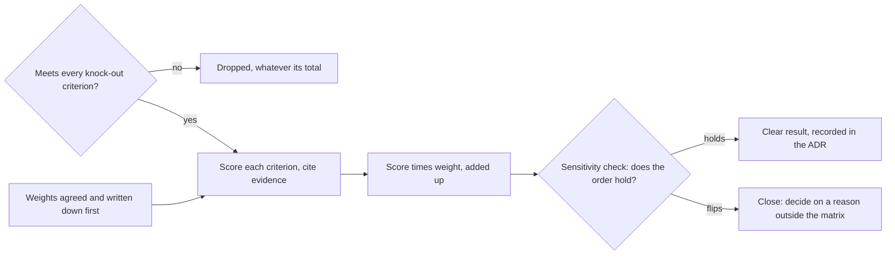

## Bạn cần biết trước

- [[management.l3.evaluating-a-vendor]] — bạn biết tiêu chí lấy từ yêu cầu và rủi ro của chính mình, và tiêu chí loại ngay được kiểm trước khi so bất cứ điều gì.
- [[management.l3.total-cost-of-ownership]] — bạn biết cộng chi phí của một phương án trong một khoảng thời gian đã nêu, tính cả giờ làm của người, và mọi con số đều là giả định.
- [[management.l3.vendor-contract-terms]] — bạn biết điều khoản hợp đồng nào quyết định chi phí kỹ thuật: xuất dữ liệu, báo trước khi API thay đổi, chi phí khi rời đi.
- [[design.l4.reduced-atam]] — bạn biết kiểu đánh giá giữ từng kịch bản riêng, thay vì cộng điểm thành một tổng cho mỗi phương án.

## Tình huống

Ở stage-4, Đơn Hàng vẫn chưa gửi được email cho khách thật, và đội phải chọn một dịch vụ gửi email trước khi khách thật đầu tiên tới. Trên bàn có ba phương án: hai dịch vụ bên ngoài, A và B, và tự chạy máy chủ email. Bạn đã chạy lần gửi thử, và B tránh được thư mục thư rác thường xuyên hơn A. Thế nhưng khi cộng hết mọi tiêu chí, A lại đứng đầu, hơn năm điểm trên năm trăm. Một đồng đội gợi ý nâng trọng số của khả năng tới hộp thư lên một chút, như vậy B sẽ đứng đầu. Phương án nào nên thắng, và khi nào bạn tin được con số nói điều đó?

## Khái niệm cốt lõi

- **ma trận chấm điểm có trọng số** (weighted scoring matrix) — một bảng chấm điểm từng phương án theo từng tiêu chí, nhân mỗi điểm với trọng số của tiêu chí đó rồi cộng lại, để các phương án mạnh ở những chỗ khác nhau nằm trên cùng một thang.
- tiêu chí loại ngay — một điều kiện kiểm trước và không có trọng số. Phương án trượt thì bị loại, dù tổng điểm của nó có thể là bao nhiêu.
- trọng số — mức một tiêu chí được tính, được thống nhất và viết ra trước khi chấm điểm bất kỳ phương án nào.
- bằng chứng cho một điểm — lần gửi thử, điều khoản hợp đồng hay con số chi phí mà điểm đó dựa vào, ghi ngay bên cạnh để có thể tranh luận riêng về từng điểm.
- kiểm tra độ nhạy — dịch từng trọng số trong một khoảng mà đội thấy hợp lý, và xem thứ tự các phương án có đổi không.

## Cơ chế hoạt động



Trong tình huống trên, mọi phương án trước hết phải đạt các tiêu chí loại ngay: gửi qua SMTP, giao thức chuẩn mà một chương trình dùng để chuyển email cho máy chủ gửi, có TLS và đăng nhập; có môi trường test; và xuất được danh sách địa chỉ bị trả lại hoặc bị chặn. Email bị trả lại là email quay về vì không gửi tới được. Địa chỉ bị chặn là địa chỉ dịch vụ không gửi tới nữa. Các tiêu chí này không có trọng số: phương án trượt một tiêu chí thì bị loại, nên giá thấp không bù được một thứ bắt buộc phải có. Cả ba phương án đều đạt.

Trước lần gửi thử đầu tiên, product owner và trưởng nhóm đã viết ra năm tiêu chí cùng trọng số, cộng lại bằng 100. Lúc đó chưa ai thấy điểm nào, nên không ai nghiêng được trọng số về phía phương án mình thích.

Sau đó, mỗi phương án được chấm từ 1 đến 5 trên từng tiêu chí, và mỗi điểm ghi rõ bằng chứng, như kết quả một lần gửi thử hay một điều khoản trong hợp đồng mẫu. Mỗi điểm nhân với trọng số, rồi cộng các tích lại. Điểm tối đa là 5 và trọng số cộng lại bằng 100, nên tổng cao nhất có thể là 500. A được 4 ở khả năng tới hộp thư, tiêu chí có trọng số 30, thành 120. Các dòng của A cộng lại được 390, của B 385, tự chạy máy chủ 210.

Cách nhau năm điểm thì chưa phải câu trả lời. Kiểm tra độ nhạy dịch từng trọng số lên hoặc xuống 10 và chia phần chênh cho bốn tiêu chí còn lại. Khi thứ tự giữ nguyên trong mọi trường hợp, tổng cao nhất là một kết quả rõ ràng. Khi thứ tự đảo, các phương án sát nhau, và một lý do nằm ngoài ma trận sẽ quyết định, ghi trong ADR. Ở đây A và B đổi chỗ cho nhau, còn tự chạy máy chủ luôn đứng cuối.

## Trong hệ thống Đơn Hàng

Các tiêu chí loại ngay và trọng số, trong `docs/team/email-service-evaluation.md`:

```markdown file=docs/team/email-service-evaluation.md tag=stage-4 lines=27-51
Kiểm trước, không có trọng số. Phương án không đạt một tiêu chí thì bị loại,
dù tổng điểm của nó có thể là bao nhiêu.

| Số | Tiêu chí | Vì sao | Dịch vụ A | Dịch vụ B | Tự chạy |
|---|---|---|---|---|---|
| L1 | Nhận email qua SMTP có TLS, có đăng nhập | Notifications giữ `MailKitEmailSender`: lớp này hôm nay nối Mailpit không TLS, nên chỉ cần thêm cấu hình TLS và đăng nhập, không viết lớp gửi mới | Đạt | Đạt | Đạt |
| L2 | Có môi trường test, gửi được mà không tới hộp thư thật | Thử cách nối trước khi gửi cho khách | Đạt | Đạt | Đạt: một bản cài thứ hai |
| L3 | Xuất được danh sách địa chỉ bị trả lại hoặc bị chặn | Không mất danh sách khi rời đi | Đạt: mọi lúc, qua API | Đạt: mỗi tháng một lần, qua trang quản trị | Đạt: dữ liệu ở máy của đội |

Không phương án nào bị loại.

### Trọng số, chốt trước khi chấm

Product owner và trưởng nhóm chốt bảng này trước lần gửi thử đầu tiên, khi
chưa ai thấy điểm của phương án nào. Trọng số viết trước thì không bị kéo về
phía phương án ai đó đã thích.

| Số | Tiêu chí | Trọng số | Lý do | Nguồn |
|---|---|---|---|---|
| K1 | Email tới hộp thư chính của khách, không vào thư rác (đo bằng gửi thử) | 30 | Email không tới thì mọi thứ khác không đáng kể | YC-5 của `refund-requirements.md`; email đơn hàng giữ như hôm nay (`multi-shop-requirements.md`, mục Không đổi) |
| K2 | Báo từng email bị trả lại, để Notifications ngừng gửi tới địa chỉ đó | 20 | Gửi lặp tới địa chỉ hỏng làm dịch vụ hạ uy tín người gửi, kéo theo email của mọi cửa hàng | Rủi ro E1 bên dưới |
| K3 | TCO 3 năm, gồm giờ của đội | 25 | Phí rẻ không có nghĩa là rẻ nếu đội phải tự lo phần còn lại | `self-run-components.md` |
| K4 | Điều khoản rời đi: giữ dữ liệu sau khi hợp đồng kết thúc, xóa có xác nhận, thời gian báo trước khi chấm dứt | 15 | Đổi dịch vụ phải làm được mà không mất dữ liệu | Cách đọc điều khoản trong `payment-gateway-evaluation.md` |
| K5 | Hỗ trợ khi sự cố | 10 | Email đến muộn đã được chấp nhận (R6), nên hỗ trợ nhẹ ký hơn | R6 của `risk-register-example.md` |
| | Tổng | 100 | | |
```

Dòng 27–28 biến L1–L3 thành đạt hoặc trượt, không có trọng số. Dòng 32 gắn L1 với code: `MailKitEmailSender`, lớp Notifications dùng để gửi email, hôm nay nói chuyện với Mailpit, một công cụ chạy cục bộ giữ email lại thay vì gửi đi. Vì vậy lớp này được giữ, chỉ cần thêm cấu hình TLS và đăng nhập. Dòng 40–42 ("Product owner và trưởng nhóm chốt…") nói ai chốt trọng số và chốt lúc nào: trước lần gửi thử đầu tiên, khi chưa ai thấy điểm. Dòng 46–50 cho mỗi trọng số một lý do và một nguồn, nên tranh luận về một trọng số nghĩa là tranh luận với lý do đó.

Điểm nằm ở mục "Điểm" của file, ngoài các đoạn trích này, và mỗi dòng ở đó đều ghi bằng chứng. Điểm 5 của B ở K1 dựa trên một lần gửi thử 1.000 email, 97% vào hộp thư chính. Điểm 5 của A ở K4 dựa trên một hợp đồng mẫu giữ dữ liệu 30 ngày, sau đó xóa và xác nhận đã xóa. Mọi con số như vậy đều được đánh dấu là giả định.

Phần kiểm tra độ nhạy:

```markdown file=docs/team/email-service-evaluation.md tag=stage-4 lines=88-110
### Độ nhạy

Trọng số là ước đoán, nên đội đổi từng trọng số 10 điểm lên hoặc xuống và
chia phần chênh đều cho bốn tiêu chí còn lại (mỗi tiêu chí 2,5), để tổng vẫn
là 100.

| Thay đổi | Dịch vụ A | Dịch vụ B | Tự chạy | Đứng đầu |
|---|---|---|---|---|
| Không đổi | 390 | 385 | 210 | A |
| K1 +10 | 390 | 402,5 | 207,5 | B |
| K1 −10 | 390 | 367,5 | 212,5 | A |
| K2 +10 | 390 | 377,5 | 207,5 | A |
| K2 −10 | 390 | 392,5 | 212,5 | B |
| K3 +10 | 377,5 | 390 | 195 | B |
| K3 −10 | 402,5 | 380 | 225 | A |
| K4 +10 | 402,5 | 377,5 | 245 | A |
| K4 −10 | 377,5 | 392,5 | 175 | B |
| K5 +10 | 390 | 377,5 | 195 | A |
| K5 −10 | 390 | 392,5 | 225 | B |

A và B đổi chỗ ở năm trong mười trường hợp, chênh nhau không quá 25 điểm
trên 500. Tự chạy đứng cuối trong mọi trường hợp, vì giờ vận hành kéo K3 và K5
xuống.
```

Dòng 90–92 ("Trọng số là ước đoán…") nêu quy tắc: mỗi trọng số lên hoặc xuống 10, phần chênh chia đều mỗi tiêu chí 2,5, để tổng trọng số vẫn là 100. Dòng 96 là ma trận như đã chấm: A 390, B 385. Trong dòng 97–106, A và B thay nhau đứng đầu, và dòng 108–109 đếm được năm lần đổi chỗ trong mười, chênh lệch không bao giờ quá 25 trên 500. Dòng 109–110 giải thích vì sao tự chạy máy chủ luôn đứng cuối: giờ vận hành của đội kéo K3 và K5 xuống. Như vậy ma trận loại hẳn một phương án và nói hai phương án còn lại sát nhau.

Từ đó ADR `0024` tiếp tục. ADR chọn A dựa trên hai điều khoản hợp đồng mà ma trận không chấm: A báo trước 6 tháng khi đổi hay ngừng một phiên bản API, B báo trước 1 tháng; A cho đội xuất danh sách địa chỉ bị chặn bất cứ lúc nào qua API, B mỗi tháng một lần qua trang quản trị. L3 chỉ hỏi có xuất được hay không. Xuất bao lâu một lần thì chưa từng được chấm, nên nó dùng được để phân xử khi hòa. Mục "Ý kiến đã nhận" của ADR trả lời backend developer đã hỏi sao không chọn B: chênh lệch ở lần gửi thử chưa đủ để quyết định, vì đổi một trọng số là thứ tự đổi.

## Đánh đổi

| Cách so phương án | Cho thấy gì | Có thể che gì | Hợp khi |
|---|---|---|---|
| Ma trận chấm điểm có trọng số kèm kiểm tra độ nhạy, như trong `email-service-evaluation.md` | một tổng cho mỗi phương án, và thứ tự đó vững tới đâu | một điểm rất tệ ở một tiêu chí, được bù bằng điểm tốt ở chỗ khác | nhiều phương án mạnh ở những chỗ khác nhau, trên các tiêu chí có thể đổi qua lại cho nhau |
| Xét từng tiêu chí hay kịch bản riêng, không cộng tổng, như reduced ATAM | chính xác mỗi phương án yếu ở đâu | phương án nào tốt hơn về tổng thể, để lại cho phán đoán | một điểm yếu nghiêm trọng không bao giờ được phép đổi lấy thứ khác |
| Chọn theo một tiêu chí quan trọng nhất, như lần gửi thử | một câu trả lời nhanh | mọi thứ khác: B chỉ báo trước 1 tháng khi đổi API, B chỉ hiện khiếu nại thư rác trong trang quản trị | một tiêu chí quan trọng tới mức các tiêu chí khác gần như không đáng kể |

Cộng điểm là thứ giúp ma trận so được những điểm mạnh khác loại, và cũng là cách một điểm yếu biến mất vào tổng. Đơn Hàng xử lý chuyện đó bằng cách biến mọi thứ không được phép đánh đổi thành tiêu chí loại ngay, và chỉ dùng trọng số cho phần còn lại.

## Bạn sẽ chọn gì nếu…

…một phương án trượt một tiêu chí loại ngay nhưng lẽ ra có tổng cao nhất? Loại nó. L1–L3 không có trọng số vì đó không phải thứ đội đem ra đánh đổi. Nếu tổng cao bù được việc trượt một tiêu chí như vậy, thì ngay từ đầu nó đã là một tiêu chí có trọng số.

…kiểm tra độ nhạy giữ nguyên thứ tự ở mọi dòng? Khi đó tổng là một kết quả vững, như với tự chạy máy chủ, đứng cuối trong cả mười một dòng của bảng. Ghi nó vào ADR, trỏ tới bản đánh giá, như ADR `0024` làm.

…các phương án khác nhau ở một điểm không tiêu chí nào chấm, như thời gian báo trước khi API đổi? Dùng ma trận trước để biết các phương án có sát nhau không. Nếu sát, để lý do đó quyết định và ghi nó vào ADR, chứ không thêm một trọng số mới sau khi đã biết điểm.

## Senior hay nhầm rằng…

- **"Phương án có tổng cao nhất đương nhiên là lựa chọn đúng."** → Thực ra một tổng chỉ vững bằng các trọng số đứng sau nó. A hơn B 5 trên 500, và dịch một trọng số 10 điểm là hai bên đổi chỗ ở năm trong mười trường hợp. Kiểm tra độ nhạy cho bạn biết tổng đang quyết định hay chỉ đang hòa. Bạn sẽ nhận ra khi một lựa chọn được bảo vệ bằng một khoảng cách nhỏ hơn mức mà một lần đổi trọng số hợp lý tạo ra.
- **"Ma trận chấm điểm là khách quan vì nó kết thúc bằng một con số."** → Thực ra mỗi trọng số là một phán đoán, và mỗi điểm là một phán đoán về bằng chứng. Ma trận làm các phán đoán đó hiện ra và cho phép tranh luận từng cái một. Bạn sẽ nhận ra khi mọi người cãi nhau về tổng mà không ai chỉ ra được mình không đồng ý với điểm nào.
- **"Có thể chỉnh trọng số sau khi chấm nếu kết quả trông không đúng."** → Thực ra trọng số đổi sau khi đã biết điểm có thể bị bẻ về phía phương án ai đó đã thích, và ma trận khi đó chỉ xác nhận lại sự ưa thích ấy. Nếu kết quả trông không đúng, hãy chỉ ra điểm hay tiêu chí bạn cho là sai, hoặc để kiểm tra độ nhạy nói các phương án sát nhau. Bạn sẽ nhận ra khi trọng số cuối cùng khác bản viết đầu tiên, và thay đổi đó tình cờ có lợi cho phương án thắng.

## Thử ngay (3 phút)

Mở `docs/team/email-service-evaluation.md` trong repository `don-hang` ở tag `stage-4` và đọc điểm của Dịch vụ A và Dịch vụ B trong mục "Điểm".

1. Sau khi thấy điểm, đồng đội đề xuất trọng số mới: K1 40, K4 5, còn K2, K3, K5 giữ nguyên 20, 25 và 10. Tính tổng mới của A và B.
2. Quyết định đội có nên dùng trọng số này không, và nói đội nên làm gì thay vào đó.

Kết quả mong đợi: A 380 và B 405, nên B giờ dẫn đầu, kèm một lý do vì sao không dùng trọng số mới.

<details><summary>Gợi ý đáp án</summary>

A được 4, 4, 3, 5, 4 ở K1–K5: 160 + 80 + 75 + 25 + 40 = 380. B được 5, 3, 4, 3, 3: 200 + 60 + 100 + 15 + 30 = 405.

Trọng số mới được chọn sau khi đã biết điểm, và chúng dời 10 điểm sang tiêu chí B mạnh nhất, khỏi tiêu chí A mạnh nhất. Đó chính là kiểu bẻ trọng số mà viết trọng số trước ngăn lại. Kiểm tra độ nhạy đã cho thấy A và B sát nhau, nên đội giữ trọng số đã thống nhất, chấp nhận rằng ma trận gọi đây là hòa, và quyết định dựa trên một lý do ngoài ma trận, như ADR `0024` làm.

</details>

## Liên hệ

- [[management.l3.evaluating-a-vendor]] — nơi tiêu chí và tiêu chí loại ngay ra đời. Bài này thêm trọng số và tổng.
- [[management.l3.total-cost-of-ownership]] — con số đứng sau K3. Ma trận chấm nó, không tính lại nó.
- [[management.l3.vendor-contract-terms]] — các điều khoản đứng sau K4, và hai điều khoản quyết định trong ADR `0024`.
- [[design.l4.reduced-atam]] — lựa chọn ngược lại: giữ từng kịch bản riêng thay vì cộng tổng.
- [[management.l3.weighing-options-in-an-adr]] — nơi ghi kết quả. ADR trỏ tới ma trận thay vì chép lại.
- [[management.l3.build-buy-or-adopt]] — câu hỏi rộng hơn mà ba phương án trả lời: mua dịch vụ hay tự chạy.
- [[management.l4.lightweight-governance]] — nơi việc thêm một dịch vụ trả phí được liệt kê là quyết định cần ADR.
- [[management.l4.deciding-under-uncertainty]] — bài tiếp theo: một quyết định cần cân nhắc kỹ tới đâu khi đầu vào của nó là ước đoán.

## Tóm tắt 5 dòng

1. Ma trận chấm điểm có trọng số nhân điểm của mỗi phương án ở từng tiêu chí với trọng số của tiêu chí đó rồi cộng lại, đưa những điểm mạnh khác loại về một thang.
2. Tiêu chí loại ngay được kiểm trước và không có trọng số. Phương án trượt một tiêu chí như vậy bị loại, dù tổng là bao nhiêu.
3. Trọng số được thống nhất và viết ra trước khi chấm, và mỗi điểm ghi bằng chứng, nên có thể tranh luận riêng về từng điểm.
4. Kiểm tra độ nhạy dịch từng trọng số trong một khoảng hợp lý. Nếu thứ tự đảo, ma trận nói các phương án sát nhau.
5. Trong `email-service-evaluation.md`, A và B đổi chỗ, nên ADR `0024` chọn giữa hai bên dựa trên các điều khoản hợp đồng nằm ngoài ma trận.
