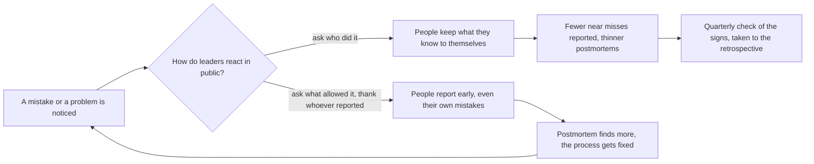

## Before you start

- [[devops.l4.blameless-postmortems]] — you know a blameless postmortem asks what the system and the process allowed, and that `0001` records contributing factors and action items with owners.
- [[devops.l4.delivery-metrics]] — you know the four delivery metrics describe the delivery system, not people, and that used to rank developers they get gamed.
- [[management.l4.sustainable-on-call]] — you know the monthly on-call count is used to share load and never to rate anyone.

## The situation

Postmortem `0001` was written from a staging drill as if the incident were real, and its review went well: the template asked what let a configuration change skip the canary, not who made the commit. Now imagine the same incident in production. The next morning a manager asks in the team chat, "Who pushed that commit?" Nobody answers. A month later a developer notices an odd limit in the config repository, fixes it quietly and tells no one. The template has not changed, yet the next postmortem will have less to work with. What makes a team keep telling what it knows after a mistake?

## Core concepts

- **psychological safety** — a team's shared belief that a person can admit a mistake, ask a question or raise a problem without being punished or shamed; in the situation above, the manager's one question lowered it. `blameless-culture.md` lines 5–8 name it as the goal of the leaders' commitments.
- Leaders (a plain phrase, used in this sense here) — in `docs/team/blameless-culture.md`, Đơn Hàng's short document of what its leaders commit to, the team lead, the product owner (the person who decides what the team builds next) and each person's direct manager, whose reactions to a mistake show everyone else what is safe to say.
- Near miss (a plain phrase, used in this sense here) — a problem noticed before it hurt any customer, like the odd limit in the situation above; it reaches the team only if someone chooses to report it.
- Held responsible (a plain phrase, used in this sense here) — owning your action items until they are done and telling your part of the review accurately; it is not the same as being blamed, which aims at a person.
- Retrospective (a plain phrase, used in this sense here) — the team's own meeting about how it works together, as opposed to the review of one incident.

## How it works



Start on the left. Someone makes a mistake or spots one. What happens next depends on what leaders do in public in the hours and days after, not only on the postmortem template: `blameless-culture.md` lines 3–5 say the template is not enough if a leader asks who did it.

On the upper branch, a leader asks who did it, like the manager in the team chat. Nobody was punished, yet everyone learned that a mistake leads to a name. Psychological safety drops, people keep what they know to themselves, and the next postmortem has fewer facts to work with.

On the lower branch, a leader asks what allowed the failure and thanks whoever reported it first. People then report early, their own mistakes included. The postmortem finds more contributing factors, and its action items fix the process. The arrow back to the left is the point: each safe reaction makes the next report more likely.

Blameless does not mean nobody is responsible. On both branches people still own their action items and tell their part of the review. What changes is what the review is for: learning how the system let the failure through, not judging a person.

Safety is a belief, so you cannot read it directly. The last node on the upper branch, "Quarterly check of the signs", is how `blameless-culture.md` watches it: every quarter the team lead checks signs that people are starting to stay quiet. The check exists to catch the upper branch early; any sign it finds goes to the next retrospective.

## In the Đơn Hàng system

`blameless-culture.md` opens with the problem from the situation and then lists what leaders commit to:

```markdown file=docs/team/blameless-culture.md tag=stage-4 lines=3-19
Mẫu postmortem không đổ lỗi (`docs/postmortems/template.md`) chưa đủ. Nếu sau
sự cố người lãnh đạo hỏi "ai làm", mọi người học cách giấu điều mình biết, và
postmortem kế tiếp tìm được ít hơn. Tài liệu này ghi những điều người lãnh đạo
của đội (trưởng nhóm, product owner, và quản lý trực tiếp) cam kết giữ trước
mọi người, để ai cũng nhận được lỗi, hỏi được và báo được vấn đề mà không bị
phạt hay bị làm xấu hổ.

### Điều lãnh đạo cam kết

- Postmortem và số sự cố không bao giờ được dùng để đánh giá một người.
- Người báo một vấn đề đầu tiên được cảm ơn trước cả đội, kể cả khi vấn đề do
  chính họ gây ra.
- Sau sự cố, câu hỏi là điều gì đã cho phép nó xảy ra, không phải ai đã làm.
  Postmortem 0001 (`docs/postmortems/0001-doc-san-pham-tra-503.md`) là ví dụ:
  mục "Yếu tố góp phần" ghi rằng quy tắc "thay đổi cấu hình cũng qua canary"
  chưa được viết ra ở đâu, nên người làm có lý do hợp lý để nghĩ khác, và action
  item sửa quy trình, không nhắm vào người commit.
```

Lines 3–5 say the template alone is not enough: if a leader asks who did it, people learn to hide what they know. Lines 5–8 name the leaders and say the commitments are kept in front of everyone. Line 12 commits that postmortems and incident counts are never used to judge a person. Lines 13–14 thank the first person to report a problem in front of the whole team, even when they caused it.

Lines 15–19 point at postmortem `0001`: the rule that configuration changes also go through the canary was written nowhere, so the person had a reasonable ground to think otherwise. In `0001` itself, the action item that writes the rule down is owned by the team lead, a role, not the person who made the commit.

The second half keeps responsibility and says how safety is watched:

```markdown file=docs/team/blameless-culture.md tag=stage-4 lines=21-45
### Trách nhiệm vẫn còn

Không đổ lỗi không có nghĩa là không ai chịu trách nhiệm:

- Mỗi người vẫn giữ action item của mình tới khi xong, như cột "Người phụ
  trách" của postmortem.
- Mỗi người vẫn kể đúng phần mình trong buổi xem lại: đã thấy gì, đã làm gì,
  vì sao lúc đó thấy hợp lý.
- Một hành vi lặp lại của cùng một người được quản lý trực tiếp xử lý riêng,
  ngoài postmortem. Postmortem không phải chỗ cho việc đó.

### Số đo đọc theo đội và hệ thống

Bốn số đo phát hành (`delivery-metrics.md`) mô tả hệ thống phát hành, không
mô tả từng người, và không được dùng để xếp hạng ai. Số sự cố và số postmortem
cũng vậy.

### Dấu hiệu đang trượt

Mỗi quý, trưởng nhóm xem các dấu hiệu cho thấy mọi người bắt đầu ngại nói:

- Số lần suýt xảy ra sự cố được báo trong quý giảm, trong khi số deploy không
  giảm.
- Có sự cố mà cửa hàng phát hiện trước đội.
- Postmortem ngắn dần: ít yếu tố góp phần, dòng thời gian thiếu mốc.
```

Lines 23–30 keep responsibility: each person holds their action items until done, like the owner column of the postmortem, and tells their part of the review — what they saw, what they did, why it seemed reasonable then. A pattern repeated by the same person goes to the direct manager, privately, outside the postmortem.

Lines 34–36 extend line 12 to the four delivery metrics and to the number of incidents and postmortems: none of them may rank anyone. `delivery-metrics.md` gives the reason: used to rank developers, people tune the number instead of the system, for example by not writing an incident record.

Lines 40–45 are the quarterly signs: fewer near misses reported while deploys hold steady, an incident a shop notices before the team, and postmortems getting shorter. Lines 47–48, after the excerpt, take any sign to the next retrospective as a problem of the team, without hunting for whoever stayed quiet.

## Trade-offs

| How leaders respond after a mistake | What people report next time | What the postmortem finds | Who owns the fixes | Fits when |
|---|---|---|---|---|
| Find who did it and act on them in public | as little as they can | the last change and its author | the person blamed | never for a mistake; `blameless-culture.md` rules it out |
| Blameless template, but leaders still ask who | what the template forces them to write | fewer facts each time | owners named, but they say little in the review | rarely; it is the gap lines 3–5 open with |
| Blameless with nobody responsible | most problems | many contributing factors | nobody, so action items stay open | rarely; it is the misreading lines 23–30 rule out |
| Rules kept in public, responsibility kept, repeated patterns handled privately | problems and near misses, early | several contributing factors and process fixes | each action item's named owner | the document's choice; it holds only while leaders keep it after a costly incident too |

## What would you choose if…

…the same developer's change starts a second incident within a quarter? The postmortem still asks what allowed it, because two incidents through the same gap point at the gap. If the direct manager sees a pattern in how the person works, lines 29–30 move that conversation out of the postmortem into a private one. Keeping the two apart keeps the review a place where people speak freely.

…someone outside the team asks for incident counts per developer to decide who is doing well? Line 12 and lines 34–36 say no. Offer what the numbers are for: the team's four delivery metrics as trends over several quarters, which `delivery-metrics.md` says the team reads together with that quarter's incident records.

…reported near misses fell from several a quarter to none, while deploys held steady? That is the first sign in lines 42–43. One reasonable step, following lines 47–48, is to take it to the next retrospective and ask what has made reporting feel risky, rather than treating the drop as good news or asking who stopped reporting.

## Seniors often assume…

- **"A blameless culture means nobody is ever held responsible for anything."** → Actually blameless changes what the review judges, not whether people own work: each person keeps their action items until done and tells their part of the review, and a repeated pattern is handled privately by the direct manager. You notice the misreading when postmortem action items stay open sprint after sprint because no owner is named.
- **"Using a blameless postmortem template is enough to make a team blameless."** → Actually people decide what to say from how leaders react, not from the headings of a form; one "who did it?" after an incident can undo what the template asks for. You notice this when postmortems get shorter, with fewer contributing factors and gaps in the timeline, while the template has not changed.
- **"Fewer reported problems means the team is making fewer mistakes."** → Actually a report depends on someone choosing to make it, so a falling count can mean people stopped speaking; `blameless-culture.md` reads fewer near misses with deploys held steady as a warning. You notice this when shops find an incident before the team does.

## Try it (3 minutes)

After an incident, five things happen:

1. The team lead opens the review by thanking the developer who raised the alarm, who also made the change.
2. A manager adds "incidents caused this year" to each developer's notes for the quarter.
3. The developer who made the change owns an action item to add a check, and keeps it until it is done.
4. In the review, the product owner asks the room who approved the pull request.
5. The same developer's third similar slip this quarter is discussed in the postmortem meeting.

Using lines 12–36 of `blameless-culture.md`, mark each as keeping or breaking a commitment, and name the lines.

Expected result: two keep a commitment, three break one, each tied to a line range.

<details><summary>Suggested answer</summary>

1 keeps it: the first person to report is thanked in front of the team, even when they caused the problem (lines 13–14).

2 breaks it: incident counts are never used to judge a person (line 12, and lines 34–36).

3 keeps it: responsibility remains, and each person holds their action items until done (lines 25–26); owning a fix is responsibility, not blame, and lines 18–19 aim action items at the process, not at a person.

4 breaks it: after an incident the question is what allowed it, not who did it (line 15).

5 breaks it: a repeated pattern by one person is handled privately by the direct manager, outside the postmortem (lines 29–30).

</details>

## Connections

- [[devops.l4.blameless-postmortems]] — the review this lesson keeps honest; its template works only while leaders keep the rules here.
- [[devops.l4.delivery-metrics]] — the measures `blameless-culture.md` forbids using to rank a person, for the reason given there: they get gamed.
- [[management.l4.sustainable-on-call]] — the same rule applied to on-call counts: used to share load, never to rate people.
- [[devops.l4.incident-command]] — the timeline kept during an incident, which the review afterwards needs people to tell fully.
- [[management.l3.technical-debt-register]] — another list that grows only when people write down what they know.
- [[management.l1.code-review-basics]] — the same habit at the smallest scale: comment on the code, not the person.
- [[management.l4.mentoring]] — next: growing people through real work, which needs them to admit what they do not know yet.

## Five-line summary

1. A blameless culture lasts only if leaders, in public, react to a mistake by asking what allowed it rather than who did it.
2. Psychological safety is a team's shared belief that admitting mistakes, asking or raising problems brings no punishment or shame.
3. `blameless-culture.md` never uses postmortems, incident counts or delivery metrics to judge a person, and thanks whoever reports a problem first.
4. People still own their action items and their part of the review; a repeated pattern is handled privately, outside the postmortem.
5. Each quarter the team lead checks signs such as fewer near misses or shops noticing incidents first, and takes them to the retrospective.
