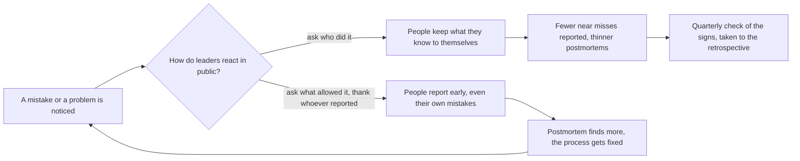

## Bạn cần biết trước

- [[devops.l4.blameless-postmortems]] — bạn biết postmortem không đổ lỗi hỏi hệ thống và quy trình đã cho phép điều gì, và `0001` ghi các yếu tố góp phần cùng các action item có người phụ trách.
- [[devops.l4.delivery-metrics]] — bạn biết bốn số đo giao phần mềm mô tả hệ thống giao phần mềm, không mô tả con người, và khi bị dùng để xếp hạng developer thì chúng bị lách.
- [[management.l4.sustainable-on-call]] — bạn biết số đếm trực sự cố hằng tháng dùng để chia tải, không bao giờ dùng để đánh giá ai.

## Tình huống

Postmortem `0001` được viết từ một buổi diễn tập trên staging, coi như sự cố là thật, và buổi xem lại diễn ra tốt: khuôn mẫu hỏi điều gì đã để một thay đổi cấu hình bỏ qua canary, không hỏi ai làm commit. Giờ hãy hình dung đúng sự cố đó xảy ra trên production. Sáng hôm sau, một quản lý hỏi trong nhóm chat của đội: "Ai đã push commit đó?" Không ai trả lời. Một tháng sau, một developer thấy một giới hạn lạ trong repo cấu hình, lặng lẽ sửa và không nói với ai. Khuôn mẫu không đổi, vậy mà postmortem kế tiếp sẽ có ít điều hơn để làm việc. Điều gì khiến một đội vẫn tiếp tục kể ra những gì mình biết sau một sai sót?

## Khái niệm cốt lõi

- **an toàn tâm lý** (psychological safety) — niềm tin chung của cả đội rằng một người có thể nhận lỗi, đặt câu hỏi hay nêu vấn đề mà không bị phạt hay bị làm cho bẽ mặt. Trong tình huống ở trên, chỉ một câu hỏi của người quản lý đã làm nó giảm xuống. Dòng 5–8 của `blameless-culture.md` gọi tên nó là mục tiêu của những cam kết từ người lãnh đạo.
- Người lãnh đạo (cụm từ thường, ở đây dùng theo nghĩa này) — theo `docs/team/blameless-culture.md`, tài liệu ngắn ghi những điều người lãnh đạo của Đơn Hàng cam kết, đó là trưởng nhóm, product owner (người quyết định đội làm gì tiếp theo) và quản lý trực tiếp của mỗi người. Cách họ phản ứng với một sai sót cho mọi người khác thấy điều gì nói ra thì an toàn.
- Suýt xảy ra sự cố (cụm từ thường, ở đây dùng theo nghĩa này) — một vấn đề được phát hiện trước khi gây hại cho khách nào, như giới hạn lạ trong tình huống ở trên. Nó chỉ tới được đội nếu có người chọn báo ra.
- Chịu trách nhiệm (cụm từ thường, ở đây dùng theo nghĩa này) — giữ action item của mình tới khi xong và kể đúng phần mình trong buổi xem lại. Điều này khác với bị đổ lỗi, thứ nhắm vào một con người.
- Retrospective (cụm từ thường, ở đây dùng theo nghĩa này) — buổi họp riêng của đội về cách cả đội làm việc với nhau, khác với buổi xem lại một sự cố.

## Cơ chế hoạt động



Đọc sơ đồ từ trái sang. Có người gây ra hoặc phát hiện một sai sót. Điều xảy ra tiếp theo phụ thuộc vào những gì người lãnh đạo làm trước mọi người trong vài giờ, vài ngày sau đó, chứ không chỉ vào khuôn mẫu postmortem. Dòng 3–5 của `blameless-culture.md` nói khuôn mẫu là chưa đủ nếu người lãnh đạo hỏi ai đã làm.

Ở nhánh trên, người lãnh đạo hỏi ai đã làm, như người quản lý trong nhóm chat. Không ai bị phạt, nhưng ai cũng học được rằng một sai sót sẽ dẫn tới một cái tên. An toàn tâm lý giảm, mọi người giữ điều mình biết cho riêng mình, và postmortem kế tiếp có ít dữ kiện hơn để làm việc.

Ở nhánh dưới, người lãnh đạo hỏi điều gì đã để lỗi xảy ra và cảm ơn người báo đầu tiên. Khi đó mọi người báo sớm, kể cả lỗi của chính họ. Postmortem tìm được nhiều yếu tố góp phần hơn, và các action item của nó sửa quy trình. Mũi tên quay về bên trái mới là điểm chính: mỗi lần phản ứng an toàn khiến lần báo sau dễ xảy ra hơn.

Không đổ lỗi không có nghĩa là không ai chịu trách nhiệm. Ở cả hai nhánh, mọi người vẫn giữ action item của mình và kể phần mình trong buổi xem lại. Điều thay đổi là buổi xem lại dùng để làm gì: học xem hệ thống đã để lỗi lọt qua thế nào, không phải để phán xét một người.

An toàn là một niềm tin, nên bạn không đọc trực tiếp được nó. Nút cuối của nhánh trên, "Quarterly check of the signs", là cách `blameless-culture.md` theo dõi nó: mỗi quý, trưởng nhóm xem các dấu hiệu cho thấy mọi người bắt đầu ngại nói. Lần kiểm tra này có mặt để bắt sớm nhánh trên. Dấu hiệu nào tìm thấy cũng được đưa vào retrospective kế tiếp.

## Trong hệ thống Đơn Hàng

`blameless-culture.md` mở đầu bằng đúng vấn đề trong tình huống, rồi liệt kê những điều người lãnh đạo cam kết:

```markdown file=docs/team/blameless-culture.md tag=stage-4 lines=3-19
Mẫu postmortem không đổ lỗi (`docs/postmortems/template.md`) chưa đủ. Nếu sau
sự cố người lãnh đạo hỏi "ai làm", mọi người học cách giấu điều mình biết, và
postmortem kế tiếp tìm được ít hơn. Tài liệu này ghi những điều người lãnh đạo
của đội (trưởng nhóm, product owner, và quản lý trực tiếp) cam kết giữ trước
mọi người, để ai cũng nhận được lỗi, hỏi được và báo được vấn đề mà không bị
phạt hay bị làm xấu hổ.

### Điều lãnh đạo cam kết

- Postmortem và số sự cố không bao giờ được dùng để đánh giá một người.
- Người báo một vấn đề đầu tiên được cảm ơn trước cả đội, kể cả khi vấn đề do
  chính họ gây ra.
- Sau sự cố, câu hỏi là điều gì đã cho phép nó xảy ra, không phải ai đã làm.
  Postmortem 0001 (`docs/postmortems/0001-doc-san-pham-tra-503.md`) là ví dụ:
  mục "Yếu tố góp phần" ghi rằng quy tắc "thay đổi cấu hình cũng qua canary"
  chưa được viết ra ở đâu, nên người làm có lý do hợp lý để nghĩ khác, và action
  item sửa quy trình, không nhắm vào người commit.
```

Dòng 3–5 nói riêng khuôn mẫu thì chưa đủ: nếu người lãnh đạo hỏi ai đã làm, mọi người học cách giấu điều mình biết. Dòng 5–8 gọi tên những người lãnh đạo và nói các cam kết được giữ trước mọi người. Dòng 12 cam kết rằng postmortem và số sự cố không bao giờ được dùng để đánh giá một người. Dòng 13–14 cảm ơn người đầu tiên báo một vấn đề trước cả đội, kể cả khi chính họ gây ra nó.

Dòng 15–19 chỉ tới postmortem `0001`: quy tắc thay đổi cấu hình cũng phải qua canary chưa được viết ra ở đâu, nên người làm có lý do hợp lý để nghĩ khác. Trong chính `0001`, action item ghi quy tắc đó ra văn bản do trưởng nhóm phụ trách, tức một vai trò, không phải người đã làm commit.

Nửa sau giữ lại trách nhiệm và nói an toàn được theo dõi thế nào:

```markdown file=docs/team/blameless-culture.md tag=stage-4 lines=21-45
### Trách nhiệm vẫn còn

Không đổ lỗi không có nghĩa là không ai chịu trách nhiệm:

- Mỗi người vẫn giữ action item của mình tới khi xong, như cột "Người phụ
  trách" của postmortem.
- Mỗi người vẫn kể đúng phần mình trong buổi xem lại: đã thấy gì, đã làm gì,
  vì sao lúc đó thấy hợp lý.
- Một hành vi lặp lại của cùng một người được quản lý trực tiếp xử lý riêng,
  ngoài postmortem. Postmortem không phải chỗ cho việc đó.

### Số đo đọc theo đội và hệ thống

Bốn số đo phát hành (`delivery-metrics.md`) mô tả hệ thống phát hành, không
mô tả từng người, và không được dùng để xếp hạng ai. Số sự cố và số postmortem
cũng vậy.

### Dấu hiệu đang trượt

Mỗi quý, trưởng nhóm xem các dấu hiệu cho thấy mọi người bắt đầu ngại nói:

- Số lần suýt xảy ra sự cố được báo trong quý giảm, trong khi số deploy không
  giảm.
- Có sự cố mà cửa hàng phát hiện trước đội.
- Postmortem ngắn dần: ít yếu tố góp phần, dòng thời gian thiếu mốc.
```

Dòng 23–30 giữ lại trách nhiệm: mỗi người giữ action item của mình tới khi xong, như cột người phụ trách của postmortem, và kể phần mình trong buổi xem lại — đã thấy gì, đã làm gì, vì sao lúc đó thấy hợp lý. Một hành vi lặp lại của cùng một người được chuyển cho quản lý trực tiếp, xử lý riêng, ngoài postmortem.

Dòng 34–36 mở rộng dòng 12 sang bốn số đo giao phần mềm và sang số sự cố, số postmortem: không con số nào trong đó được dùng để xếp hạng ai. `delivery-metrics.md` nêu lý do: khi bị dùng để xếp hạng developer, người ta chỉnh con số thay vì chỉnh hệ thống, chẳng hạn bằng cách không viết bản ghi sự cố.

Dòng 40–45 là các dấu hiệu hằng quý: số lần suýt xảy ra sự cố được báo giảm trong khi số deploy giữ nguyên, có sự cố cửa hàng phát hiện trước đội, và postmortem ngắn dần. Dòng 47–48, ở ngoài đoạn trích, đưa mọi dấu hiệu vào retrospective kế tiếp như một vấn đề của cả đội, không đi tìm xem ai đã im lặng.

## Đánh đổi

| Cách người lãnh đạo phản ứng sau một sai sót | Lần sau mọi người báo gì | Postmortem tìm thấy gì | Ai giữ các bản sửa | Hợp khi |
|---|---|---|---|---|
| Tìm ai đã làm và xử lý họ trước mọi người | càng ít càng tốt | thay đổi cuối cùng và người làm nó | người bị đổ lỗi | không bao giờ với một sai sót, `blameless-culture.md` loại bỏ cách này |
| Khuôn mẫu không đổ lỗi, nhưng người lãnh đạo vẫn hỏi ai | những gì khuôn mẫu buộc phải viết | mỗi lần ít dữ kiện hơn | có ghi người phụ trách, nhưng họ nói rất ít trong buổi xem lại | hiếm khi, đây chính là lỗ hổng mà dòng 3–5 mở đầu |
| Không đổ lỗi và cũng không ai chịu trách nhiệm | phần lớn vấn đề | nhiều yếu tố góp phần | không ai, nên action item cứ mở mãi | hiếm khi, đây là cách hiểu sai mà dòng 23–30 loại bỏ |
| Giữ quy tắc trước mọi người, giữ trách nhiệm, hành vi lặp lại xử lý riêng | vấn đề và các lần suýt xảy ra sự cố, báo sớm | vài yếu tố góp phần và các bản sửa quy trình | người phụ trách có tên của mỗi action item | lựa chọn của tài liệu, chỉ đứng vững khi người lãnh đạo giữ nó cả sau một sự cố gây thiệt hại lớn |

## Bạn sẽ chọn gì nếu…

…thay đổi của cùng một developer gây ra sự cố thứ hai trong một quý? Postmortem vẫn hỏi điều gì đã để lỗi xảy ra, vì hai sự cố đi qua cùng một lỗ hổng là đang chỉ vào lỗ hổng đó. Nếu quản lý trực tiếp thấy một khuôn mẫu lặp lại trong cách người đó làm việc, dòng 29–30 đưa cuộc trao đổi đó ra khỏi postmortem, thành một cuộc nói chuyện riêng. Tách hai việc này ra giữ cho buổi xem lại là nơi mọi người nói thoải mái.

…một người ngoài đội xin số sự cố theo từng developer để quyết định ai đang làm tốt? Dòng 12 và dòng 34–36 nói không. Hãy đưa ra thứ các con số được làm ra để phục vụ: bốn số đo giao phần mềm của đội dưới dạng xu hướng qua nhiều quý, mà `delivery-metrics.md` nói đội đọc cùng với các bản ghi sự cố của quý đó.

…số lần suýt xảy ra sự cố được báo giảm từ vài lần mỗi quý xuống không lần nào, trong khi số deploy giữ nguyên? Đó là dấu hiệu đầu tiên ở dòng 42–43. Một bước hợp lý, theo dòng 47–48, là đưa nó vào retrospective kế tiếp và hỏi điều gì đã khiến mọi người thấy báo ra là rủi ro, thay vì coi mức giảm là tin tốt hay hỏi ai đã thôi không báo.

## Senior hay nhầm rằng…

- **"Văn hóa không đổ lỗi nghĩa là không bao giờ có ai phải chịu trách nhiệm cho điều gì."** → Thực ra không đổ lỗi thay đổi điều buổi xem lại phán xét, không thay đổi chuyện mỗi người vẫn giữ phần việc của mình: mỗi người giữ action item của mình tới khi xong và kể phần mình trong buổi xem lại, còn hành vi lặp lại do quản lý trực tiếp xử lý riêng. Bạn sẽ nhận ra cách hiểu sai này khi action item của postmortem cứ mở qua sprint này tới sprint khác vì không có người phụ trách nào được ghi tên.
- **"Dùng khuôn mẫu postmortem không đổ lỗi là đủ để cả đội không đổ lỗi."** → Thực ra mọi người quyết định nói gì dựa trên cách người lãnh đạo phản ứng, không dựa trên các tiêu đề của một biểu mẫu. Chỉ một câu "ai làm?" sau sự cố là có thể xóa đi điều khuôn mẫu yêu cầu. Bạn sẽ nhận ra khi postmortem ngắn dần, ít yếu tố góp phần hơn và dòng thời gian thiếu mốc, trong khi khuôn mẫu không hề đổi.
- **"Vấn đề được báo ít đi nghĩa là đội đang mắc ít lỗi hơn."** → Thực ra mỗi lần báo phụ thuộc vào việc có người chọn báo ra, nên con số giảm có thể có nghĩa là mọi người đã thôi lên tiếng. `blameless-culture.md` coi số lần suýt xảy ra sự cố giảm trong khi số deploy giữ nguyên là một cảnh báo. Bạn sẽ nhận ra khi cửa hàng phát hiện một sự cố trước đội.

## Thử ngay (3 phút)

Sau một sự cố, có năm việc xảy ra:

1. Trưởng nhóm mở đầu buổi xem lại bằng lời cảm ơn developer đã báo động, cũng là người đã làm thay đổi.
2. Một quản lý thêm dòng "số sự cố đã gây ra trong năm" vào ghi chú quý của từng developer.
3. Developer đã làm thay đổi nhận một action item thêm phép kiểm, và giữ nó tới khi xong.
4. Trong buổi xem lại, product owner hỏi cả phòng ai đã duyệt pull request.
5. Lần sơ suất tương tự thứ ba trong quý của cùng developer đó được đem ra bàn trong buổi họp postmortem.

Dựa vào dòng 12–36 của `blameless-culture.md`, đánh dấu mỗi việc là giữ hay phá một cam kết, và nêu các dòng tương ứng.

Kết quả mong đợi: hai việc giữ cam kết, ba việc phá cam kết, mỗi việc gắn với một khoảng dòng.

<details><summary>Gợi ý đáp án</summary>

1 giữ cam kết: người báo đầu tiên được cảm ơn trước cả đội, kể cả khi chính họ gây ra vấn đề (dòng 13–14).

2 phá cam kết: số sự cố không bao giờ được dùng để đánh giá một người (dòng 12, và dòng 34–36).

3 giữ cam kết: trách nhiệm vẫn còn, và mỗi người giữ action item của mình tới khi xong (dòng 25–26). Nhận một bản sửa là chịu trách nhiệm, không phải bị đổ lỗi, và dòng 18–19 hướng action item vào quy trình, không vào một người.

4 phá cam kết: sau sự cố, câu hỏi là điều gì đã để nó xảy ra, không phải ai đã làm (dòng 15).

5 phá cam kết: hành vi lặp lại của một người được quản lý trực tiếp xử lý riêng, ngoài postmortem (dòng 29–30).

</details>

## Liên hệ

- [[devops.l4.blameless-postmortems]] — buổi xem lại mà bài này giữ cho trung thực, khuôn mẫu của nó chỉ có tác dụng khi người lãnh đạo giữ các quy tắc ở đây.
- [[devops.l4.delivery-metrics]] — những số đo mà `blameless-culture.md` cấm dùng để xếp hạng một người, vì lý do nêu ở đó: chúng sẽ bị lách.
- [[management.l4.sustainable-on-call]] — cùng quy tắc áp cho số đếm trực sự cố: dùng để chia tải, không bao giờ để đánh giá người.
- [[devops.l4.incident-command]] — dòng thời gian ghi trong lúc xử lý sự cố, thứ mà buổi xem lại sau đó cần mọi người kể đầy đủ.
- [[management.l3.technical-debt-register]] — một danh sách khác chỉ dài thêm khi mọi người ghi ra điều mình biết.
- [[management.l1.code-review-basics]] — cùng thói quen ở quy mô nhỏ nhất: nhận xét về code, không nhận xét về người.
- [[management.l4.mentoring]] — tiếp theo: giúp người lớn lên qua việc thật, điều đòi hỏi họ dám nhận những gì mình chưa biết.

## Tóm tắt 5 dòng

1. Văn hóa không đổ lỗi chỉ bền khi người lãnh đạo, trước mọi người, phản ứng với sai sót bằng câu hỏi điều gì đã để nó xảy ra thay vì ai đã làm.
2. An toàn tâm lý là niềm tin chung của đội rằng nhận lỗi, đặt câu hỏi hay nêu vấn đề sẽ không bị phạt hay bẽ mặt.
3. `blameless-culture.md` không bao giờ dùng postmortem, số sự cố hay số đo giao phần mềm để đánh giá một người, và cảm ơn người báo vấn đề đầu tiên.
4. Mọi người vẫn giữ action item của mình và phần mình trong buổi xem lại, còn hành vi lặp lại được xử lý riêng, ngoài postmortem.
5. Mỗi quý trưởng nhóm xem các dấu hiệu như ít lần suýt xảy ra sự cố được báo hơn hay cửa hàng phát hiện sự cố trước, rồi đưa chúng vào retrospective.
