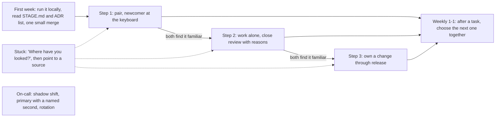

## Before you start

- [[management.l4.blameless-culture]] — you know people grow only where admitting "I do not know this yet" brings no shame.
- [[management.l4.sustainable-on-call]] — you know `on-call-staffing.md` and its rules for keeping the rotation bearable.
- [[management.l1.code-review-basics]] — you know a good review comment is about the code, gives a reason and marks must-fix apart from suggestion.
- [[management.l3.architecture-decision-record]] — you know an ADR keeps a decision with its context, so the reasons can be read later.

## The situation

A new backend developer joins Đơn Hàng's team. On their third day their first pull request fails CI, and they message you; you open the branch, fix it in five minutes and push. The next week they ask why a runbook step exists, and you explain it from memory. Your own sprint tasks slip, so you review their work in the evening. A month later they still message you first, before reading anything, and nobody planned the hours you spent. How do you help a new developer so they need you a little less each week?

## Core concepts

- **mentoring** — an ongoing relationship in which an experienced person helps a less experienced one grow through real work, questions and feedback, rather than by handing over answers; in the situation above, fixing the branch was help, but not yet mentoring.
- Step (a plain word, used in this sense here) — one of the three levels in `docs/team/mentoring-plan.md`, each giving the newcomer more of the work and the mentor less of it.
- Shadow shift (a plain phrase, used in this sense here) — an on-call shift where the newcomer receives every page with the person on call and watches, without deciding.
- 1-1 (a plain term, used in this sense here) — a short meeting of only the mentor and the newcomer, once a week in the plan.

## How it works



In the first week the newcomer runs the project on their own machine following `STAGE.md` (the repository's description of the current system), reads the ADR list and merges one small change through pull request, CI and review. Then come three steps on real sprint tasks, each giving the newcomer more of the work. In step 1 they pair, and the newcomer types most of the time. In step 2 the newcomer works alone and the mentor reviews more closely than usual, giving the reason for every comment. In step 3 the newcomer owns a change from the story to production, the running system shops use, canary and release note included; a release note tells users and the team what a release changes.

A newcomer moves up when both people find the current step familiar, not when a number of weeks has passed.

The dotted node `E` applies at every step. Instead of fixing the branch yourself, as in the situation above, you first ask where the newcomer has looked, then point to the place that holds the answer, such as an ADR or a runbook. The newcomer learns where answers live and asks less next time.

Node `G` stands apart because on-call follows the same shape on its own schedule: one shadow shift, one shift as primary with a named second, then a place in the rotation, taking regular turns as primary.

Node `F` closes the loop. The 1-1 is weekly; in the 1-1 after a task finishes, the two pick the next task together. Behind all of it sits one rule from the plan: the mentor takes fewer sprint tasks while mentoring, and the team counts that when it picks sprint work.

## In the Đơn Hàng system

`mentoring-plan.md` first defines mentoring in lines 3–5, in the same words as "Core concepts", and lists a first week in lines 9–15. The steps and the rule for being stuck follow:

```markdown file=docs/team/mentoring-plan.md tag=stage-4 lines=17-41
### Ba bậc

Người mới đi qua ba bậc trên việc thật của sprint, mỗi bậc ít nhất một việc:

1. Làm cặp với người kèm: hai người cùng một màn hình, người mới cầm bàn phím
   phần lớn thời gian.
2. Tự làm, có review kỹ: người mới làm một mình, người kèm review kỹ hơn
   thường lệ và giải thích lý do của mỗi nhận xét, theo cách
   `review-comments-examples.md` ghi.
3. Sở hữu một thay đổi tới khi phát hành: từ story tới production, gồm canary
   (`docs/design/canary-checks.md`) và release note.

Lên bậc khi người kèm và người mới cùng thấy bậc hiện tại đã quen, không theo
số tuần.

### Khi người mới bị kẹt

Người kèm hỏi trước: "Bạn đã xem ở đâu rồi?". Rồi trỏ tới nơi giữ câu trả lời,
như một ADR, một runbook trong `docs/runbooks/` hay một tài liệu thiết kế, trước
khi tự đưa câu trả lời. Người mới học được câu trả lời nằm ở đâu, và lần sau
không cần hỏi.

Quyết định được giải thích trong ADR và trong nhận xét review là cách một người
kèm giúp được nhiều người hơn mình kèm trực tiếp: người khác đọc lý do và tự ra
quyết định tiếp theo mà không cần hỏi.
```

Line 19 puts every step on real sprint work, at least one task each; there is no practice project. Lines 23–25 tie step 2 to `review-comments-examples.md`, whose must-fix example in lines 7–9 names the method, cites the acceptance criterion and ends with a question. Lines 29–30 are the rule for moving up.

Lines 34–37 are the order when the newcomer is stuck: ask where they have looked, point to an ADR, a runbook in `docs/runbooks/` or a design document, and only then give the answer. Lines 39–41 say why this scales: reasons written in ADRs and review comments let other people take the next decision without asking.

The rest of the plan is about on-call and the mentor's time:

```markdown file=docs/team/mentoring-plan.md tag=stage-4 lines=43-56
### Trực sự cố

Trực theo cùng ba bước, như `on-call-staffing.md` yêu cầu: một ca đi theo
người trực, một ca trực chính có người thứ hai được chỉ định, rồi vào vòng
trực.

### Thời gian của người kèm

Kèm người là việc đội lập kế hoạch, không phải việc làm thêm sau giờ. Trong
thời gian kèm, người kèm nhận ít việc sprint hơn (giả định: bớt khoảng một phần
năm), và đội tính phần đó khi chọn việc cho sprint.

Mỗi tuần một buổi 1-1 ba mươi phút giữa người kèm và người mới. Phản hồi đi hai
chiều: người mới cũng nói điều gì trong cách kèm đang giúp và điều gì không.
```

Lines 45–47 point to `on-call-staffing.md`, where lines 49–56 hold the same three steps; in the shadow shift the newcomer receives every page and does not decide. Lines 51–53 make mentoring planned work: the mentor takes fewer sprint tasks, about one fifth fewer as the project's assumption, and the team counts that. Lines 55–56 set a weekly 30-minute 1-1 where feedback goes both ways.

After the excerpt, lines 60–65 pick the next task together at the 1-1: one that touches a part of the system the newcomer has not changed yet, and one that practises their weakest kind of document; lines 67–68 leave promotion and pay out of the plan.

## Trade-offs

| How you help a newcomer | Today's task | What they can do alone in a month | Cost to the mentor | Fits when |
|---|---|---|---|---|
| Fix it for them | done fastest | little; they ask again | small each time, never ends | an incident is running and minutes matter |
| Leave them alone with the task | slow, often stuck | uneven, with gaps nobody sees | almost none at first | rarely; the gaps show up later in production |
| A weekly career chat, separate from the work | unchanged | what they learn by themselves | one meeting a week | as a complement, not as the mentoring |
| Real work with support that shrinks by step | slower at first | owns a change through release | fewer sprint tasks, planned | the plan's choice for every new developer |

## What would you choose if…

…the newcomer, on a shift as primary with you as the named second, is stuck while a SEV1 incident is running? The plan's stuck rule (lines 34–37) does not mention incidents; when the shop is down, restoring it comes first, so help directly and walk through the runbook at the next 1-1.

…the sprint is tight and someone proposes giving you back your full share of tasks for two weeks? Lines 51–53 say the team counts the mentor's lighter load when it picks sprint work. Dropping it moves the mentoring to after hours, the gap the plan was written to close, so raise it at sprint planning rather than absorbing it.

…a newcomer says step 1 feels slow and wants to skip it? Lines 29–30 move up when both of you find the step familiar, and lines 55–56 ask for their feedback. Agree on one task that would show it, and move up when it does.

## Seniors often assume…

- **"The fastest way to help a junior is to fix the problem for them."** → Actually it is fastest only for today's task, because the junior learns the answer but not where answers live, so the next similar question comes back to you. You notice this when the same person asks you the same kind of question month after month, before opening any document.
- **"Mentoring is a weekly chat about careers, separate from the daily work."** → Actually the plan puts all three steps on real sprint tasks and uses the weekly 1-1 to pick the next task; promotion and pay are left out on purpose. You notice the chat-only version when a newcomer has talked about goals for months yet has never owned a change through release.
- **"Time spent mentoring is time taken away from an architect's real work."** → Actually an architect's reach grows when others can take the next decision alone, and lines 39–41 say reasons written in ADRs and review comments let them do that. You notice the opposite when every decision in a part of the system waits for the same one person to answer.

## Try it (3 minutes)

A mentor at Đơn Hàng does five things in a newcomer's second month:

1. The newcomer asks why Payments is a separate service; the mentor first asks where they have looked, then points to the ADR list.
2. The mentor moves the newcomer to step 3 because four weeks have passed.
3. The newcomer's first on-call shift is as primary with a named second, with no shadow shift before it.
4. The mentor reviews the newcomer's pull request with comments that each give a reason.
5. The mentor does the newcomer's reviews in the evening, because their sprint load was not reduced.

Using lines 17–56 of `mentoring-plan.md`, mark each as following or breaking the plan, and name the lines.

Expected result: two follow the plan and three break it, each tied to a line range.

<details><summary>Suggested answer</summary>

1 follows it: ask where they have looked, then point to where the answer lives, such as an ADR, before giving it (lines 34–37).

2 breaks it: moving up depends on both finding the step familiar, not on the number of weeks (lines 29–30).

3 breaks it: on-call starts with a shadow shift, then a shift as primary with a named second, then the rotation; this newcomer skipped the first step (lines 45–47).

4 follows it: step 2 is a closer review that explains the reason for every comment (lines 23–25).

5 breaks it: mentoring is planned work, and the mentor takes fewer sprint tasks while mentoring (lines 51–53).

</details>

## Connections

- [[management.l4.blameless-culture]] — prerequisite: a newcomer asks for help only where not knowing is safe to admit.
- [[management.l4.sustainable-on-call]] — the document whose newcomer steps the on-call part of the plan follows.
- [[management.l1.code-review-basics]] — the review habits step 2 uses more closely, with a reason for each comment.
- [[management.l3.architecture-decision-record]] — the place a mentor points to first, and the way one decision teaches many people.
- [[devops.l4.runbooks]] — the other source the mentor points to when the newcomer is stuck.
- [[management.l2.readme]] — the same idea for the first week: written setup lets a newcomer start without asking.
- [[management.l1.scrum-from-junior-seat]] — the sprint where the mentor's lighter load is planned, seen from the newcomer's seat.

## Five-line summary

1. Mentoring hands a newcomer real work, with support that shrinks step by step, instead of handing over answers.
2. `mentoring-plan.md` moves a newcomer through pairing, working alone with a close review, then owning a change through release.
3. When stuck, the mentor first asks where they have looked and points to an ADR or runbook before answering.
4. On-call follows the same steps: a shadow shift, a primary shift with a named second, then the rotation.
5. The mentor takes fewer sprint tasks while mentoring, and reasons written in ADRs and reviews let others decide without asking.
