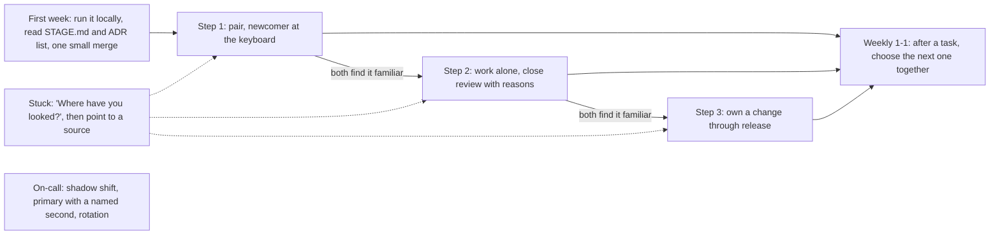

## Bạn cần biết trước

- [[management.l4.blameless-culture]] — bạn biết người ta chỉ lớn lên được ở nơi nói "mình chưa biết cái này" không bị làm cho bẽ mặt.
- [[management.l4.sustainable-on-call]] — bạn biết `on-call-staffing.md` và các quy tắc giữ cho vòng trực ở mức chịu được.
- [[management.l1.code-review-basics]] — bạn biết một nhận xét review tốt nói về code, có nêu lý do và tách rõ điều bắt buộc sửa với điều chỉ là gợi ý.
- [[management.l3.architecture-decision-record]] — bạn biết ADR giữ một quyết định cùng bối cảnh của nó, để sau này đọc lại được lý do.

## Tình huống

Một developer backend mới vào đội Đơn Hàng. Ngày thứ ba, pull request đầu tiên của họ trượt CI, và họ nhắn cho bạn. Bạn mở branch, sửa trong năm phút rồi push. Tuần sau họ hỏi vì sao một bước trong runbook lại có mặt, và bạn giải thích theo trí nhớ. Việc sprint của bạn bị trễ, nên bạn review bài của họ vào buổi tối. Một tháng sau, họ vẫn nhắn cho bạn trước, chưa đọc gì cả, và số giờ bạn bỏ ra không nằm trong kế hoạch nào. Giúp một developer mới thế nào để mỗi tuần họ cần tới bạn ít đi một chút?

## Khái niệm cốt lõi

- **mentoring** (quan hệ lâu dài trong đó người giàu kinh nghiệm giúp người khác lớn lên qua việc thật và phản hồi) — một quan hệ kéo dài, trong đó người nhiều kinh nghiệm giúp người ít kinh nghiệm hơn lớn lên qua việc thật, câu hỏi và phản hồi, thay vì đưa sẵn câu trả lời. Trong tình huống ở trên, sửa branch hộ là giúp đỡ, nhưng chưa phải mentoring.
- Bậc (từ thường, ở đây dùng theo nghĩa này) — một trong ba mức trong `docs/team/mentoring-plan.md`. Mỗi bậc giao cho người mới nhiều phần việc hơn và để người kèm làm ít hơn.
- Ca đi theo (cụm từ thường, ở đây dùng theo nghĩa này) — một ca trực sự cố trong đó người mới nhận mọi lần gọi cùng với người đang trực và chỉ quan sát, không ra quyết định.
- 1-1 (thuật ngữ thường, ở đây dùng theo nghĩa này) — buổi gặp ngắn chỉ có người kèm và người mới, theo kế hoạch là mỗi tuần một lần.

## Cơ chế hoạt động



Tuần đầu, người mới chạy dự án trên máy mình theo `STAGE.md` (bản mô tả hệ thống hiện tại của repository), đọc danh sách ADR và đưa một thay đổi nhỏ đi hết pull request, CI và review cho tới khi merge. Sau đó là ba bậc trên việc sprint thật, mỗi bậc giao cho người mới nhiều phần việc hơn. Ở bậc 1, hai người làm cặp, và người mới cầm bàn phím phần lớn thời gian. Ở bậc 2, người mới làm một mình, còn người kèm review kỹ hơn thường lệ và nêu lý do cho từng nhận xét. Ở bậc 3, người mới sở hữu một thay đổi từ story tới production, tức hệ thống đang chạy mà các cửa hàng dùng, gồm cả canary và release note. Release note cho người dùng và đội biết một lần phát hành thay đổi những gì.

Người mới lên bậc khi cả hai cùng thấy bậc hiện tại đã quen, không phải khi đã đủ một số tuần nào đó.

Nút nét đứt `E` áp dụng ở mọi bậc. Thay vì tự sửa branch như trong tình huống ở trên, trước hết bạn hỏi người mới đã xem ở đâu, rồi chỉ tới nơi giữ câu trả lời, như một ADR hay một runbook. Người mới học được câu trả lời nằm ở đâu, và lần sau hỏi ít hơn.

Nút `G` đứng riêng, vì trực sự cố đi theo cùng hình dạng đó trên lịch của riêng nó: một ca đi theo, một ca trực chính có người thứ hai được chỉ định, rồi vào vòng trực, lần lượt trực chính như mọi người.

Nút `F` khép vòng lại. Buổi 1-1 diễn ra mỗi tuần, và ở buổi 1-1 ngay sau khi một việc xong, hai người cùng chọn việc tiếp theo. Đứng sau tất cả là một quy tắc của kế hoạch: trong thời gian kèm, người kèm nhận ít việc sprint hơn, và đội tính phần đó khi chọn việc cho sprint.

## Trong hệ thống Đơn Hàng

`mentoring-plan.md` định nghĩa mentoring ở dòng 3–5, bằng đúng những lời trong "Khái niệm cốt lõi", và liệt kê tuần đầu ở dòng 9–15. Tiếp theo là các bậc và quy tắc khi bị kẹt:

```markdown file=docs/team/mentoring-plan.md tag=stage-4 lines=17-41
### Ba bậc

Người mới đi qua ba bậc trên việc thật của sprint, mỗi bậc ít nhất một việc:

1. Làm cặp với người kèm: hai người cùng một màn hình, người mới cầm bàn phím
   phần lớn thời gian.
2. Tự làm, có review kỹ: người mới làm một mình, người kèm review kỹ hơn
   thường lệ và giải thích lý do của mỗi nhận xét, theo cách
   `review-comments-examples.md` ghi.
3. Sở hữu một thay đổi tới khi phát hành: từ story tới production, gồm canary
   (`docs/design/canary-checks.md`) và release note.

Lên bậc khi người kèm và người mới cùng thấy bậc hiện tại đã quen, không theo
số tuần.

### Khi người mới bị kẹt

Người kèm hỏi trước: "Bạn đã xem ở đâu rồi?". Rồi trỏ tới nơi giữ câu trả lời,
như một ADR, một runbook trong `docs/runbooks/` hay một tài liệu thiết kế, trước
khi tự đưa câu trả lời. Người mới học được câu trả lời nằm ở đâu, và lần sau
không cần hỏi.

Quyết định được giải thích trong ADR và trong nhận xét review là cách một người
kèm giúp được nhiều người hơn mình kèm trực tiếp: người khác đọc lý do và tự ra
quyết định tiếp theo mà không cần hỏi.
```

Dòng 19 đặt mọi bậc lên việc sprint thật, mỗi bậc ít nhất một việc, không có dự án tập dượt nào. Dòng 23–25 nối bậc 2 với `review-comments-examples.md`, nơi ví dụ bắt buộc sửa ở dòng 7–9 gọi tên phương thức, dẫn tiêu chí chấp nhận và kết thúc bằng một câu hỏi. Dòng 29–30 là quy tắc lên bậc.

Dòng 34–37 là thứ tự khi người mới bị kẹt: hỏi họ đã xem ở đâu, chỉ tới một ADR, một runbook trong `docs/runbooks/` hay một tài liệu thiết kế, rồi mới đưa câu trả lời. Dòng 39–41 nói vì sao cách này nhân rộng được: lý do viết trong ADR và nhận xét review giúp người khác tự ra quyết định tiếp theo mà không cần hỏi.

Phần còn lại của kế hoạch nói về trực sự cố và thời gian của người kèm:

```markdown file=docs/team/mentoring-plan.md tag=stage-4 lines=43-56
### Trực sự cố

Trực theo cùng ba bước, như `on-call-staffing.md` yêu cầu: một ca đi theo
người trực, một ca trực chính có người thứ hai được chỉ định, rồi vào vòng
trực.

### Thời gian của người kèm

Kèm người là việc đội lập kế hoạch, không phải việc làm thêm sau giờ. Trong
thời gian kèm, người kèm nhận ít việc sprint hơn (giả định: bớt khoảng một phần
năm), và đội tính phần đó khi chọn việc cho sprint.

Mỗi tuần một buổi 1-1 ba mươi phút giữa người kèm và người mới. Phản hồi đi hai
chiều: người mới cũng nói điều gì trong cách kèm đang giúp và điều gì không.
```

Dòng 45–47 chỉ tới `on-call-staffing.md`, nơi dòng 49–56 ghi cùng ba bước đó. Trong ca đi theo, người mới nhận mọi lần gọi nhưng không ra quyết định. Dòng 51–53 biến mentoring thành việc có kế hoạch: người kèm nhận ít việc sprint hơn, bớt khoảng một phần năm theo giả định của dự án, và đội tính phần đó. Dòng 55–56 đặt một buổi 1-1 30 phút mỗi tuần, nơi phản hồi đi theo cả hai chiều.

Sau đoạn trích, dòng 60–65 chọn việc tiếp theo cùng nhau ở buổi 1-1: một việc chạm vào phần hệ thống người mới chưa từng sửa, và một việc tập loại tài liệu họ yếu nhất. Dòng 67–68 để chuyện thăng tiến và lương ra ngoài kế hoạch.

## Đánh đổi

| Cách bạn giúp người mới | Việc hôm nay | Sau một tháng họ tự làm được gì | Cái giá với người kèm | Hợp khi |
|---|---|---|---|---|
| Sửa hộ họ | xong nhanh nhất | rất ít, họ lại hỏi tiếp | nhỏ mỗi lần, nhưng không bao giờ hết | đang có sự cố và từng phút đều quan trọng |
| Để họ tự xoay xở với việc | chậm, hay bị kẹt | không đều, có những lỗ hổng không ai thấy | gần như không có lúc đầu | hiếm khi, các lỗ hổng sẽ lộ ra sau này trên production |
| Mỗi tuần nói chuyện về sự nghiệp, tách khỏi công việc | không đổi | những gì họ tự học được | một buổi gặp mỗi tuần | như một phần bổ sung, không thay cho mentoring |
| Việc thật với phần hỗ trợ giảm dần theo bậc | chậm hơn lúc đầu | sở hữu một thay đổi tới khi phát hành | ít việc sprint hơn, có kế hoạch | lựa chọn của kế hoạch cho mọi developer mới |

## Bạn sẽ chọn gì nếu…

…người mới đang trực chính, bạn là người thứ hai được chỉ định, và họ bị kẹt giữa lúc một sự cố SEV1 đang diễn ra? Quy tắc khi bị kẹt của kế hoạch (dòng 34–37) không nhắc tới sự cố. Khi cửa hàng đang sập, khôi phục là việc trước tiên, nên hãy giúp trực tiếp, rồi cùng nhau đi lại runbook ở buổi 1-1 kế tiếp.

…sprint đang gấp, và có người đề nghị trả lại cho bạn đủ phần việc trong hai tuần? Dòng 51–53 nói đội tính phần việc nhẹ hơn của người kèm khi chọn việc cho sprint. Bỏ điều đó đi là đẩy mentoring ra sau giờ làm, đúng lỗ hổng kế hoạch được viết ra để lấp. Vì vậy hãy nêu chuyện này trong buổi lập kế hoạch sprint thay vì lặng lẽ gánh thêm.

…một người mới nói bậc 1 chậm quá và muốn bỏ qua? Dòng 29–30 cho lên bậc khi cả hai cùng thấy bậc đó đã quen, còn dòng 55–56 yêu cầu lắng nghe phản hồi của họ. Hãy thống nhất một việc đủ để cho thấy điều đó, và lên bậc khi việc ấy cho thấy được.

## Senior hay nhầm rằng…

- **"Cách nhanh nhất để giúp một junior là sửa vấn đề hộ họ."** → Thực ra cách đó chỉ nhanh nhất cho việc hôm nay, vì junior học được câu trả lời nhưng không học được câu trả lời nằm ở đâu, nên câu hỏi tương tự lần sau lại quay về bạn. Bạn sẽ nhận ra khi cùng một người hỏi bạn cùng một kiểu câu hỏi tháng này qua tháng khác, trước khi mở bất kỳ tài liệu nào.
- **"Mentoring là buổi nói chuyện hằng tuần về sự nghiệp, tách khỏi công việc hằng ngày."** → Thực ra kế hoạch đặt cả ba bậc lên việc sprint thật và dùng buổi 1-1 hằng tuần để chọn việc tiếp theo, còn thăng tiến và lương được cố ý để ra ngoài. Bạn sẽ nhận ra kiểu chỉ nói chuyện khi một người mới đã bàn về mục tiêu suốt mấy tháng mà chưa từng sở hữu một thay đổi nào tới khi phát hành.
- **"Thời gian dành cho mentoring là thời gian lấy đi từ công việc thật của một architect."** → Thực ra tầm ảnh hưởng của architect lớn lên khi người khác tự ra được quyết định tiếp theo, và dòng 39–41 nói lý do viết trong ADR và nhận xét review giúp họ làm được điều đó. Bạn sẽ nhận ra điều ngược lại khi mọi quyết định trong một phần hệ thống đều phải chờ cùng một người trả lời.

## Thử ngay (3 phút)

Trong tháng thứ hai của một người mới, một người kèm ở Đơn Hàng làm năm việc:

1. Người mới hỏi vì sao Payments là một service riêng. Người kèm hỏi trước họ đã xem ở đâu, rồi chỉ tới danh sách ADR.
2. Người kèm cho người mới lên bậc 3 vì đã qua bốn tuần.
3. Ca trực sự cố đầu tiên của người mới là ca trực chính có người thứ hai được chỉ định, không có ca đi theo nào trước đó.
4. Người kèm review pull request của người mới, mỗi nhận xét đều nêu lý do.
5. Người kèm review bài của người mới vào buổi tối, vì phần việc sprint của mình không được giảm.

Dựa vào dòng 17–56 của `mentoring-plan.md`, đánh dấu mỗi việc là theo hay phá kế hoạch, và nêu các dòng tương ứng.

Kết quả mong đợi: hai việc theo kế hoạch, ba việc phá kế hoạch, mỗi việc gắn với một khoảng dòng.

<details><summary>Gợi ý đáp án</summary>

1 theo kế hoạch: hỏi họ đã xem ở đâu, rồi chỉ tới nơi giữ câu trả lời, như một ADR, trước khi tự trả lời (dòng 34–37).

2 phá kế hoạch: lên bậc phụ thuộc vào việc cả hai cùng thấy bậc đó đã quen, không phụ thuộc vào số tuần (dòng 29–30).

3 phá kế hoạch: trực sự cố bắt đầu bằng một ca đi theo, rồi một ca trực chính có người thứ hai được chỉ định, rồi mới vào vòng trực. Người mới này đã bỏ qua bước đầu tiên (dòng 45–47).

4 theo kế hoạch: bậc 2 là review kỹ hơn, giải thích lý do của mỗi nhận xét (dòng 23–25).

5 phá kế hoạch: mentoring là việc có kế hoạch, và trong thời gian kèm, người kèm nhận ít việc sprint hơn (dòng 51–53).

</details>

## Liên hệ

- [[management.l4.blameless-culture]] — điều kiện trước: người mới chỉ xin giúp ở nơi nhận mình chưa biết là an toàn.
- [[management.l4.sustainable-on-call]] — tài liệu có các bước dành cho người mới mà phần trực sự cố của kế hoạch làm theo.
- [[management.l1.code-review-basics]] — các thói quen review mà bậc 2 dùng kỹ hơn, với lý do cho mỗi nhận xét.
- [[management.l3.architecture-decision-record]] — nơi người kèm chỉ tới đầu tiên, và là cách một quyết định dạy được nhiều người.
- [[devops.l4.runbooks]] — nguồn còn lại mà người kèm chỉ tới khi người mới bị kẹt.
- [[management.l2.readme]] — cùng ý tưởng cho tuần đầu: hướng dẫn cài đặt viết sẵn giúp người mới bắt đầu mà không cần hỏi.
- [[management.l1.scrum-from-junior-seat]] — sprint nơi phần việc nhẹ hơn của người kèm được lên kế hoạch, nhìn từ chỗ ngồi của người mới.

## Tóm tắt 5 dòng

1. Mentoring giao cho người mới việc thật, với phần hỗ trợ giảm dần từng bước, thay vì đưa sẵn câu trả lời.
2. `mentoring-plan.md` đưa người mới đi qua làm cặp, tự làm có review kỹ, rồi sở hữu một thay đổi tới khi phát hành.
3. Khi người mới bị kẹt, người kèm hỏi trước họ đã xem ở đâu và chỉ tới một ADR hay runbook rồi mới trả lời.
4. Trực sự cố đi theo cùng các bước: một ca đi theo, một ca trực chính có người thứ hai được chỉ định, rồi vào vòng trực.
5. Người kèm nhận ít việc sprint hơn trong thời gian kèm, và lý do viết trong ADR và review giúp người khác tự quyết mà không cần hỏi.
