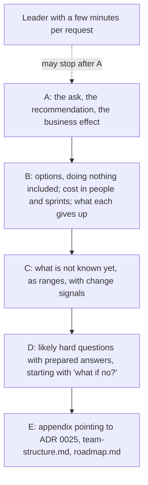

## Before you start

- [[management.l2.answer-first]] — you know a work document opens with its conclusion, decision or request, because a busy reader may stop early.
- [[management.l2.stakeholder-communication]] — you know an update gives a forecast as a range, the risks that could move it and what the team needs, in the reader's words.
- [[management.l4.deciding-under-uncertainty]] — you know a decision states its assumptions and the signals that would reopen it.
- [[management.l4.team-types]] — you know ADR `0025` plans two stream-aligned teams and a platform team, the platform team first.

## The situation

ADR `0025` is accepted inside the team: two stream-aligned teams and a platform team, with the platform team formed first. New teams need people, so leadership must agree. The person who sets the team's priorities gets you a slot in leadership's next meeting, between several other requests. Your first draft opens with Conway's law, then the formula n(n-1)/2 for how many pairs of people may need to talk, then the four team types and a table of who owns which part. The team lead reads page one and says: "I still do not know what you want them to decide." How do you write to leaders so they can decide in the few minutes they give each request?

## Core concepts

- Leadership brief (a plain phrase, used in this sense here) — a short document that asks leaders for one decision, written so its first paragraph is enough to decide; `docs/team/leadership-brief-platform-team.md` is Đơn Hàng's.
- The ask (a plain phrase, used in this sense here) — the decision the brief requests, stated in its first sentence together with the recommended option.
- Business effect (a plain phrase, used in this sense here) — what the decision changes for the business, said in things shops and leaders see, such as how soon a new shop can open, not in components.
- Change signal (a plain phrase, used in this sense here) — an observation named in advance that would make the team change the plan, the same idea as a reopen signal in an ADR.
- Appendix (a plain word, used in this sense here) — the last section of the brief, which points to the documents that hold the technical detail.

## How it works



Leaders weigh many requests and give each only a few minutes, so a brief puts what they must act on first. In the situation above, the draft spent its first page on why; leaders first ask what they are to approve and what it changes for the business. Node `A` answers that in one paragraph. A leader who stops there still knows what to decide.

Node `B` is the comparison. Each option carries its cost in the units leaders plan with, people and sprints, and what it gives up. Doing nothing is one of the options, because leaders can usually choose it, and it has a cost of its own. With only one option shown, leaders can approve or refuse, but they cannot choose.

Node `C` states what the team does not know yet. A number that is not settled appears as a range, next to the change signals that would alter the plan. A confident number that later moves usually costs more trust than a range given up front, and a signal named in advance lets a later change read as an expected step.

Node `D` lists the hard questions leaders are likely to ask, each with a prepared answer. The first is what happens if the answer is no; a prepared answer lets the meeting still end with a decision, not a dead end.

Node `E` is the appendix. The technical reasoning is not deleted; it stays in the documents that already hold it.

## In the Đơn Hàng system

The brief's title reads "Proposal: form a platform team before the second product team". Its first paragraph and the options follow:

```markdown file=docs/team/leadership-brief-platform-team.md tag=stage-4 lines=3-24
Đề nghị ban lãnh đạo đồng ý lập một đội platform trước khi lập đội sản phẩm
thứ hai. Hiệu quả cho kinh doanh: cửa hàng mới mở được nhanh hơn, vì đội sản
phẩm không còn phải tự dựng và giữ cluster, deploy, giám sát; và các cửa hàng
giữ được mức dịch vụ đã cam kết (SLO trong `docs/design/slo.md`) trong lúc số
cửa hàng tăng. Mọi con số dưới đây là giả định của đội.

### Phương án

| Phương án | Chi phí | Điều phải bỏ |
|---|---|---|
| A. Không làm gì: giữ một đội bảy người | Không thêm người | Mở cửa hàng mới, production trên Kubernetes managed và giám sát production xếp hàng sau nhau trong một đội; cluster vẫn chỉ một người sửa được |
| B. Thêm người vào đội hiện có, lên mười bốn người | 7 người; khoảng 2 tới 3 sprint để người mới làm được việc | Số cặp người cần trao đổi từ 21 lên 91; mỗi người vẫn phải biết toàn bộ hệ thống, nên đội chậm lại khi lớn lên |
| C. Đề xuất: lập đội platform 3 tới 4 người trước, rồi đội sản phẩm thứ hai (Cửa hàng) 5 tới 7 người | 3 tới 4 người trước, 5 tới 7 người sau; đội hiện có dành một người trong 2 sprint để chuyển giao phần chung | Đội sản phẩm thứ hai bắt đầu muộn hơn so với lập nó ngay, khoảng thời gian đội platform cần để nhận phần chung (2 tới 3 sprint) |

Với C, khi đội Cửa hàng bắt đầu, đội đó deploy qua con đường đội platform đã
giữ sẵn, không phải học cluster từ đầu, nên làm ra việc cho cửa hàng sớm hơn.

### Điều chưa chắc

- Đội platform cần 3 tới 4 người. Con số đúng phụ thuộc phần việc chuyển
  production sang Kubernetes managed, chưa ước lượng xong.
- Thời gian đội platform nhận phần chung: 2 tới 3 sprint.
```

Lines 3–7 are node `A`. The ask is to form a platform team before the second product team. The business effect has two parts: new shops open sooner, because product teams no longer build and keep the cluster, deployment and monitoring themselves, and shops keep the SLOs in `docs/design/slo.md` while their number grows. Line 7 marks every number as the team's assumption.

Lines 13–15 are node `B`, and option A is doing nothing: no new people, but new shops, managed Kubernetes and production monitoring queue behind one another in one team. Even C, the recommendation, admits its second product team starts later. Lines 17–18 add what C buys: the Cửa hàng team deploys through the path the platform team already keeps. Lines 22–24 are node `C`: 3 to 4 people, because the move to managed Kubernetes is not estimated yet, and 2 to 3 sprints to take over the shared parts, the cluster, deployment and monitoring of lines 4–5.

The signals and the prepared questions come next:

```markdown file=docs/team/leadership-brief-platform-team.md tag=stage-4 lines=26-47
Tín hiệu làm đổi kế hoạch:

- Yêu cầu từ đội sản phẩm sang đội platform thường quá 2 ngày làm việc mới
  được trả lời: đội platform thiếu người.
- Số cửa hàng tăng chậm hơn giả định trong `multi-shop-requirements.md`: lùi
  việc lập đội Cửa hàng, đội platform giữ nguyên.
- Hai đội cùng phải sửa một phần hệ thống trong phần lớn thay đổi: ranh giới
  đội đặt sai, đội xem lại cách chia trước khi thêm người.

### Câu hỏi có thể gặp

- Nếu không đồng ý thì sao? Đội giữ phương án A. Các kết quả ở mục "Tiếp theo"
  của `roadmap.md` làm lần lượt, mỗi lần một, và đội báo lại thứ tự để ban lãnh
  đạo chọn kết quả nào đi trước.
- Sao không lập đội sản phẩm thứ hai trước, cho nhanh? Hai đội sản phẩm cùng tự
  giữ cluster và deploy thì mỗi đội làm lại cùng một việc, và lỗi ở phần chung
  không có ai chịu trách nhiệm rõ.
- Đội platform có thành chỗ mọi việc phải chờ không? Đội platform cung cấp
  dịch vụ để đội sản phẩm tự làm, không làm thay: đội sản phẩm tự deploy và tự
  trực cho service của mình.
- Khi nào thấy hiệu quả? Khi đội Cửa hàng ra thay đổi đầu tiên tới production
  mà không cần ai ngoài đội deploy giúp.
```

Lines 28–33 are the change signals, each with what it would change. Requests to the platform team often answered after more than 2 working days mean it is short of people. Shops growing slower than `multi-shop-requirements.md` assumes delays the Cửa hàng team. Two teams changing the same part in most changes means the team boundary is wrong.

Lines 37–39 answer "what if not": the team keeps option A, works through the outcomes listed under "Next", the middle of the three horizons in `roadmap.md`, one at a time, and reports their order so leadership picks which goes first. Lines 46–47 give a sign leaders can check without technical knowledge: the Cửa hàng team ships its first change to production with nobody outside the team helping it deploy.

After the excerpt, lines 49–55 are node `E`: ADR `0025` for the decision and the options weighed, `team-structure.md` for team ownership, and `roadmap.md` for the outcomes waiting for people. ADR `0025` lines 26–49 weigh a bigger team, layer teams, and stream-aligned teams with a platform team. The brief's option B is the ADR's bigger team and C is the ADR's choice. Layer teams stay in the ADR, and the brief adds option A, doing nothing.

## Trade-offs

| How the brief is written | What a leader can do in a few minutes | Trust when things change | Fits when |
|---|---|---|---|
| Technical background first, ask on page two | not decide yet; the ask is out of reach | high for those who read it all | the readers are the team deciding, as with ADR `0025` |
| Recommendation only | approve or refuse | drops if a rejected option later looks better and was never shown | the decision is small and easy to reverse |
| Ask first, options including doing nothing | choose, knowing what each option gives up | holds, because the trade was theirs | the decision costs people or sprints, as in this brief |
| One confident number | plan on it | falls when the number moves | the number is already measured |
| A range with change signals | plan on a range and know what to watch | holds, because the change was announced | the number is not estimated yet, as in lines 22–24 |

## What would you choose if…

…a leader asks for one number instead of "3 to 4 people"? Give the range with its reason from lines 22–23: the move to managed Kubernetes is not estimated yet. If they must plan now, offer the upper end as the figure to plan with and say the estimate will narrow it.

…a leader with an engineering background wants the full reasoning during the meeting? Keep the opening for the other readers and walk that leader through the appendix: ADR `0025` holds the options weighed and why two were rejected.

…leadership answers no? Lines 37–39 already hold the answer, so the meeting still ends with a decision: the team keeps one team, and leaders choose which "Next" outcome of `roadmap.md` goes first.

## Seniors often assume…

- **"Leaders need the full technical detail before they will trust a recommendation."** → Actually leaders can check a recommendation against what they already know: the business effect, the cost in people and sprints, and what each option gives up. The detail stays one link away in the appendix. You notice the full-detail version when a meeting ends with "send us something shorter" and the decision moves to the next meeting.
- **"Showing only the recommended option makes the strongest case."** → Actually with one option leaders can only approve or refuse, and a refusal leaves no plan. The cost of doing nothing, set beside the recommendation, is what makes the case. You notice the single-option version when a leader asks "what else did you consider?" and the answer is not in the brief.
- **"Admitting uncertainty in front of leadership looks weak."** → Actually a range with the signals that would change it shows where the team's knowledge ends, while a confident number that later moves usually costs more trust than the range would have. You notice this when a promised "3 people" becomes 4 and the team's next request meets more doubt.

## Try it (3 minutes)

A teammate wants these six sentences somewhere in the brief:

1. "Seven people make 21 pairs who may need to talk; fourteen make 91."
2. "We ask you to agree to form a platform team before the second product team."
3. "The platform team needs 3 to 4 people; the move to managed Kubernetes is not estimated yet."
4. "Layer teams were rejected because nearly every change would cross all three teams."
5. "If you say no, we keep one team and you choose which next outcome goes first."
6. "New shops open sooner, and shops keep their SLOs while their number grows."

Using the diagram's five nodes and the brief, place each sentence in node `A`, `B`, `C`, `D` or `E`, and name the lines where the brief, or the document its appendix points to, already says it.

Expected result: two sentences go in node `A`, and one each in `B`, `C`, `D` and `E`.

<details><summary>Suggested answer</summary>

1 goes in `B`: it is part of what option B gives up (line 14).

2 goes in `A`: it is the ask (lines 3–4).

3 goes in `C`: a range with the reason it is not settled (lines 22–23).

4 goes in `E`: the brief does not argue it; ADR `0025` does (lines 57–59), and the appendix points there (lines 51–52).

5 goes in `D`: the prepared answer to "what if no?" (lines 37–39).

6 goes in `A`: it is the business effect (lines 4–7).

</details>

## Connections

- [[management.l2.answer-first]] — the same rule one level up: for leaders, the conclusion is the decision asked of them.
- [[management.l2.stakeholder-communication]] — ranges and risks for stakeholders, here attached to a decision.
- [[management.l4.deciding-under-uncertainty]] — the source of the change signals, shown here to the people who approve.
- [[management.l4.team-types]] — the team types the brief asks for, kept out of its opening.
- [[management.l4.weighted-scoring-matrix]] — a finer comparison of options, for the appendix.
- [[management.l4.roadmap]] — the outcomes that queue under option A and that leaders order if the answer is no.
- [[management.l4.technical-strategy]] — the direction those roadmap outcomes serve.
- [[management.l2.schedule-buffer]] — the same honesty in a schedule: visible room for uncertainty, not a confident number.

## Five-line summary

1. A brief to leadership opens with the decision asked for, the recommendation and its business effect, before any technical detail.
2. `leadership-brief-platform-team.md` asks for a platform team before a second product team, so new shops open sooner and SLOs hold.
3. It compares three options, doing nothing included, each with its cost in people and sprints and what it gives up.
4. Numbers not yet settled appear as ranges beside the signals that would change the plan, which keeps trust when they move.
5. Detail moves to an appendix pointing to ADR `0025` and `team-structure.md`, and hard questions such as a refusal have prepared answers.
