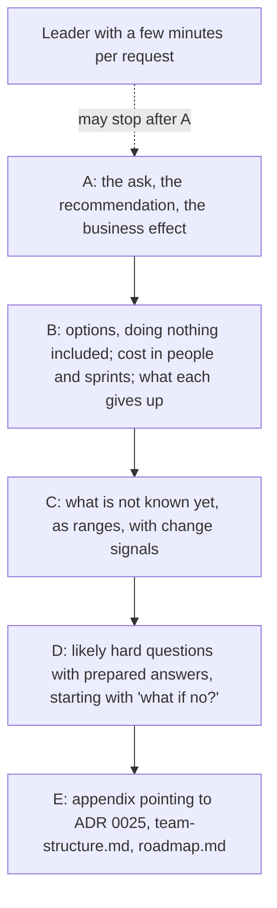

## Bạn cần biết trước

- [[management.l2.answer-first]] — bạn biết một tài liệu công việc mở đầu bằng kết luận, quyết định hay yêu cầu, vì người đọc bận có thể dừng sớm.
- [[management.l2.stakeholder-communication]] — bạn biết một bản cập nhật đưa dự báo dưới dạng khoảng, kèm các rủi ro có thể làm dự báo xê dịch và những gì đội cần, bằng ngôn ngữ của người đọc.
- [[management.l4.deciding-under-uncertainty]] — bạn biết một quyết định ghi rõ các giả định và những tín hiệu sẽ khiến nó được mở lại.
- [[management.l4.team-types]] — bạn biết ADR `0025` dự kiến hai đội theo luồng và một đội platform, đội platform lập trước.

## Tình huống

ADR `0025` đã được chấp nhận trong đội: hai đội theo luồng và một đội platform, đội platform lập trước. Đội mới cần người, nên ban lãnh đạo phải đồng ý. Người đặt thứ tự ưu tiên cho đội xin cho bạn một suất trong buổi họp tới của ban lãnh đạo, xen giữa nhiều đề nghị khác. Bản nháp đầu tiên của bạn mở đầu bằng định luật Conway, tiếp theo là công thức n(n-1)/2 cho số cặp người có thể cần trao đổi, rồi tới bốn kiểu đội và một bảng ai sở hữu phần nào. Trưởng nhóm đọc trang đầu và nói: "Tôi vẫn chưa biết bạn muốn họ quyết định gì." Viết cho lãnh đạo thế nào để họ quyết được trong vài phút họ dành cho mỗi đề nghị?

## Khái niệm cốt lõi

- Bản đề xuất cho lãnh đạo (cụm từ thường, ở đây dùng theo nghĩa này) — một tài liệu ngắn xin lãnh đạo đúng một quyết định, viết sao cho chỉ đoạn đầu tiên đã đủ để quyết. Bản của Đơn Hàng là `docs/team/leadership-brief-platform-team.md`.
- Lời đề nghị (cụm từ thường, ở đây dùng theo nghĩa này) — quyết định mà bản đề xuất xin, nêu ngay ở câu đầu tiên cùng phương án được khuyến nghị.
- Hiệu quả cho kinh doanh (cụm từ thường, ở đây dùng theo nghĩa này) — điều quyết định thay đổi cho việc kinh doanh, nói bằng những thứ cửa hàng và lãnh đạo nhìn thấy, như một cửa hàng mới mở được sớm tới đâu, chứ không nói bằng các thành phần của hệ thống.
- Tín hiệu đổi kế hoạch (cụm từ thường, ở đây dùng theo nghĩa này) — một điều quan sát được, nêu tên từ trước, mà nếu xảy ra thì đội sẽ đổi kế hoạch. Đây cũng là ý của tín hiệu mở lại trong một ADR.
- Phụ lục (từ thường, ở đây dùng theo nghĩa này) — phần cuối của bản đề xuất, trỏ tới các tài liệu chứa chi tiết kỹ thuật.

## Cơ chế hoạt động



Lãnh đạo cân nhắc nhiều đề nghị và chỉ dành cho mỗi đề nghị vài phút, nên bản đề xuất đặt điều họ phải quyết lên đầu. Trong tình huống trên, bản nháp dùng cả trang đầu để nói lý do. Còn lãnh đạo thì trước hết hỏi họ được xin duyệt điều gì và điều đó đổi gì cho kinh doanh. Nút `A` trả lời hai câu đó trong một đoạn. Người lãnh đạo dừng đọc ở đây vẫn biết mình phải quyết gì.

Nút `B` là phần so sánh. Mỗi phương án ghi chi phí bằng đơn vị lãnh đạo dùng khi lập kế hoạch, tức số người và số sprint, cùng điều phương án đó phải bỏ. Không làm gì cũng là một phương án, vì lãnh đạo thường có quyền chọn nó, và nó cũng có cái giá riêng. Chỉ thấy một phương án thì lãnh đạo duyệt hoặc từ chối được, nhưng không chọn được.

Nút `C` nói những điều đội chưa biết. Con số chưa chốt được ghi dưới dạng khoảng, đặt cạnh các tín hiệu sẽ làm đổi kế hoạch. Một con số chắc nịch mà về sau xê dịch thường làm mất lòng tin nhiều hơn một khoảng nói ra từ đầu. Còn tín hiệu nêu tên trước giúp thay đổi về sau trông như một bước đã lường trước.

Nút `D` liệt kê những câu hỏi khó lãnh đạo có thể đặt ra, câu nào cũng có câu trả lời chuẩn bị sẵn. Câu đầu tiên là chuyện gì xảy ra nếu câu trả lời là không. Có sẵn câu trả lời thì buổi họp vẫn kết thúc bằng một quyết định, không rơi vào ngõ cụt.

Nút `E` là phụ lục. Phần lập luận kỹ thuật không bị xóa, nó vẫn nằm trong các tài liệu vốn đã chứa nó.

## Trong hệ thống Đơn Hàng

Bản đề xuất có tiêu đề "Đề nghị: lập đội platform trước đội sản phẩm thứ hai". Đoạn đầu tiên và các phương án như sau:

```markdown file=docs/team/leadership-brief-platform-team.md tag=stage-4 lines=3-24
Đề nghị ban lãnh đạo đồng ý lập một đội platform trước khi lập đội sản phẩm
thứ hai. Hiệu quả cho kinh doanh: cửa hàng mới mở được nhanh hơn, vì đội sản
phẩm không còn phải tự dựng và giữ cluster, deploy, giám sát; và các cửa hàng
giữ được mức dịch vụ đã cam kết (SLO trong `docs/design/slo.md`) trong lúc số
cửa hàng tăng. Mọi con số dưới đây là giả định của đội.

### Phương án

| Phương án | Chi phí | Điều phải bỏ |
|---|---|---|
| A. Không làm gì: giữ một đội bảy người | Không thêm người | Mở cửa hàng mới, production trên Kubernetes managed và giám sát production xếp hàng sau nhau trong một đội; cluster vẫn chỉ một người sửa được |
| B. Thêm người vào đội hiện có, lên mười bốn người | 7 người; khoảng 2 tới 3 sprint để người mới làm được việc | Số cặp người cần trao đổi từ 21 lên 91; mỗi người vẫn phải biết toàn bộ hệ thống, nên đội chậm lại khi lớn lên |
| C. Đề xuất: lập đội platform 3 tới 4 người trước, rồi đội sản phẩm thứ hai (Cửa hàng) 5 tới 7 người | 3 tới 4 người trước, 5 tới 7 người sau; đội hiện có dành một người trong 2 sprint để chuyển giao phần chung | Đội sản phẩm thứ hai bắt đầu muộn hơn so với lập nó ngay, khoảng thời gian đội platform cần để nhận phần chung (2 tới 3 sprint) |

Với C, khi đội Cửa hàng bắt đầu, đội đó deploy qua con đường đội platform đã
giữ sẵn, không phải học cluster từ đầu, nên làm ra việc cho cửa hàng sớm hơn.

### Điều chưa chắc

- Đội platform cần 3 tới 4 người. Con số đúng phụ thuộc phần việc chuyển
  production sang Kubernetes managed, chưa ước lượng xong.
- Thời gian đội platform nhận phần chung: 2 tới 3 sprint.
```

Dòng 3–7 là nút `A`. Lời đề nghị là lập một đội platform trước đội sản phẩm thứ hai. Hiệu quả cho kinh doanh có hai phần. Một là cửa hàng mới mở được sớm hơn, vì đội sản phẩm không còn phải tự dựng và giữ cluster, deploy và monitoring. Hai là các cửa hàng vẫn giữ được các SLO trong `docs/design/slo.md` trong lúc số cửa hàng tăng. Dòng 7 ghi rõ mọi con số đều là giả định của đội.

Dòng 13–15 là nút `B`, và phương án A là không làm gì: không thêm người, nhưng việc mở cửa hàng mới, Kubernetes managed và monitoring production phải xếp hàng sau nhau trong cùng một đội. Ngay cả C, phương án được khuyến nghị, cũng thừa nhận đội sản phẩm thứ hai sẽ bắt đầu muộn hơn. Dòng 17–18 nói thêm C mang lại gì: đội Cửa hàng deploy qua con đường mà đội platform đã giữ sẵn. Dòng 22–24 là nút `C`: 3 tới 4 người, vì việc chuyển sang Kubernetes managed chưa ước lượng xong, và 2 tới 3 sprint để nhận phần chung, tức cluster, deploy và monitoring ở dòng 4–5.

Tiếp theo là các tín hiệu và những câu hỏi đã chuẩn bị:

```markdown file=docs/team/leadership-brief-platform-team.md tag=stage-4 lines=26-47
Tín hiệu làm đổi kế hoạch:

- Yêu cầu từ đội sản phẩm sang đội platform thường quá 2 ngày làm việc mới
  được trả lời: đội platform thiếu người.
- Số cửa hàng tăng chậm hơn giả định trong `multi-shop-requirements.md`: lùi
  việc lập đội Cửa hàng, đội platform giữ nguyên.
- Hai đội cùng phải sửa một phần hệ thống trong phần lớn thay đổi: ranh giới
  đội đặt sai, đội xem lại cách chia trước khi thêm người.

### Câu hỏi có thể gặp

- Nếu không đồng ý thì sao? Đội giữ phương án A. Các kết quả ở mục "Tiếp theo"
  của `roadmap.md` làm lần lượt, mỗi lần một, và đội báo lại thứ tự để ban lãnh
  đạo chọn kết quả nào đi trước.
- Sao không lập đội sản phẩm thứ hai trước, cho nhanh? Hai đội sản phẩm cùng tự
  giữ cluster và deploy thì mỗi đội làm lại cùng một việc, và lỗi ở phần chung
  không có ai chịu trách nhiệm rõ.
- Đội platform có thành chỗ mọi việc phải chờ không? Đội platform cung cấp
  dịch vụ để đội sản phẩm tự làm, không làm thay: đội sản phẩm tự deploy và tự
  trực cho service của mình.
- Khi nào thấy hiệu quả? Khi đội Cửa hàng ra thay đổi đầu tiên tới production
  mà không cần ai ngoài đội deploy giúp.
```

Dòng 28–33 là các tín hiệu đổi kế hoạch, mỗi tín hiệu kèm điều nó sẽ làm thay đổi. Yêu cầu gửi đội platform thường quá 2 ngày làm việc mới được trả lời nghĩa là đội platform thiếu người. Số cửa hàng tăng chậm hơn giả định trong `multi-shop-requirements.md` thì lùi việc lập đội Cửa hàng. Hai đội cùng phải sửa một phần trong phần lớn thay đổi nghĩa là ranh giới đội đặt sai.

Dòng 37–39 trả lời câu "nếu không đồng ý thì sao": đội giữ phương án A, làm lần lượt từng kết quả ghi ở mục "Tiếp theo", mốc giữa trong ba mốc thời gian của `roadmap.md`, và báo lại thứ tự để ban lãnh đạo chọn kết quả nào đi trước. Dòng 46–47 đưa ra một dấu hiệu lãnh đạo tự kiểm được mà không cần kiến thức kỹ thuật: đội Cửa hàng đưa thay đổi đầu tiên lên production mà không cần ai ngoài đội giúp deploy.

Sau đoạn trích, dòng 49–55 là nút `E`: ADR `0025` cho quyết định và các phương án đã cân nhắc, `team-structure.md` cho việc đội nào sở hữu phần nào, và `roadmap.md` cho các kết quả đang chờ người làm. Dòng 26–49 của ADR `0025` cân nhắc một đội lớn hơn, các đội theo tầng, và các đội theo luồng cộng một đội platform. Phương án B của bản đề xuất chính là đội lớn hơn trong ADR, còn C là lựa chọn của ADR. Các đội theo tầng ở lại trong ADR, còn bản đề xuất thêm phương án A, không làm gì.

## Đánh đổi

| Cách viết bản đề xuất | Lãnh đạo làm được gì trong vài phút | Lòng tin khi có thay đổi | Hợp khi |
|---|---|---|---|
| Bối cảnh kỹ thuật trước, lời đề nghị ở trang hai | chưa quyết được, lời đề nghị nằm ngoài tầm đọc | cao với người đọc hết | người đọc là chính đội ra quyết định, như với ADR `0025` |
| Chỉ có phương án khuyến nghị | duyệt hoặc từ chối | giảm nếu về sau một phương án bị loại trông tốt hơn mà chưa từng được nêu | quyết định nhỏ và dễ đảo ngược |
| Lời đề nghị trước, các phương án gồm cả không làm gì | chọn, biết mỗi phương án phải bỏ gì | giữ được, vì sự đánh đổi là do họ chọn | quyết định tốn người hoặc sprint, như bản đề xuất này |
| Một con số chắc nịch | lập kế hoạch theo con số đó | sụt khi con số xê dịch | con số đã đo được |
| Một khoảng kèm tín hiệu đổi kế hoạch | lập kế hoạch theo khoảng và biết cần theo dõi gì | giữ được, vì thay đổi đã được báo trước | con số chưa ước lượng xong, như ở dòng 22–24 |

## Bạn sẽ chọn gì nếu…

…một người lãnh đạo muốn một con số thay vì "3 tới 4 người"? Đưa khoảng đó kèm lý do ở dòng 22–23: việc chuyển sang Kubernetes managed chưa ước lượng xong. Nếu họ buộc phải lập kế hoạch ngay, đề nghị lấy cận trên làm con số để lập kế hoạch, và nói rằng ước lượng sẽ thu hẹp khoảng này.

…một người lãnh đạo xuất thân kỹ thuật muốn nghe toàn bộ lập luận ngay trong buổi họp? Giữ phần mở đầu cho những người đọc khác, và dẫn người đó đi qua phụ lục: ADR `0025` chứa các phương án đã cân nhắc và lý do hai phương án bị loại.

…ban lãnh đạo trả lời không? Dòng 37–39 đã có sẵn câu trả lời, nên buổi họp vẫn kết thúc bằng một quyết định: đội giữ nguyên một đội, và lãnh đạo chọn kết quả nào trong mục "Tiếp theo" của `roadmap.md` đi trước.

## Senior hay nhầm rằng…

- **"Lãnh đạo cần đủ chi tiết kỹ thuật thì mới tin một khuyến nghị."** → Thực ra lãnh đạo kiểm một khuyến nghị bằng những gì họ đã biết: hiệu quả cho kinh doanh, chi phí tính bằng người và sprint, và điều mỗi phương án phải bỏ. Chi tiết vẫn ở cách một đường dẫn, trong phụ lục. Bạn sẽ nhận ra bản đầy đủ chi tiết khi buổi họp kết thúc bằng câu "gửi lại bản ngắn hơn" và quyết định bị dời sang buổi họp sau.
- **"Chỉ nêu phương án khuyến nghị là cách thuyết phục mạnh nhất."** → Thực ra với một phương án, lãnh đạo chỉ duyệt hoặc từ chối được, và một lời từ chối để lại khoảng trống không có kế hoạch nào. Chính cái giá của việc không làm gì, đặt cạnh khuyến nghị, mới làm nên sức thuyết phục. Bạn sẽ nhận ra bản chỉ có một phương án khi một người lãnh đạo hỏi "còn cân nhắc phương án nào khác không?" và câu trả lời không có trong bản đề xuất.
- **"Thừa nhận điều chưa chắc trước mặt lãnh đạo trông yếu kém."** → Thực ra một khoảng kèm các tín hiệu sẽ làm nó thay đổi cho thấy hiểu biết của đội dừng ở đâu, còn một con số chắc nịch mà về sau xê dịch thường làm mất lòng tin nhiều hơn khoảng kia. Bạn sẽ nhận ra khi lời hứa "3 người" thành 4 và đề nghị tiếp theo của đội gặp nhiều nghi ngờ hơn.

## Thử ngay (3 phút)

Một đồng nghiệp muốn đưa sáu câu này vào đâu đó trong bản đề xuất:

1. "Bảy người tạo ra 21 cặp có thể cần trao đổi, mười bốn người tạo ra 91."
2. "Chúng tôi đề nghị ban lãnh đạo đồng ý lập một đội platform trước đội sản phẩm thứ hai."
3. "Đội platform cần 3 tới 4 người, việc chuyển sang Kubernetes managed chưa ước lượng xong."
4. "Các đội theo tầng bị loại vì gần như mọi thay đổi sẽ đi qua cả ba đội."
5. "Nếu ban lãnh đạo không đồng ý, chúng tôi giữ một đội và ban lãnh đạo chọn kết quả tiếp theo nào đi trước."
6. "Cửa hàng mới mở được sớm hơn, và các cửa hàng giữ được SLO trong lúc số cửa hàng tăng."

Dựa vào năm nút của sơ đồ và bản đề xuất, xếp mỗi câu vào nút `A`, `B`, `C`, `D` hoặc `E`, rồi chỉ ra những dòng mà bản đề xuất, hoặc tài liệu phụ lục của nó trỏ tới, đã nói điều đó.

Kết quả mong đợi: hai câu vào nút `A`, còn `B`, `C`, `D` và `E` mỗi nút một câu.

<details><summary>Gợi ý đáp án</summary>

Câu 1 vào `B`: đây là một phần điều phương án B phải bỏ (dòng 14).

Câu 2 vào `A`: đây là lời đề nghị (dòng 3–4).

Câu 3 vào `C`: một khoảng kèm lý do nó chưa chốt (dòng 22–23).

Câu 4 vào `E`: bản đề xuất không lập luận điều này, ADR `0025` mới lập luận (dòng 57–59), và phụ lục trỏ tới đó (dòng 51–52).

Câu 5 vào `D`: câu trả lời chuẩn bị sẵn cho "nếu không đồng ý thì sao?" (dòng 37–39).

Câu 6 vào `A`: đây là hiệu quả cho kinh doanh (dòng 4–7).

</details>

## Liên hệ

- [[management.l2.answer-first]] — cùng quy tắc đó ở một tầm cao hơn: với lãnh đạo, kết luận là quyết định mà họ được xin.
- [[management.l2.stakeholder-communication]] — khoảng và rủi ro cho bên liên quan, ở đây gắn vào một quyết định.
- [[management.l4.deciding-under-uncertainty]] — nguồn gốc của các tín hiệu đổi kế hoạch, ở đây đưa ra cho những người duyệt.
- [[management.l4.team-types]] — các kiểu đội mà bản đề xuất xin lập, được giữ ngoài phần mở đầu.
- [[management.l4.weighted-scoring-matrix]] — so sánh các phương án kỹ hơn, để dành cho phụ lục.
- [[management.l4.roadmap]] — các kết quả phải xếp hàng nếu chọn phương án A, và lãnh đạo sắp thứ tự nếu câu trả lời là không.
- [[management.l4.technical-strategy]] — hướng đi mà các kết quả trong roadmap đó phục vụ.
- [[management.l2.schedule-buffer]] — cùng sự trung thực đó trong một lịch làm việc: phần thời gian chừa cho điều chưa chắc được ghi ra rõ ràng, không phải một con số chắc nịch.

## Tóm tắt 5 dòng

1. Bản đề xuất gửi lãnh đạo mở đầu bằng quyết định được xin, phương án khuyến nghị và hiệu quả cho kinh doanh, trước mọi chi tiết kỹ thuật.
2. `leadership-brief-platform-team.md` xin lập đội platform trước đội sản phẩm thứ hai, để cửa hàng mới mở sớm hơn và SLO vẫn giữ được.
3. Bản đề xuất so sánh ba phương án, có cả không làm gì, mỗi phương án kèm chi phí tính bằng người và sprint cùng điều phải bỏ.
4. Con số chưa chốt được ghi dưới dạng khoảng, cạnh các tín hiệu sẽ làm đổi kế hoạch, nhờ đó giữ được lòng tin khi con số xê dịch.
5. Chi tiết chuyển vào phụ lục trỏ tới ADR `0025` và `team-structure.md`, còn các câu hỏi khó như một lời từ chối đã có câu trả lời chuẩn bị sẵn.
