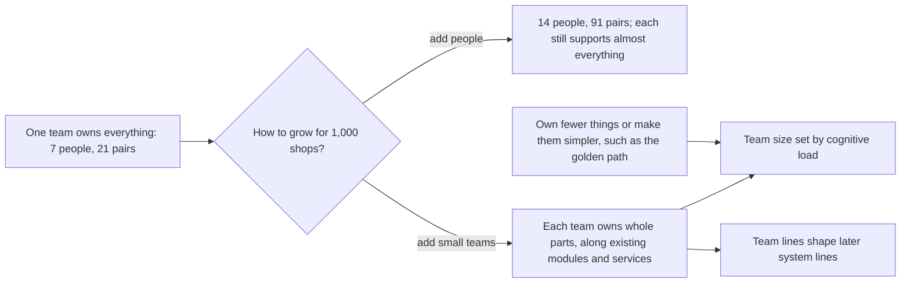

## Before you start

- [[design.l4.conways-law]] — you know that a system's structure tends to mirror the communication structure of the people who build it.
- [[design.l4.a-thousand-shops]] — you know that `multi-shop-requirements.md` expects three to four teams, not one, to serve 1,000 shops.
- [[management.l4.roadmap]] — you know the roadmap keeps a fixed share of every sprint for debt and platform work.
- [[devops.l4.golden-path]] — you know the golden path is the supported, documented way to add a service, with defaults that already meet the platform's rules.

## The situation

Suppose leadership has accepted the plan to serve 1,000 shops and asks how many developers to hire. Someone offers the simple answer: seven more, all in the one team of seven that exists today. That team already reviews code, answers questions and takes on-call for the api, the Notifications and Payments services, the Flutter app, staging's platform and CI. Only the team lead can change the OpenTofu code in `deploy/tofu/`. A bigger team has more hands, but nobody has asked whether it leaves anyone less to know. How should Đơn Hàng add people so that each of them can still keep in mind what they change and support?

## Core concepts

- **cognitive load** — how much a team's members must know and keep in mind to change and run everything the team owns; in the situation above, it is everything the team's four developers review and support.
- communication pairs — the n(n-1)/2 pairs of people in a group of n who may need to talk to each other.
- owning a part — being the team that changes a part of the system, reviews changes to it and supports it, on-call included.
- one-person part — a part that only one person can change without asking anyone, so it stops when that person is away.

## How it works



Start with the team as it is. In the situation above, seven people make 21 pairs who may need to talk, because a group of n people has n(n-1)/2 pairs. Pairs grow much faster than people: double the team to fourteen and the pairs reach 91.

Adding people also leaves the cognitive load where it was. Each person still reviews and supports much of the whole system, so each must keep nearly all of it in mind. The load per person stays the same or grows while the pairs multiply.

The other branch grows by adding small teams. Each team owns whole parts of the system, the parts that change together, so most changes need talk only inside the team. In this plan, a team's size is set by its cognitive load, how much it must know to change and run its parts. Counting services or lines of code misses this: the OpenTofu code is not a service at all, yet someone has to know it.

Where the team lines go matters beyond today. By Conway's law, the lines between teams tend to become lines in the system later. So the plan draws them along modules and services that already exist, such as Ordering and Catalog, and draws no new line across a module.

Finally, load can fall without anyone new. A team can own fewer things, or make each thing simpler to use. The golden path does the second for adding a service: its defaults already meet the platform's rules, so a team need not learn every rule first. Lower load lets the same team carry more parts before it needs to grow or split.

## In the Đơn Hàng system

The start of `docs/team/team-structure.md`, with what the one team owns today and why it does not grow by adding people:

```markdown file=docs/team/team-structure.md tag=stage-4 lines=10-33
Một đội: một product owner, một scrum master, bốn lập trình viên, một tester
(như `sprint-example.md`). Đội sở hữu toàn bộ hệ thống ở stage-4:

| Phần | Gồm | Người giữ | Số người sửa được |
|---|---|---|---|
| api | Module Ordering (`DonHang.Domain`, `DonHang.Infrastructure`) và Catalog (`DonHang.Catalog`) trong `DonHang.Api` | Lập trình viên backend | 4 |
| Notifications | `DonHang.Notifications`, database `donhang_notifications` | Lập trình viên backend | 3 |
| Payments | `DonHang.Payments`, database `donhang_payments`, cổng thanh toán (ADR 0010) | Lập trình viên backend | 2 |
| DonHang.App | App Flutter (`docs/design/app-structure.md`) | Lập trình viên frontend | 2 |
| Platform của staging | Các năng lực trong `platform-capabilities.md`: Argo CD, Gateway, Sealed Secrets, Prometheus, admission policy, golden path | Trưởng nhóm, lập trình viên phụ trách nền tảng | 2 |
| Lớp cluster và lớp platform của OpenTofu | `deploy/tofu/` | Trưởng nhóm | 1: chỉ một người sửa được |
| CI | `.github/workflows/ci.yml`, các job `image` và `publish` | Lập trình viên backend | 2 |
| Trực | Một vòng trực cho mọi thứ ở trên (`on-call.md`) | Bốn lập trình viên | 4 |

Cột cuối đếm người đã từng sửa phần đó và tự sửa được không cần hỏi ai (giả
định của đội). Phần chỉ một người sửa được là rủi ro: người đó nghỉ thì phần
đó đứng.

### Vì sao không thêm người vào một đội

Trong một nhóm n người có n(n-1)/2 cặp có thể cần trao đổi với nhau. Bảy người
là 21 cặp; cùng đội đó lên mười bốn người là 91 cặp. Thêm người cũng không làm
mỗi người phải biết ít đi: mỗi người vẫn review và trực cho gần như mọi thứ đội
sở hữu, nên tải nhận thức của từng người giữ nguyên hoặc tăng.
```

Lines 10–11 name the seven people and say they own the whole system at stage-4. The table in lines 13–22 runs from the api, with its modules Ordering and Catalog, through Notifications, Payments and the Flutter app to staging's platform, CI and one on-call rotation for all of it. The last column counts the people who can change a part without asking anyone, an assumption of the team (lines 24–26).

Line 20 is the one-person part: only the team lead can change the OpenTofu code for the cluster and platform. Lines 30–33 give the pairs, 21 at seven people and 91 at fourteen, and say why each person's cognitive load stays the same or grows: each still reviews and takes on-call for almost everything the team owns.

The next lines lower the load another way and set out the plan:

```markdown file=docs/team/team-structure.md tag=stage-4 lines=35-58
Tải cũng giảm được mà không thêm người: sở hữu ít thứ hơn, hoặc làm cho mỗi
thứ dễ dùng hơn, như golden path làm cho việc thêm một service
(`golden-path.md`).

### Kế hoạch

Theo ADR 0025, Đơn Hàng lớn lên bằng cách thêm đội nhỏ, mỗi đội sở hữu trọn
những phần hệ thống đổi cùng nhau:

| Đội | Kiểu | Sở hữu |
|---|---|---|
| Đặt hàng | Theo luồng | Module Ordering, Payments, Notifications, `DonHang.App/lib/features/ordering`, `lib/design/`, `lib/shared/` |
| Cửa hàng | Theo luồng | Module Catalog, việc mở cửa hàng mới (`docs/design/multi-shop-data-rollout.md`), `lib/features/catalog`, `lib/features/auth` |
| Platform | Platform | OpenTofu, Argo CD và repo cấu hình, Gateway, Sealed Secrets, Prometheus, admission policy, golden path, vận hành PostgreSQL, RabbitMQ và Keycloak |

- Mỗi đội 5 tới 7 người (giả định). Cỡ đội đặt theo lượng mỗi đội phải biết
  để sửa và vận hành phần của mình, không theo số service hay số dòng code.
- Đội platform lập trước đội theo luồng thứ hai: đội hôm nay trở thành đội
  Đặt hàng.
- Ranh giới đội đi theo ranh giới module và service đã có. Ranh giới đội về
  sau sẽ định hình ranh giới hệ thống, nên kế hoạch không vẽ ranh giới mới cắt
  ngang một module.
- Chưa có đội hệ con phức tạp. Ký hóa đơn trong HSM của nhà cung cấp (ADR
  0023) chưa có code chạy với HSM đó; khi được xây, đó là ứng viên đầu tiên.
```

Lines 35–37 note that load also falls by owning fewer things or by making each simpler, as the golden path does for adding a service. Lines 41–48 grow Đơn Hàng by adding small teams that each own whole parts that change together. There are three: Đặt hàng for ordering, Cửa hàng for shops, and Platform, which takes over OpenTofu and the shared tools. Skip the column Kiểu and lines 57–58 for now; both describe kinds of team, the next lesson's subject.

Lines 50–51 set each team at 5 to 7 people, an assumption, sized by what it must know to change and run its parts, not by services or lines of code. Lines 52–53 turn today's team into Đặt hàng and form Platform before the second team for a business flow, Cửa hàng. Lines 54–56 apply Conway's law: team lines follow the module and service lines that exist, and no new line cuts across a module.

## Trade-offs

| Way to grow | Pairs who may need to talk | Cognitive load per person | What it costs | Fits when |
|---|---|---|---|---|
| Add people to the one team | grow fastest: 21 at seven, 91 at fourteen | stays the same or grows | little up front; every review and decision involves more people | the system is small and the growth is a person or two |
| Add small teams that own whole parts | for most changes, inside each team of 5 to 7 | limited to the parts the team owns | requests between teams, and team lines that tend to harden into system lines | the system already has module and service lines that can carry team lines |
| One team per service | follows the count of services | uneven: the api, with two modules, counts as one; the OpenTofu code counts as none | teams sized by a count that says little about what must be known | rarely; a service count is at most a first rough cut |
| Lower the load without new people | unchanged | falls as the team owns fewer or simpler things | platform work that has to be paid for, for example from the roadmap's fixed share | the team is overloaded but the amount of work is not growing |

## What would you choose if…

…the team that becomes Đặt hàng fell behind on the 1,000-shop work and you were offered three more developers for it? A sensible first step looks at what the team owns, not at its headcount. It already has seven people; three more make ten, past the 5 to 7 the plan assumes, and take its pairs from 21 to 45. Moving a whole part to another team, or making a part simpler, lowers the load instead. Đơn Hàng's files do not record this case; it follows from lines 30–33 and 50–51.

…someone proposed splitting the Ordering module between two teams, because it is the largest part? Lines 54–56 say no team line cuts across a module. By Conway's law, two teams sharing one module must agree on each change, and the module's boundary blurs. A sensible choice keeps Ordering whole inside one team and, if that team carries too much, moves a different whole part elsewhere.

## Seniors often assume…

- **"A team that falls behind catches up by adding more developers to it."** → Actually each new person adds pairs who may need to talk, and still has to learn much of what the team owns. Seven people make 21 pairs and fourteen make 91, while each person's cognitive load stays the same or grows. You may notice this belief when a team grows, reviews and the team's short daily meeting start to take longer, and the work finished per sprint does not rise with the headcount.
- **"One large team coordinates more easily than several small ones, because everyone hears everything."** → Actually hearing everything is the cost: every person must follow every part, and the pairs grow much faster than the people. Small teams that own whole parts keep the talk for most changes inside the team. You notice this belief when even a small change waits for the one person who knows another corner of the system.
- **"The number of services is a good measure of how much a team can own."** → Actually what counts is how much the team must know to change and run its parts. In `team-structure.md` the api is one service yet holds two modules, and the OpenTofu code is no service at all, yet only one person can change it. You notice this belief when a team that owns "only two services" is still worn out, because it also runs the shared tools and their on-call.

## Try it (3 minutes)

Use the formula in line 30 and the team size in line 50.

1. Suppose Đơn Hàng grows to three teams of six people each. Count the pairs inside the three teams together.
2. Count the pairs if the same eighteen people were one team.

Expected result: 45 pairs inside the three teams, against 153 in one team of eighteen.

<details><summary>Suggested answer</summary>

Each team of six has 6 × 5 / 2 = 15 pairs, so three teams make 45. One team of eighteen has 18 × 17 / 2 = 153.

The 45 leave out pairs across teams; how teams handle those requests is the subject of a later lesson. For most changes, talk stays inside a team of six, where each person mainly keeps that team's parts in mind.

</details>

## Connections

- [[design.l4.conways-law]] — the reason team lines are drawn along existing modules and services.
- [[design.l4.a-thousand-shops]] — the growth this lesson plans the people for.
- [[management.l4.roadmap]] — the fixed share that can pay for work which lowers load without new people.
- [[devops.l4.golden-path]] — one way to lower cognitive load: make adding a service simpler.
- [[management.l1.scrum-from-junior-seat]] — the same seven-person team seen from the inside, one sprint at a time.
- [[management.l4.technical-strategy]] — the direction for the system; this lesson plans the teams that carry it out.
- [[design.l4.distributed-monolith]] — what tends to follow when parts that must change together end up apart.
- [[devops.l4.platform-engineering]] — the shared work Platform takes on so other teams carry less.
- [[management.l4.team-types]] — next: the kinds of team the column Kiểu names.

## Five-line summary

1. Grow by adding small teams that each own whole parts of the system, sized by how much they must keep in mind.
2. A group of n people has n(n-1)/2 pairs: seven make 21, fourteen make 91, and each person's load does not fall.
3. `team-structure.md` lists the one team's parts at stage-4, from the api to on-call, and marks OpenTofu as a one-person part.
4. Team lines follow existing modules and services, because by Conway's law they shape the system's later boundaries.
5. Load also falls without new people, by owning fewer things or making them simpler, as the golden path does.
