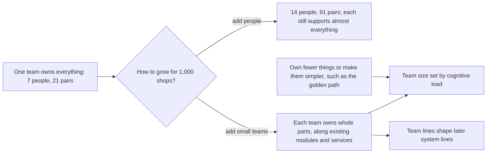

## Bạn cần biết trước

- [[design.l4.conways-law]] — bạn biết cấu trúc của một hệ thống có xu hướng phản chiếu cấu trúc trao đổi của những người xây nó.
- [[design.l4.a-thousand-shops]] — bạn biết `multi-shop-requirements.md` dự kiến cần ba tới bốn đội, không phải một, để phục vụ 1.000 cửa hàng.
- [[management.l4.roadmap]] — bạn biết roadmap giữ một phần cố định của mỗi sprint cho việc trả nợ kỹ thuật và việc nền tảng.
- [[devops.l4.golden-path]] — bạn biết golden path là cách được hỗ trợ, có tài liệu, để thêm một service, với các mặc định đã đáp ứng sẵn quy tắc của platform.

## Tình huống

Giả sử ban lãnh đạo đã chấp nhận kế hoạch phục vụ 1.000 cửa hàng và hỏi cần tuyển bao nhiêu lập trình viên. Có người đưa ra câu trả lời đơn giản: thêm bảy người, tất cả vào đội bảy người duy nhất đang có. Đội đó hiện đã review code, trả lời câu hỏi và trực sự cố cho api, service Notifications và Payments, app Flutter, platform của staging và CI. Chỉ trưởng nhóm sửa được code OpenTofu trong `deploy/tofu/`. Đội lớn hơn thì nhiều tay hơn, nhưng chưa ai hỏi liệu nó có giúp ai phải biết ít đi không. Đơn Hàng nên thêm người thế nào để mỗi người vẫn nắm được những gì mình sửa và hỗ trợ?

## Khái niệm cốt lõi

- **tải nhận thức** (cognitive load) — lượng điều các thành viên của một đội phải biết và nhớ để sửa và vận hành mọi thứ đội sở hữu. Trong tình huống trên, đó là mọi thứ bốn lập trình viên của đội review và hỗ trợ.
- cặp trao đổi — n(n-1)/2 cặp người trong một nhóm n người có thể cần nói chuyện với nhau.
- sở hữu một phần — là đội sửa một phần của hệ thống, review thay đổi ở phần đó và hỗ trợ nó, kể cả trực sự cố.
- phần một người — phần chỉ một người sửa được mà không cần hỏi ai, nên người đó vắng thì phần đó đứng.

## Cơ chế hoạt động



Bắt đầu từ đội như hiện nay. Trong tình huống trên, bảy người tạo thành 21 cặp có thể cần trao đổi, vì một nhóm n người có n(n-1)/2 cặp. Số cặp tăng nhanh hơn số người nhiều: tăng đội gấp đôi lên mười bốn người thì số cặp lên tới 91.

Thêm người cũng không làm tải nhận thức giảm đi. Mỗi người vẫn review và hỗ trợ phần lớn hệ thống, nên vẫn phải nắm gần như toàn bộ. Tải trên mỗi người giữ nguyên hoặc tăng, trong khi số cặp nhân lên.

Nhánh còn lại lớn lên bằng cách thêm đội nhỏ. Mỗi đội sở hữu trọn những phần của hệ thống đổi cùng nhau, nên phần lớn thay đổi chỉ cần trao đổi trong nội bộ đội. Trong kế hoạch này, cỡ đội đặt theo tải nhận thức, tức lượng đội phải biết để sửa và vận hành phần của mình. Đếm service hay số dòng code sẽ bỏ sót điều này: code OpenTofu không phải service, nhưng vẫn phải có người nắm nó.

Đặt ranh giới đội ở đâu có ảnh hưởng xa hơn hôm nay. Theo định luật Conway, ranh giới giữa các đội về sau có xu hướng thành ranh giới trong hệ thống. Vì vậy kế hoạch vẽ chúng theo các module và service đã có, như Ordering và Catalog, và không vẽ ranh giới mới nào cắt ngang một module.

Cuối cùng, tải có thể giảm mà không cần người mới. Một đội có thể sở hữu ít thứ hơn, hoặc làm cho mỗi thứ dễ dùng hơn. Golden path làm điều thứ hai khi thêm service: các mặc định của nó đã đáp ứng sẵn quy tắc của platform, nên đội không phải học hết mọi quy tắc trước. Tải thấp hơn thì cùng một đội gánh được nhiều phần hơn trước khi phải lớn lên hay tách ra.

## Trong hệ thống Đơn Hàng

Phần đầu của `docs/team/team-structure.md`, ghi những gì đội duy nhất đang sở hữu và vì sao đội không lớn lên bằng cách thêm người:

```markdown file=docs/team/team-structure.md tag=stage-4 lines=10-33
Một đội: một product owner, một scrum master, bốn lập trình viên, một tester
(như `sprint-example.md`). Đội sở hữu toàn bộ hệ thống ở stage-4:

| Phần | Gồm | Người giữ | Số người sửa được |
|---|---|---|---|
| api | Module Ordering (`DonHang.Domain`, `DonHang.Infrastructure`) và Catalog (`DonHang.Catalog`) trong `DonHang.Api` | Lập trình viên backend | 4 |
| Notifications | `DonHang.Notifications`, database `donhang_notifications` | Lập trình viên backend | 3 |
| Payments | `DonHang.Payments`, database `donhang_payments`, cổng thanh toán (ADR 0010) | Lập trình viên backend | 2 |
| DonHang.App | App Flutter (`docs/design/app-structure.md`) | Lập trình viên frontend | 2 |
| Platform của staging | Các năng lực trong `platform-capabilities.md`: Argo CD, Gateway, Sealed Secrets, Prometheus, admission policy, golden path | Trưởng nhóm, lập trình viên phụ trách nền tảng | 2 |
| Lớp cluster và lớp platform của OpenTofu | `deploy/tofu/` | Trưởng nhóm | 1: chỉ một người sửa được |
| CI | `.github/workflows/ci.yml`, các job `image` và `publish` | Lập trình viên backend | 2 |
| Trực | Một vòng trực cho mọi thứ ở trên (`on-call.md`) | Bốn lập trình viên | 4 |

Cột cuối đếm người đã từng sửa phần đó và tự sửa được không cần hỏi ai (giả
định của đội). Phần chỉ một người sửa được là rủi ro: người đó nghỉ thì phần
đó đứng.

### Vì sao không thêm người vào một đội

Trong một nhóm n người có n(n-1)/2 cặp có thể cần trao đổi với nhau. Bảy người
là 21 cặp; cùng đội đó lên mười bốn người là 91 cặp. Thêm người cũng không làm
mỗi người phải biết ít đi: mỗi người vẫn review và trực cho gần như mọi thứ đội
sở hữu, nên tải nhận thức của từng người giữ nguyên hoặc tăng.
```

Dòng 10–11 nêu bảy người và ghi rằng họ sở hữu toàn bộ hệ thống ở stage-4. Bảng ở dòng 13–22 đi từ api, với hai module Ordering và Catalog, qua Notifications, Payments và app Flutter, tới platform của staging, CI và một vòng trực sự cố cho tất cả. Cột cuối đếm số người sửa được một phần mà không cần hỏi ai, đây là giả định của đội (dòng 24–26).

Dòng 20 là phần một người: chỉ trưởng nhóm sửa được code OpenTofu cho cluster và platform. Dòng 30–33 đưa ra số cặp, 21 khi có bảy người và 91 khi có mười bốn, và giải thích vì sao tải nhận thức của mỗi người giữ nguyên hoặc tăng: ai cũng vẫn review và trực sự cố cho gần như mọi thứ đội sở hữu.

Các dòng tiếp theo nêu thêm một hướng giảm tải và trình bày kế hoạch:

```markdown file=docs/team/team-structure.md tag=stage-4 lines=35-58
Tải cũng giảm được mà không thêm người: sở hữu ít thứ hơn, hoặc làm cho mỗi
thứ dễ dùng hơn, như golden path làm cho việc thêm một service
(`golden-path.md`).

### Kế hoạch

Theo ADR 0025, Đơn Hàng lớn lên bằng cách thêm đội nhỏ, mỗi đội sở hữu trọn
những phần hệ thống đổi cùng nhau:

| Đội | Kiểu | Sở hữu |
|---|---|---|
| Đặt hàng | Theo luồng | Module Ordering, Payments, Notifications, `DonHang.App/lib/features/ordering`, `lib/design/`, `lib/shared/` |
| Cửa hàng | Theo luồng | Module Catalog, việc mở cửa hàng mới (`docs/design/multi-shop-data-rollout.md`), `lib/features/catalog`, `lib/features/auth` |
| Platform | Platform | OpenTofu, Argo CD và repo cấu hình, Gateway, Sealed Secrets, Prometheus, admission policy, golden path, vận hành PostgreSQL, RabbitMQ và Keycloak |

- Mỗi đội 5 tới 7 người (giả định). Cỡ đội đặt theo lượng mỗi đội phải biết
  để sửa và vận hành phần của mình, không theo số service hay số dòng code.
- Đội platform lập trước đội theo luồng thứ hai: đội hôm nay trở thành đội
  Đặt hàng.
- Ranh giới đội đi theo ranh giới module và service đã có. Ranh giới đội về
  sau sẽ định hình ranh giới hệ thống, nên kế hoạch không vẽ ranh giới mới cắt
  ngang một module.
- Chưa có đội hệ con phức tạp. Ký hóa đơn trong HSM của nhà cung cấp (ADR
  0023) chưa có code chạy với HSM đó; khi được xây, đó là ứng viên đầu tiên.
```

Dòng 35–37 ghi rằng tải cũng giảm khi sở hữu ít thứ hơn hoặc làm mỗi thứ đơn giản hơn, như golden path làm khi thêm service. Dòng 41–48 cho Đơn Hàng lớn lên bằng cách thêm các đội nhỏ, mỗi đội sở hữu trọn những phần đổi cùng nhau. Có ba đội: Đặt hàng lo phần đặt hàng, Cửa hàng lo phần cửa hàng, và Platform nhận OpenTofu cùng các công cụ dùng chung. Tạm bỏ qua cột Kiểu và dòng 57–58: cả hai nói về các kiểu đội, chủ đề của bài tiếp theo.

Dòng 50–51 đặt mỗi đội 5 tới 7 người, một giả định, với cỡ đội tính theo lượng đội phải biết để sửa và vận hành phần của mình, không theo số service hay số dòng code. Dòng 52–53 biến đội hôm nay thành Đặt hàng, và lập Platform trước đội thứ hai theo luồng nghiệp vụ là Cửa hàng. Dòng 54–56 áp dụng định luật Conway: ranh giới đội đi theo ranh giới module và service đã có, và không ranh giới mới nào cắt ngang một module.

## Đánh đổi

| Cách lớn lên | Số cặp có thể cần trao đổi | Tải nhận thức trên mỗi người | Cái giá | Hợp khi |
|---|---|---|---|---|
| Thêm người vào đội duy nhất | tăng nhanh nhất: 21 khi bảy người, 91 khi mười bốn | giữ nguyên hoặc tăng | ban đầu tốn ít; mọi lần review và mọi quyết định đều dính tới nhiều người hơn | hệ thống nhỏ và chỉ thêm một hai người |
| Thêm đội nhỏ sở hữu trọn từng phần | với phần lớn thay đổi, chỉ trong nội bộ mỗi đội 5 tới 7 người | chỉ gồm những phần đội sở hữu | yêu cầu qua lại giữa các đội, và ranh giới đội có xu hướng cứng lại thành ranh giới hệ thống | hệ thống đã có ranh giới module và service đủ để đặt ranh giới đội lên |
| Mỗi service một đội | theo số service | không đều: api có hai module mà chỉ tính là một, code OpenTofu không được tính | cỡ đội đặt theo một con số ít nói lên những gì cần biết | hiếm khi; đếm service cùng lắm là bước chia thô đầu tiên |
| Giảm tải mà không thêm người | không đổi | giảm khi đội sở hữu ít thứ hơn hoặc thứ đơn giản hơn | việc nền tảng phải có nguồn trả, ví dụ từ phần cố định của roadmap | đội quá tải nhưng lượng việc không tăng |

## Bạn sẽ chọn gì nếu…

…đội sắp thành Đặt hàng chậm tiến độ ở phần việc 1.000 cửa hàng, và bạn được đề nghị thêm ba lập trình viên cho đội? Bước đầu hợp lý là nhìn vào những gì đội sở hữu, không phải số người. Đội đã có bảy người, thêm ba là mười, vượt mức 5 tới 7 mà kế hoạch giả định, và đẩy số cặp từ 21 lên 45. Chuyển trọn một phần sang đội khác, hoặc làm một phần đơn giản đi, mới là cách giảm tải. Tài liệu của Đơn Hàng không ghi trường hợp này, nó suy ra từ dòng 30–33 và 50–51.

…có người đề xuất chia module Ordering cho hai đội, vì đó là phần lớn nhất? Dòng 54–56 nói không ranh giới đội nào cắt ngang một module. Theo định luật Conway, hai đội dùng chung một module phải thống nhất từng thay đổi, và ranh giới của module nhòe đi. Lựa chọn hợp lý là giữ trọn Ordering trong một đội, và nếu đội đó gánh quá nhiều thì chuyển một phần trọn vẹn khác sang chỗ khác.

## Senior hay nhầm rằng…

- **"Đội chậm tiến độ thì thêm lập trình viên vào là đuổi kịp."** → Thực ra mỗi người mới thêm những cặp có thể cần trao đổi, và vẫn phải học phần lớn những gì đội sở hữu. Bảy người là 21 cặp, mười bốn người là 91, trong khi tải nhận thức của từng người giữ nguyên hoặc tăng. Bạn sẽ nhận ra khi đội lớn lên, review và buổi họp ngắn hằng ngày của đội bắt đầu kéo dài, còn lượng việc xong mỗi sprint không tăng theo số người.
- **"Một đội lớn phối hợp dễ hơn nhiều đội nhỏ, vì ai cũng nghe được mọi thứ."** → Thực ra nghe được mọi thứ chính là cái giá: ai cũng phải theo dõi mọi phần, và số cặp tăng nhanh hơn số người nhiều. Các đội nhỏ sở hữu trọn từng phần giữ trao đổi cho phần lớn thay đổi ở trong nội bộ đội. Bạn sẽ nhận ra khi ngay cả một thay đổi nhỏ cũng phải chờ người duy nhất biết một góc khác của hệ thống.
- **"Số service là thước đo tốt cho lượng một đội sở hữu được."** → Thực ra điều đáng tính là đội phải biết bao nhiêu để sửa và vận hành phần của mình. Trong `team-structure.md`, api là một service nhưng chứa hai module, còn code OpenTofu chẳng phải service nào, vậy mà chỉ một người sửa được. Bạn sẽ nhận ra khi một đội sở hữu "chỉ hai service" vẫn kiệt sức, vì đội đó còn vận hành các công cụ dùng chung và trực sự cố cho chúng.

## Thử ngay (3 phút)

Dùng công thức ở dòng 30 và cỡ đội ở dòng 50.

1. Giả sử Đơn Hàng lớn lên thành ba đội, mỗi đội sáu người. Đếm tổng số cặp trong cả ba đội.
2. Đếm số cặp nếu cũng mười tám người đó gộp thành một đội.

Kết quả mong đợi: 45 cặp trong ba đội, so với 153 trong một đội mười tám người.

<details><summary>Gợi ý đáp án</summary>

Mỗi đội sáu người có 6 × 5 / 2 = 15 cặp, nên ba đội là 45. Một đội mười tám người có 18 × 17 / 2 = 153.

Con số 45 chưa tính các cặp giữa hai đội; các đội xử lý những yêu cầu đó ra sao là chủ đề của một bài sau. Với phần lớn thay đổi, trao đổi nằm gọn trong một đội sáu người, nơi mỗi người chủ yếu chỉ phải nắm các phần của đội mình.

</details>

## Liên hệ

- [[design.l4.conways-law]] — lý do ranh giới đội được vẽ theo các module và service đã có.
- [[design.l4.a-thousand-shops]] — sự tăng trưởng mà bài này lên kế hoạch nhân sự cho.
- [[management.l4.roadmap]] — phần cố định có thể trả cho việc giảm tải mà không cần người mới.
- [[devops.l4.golden-path]] — một hướng giảm tải nhận thức: thêm service trở nên đơn giản hơn.
- [[management.l1.scrum-from-junior-seat]] — cùng đội bảy người đó nhìn từ bên trong, từng sprint một.
- [[management.l4.technical-strategy]] — hướng đi của hệ thống; bài này lên kế hoạch cho các đội thực hiện nó.
- [[design.l4.distributed-monolith]] — điều thường xảy ra khi những phần phải đổi cùng nhau lại nằm tách rời.
- [[devops.l4.platform-engineering]] — việc dùng chung mà Platform nhận về để các đội khác gánh ít hơn.
- [[management.l4.team-types]] — tiếp theo: các kiểu đội mà cột Kiểu nêu tên.

## Tóm tắt 5 dòng

1. Lớn lên bằng cách thêm đội nhỏ, mỗi đội sở hữu trọn từng phần của hệ thống, với cỡ đội đặt theo lượng đội phải nắm.
2. Một nhóm n người có n(n-1)/2 cặp: bảy người là 21, mười bốn người là 91, và tải của mỗi người không giảm.
3. `team-structure.md` liệt kê các phần của đội duy nhất ở stage-4, từ api tới trực sự cố, và đánh dấu OpenTofu là phần một người.
4. Ranh giới đội đi theo các module và service đã có, vì theo định luật Conway chúng định hình ranh giới hệ thống về sau.
5. Tải cũng giảm được mà không cần người mới, bằng cách sở hữu ít thứ hơn hoặc làm chúng đơn giản hơn, như golden path đã làm.
