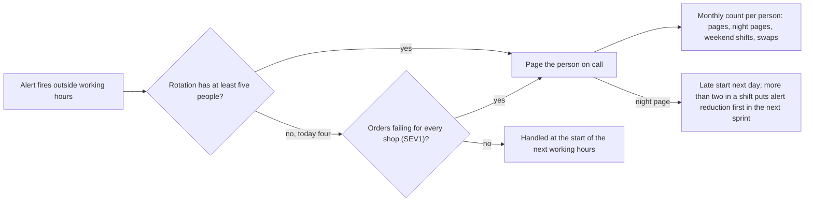

## Before you start

- [[management.l4.teams-run-what-they-build]] — you know the team that builds a service also holds its on-call, and that today one team runs everything with one rotation.
- [[devops.l4.on-call]] — you know `on-call.md` names a primary and a secondary for each one-week shift, and that paging is not live yet.
- [[devops.l4.incident-command]] — you know severity follows impact on customers, with SEV1 meaning orders fail for every shop.
- [[devops.l4.alerting-on-symptoms]] — you know a page that needs no action teaches people to ignore alerts, which is alert fatigue.

## The situation

Paging in Đơn Hàng is not live yet, and the team is deciding how on-call will run once it is. `on-call.md` puts the team's four developers in one rotation: each is primary one week in four and secondary in another. At the planning meeting a colleague suggests the most experienced developer take extra weeks, because they fix things fastest. Another says the rotation is fair as long as everyone holds the same number of weeks. You picture a week with three pages at 3 a.m., each followed by a normal working day, and then the same week again a month later. How do you organise on-call so the people in it can keep doing it month after month?

## Core concepts

- Sustainable rotation (a plain phrase, used in this sense here) — an on-call rotation each person can keep doing month after month, because they are on call rarely enough to rest between shifts.
- Out-of-hours paging (a plain phrase, used in this sense here) — paging the person on call outside working hours, at night or on a weekend; `on-call-staffing.md` limits it while a rotation is small.
- On-call load (a plain phrase, used in this sense here) — what a person actually carried while on call: pages, night pages, weekend or holiday shifts and swapped shifts, counted per person per month.
- Night page (a plain phrase, used in this sense here) — a page between 22:00 and 07:00, as `on-call-staffing.md` defines night.

## How it works



Follow the diagram from the left. An alert fires outside working hours. The first question is not how bad it is but how many people share the rotation. `on-call-staffing.md` sets five as the minimum before every `severity: page` alert may page outside working hours: with one-week shifts, nobody is then primary more than one week in five.

In the situation above, the rotation has four developers, so the "no" branch applies. Outside working hours only SEV1 pages someone. Every other `page` alert, which `incident-response.md` calls SEV2, waits for the next working hours and keeps burning error budget meanwhile. One reading of the rule: the team accepts that cost so people are rested when a SEV1 comes. The on-call person sets severity when acknowledging a page, so the document leaves open how an unanswered alert is judged SEV1; settle that before paging goes live.

Every page that does reach a person feeds the monthly count on the right. The team lead counts, for each person, all pages, night pages, weekend or holiday shifts and swapped shifts. Fairness is judged by that load, not by the number of shifts, because two people with the same shifts can carry very different loads.

A night page also triggers two rules. The person paged starts late the next day without having to ask. If one shift had more than two night pages, reducing those alerts goes to the top of the next sprint, ahead of feature work: fix the cause, fix the threshold, or lower the alert to `ticket`.

## In the Đơn Hàng system

`on-call-staffing.md` was written after `on-call.md` and `incident-response.md` and does not replace them; lines 6–7 mark every number as assumed policy, to be reviewed after three months of real on-call. Its first rule is the size of a rotation:

```markdown file=docs/team/on-call-staffing.md tag=stage-4 lines=9-24
### Bao nhiêu người cho một vòng trực

Một vòng trực có gọi người ngoài giờ làm việc cần ít nhất năm người. Với ca dài
một tuần, năm người nghĩa là không ai trực chính quá một tuần trong năm tuần.

Vòng trực hiện tại (`on-call.md`) có bốn lập trình viên, ít hơn mức đó: mỗi
người trực chính một tuần trong bốn. Vì vậy, cho tới khi có đội thứ hai
(`team-structure.md`):

- Ngoài giờ làm việc, chỉ gọi người cho mức nghiêm trọng cao nhất của
  `incident-response.md`, tức SEV1.
- Alert của SEV2 bật ngoài giờ được xử lý vào đầu giờ làm việc kế tiếp.
- Trong giờ làm việc, gọi người như `on-call.md` ghi.

Khi đội tách theo ADR 0025, mỗi vòng trực mới cũng phải đủ năm người trước khi
gọi người ngoài giờ cho mọi alert `severity: page`.
```

Lines 11–12 give the minimum and its reason: five people, so nobody is primary more than one week in five. Lines 14–21 apply it to today: four developers, each primary one week in four, so until a second team forms only SEV1 pages outside working hours.

Lines 23–24 carry the rule into the split: each new rotation needs five people before every `severity: page` alert may page outside working hours.

The second rule is about load, and what follows a hard night:

```markdown file=docs/team/on-call-staffing.md tag=stage-4 lines=26-47
### Đếm tải của từng người

Công bằng đo bằng tải mỗi người đã mang, không bằng số ca: hai người cùng trực
bốn ca có thể mang tải rất khác nhau. Mỗi tháng, trưởng nhóm đếm cho từng
người:

| Số đếm | Ghi chú |
|---|---|
| Số lần bị gọi | Mọi lần gọi, kể cả lần hóa ra vô ích |
| Số lần bị gọi ban đêm | Từ 22:00 tới 07:00 |
| Số ca cuối tuần hoặc ngày lễ | Ca có ít nhất một ngày cuối tuần hoặc ngày lễ |
| Số ca đã đổi | Ca đổi cho người khác và ca nhận đổi |

Người có tải cao hơn hẳn những người khác trong tháng được xếp ít ca cuối tuần
hơn ở tháng sau. Số đếm chỉ dùng để chia tải, không dùng để đánh giá ai.

### Sau một đêm bị gọi

- Người bị gọi ban đêm được bắt đầu làm muộn vào hôm sau, không cần xin.
- Một ca có hơn hai lần bị gọi ban đêm: việc giảm các alert đó (sửa nguyên
  nhân, sửa ngưỡng, hoặc hạ xuống `ticket` theo mục "Xem lại mọi lần gọi" của
  `on-call.md`) được xếp lên đầu sprint kế tiếp, trước việc tính năng.
```

Lines 28–30 reject equal shift counts as the measure of fairness. Lines 32–37 list the four counts; a useless page still counts, and a swap counts for both people. Lines 39–40 say what the count is for: whoever carried clearly more gets fewer weekend shifts the next month, and the numbers are never used to rate anyone. Lines 44–47 are the rules after a night page.

Lines 58–65, after the excerpt, say when all this starts: from the day paging runs for real. Today no notifier exists, so the schedule serves drills only. Pay or time off for on-call is left to the company and labour law; the document sets no amount.

## Trade-offs

| Way to staff out-of-hours on-call | Rest per person | Failures below SEV1 at night | Who can answer a page | Fits when |
|---|---|---|---|---|
| Four people, every `page` alert pages out of hours | primary one week in four plus a secondary week | handled at once | all four | rarely; the document rules it out while the rotation is below five |
| Four people, only SEV1 pages out of hours | same shifts, far fewer night pages | wait for working hours, burning error budget meanwhile | all four | below five and no second team yet, as today |
| Five or more people, every `page` alert pages out of hours | primary at most one week in five | handled at once | all five or more | the team is large enough, or each team after the split reaches five |
| The most experienced take most shifts | heavy on a few, light on the rest | handled at once, while those few last | only those few | rarely, as a short stopgap the team names and ends; the document does not use it |

## What would you choose if…

…after the split, the new Cửa hàng team starts with four developers? Lines 23–24 say its rotation needs five before every `page` alert may page outside working hours. A reading consistent with lines 14–21 is that it pages only for SEV1 at night until it reaches five, though the document does not spell that out. Write the choice down before paging goes live.

…the same alert paged three nights in one shift, and the person who sets the sprint's priorities wants the next sprint for a promised feature? Lines 45–47 put reducing that alert first, before feature work. A sensible way to say it is to show the three night pages and the size of the fix, so the feature moves by that amount, not by an open-ended delay.

…one developer's count is far above the others' for a third month running? Line 39 already gives that person fewer weekend shifts. If the gap stays, look at what the count shows, such as many swaps taken for others or one alert that pages on their weeks, rather than at the person. Line 40 keeps the count for sharing load only.

## Seniors often assume…

- **"The most experienced engineers should take most on-call shifts, because they fix problems fastest."** → Actually a rotation lasts only if each person is on call rarely enough to rest; piling shifts on a few wears down the people the team relies on most, and gives everyone else little practice answering a page. You notice this when the same two names fill every month's count, and a page during their leave finds nobody who knows what to do.
- **"A rotation is fair as long as everyone has the same number of shifts."** → Actually two people with the same shifts can carry very different loads, so `on-call-staffing.md` counts pages, night pages, weekend or holiday shifts and swaps per person each month. You notice this when one person's night-page count is several times the others' while the shift calendar looks even.
- **"A hard on-call week is part of the job and needs no follow-up."** → Actually the person paged at night starts late the next day, and more than two night pages in one shift puts reducing those alerts ahead of feature work in the next sprint. You notice the cost of skipping this when the same alert pages night after night across shifts and people start to ignore it.

## Try it (3 minutes)

Imagine paging is live and the team lead's count for one month of four one-week shifts reads:

| Developer | Pages | Night pages | Weekend or holiday shifts | Swapped shifts |
|---|---|---|---|---|
| A | 3 | 0 | 1 | 0 |
| B | 11 | 4 | 1 | 1 |
| C | 2 | 1 | 1 | 0 |
| D | 4 | 0 | 1 | 1 |

B's four night pages all came in B's own shift.

1. Using lines 39–47 of `on-call-staffing.md`, list every rule that applies and to whom.
2. Note one thing the team must not do with this table.

Expected result: three rules apply — two to B personally, one to the team's next sprint, and the late-start rule also to C — plus one thing the table must not be used for.

<details><summary>Suggested answer</summary>

B carried clearly more load than the others in the same number of shifts, so B gets fewer weekend shifts next month (line 39).

B's shift had more than two night pages, so reducing those alerts goes to the top of the next sprint, before feature work (lines 45–47).

B and C each start late on the day after a night page, without having to ask (line 44).

The table must not be used to rate B or anyone else (line 40).

</details>

## Connections

- [[management.l4.teams-run-what-they-build]] — why each team holds its own rotation; this lesson keeps that rotation bearable.
- [[devops.l4.on-call]] — the rotation, escalation and review after each shift whose people this lesson keeps rested.
- [[devops.l4.incident-command]] — the severity levels that decide which out-of-hours alerts may page today.
- [[devops.l4.alerting-on-symptoms]] — the alert fatigue that alert reduction after a hard shift works against.
- [[devops.l4.burn-rate-alerts]] — the fast-burn alerts, the only ones labelled `page`, that this lesson limits at night.
- [[devops.l4.runbooks]] — where the review after a page that needed action checks whether the runbook was enough.
- [[management.l2.risk-register]] — one place to record a rotation below five as a risk, with the SEV1-only rule as its response.
- [[management.l4.blameless-culture]] — next: why the count is used to share load and never to rate people.

## Five-line summary

1. On-call stays sustainable only when each person is on call rarely enough to rest, and fairness is judged by the load each carries.
2. `on-call-staffing.md` requires five people before every `page` alert may page outside working hours, so nobody is primary more than one week in five.
3. With four developers today, only SEV1 pages outside working hours; SEV2 waits for the next working hours.
4. Each month the team lead counts every person's pages, night pages, weekend or holiday shifts and swaps, to share load, never to rate.
5. A night page earns a late start; more than two in one shift put reducing those alerts first in the next sprint.
