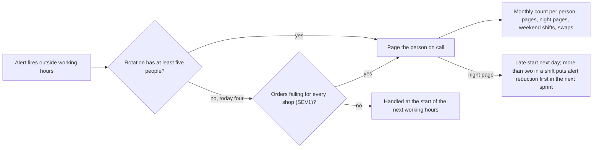

## Bạn cần biết trước

- [[management.l4.teams-run-what-they-build]] — bạn biết đội xây service cũng là đội trực sự cố cho nó, và hiện tại một đội vận hành mọi thứ với một vòng trực.
- [[devops.l4.on-call]] — bạn biết `on-call.md` chỉ định một người trực chính và một người trực phụ cho mỗi ca một tuần, và việc gọi người trực chưa áp dụng thật.
- [[devops.l4.incident-command]] — bạn biết mức nghiêm trọng xếp theo ảnh hưởng tới khách, và SEV1 nghĩa là đặt hàng thất bại với mọi cửa hàng.
- [[devops.l4.alerting-on-symptoms]] — bạn biết một lần gọi không cần làm gì sẽ khiến người ta quen bỏ qua cảnh báo, tức nhờn cảnh báo.

## Tình huống

Đơn Hàng chưa gọi người trực thật, và đội đang bàn trực sự cố sẽ chạy thế nào khi bắt đầu. `on-call.md` xếp bốn developer của đội vào một vòng trực: mỗi người trực chính một tuần trong bốn, và trực phụ một tuần khác. Trong buổi họp kế hoạch, một đồng nghiệp đề nghị để developer nhiều kinh nghiệm nhất nhận thêm tuần, vì người đó sửa lỗi nhanh nhất. Một người khác cho rằng vòng trực công bằng miễn ai cũng trực số tuần như nhau. Bạn hình dung một tuần có ba lần bị gọi lúc 3 giờ sáng, sau mỗi lần vẫn là một ngày làm việc bình thường, rồi một tháng sau lại đúng tuần như vậy. Tổ chức trực sự cố thế nào để những người trong vòng trực làm được tháng này qua tháng khác?

## Khái niệm cốt lõi

- Vòng trực bền (cụm từ thường, ở đây dùng theo nghĩa này) — vòng trực mà mỗi người làm được tháng này qua tháng khác, vì họ trực đủ thưa để nghỉ ngơi giữa các ca.
- Gọi người ngoài giờ (cụm từ thường, ở đây dùng theo nghĩa này) — gọi người đang trực ngoài giờ làm việc, vào ban đêm hay cuối tuần. `on-call-staffing.md` giới hạn việc này khi vòng trực còn ít người.
- Tải trực (cụm từ thường, ở đây dùng theo nghĩa này) — những gì một người thực sự đã mang khi trực: số lần bị gọi, số lần bị gọi ban đêm, số ca cuối tuần hoặc ngày lễ và số ca đổi, đếm theo từng người mỗi tháng.
- Lần gọi ban đêm (cụm từ thường, ở đây dùng theo nghĩa này) — một lần bị gọi trong khoảng 22:00 tới 07:00, đúng như `on-call-staffing.md` định nghĩa ban đêm.

## Cơ chế hoạt động



Đọc sơ đồ từ trái sang. Một cảnh báo bật ngoài giờ làm việc. Câu hỏi đầu tiên không phải nó nặng tới đâu, mà là vòng trực có bao nhiêu người. `on-call-staffing.md` đặt mức tối thiểu là năm người trước khi mọi cảnh báo `severity: page` được gọi người ngoài giờ: với ca một tuần, khi đó không ai trực chính quá một tuần trong năm tuần.

Trong tình huống ở trên, vòng trực có bốn developer, nên đi theo nhánh "no". Ngoài giờ làm việc, chỉ SEV1 mới gọi người. Mọi cảnh báo `page` khác, mà `incident-response.md` gọi là SEV2, chờ tới giờ làm việc kế tiếp và trong lúc đó vẫn tiếp tục đốt error budget. Có thể hiểu quy tắc này như sau: đội chấp nhận cái giá đó để mọi người còn đủ sức khi SEV1 tới. Người trực đặt mức nghiêm trọng lúc xác nhận lần gọi, nên tài liệu chưa nói một cảnh báo chưa ai trả lời được xếp là SEV1 bằng cách nào. Hãy chốt điều này trước khi việc gọi người trực áp dụng thật.

Mỗi lần gọi thực sự tới một người đều được cộng vào số đếm hằng tháng ở bên phải. Với từng người, trưởng nhóm đếm mọi lần bị gọi, các lần bị gọi ban đêm, các ca cuối tuần hoặc ngày lễ và các ca đã đổi. Công bằng được đo bằng tải đó, không bằng số ca, vì hai người cùng số ca có thể mang tải rất khác nhau.

Một lần gọi ban đêm còn kéo theo hai quy tắc. Người bị gọi được bắt đầu làm muộn vào hôm sau, không cần xin. Nếu một ca có hơn hai lần bị gọi ban đêm, giảm các cảnh báo đó được xếp lên đầu sprint kế tiếp, trước việc tính năng: sửa nguyên nhân, sửa ngưỡng, hoặc hạ cảnh báo xuống `ticket`.

## Trong hệ thống Đơn Hàng

`on-call-staffing.md` được viết sau `on-call.md` và `incident-response.md`, và không thay thế hai file đó. Dòng 6–7 ghi rõ mọi con số trong file là chính sách giả định, sẽ xem lại sau ba tháng trực thật. Quy tắc đầu tiên là kích thước của một vòng trực:

```markdown file=docs/team/on-call-staffing.md tag=stage-4 lines=9-24
### Bao nhiêu người cho một vòng trực

Một vòng trực có gọi người ngoài giờ làm việc cần ít nhất năm người. Với ca dài
một tuần, năm người nghĩa là không ai trực chính quá một tuần trong năm tuần.

Vòng trực hiện tại (`on-call.md`) có bốn lập trình viên, ít hơn mức đó: mỗi
người trực chính một tuần trong bốn. Vì vậy, cho tới khi có đội thứ hai
(`team-structure.md`):

- Ngoài giờ làm việc, chỉ gọi người cho mức nghiêm trọng cao nhất của
  `incident-response.md`, tức SEV1.
- Alert của SEV2 bật ngoài giờ được xử lý vào đầu giờ làm việc kế tiếp.
- Trong giờ làm việc, gọi người như `on-call.md` ghi.

Khi đội tách theo ADR 0025, mỗi vòng trực mới cũng phải đủ năm người trước khi
gọi người ngoài giờ cho mọi alert `severity: page`.
```

Dòng 11–12 đưa ra mức tối thiểu và lý do: năm người, để không ai trực chính quá một tuần trong năm tuần. Dòng 14–21 áp mức đó vào hiện tại: bốn developer, mỗi người trực chính một tuần trong bốn, nên cho tới khi có đội thứ hai, ngoài giờ chỉ SEV1 mới gọi người.

Dòng 23–24 mang quy tắc này sang lúc tách đội: mỗi vòng trực mới cần năm người trước khi mọi cảnh báo `severity: page` được gọi người ngoài giờ.

Quy tắc thứ hai nói về tải, và những gì diễn ra sau một đêm vất vả:

```markdown file=docs/team/on-call-staffing.md tag=stage-4 lines=26-47
### Đếm tải của từng người

Công bằng đo bằng tải mỗi người đã mang, không bằng số ca: hai người cùng trực
bốn ca có thể mang tải rất khác nhau. Mỗi tháng, trưởng nhóm đếm cho từng
người:

| Số đếm | Ghi chú |
|---|---|
| Số lần bị gọi | Mọi lần gọi, kể cả lần hóa ra vô ích |
| Số lần bị gọi ban đêm | Từ 22:00 tới 07:00 |
| Số ca cuối tuần hoặc ngày lễ | Ca có ít nhất một ngày cuối tuần hoặc ngày lễ |
| Số ca đã đổi | Ca đổi cho người khác và ca nhận đổi |

Người có tải cao hơn hẳn những người khác trong tháng được xếp ít ca cuối tuần
hơn ở tháng sau. Số đếm chỉ dùng để chia tải, không dùng để đánh giá ai.

### Sau một đêm bị gọi

- Người bị gọi ban đêm được bắt đầu làm muộn vào hôm sau, không cần xin.
- Một ca có hơn hai lần bị gọi ban đêm: việc giảm các alert đó (sửa nguyên
  nhân, sửa ngưỡng, hoặc hạ xuống `ticket` theo mục "Xem lại mọi lần gọi" của
  `on-call.md`) được xếp lên đầu sprint kế tiếp, trước việc tính năng.
```

Dòng 28–30 bác bỏ số ca bằng nhau làm thước đo công bằng. Dòng 32–37 liệt kê bốn số đếm: một lần gọi vô ích vẫn được tính, và một ca đổi được tính cho cả hai người. Dòng 39–40 nói số đếm để làm gì: ai mang tải cao hơn hẳn thì tháng sau trực ít ca cuối tuần hơn, và các con số không bao giờ được dùng để đánh giá ai. Dòng 44–47 là các quy tắc sau một lần gọi ban đêm.

Dòng 58–65, ở ngoài đoạn trích, cho biết khi nào tất cả những điều này bắt đầu: từ ngày việc gọi người trực chạy thật. Hiện chưa có notifier nào, nên lịch trực chỉ dùng cho diễn tập. Tiền hay ngày nghỉ bù cho trực sự cố do công ty và luật lao động quyết, tài liệu không đặt con số nào.

## Đánh đổi

| Cách bố trí người trực ngoài giờ | Thời gian nghỉ của mỗi người | Lỗi dưới SEV1 vào ban đêm | Ai trả lời được lần gọi | Hợp khi |
|---|---|---|---|---|
| Bốn người, mọi cảnh báo `page` đều gọi người ngoài giờ | trực chính một tuần trong bốn, cộng một tuần trực phụ | xử lý ngay | cả bốn người | hiếm khi, tài liệu không cho phép khi vòng trực dưới năm người |
| Bốn người, ngoài giờ chỉ SEV1 gọi người | số ca như cũ, ít lần gọi ban đêm hơn nhiều | chờ tới giờ làm việc, trong lúc đó đốt error budget | cả bốn người | dưới năm người và chưa có đội thứ hai, như hiện tại |
| Từ năm người trở lên, mọi cảnh báo `page` đều gọi người ngoài giờ | trực chính nhiều nhất một tuần trong năm | xử lý ngay | cả năm người trở lên | đội đủ lớn, hoặc mỗi đội sau khi tách đủ năm người |
| Người nhiều kinh nghiệm nhất nhận phần lớn ca | nặng với vài người, nhẹ với số còn lại | xử lý ngay, chừng nào vài người đó còn trụ được | chỉ vài người đó | hiếm khi, như một giải pháp tạm ngắn mà đội gọi tên rõ và có ngày kết thúc. Tài liệu không dùng cách này |

## Bạn sẽ chọn gì nếu…

…sau khi tách đội, đội Cửa hàng mới bắt đầu với bốn developer? Dòng 23–24 nói vòng trực của đội cần năm người trước khi mọi cảnh báo `page` được gọi người ngoài giờ. Một cách hiểu khớp với dòng 14–21 là ban đêm đội chỉ gọi người cho SEV1 cho tới khi đủ năm người, dù tài liệu không nói thẳng điều đó. Hãy ghi lựa chọn ra văn bản trước khi việc gọi người trực áp dụng thật.

…cùng một cảnh báo đã gọi người ba đêm trong một ca, còn người đặt thứ tự ưu tiên của sprint muốn dành sprint tới cho một tính năng đã hứa? Dòng 45–47 xếp giảm cảnh báo đó lên trước, trước việc tính năng. Một cách nói hợp lý là đưa ra ba lần gọi ban đêm và kích thước của bản sửa, để tính năng chỉ lùi đúng chừng đó, thay vì bị hoãn không biết tới bao giờ.

…số đếm của một developer cao hơn hẳn những người khác tháng thứ ba liên tiếp? Dòng 39 đã cho người đó ít ca cuối tuần hơn. Nếu khoảng cách vẫn còn, hãy nhìn vào điều số đếm cho thấy, như nhiều ca nhận đổi cho người khác hay một cảnh báo hay gọi người vào đúng các tuần của họ, thay vì nhìn vào con người. Dòng 40 giữ số đếm chỉ để chia tải.

## Senior hay nhầm rằng…

- **"Kỹ sư nhiều kinh nghiệm nhất nên nhận phần lớn ca trực, vì họ sửa lỗi nhanh nhất."** → Thực ra vòng trực chỉ bền khi mỗi người trực đủ thưa để nghỉ ngơi. Dồn ca lên vài người sẽ bào mòn đúng những người đội dựa vào nhiều nhất, và những người còn lại ít có dịp tập trả lời một lần gọi. Bạn sẽ nhận ra khi cùng hai cái tên chiếm hết số đếm tháng nào cũng vậy, và một lần gọi trong lúc họ nghỉ phép không tìm được ai biết phải làm gì.
- **"Vòng trực công bằng miễn ai cũng trực số ca như nhau."** → Thực ra hai người cùng số ca có thể mang tải rất khác nhau, vì vậy `on-call-staffing.md` đếm mỗi tháng cho từng người số lần bị gọi, số lần bị gọi ban đêm, số ca cuối tuần hoặc ngày lễ và số ca đổi. Bạn sẽ nhận ra khi số lần bị gọi ban đêm của một người gấp mấy lần những người khác, trong khi lịch trực trông vẫn đều.
- **"Một tuần trực vất vả là chuyện của nghề, không cần làm gì thêm."** → Thực ra người bị gọi ban đêm được bắt đầu làm muộn hôm sau, và hơn hai lần bị gọi ban đêm trong một ca sẽ đưa giảm các cảnh báo đó lên trước việc tính năng ở sprint kế tiếp. Bạn sẽ thấy cái giá của việc bỏ qua bước này khi cùng một cảnh báo gọi người đêm này qua đêm khác, qua nhiều ca, và mọi người bắt đầu lờ nó đi.

## Thử ngay (3 phút)

Hình dung việc gọi người trực đã chạy thật, và số đếm của trưởng nhóm cho một tháng gồm bốn ca một tuần như sau:

| Developer | Lần bị gọi | Lần bị gọi ban đêm | Ca cuối tuần hoặc ngày lễ | Ca đã đổi |
|---|---|---|---|---|
| A | 3 | 0 | 1 | 0 |
| B | 11 | 4 | 1 | 1 |
| C | 2 | 1 | 1 | 0 |
| D | 4 | 0 | 1 | 1 |

Bốn lần bị gọi ban đêm của B đều rơi vào ca của chính B.

1. Dựa vào dòng 39–47 của `on-call-staffing.md`, liệt kê mọi quy tắc được áp dụng và áp cho ai.
2. Ghi ra một điều đội không được làm với bảng này.

Kết quả mong đợi: ba quy tắc được áp dụng — hai áp cho riêng B, một áp cho sprint kế tiếp của đội, và quy tắc bắt đầu làm muộn áp cả cho C — cùng một điều không được dùng bảng này để làm.

<details><summary>Gợi ý đáp án</summary>

B mang tải cao hơn hẳn những người khác với cùng số ca, nên tháng sau B được xếp ít ca cuối tuần hơn (dòng 39).

Ca của B có hơn hai lần bị gọi ban đêm, nên giảm các cảnh báo đó được xếp lên đầu sprint kế tiếp, trước việc tính năng (dòng 45–47).

B và C đều được bắt đầu làm muộn vào hôm sau mỗi lần bị gọi ban đêm, không cần xin (dòng 44).

Không được dùng bảng này để đánh giá B hay bất kỳ ai (dòng 40).

</details>

## Liên hệ

- [[management.l4.teams-run-what-they-build]] — vì sao mỗi đội giữ vòng trực của riêng mình, còn bài này giữ cho vòng trực đó ở mức chịu được.
- [[devops.l4.on-call]] — vòng trực, chuyển cấp và buổi xem lại sau mỗi ca, với những người mà bài này giữ cho đủ nghỉ ngơi.
- [[devops.l4.incident-command]] — các mức nghiêm trọng quyết định cảnh báo ngoài giờ nào hiện được gọi người.
- [[devops.l4.alerting-on-symptoms]] — nhờn cảnh báo, thứ mà việc giảm cảnh báo sau một ca vất vả chống lại.
- [[devops.l4.burn-rate-alerts]] — các cảnh báo fast-burn, những cảnh báo duy nhất có nhãn `page`, mà bài này giới hạn vào ban đêm.
- [[devops.l4.runbooks]] — nơi buổi xem lại sau một lần gọi cần hành động kiểm tra runbook đã đủ chưa.
- [[management.l2.risk-register]] — một chỗ để ghi vòng trực dưới năm người thành một rủi ro, với quy tắc chỉ gọi cho SEV1 là cách xử lý.
- [[management.l4.blameless-culture]] — tiếp theo: vì sao số đếm dùng để chia tải và không bao giờ dùng để đánh giá người.

## Tóm tắt 5 dòng

1. Trực sự cố chỉ bền khi mỗi người trực đủ thưa để nghỉ ngơi, và công bằng được đo bằng tải mỗi người mang.
2. `on-call-staffing.md` đòi năm người trước khi mọi cảnh báo `page` được gọi người ngoài giờ, để không ai trực chính quá một tuần trong năm tuần.
3. Với bốn developer hiện tại, ngoài giờ chỉ SEV1 mới gọi người, còn SEV2 chờ tới giờ làm việc kế tiếp.
4. Mỗi tháng trưởng nhóm đếm cho từng người số lần bị gọi, lần bị gọi ban đêm, ca cuối tuần hoặc ngày lễ và ca đổi, để chia tải, không để đánh giá.
5. Một lần gọi ban đêm đổi được một buổi sáng bắt đầu muộn, và hơn hai lần trong một ca sẽ đưa giảm các cảnh báo đó lên đầu sprint kế tiếp.
