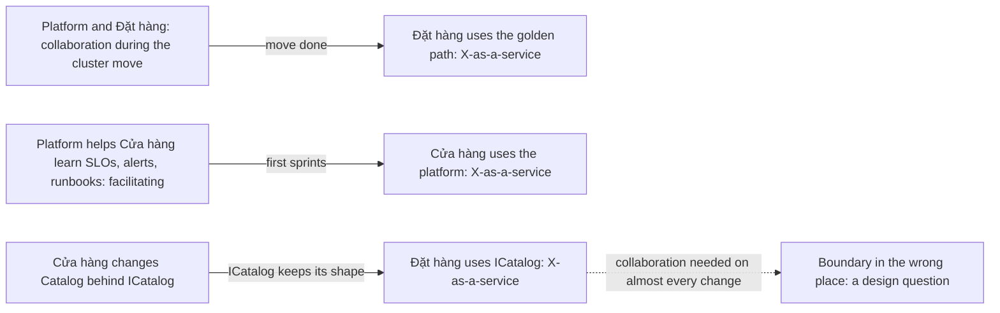

## Before you start

- [[management.l4.team-types]] — you know Đơn Hàng plans two stream-aligned teams, Đặt hàng and Cửa hàng, and a platform team.
- [[design.l3.module-contracts]] — you know other modules reach Catalog only through `ICatalog`, while everything behind it is `internal`.
- [[k8s.l4.moving-to-a-new-cluster]] — you know the plan to build a managed cluster beside the old one and move only the data.

## The situation

The platform team forms first, and your team becomes Đặt hàng. Together you will move Đơn Hàng to the new cluster. Later Cửa hàng forms and takes over Catalog.

At a planning meeting, a colleague asks that Đặt hàng join every Catalog design meeting, since ordering reads prices from Catalog. Another asks that the platform team review every deploy change of both product teams, now and for good. Each request sounds careful. Together they put all three teams in each other's meetings forever. How closely should each pair of teams work together, and for how long?

## Core concepts

- **team interaction mode** — one of the three ways Team Topologies names for two teams to work together: collaboration, X-as-a-service or facilitating.
- **X-as-a-service** — the mode in which one team uses what another team provides, such as a golden path or a module contract, with little discussion needed.

The other two modes, in plain words:

- Collaboration — two teams work closely on a shared goal, deciding together as they go.
- Facilitating — one team helps another learn a skill, as an enabling team does, and the learning team keeps doing its own work. In Đơn Hàng's plan, one platform person does it.

## How it works



In the situation above, each request picks a team interaction mode without naming it, and picks it for good. The first makes Đặt hàng and Cửa hàng collaborate on Catalog; the second makes the platform team collaborate with both product teams. Together, with no end, they become the last row of the trade-offs table.

Collaboration is the expensive one. Both teams spend attention on each other. What it buys is speed of discovery: when nobody yet knows where the line between two teams' work should sit, deciding together finds it fast. That is why collaboration is planned with an end, like the cluster move in the top row of the diagram.

X-as-a-service is cheap in attention. One team uses what the other offers and gets on with its work. The price moves to the provider: its offer must be clear and stay stable, or every user comes back to ask. The bottom row is a module contract: Cửa hàng may change Catalog behind `ICatalog`, and while `ICatalog` keeps its shape, Đặt hàng uses it as X-as-a-service.

Facilitating sits between them. One team helps another learn, here a single platform person as in the middle row, and then the learning team runs on its own. If the skill has not passed on by the end date, a new short end is one answer, not letting the helper take over.

The modes are not fixed. A pair moves to X-as-a-service once the line is clear. The dotted arrow is the warning sign: if two teams need collaboration on almost every change, more talking is unlikely to fix it. It is a sign that the line between them is in the wrong place, and moving it is a design question.

## In the Đơn Hàng system

`team-structure.md` records the mode for each pair of planned teams and what each team offers:

```markdown file=docs/team/team-structure.md tag=stage-4 lines=60-83
### Cách các đội làm việc với nhau

| Cặp đội | Cách | Tới khi nào |
|---|---|---|
| Platform và Đặt hàng | Cộng tác: làm chung trong lúc chuyển sang cluster managed (`docs/design/cluster-migration-plan.md`) | Tới khi chuyển xong; sau đó X-as-a-service qua golden path |
| Platform và Cửa hàng | X-as-a-service qua golden path và các năng lực trong `platform-capabilities.md`; một người của đội platform hỗ trợ học (facilitating) về SLO, alert và runbook | Hỗ trợ học trong 2 sprint đầu của đội Cửa hàng (giả định), rồi chỉ còn X-as-a-service |
| Đặt hàng và Cửa hàng | X-as-a-service qua hợp đồng module `ICatalog` (`DonHang.Catalog/ICatalog.cs`): đội Cửa hàng đổi gì phía sau `ICatalog` cũng được, không cần hỏi, miễn `ICatalog` giữ hình dạng | Lâu dài |

Cộng tác tìm ra ranh giới tốt nhanh nhưng tốn sự chú ý của cả hai đội, nên
luôn có hạn. Hai đội phải cộng tác trên gần như mọi thay đổi là dấu hiệu ranh
giới đặt sai chỗ: đó là câu hỏi thiết kế, đưa vào điều kiện mở lại của ADR
0025, không phải chuyện trao đổi chưa tốt.

### Mỗi đội cung cấp gì

| Đội | Cung cấp | Cách gửi yêu cầu | Trả lời trong |
|---|---|---|---|
| Platform | Cluster, golden path, Argo CD, Gateway, Sealed Secrets, Prometheus, sao lưu database | Issue có nhãn của đội platform; thay đổi nhỏ thì gửi thẳng pull request | 2 ngày làm việc (giả định) |
| Đặt hàng | Đặt đơn, hoàn tiền, email cho khách; message `OrderMessage`; `lib/design/` và `lib/shared/` của app | Issue có nhãn của đội Đặt hàng | 2 ngày làm việc (giả định) |
| Cửa hàng | `ICatalog`, mở cửa hàng mới, đăng nhập trong app | Issue có nhãn của đội Cửa hàng | 2 ngày làm việc (giả định) |

"Trả lời" là nói sẽ làm, khi nào, hoặc vì sao không; không phải làm xong. Nhờ
vậy một yêu cầu sang đội khác là một bước đã biết, không phải một lần thương
lượng.
```

Line 64 is the top row of the diagram: the platform team and Đặt hàng collaborate ("cộng tác") during the move in `cluster-migration-plan.md`, and the third column gives the end, after which Đặt hàng uses the golden path as X-as-a-service. Line 65 adds facilitating: one platform person helps Cửa hàng learn SLOs, alerts and runbooks for its first two sprints, an assumption of the plan. Line 66 is the long-term pair, the two stream-aligned teams, working through `ICatalog`.

Lines 68–71, the paragraph under the first table, say why collaboration always has an end, and treat constant collaboration as a sign the line is misplaced. ADR `0025` lists situations in which the team split must be reconsidered, and this sign is one of them.

Lines 75–79, the table under "Mỗi đội cung cấp gì", are each team's published offer: what it provides, how to ask (an issue with the team's label, a written request in the project's shared list of work, tagged so that team sees it; for a small change the platform team also takes a pull request directly, line 77) and how soon it answers. The names in the "Cung cấp" column are only examples of each team's parts; you do not need them here. Lines 81–83 define "answer" as saying yes and when, or why not, not as finishing the work. That turns a request to another team into a known step rather than a negotiation.

The offer behind line 66 is the contract itself:

```csharp file=DonHang.Catalog/ICatalog.cs tag=stage-4 lines=3-19
// lesson: design.l3.module-contracts
// The Catalog module's contract: the only way other modules reach products.
// Everything behind it (Product, CatalogDbContext, the repository, the Redis
// cache) is `internal` and can change without any caller noticing.
public interface ICatalog
{
    // One page of products in id order, only those costing at most
    // maxPriceVnd when it is given.
    Task<List<CatalogProduct>> ListAsync(int limit, int offset, int? maxPriceVnd);

    // The product, or null when no product has this id.
    Task<CatalogProduct?> FindAsync(int id);

    // Saves the new price and returns the changed product, or null when no
    // product has this id.
    Task<CatalogProduct?> ChangePriceAsync(int id, int priceVnd);
}
```

Lines 5–6 list what Cửa hàng may change without asking: the entity, its DbContext, the repository and the Redis cache. Lines 7–19 are "the shape" that line 66 of `team-structure.md` asks Cửa hàng to keep: three methods with their parameters and results. As long as these stay, Đặt hàng's ordering code, which reads prices through `ICatalog` outside the excerpt, needs no meeting about Catalog's internals.

## Trade-offs

| Mode | Attention it costs | What it needs | Fits when | Goes wrong when |
|---|---|---|---|---|
| Collaboration | high, on both teams | a shared goal and a planned end | the line between two teams' work is not yet known, as during the cluster move | it never ends, and both teams slow down |
| X-as-a-service | low for the user, steady work for the provider | a clear offer that stays stable, and a published way to ask | the line is known, as with `ICatalog` or the golden path | the offer is unclear or changes often, so users keep asking |
| Facilitating | some, on one helper | a skill to pass on and an end date | a team is new to a skill, as Cửa hàng with SLOs | the helper starts doing the work instead |
| No chosen mode, everyone in every meeting | high, on every team, all the time | nothing to set up | rarely, perhaps very early, before teams have their own parts | every change waits for the busiest team |

## What would you choose if…

…the cluster move were finished, but Đặt hàng still asked the platform team about every change to its deploy files? A sensible first step is to end the collaboration the plan already ends at line 64 and send requests through the platform team's published route. If many requests then take more than two working days to be answered, review the plan. `team-structure.md` ends, outside the excerpt, with a short list of signs that the plan itself should be reviewed, and this is one of them. The answer may be a gap in the golden path rather than in the people.

…Cửa hàng wanted to rename `ChangePriceAsync` or change its parameters? That changes the shape line 66 asks it to keep, so the "without asking" part no longer covers it. `team-structure.md` does not say how such a change is agreed. A sensible answer is a short, planned collaboration for that one change, opened by an issue to Đặt hàng, after which the pair returns to X-as-a-service.

…a year later, most changes in a quarter needed both stream-aligned teams to edit Catalog together? That is the warning sign from lines 69–71. The plan's review list names it too, by repeating one of ADR `0025`'s situations for reconsidering the team split: two teams editing one module in most changes of a quarter. Moving the line between Đặt hàng's ordering code and Catalog is a design question for an ADR, not a reason for a standing meeting.

## Seniors often assume…

- **"More collaboration between teams is always better."** → Actually collaboration costs both teams' attention, so it pays only while the two are still finding where their work divides. After that, X-as-a-service lets each team move without waiting. You notice this when two teams share so many meetings that neither ships a change without the other's calendar.
- **"X-as-a-service means the providing team does the work for the other team."** → Actually the using team does its own work with what the provider offers. Cửa hàng deploys through the golden path itself, and Đặt hàng calls `ICatalog` itself. The provider's job is to keep the offer clear and stable. You notice the confusion when a platform team's queue fills with deploys it is asked to run for others.
- **"The way two teams work together, once agreed, should stay fixed."** → Actually line 64 already plans a change from collaboration to X-as-a-service, and line 65 ends facilitating after two sprints. A mode that fits a move or a new team stops fitting once that is done. You notice a stale mode when a collaboration's meetings go on after its goal is reached, with nothing left to decide.

## Try it (3 minutes)

Use the two excerpts above.

1. Take three changes Cửa hàng might make: (a) move product data to a different table layout behind `ICatalog`; (b) add a parameter to `ListAsync`; (c) write the first SLO for opening new shops in its first sprint.
2. For each, name the mode with the team it involves, using lines 64–66 of `team-structure.md` and lines 5–19 of `ICatalog.cs`.

Expected result: one stays within X-as-a-service with Đặt hàng, so Cửa hàng asks no one, one goes beyond what line 66 lets Cửa hàng do alone, and one fits facilitating.

<details><summary>Suggested answer</summary>

(a) X-as-a-service with Đặt hàng, and nothing to ask. The table layout sits behind `ICatalog` (lines 5–6), and line 66 lets Cửa hàng change anything there without asking.

(b) Adding a parameter changes the shape of `ICatalog` (line 11), so line 66 no longer covers it. Cửa hàng opens an issue with Đặt hàng's label, the route line 78 publishes, and the two teams agree this one change, perhaps by a short collaboration.

(c) Facilitating with the platform team: line 65 assigns one platform person to help Cửa hàng learn SLOs, alerts and runbooks in its first two sprints. Cửa hàng writes the SLO itself; the helper does not write it for them.

</details>

## Connections

- [[management.l4.team-types]] — the four team types; this lesson says how teams of those types work together.
- [[design.l3.module-contracts]] — the contract `ICatalog` that X-as-a-service between the two stream-aligned teams runs through.
- [[k8s.l4.moving-to-a-new-cluster]] — the move that the platform team and Đặt hàng collaborate on, with a planned end.
- [[devops.l4.golden-path]] — the main offer the platform team provides as X-as-a-service.
- [[design.l4.conways-law]] — why a misplaced line between teams becomes a misplaced line in the system.
- [[design.l4.where-boundaries-are-enforced]] — where a line like the one `ICatalog` draws is enforced, depending on the architecture style.
- [[management.l4.lightweight-governance]] — the same idea for decisions: say clearly who decides what, so nobody negotiates each time.
- [[management.l4.teams-run-what-they-build]] — next: which team runs each service in production.

## Five-line summary

1. Choose how each pair of teams works together, collaboration, X-as-a-service or facilitating, and change that choice as the work changes.
2. Collaboration finds a good line quickly but costs both teams' attention, so it is planned with an end.
3. X-as-a-service costs little attention but needs a clear, stable offer, such as the golden path or `ICatalog`.
4. Each team publishes what it offers, how to ask and how soon it answers, so a request is a known step.
5. Two teams collaborating on almost every change signal a misplaced boundary, which is a design question, not a communication problem.
