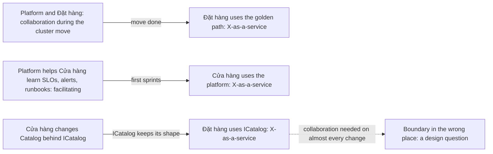

## Bạn cần biết trước

- [[management.l4.team-types]] — bạn biết Đơn Hàng dự kiến có hai đội theo luồng là Đặt hàng và Cửa hàng, cộng một đội platform.
- [[design.l3.module-contracts]] — bạn biết các module khác chỉ chạm tới Catalog qua `ICatalog`, còn mọi thứ phía sau nó là `internal`.
- [[k8s.l4.moving-to-a-new-cluster]] — bạn biết kế hoạch dựng một cluster managed bên cạnh cluster cũ và chỉ chuyển dữ liệu sang.

## Tình huống

Đội platform được lập trước, và đội của bạn trở thành Đặt hàng. Hai đội sẽ cùng nhau chuyển Đơn Hàng sang cluster mới. Sau đó Cửa hàng được lập và nhận Catalog.

Trong một buổi họp kế hoạch, một đồng nghiệp đề nghị Đặt hàng dự mọi buổi họp thiết kế của Catalog, vì phần đặt hàng đọc giá từ Catalog. Một người khác đề nghị đội platform review mọi thay đổi về deploy của cả hai đội sản phẩm, từ giờ và mãi về sau. Đề nghị nào nghe cũng cẩn thận. Gộp lại, chúng kéo cả ba đội vào họp của nhau mãi mãi. Mỗi cặp đội nên làm việc sát nhau tới mức nào, và trong bao lâu?

## Khái niệm cốt lõi

- **cách tương tác giữa các đội** (team interaction mode) — một trong ba cách Team Topologies gọi tên để hai đội làm việc với nhau: cộng tác, X-as-a-service hoặc hỗ trợ học.
- **X-as-a-service** (Một đội dùng thứ đội khác cung cấp mà không cần trao đổi nhiều) — cách mà một đội dùng thứ đội khác cung cấp, như một golden path hay một hợp đồng của module, mà không cần trao đổi nhiều.

Hai cách còn lại, nói bằng lời thường:

- Cộng tác (collaboration) — hai đội làm sát nhau vì một mục tiêu chung, vừa làm vừa cùng quyết định.
- Hỗ trợ học (facilitating) — một đội giúp đội khác học một kỹ năng, như đội nâng năng lực vẫn làm, còn đội đang học vẫn tự làm việc của mình. Trong kế hoạch của Đơn Hàng, một người của đội platform đảm nhận việc này.

## Cơ chế hoạt động



Trong tình huống trên, mỗi đề nghị đã ngầm chọn cách tương tác giữa các đội cho một cặp đội mà không gọi tên, và chọn luôn cho mãi về sau. Đề nghị thứ nhất bắt Đặt hàng và Cửa hàng cộng tác trên Catalog. Đề nghị thứ hai bắt đội platform cộng tác với cả hai đội sản phẩm. Gộp lại, và không có điểm dừng, chúng thành đúng hàng cuối của bảng đánh đổi.

Cộng tác là cách đắt nhất. Cả hai đội đều tốn sự chú ý cho nhau. Đổi lại là tốc độ tìm ra: khi chưa ai biết ranh giới giữa việc của hai đội nên nằm ở đâu, cùng nhau quyết định sẽ tìm ra nó nhanh. Vì thế cộng tác luôn được lên kế hoạch với một điểm kết thúc, như lần chuyển cluster ở hàng trên cùng của sơ đồ.

X-as-a-service tốn ít sự chú ý. Một đội dùng thứ đội kia cung cấp rồi làm tiếp việc của mình. Cái giá dồn sang bên cung cấp: thứ họ cung cấp phải rõ và giữ ổn định, nếu không mọi đội dùng sẽ quay lại hỏi. Hàng dưới cùng là một hợp đồng của module: Cửa hàng được đổi Catalog phía sau `ICatalog`, và chừng nào `ICatalog` còn giữ hình dạng, Đặt hàng dùng nó theo kiểu X-as-a-service.

Hỗ trợ học nằm giữa hai cách kia. Một đội giúp đội khác học, ở đây là một người của đội platform như hàng giữa, rồi đội đang học tự chạy tiếp. Nếu tới hạn mà kỹ năng chưa truyền xong, có thể đặt thêm một hạn ngắn mới, chứ không phải để người giúp làm thay luôn.

Các cách này không cố định. Một cặp đội chuyển sang X-as-a-service khi ranh giới đã rõ. Mũi tên nét đứt là dấu hiệu cảnh báo: nếu hai đội phải cộng tác trên gần như mọi thay đổi, nói chuyện nhiều hơn khó mà sửa được. Đó là dấu hiệu ranh giới giữa hai đội đặt sai chỗ, và dời ranh giới là một câu hỏi thiết kế.

## Trong hệ thống Đơn Hàng

`team-structure.md` ghi cách làm việc cho từng cặp đội dự kiến và thứ mỗi đội cung cấp:

```markdown file=docs/team/team-structure.md tag=stage-4 lines=60-83
### Cách các đội làm việc với nhau

| Cặp đội | Cách | Tới khi nào |
|---|---|---|
| Platform và Đặt hàng | Cộng tác: làm chung trong lúc chuyển sang cluster managed (`docs/design/cluster-migration-plan.md`) | Tới khi chuyển xong; sau đó X-as-a-service qua golden path |
| Platform và Cửa hàng | X-as-a-service qua golden path và các năng lực trong `platform-capabilities.md`; một người của đội platform hỗ trợ học (facilitating) về SLO, alert và runbook | Hỗ trợ học trong 2 sprint đầu của đội Cửa hàng (giả định), rồi chỉ còn X-as-a-service |
| Đặt hàng và Cửa hàng | X-as-a-service qua hợp đồng module `ICatalog` (`DonHang.Catalog/ICatalog.cs`): đội Cửa hàng đổi gì phía sau `ICatalog` cũng được, không cần hỏi, miễn `ICatalog` giữ hình dạng | Lâu dài |

Cộng tác tìm ra ranh giới tốt nhanh nhưng tốn sự chú ý của cả hai đội, nên
luôn có hạn. Hai đội phải cộng tác trên gần như mọi thay đổi là dấu hiệu ranh
giới đặt sai chỗ: đó là câu hỏi thiết kế, đưa vào điều kiện mở lại của ADR
0025, không phải chuyện trao đổi chưa tốt.

### Mỗi đội cung cấp gì

| Đội | Cung cấp | Cách gửi yêu cầu | Trả lời trong |
|---|---|---|---|
| Platform | Cluster, golden path, Argo CD, Gateway, Sealed Secrets, Prometheus, sao lưu database | Issue có nhãn của đội platform; thay đổi nhỏ thì gửi thẳng pull request | 2 ngày làm việc (giả định) |
| Đặt hàng | Đặt đơn, hoàn tiền, email cho khách; message `OrderMessage`; `lib/design/` và `lib/shared/` của app | Issue có nhãn của đội Đặt hàng | 2 ngày làm việc (giả định) |
| Cửa hàng | `ICatalog`, mở cửa hàng mới, đăng nhập trong app | Issue có nhãn của đội Cửa hàng | 2 ngày làm việc (giả định) |

"Trả lời" là nói sẽ làm, khi nào, hoặc vì sao không; không phải làm xong. Nhờ
vậy một yêu cầu sang đội khác là một bước đã biết, không phải một lần thương
lượng.
```

Dòng 64 là hàng trên cùng của sơ đồ: đội platform và Đặt hàng cộng tác trong lần chuyển theo `cluster-migration-plan.md`, và cột thứ ba ghi điểm kết thúc, sau đó Đặt hàng dùng golden path theo kiểu X-as-a-service. Dòng 65 thêm hỗ trợ học: một người của đội platform giúp Cửa hàng học SLO, cảnh báo và runbook trong hai sprint đầu, đây là một giả định của kế hoạch. Dòng 66 là cặp lâu dài, hai đội theo luồng, làm việc với nhau qua `ICatalog`.

Dòng 68–71, đoạn văn dưới bảng đầu tiên, nói vì sao cộng tác luôn có hạn, và coi cộng tác không ngừng là dấu hiệu ranh giới đặt sai chỗ. ADR `0025` liệt kê những tình huống buộc phải xem lại cách chia đội, và dấu hiệu này là một trong số đó.

Dòng 75–79, bảng dưới "Mỗi đội cung cấp gì", là thứ mỗi đội công bố mình cung cấp: cung cấp gì, hỏi bằng cách nào (một issue có nhãn của đội đó, tức một yêu cầu viết ra trong danh sách việc chung của dự án, gắn nhãn để đội kia thấy; với thay đổi nhỏ, đội platform nhận cả pull request gửi thẳng, dòng 77) và bao lâu thì trả lời. Các tên trong cột "Cung cấp" chỉ là ví dụ về phần của mỗi đội, ở đây bạn không cần tới chúng. Dòng 81–83 định nghĩa "trả lời" là nói đồng ý và khi nào, hoặc vì sao không, chứ không phải làm xong việc. Nhờ vậy một yêu cầu gửi sang đội khác thành một bước đã biết, không phải một lần thương lượng.

Thứ được cung cấp đứng sau dòng 66 chính là hợp đồng:

```csharp file=DonHang.Catalog/ICatalog.cs tag=stage-4 lines=3-19
// lesson: design.l3.module-contracts
// The Catalog module's contract: the only way other modules reach products.
// Everything behind it (Product, CatalogDbContext, the repository, the Redis
// cache) is `internal` and can change without any caller noticing.
public interface ICatalog
{
    // One page of products in id order, only those costing at most
    // maxPriceVnd when it is given.
    Task<List<CatalogProduct>> ListAsync(int limit, int offset, int? maxPriceVnd);

    // The product, or null when no product has this id.
    Task<CatalogProduct?> FindAsync(int id);

    // Saves the new price and returns the changed product, or null when no
    // product has this id.
    Task<CatalogProduct?> ChangePriceAsync(int id, int priceVnd);
}
```

Dòng 5–6 liệt kê những gì Cửa hàng được đổi mà không cần hỏi: entity, DbContext của nó, repository và cache Redis. Dòng 7–19 là "hình dạng" mà dòng 66 của `team-structure.md` yêu cầu Cửa hàng giữ: ba method cùng tham số và kết quả của chúng. Chừng nào những thứ này còn nguyên, code đặt hàng của Đặt hàng, vốn đọc giá qua `ICatalog` ở ngoài đoạn trích, không cần họp gì về phần bên trong Catalog.

## Đánh đổi

| Cách | Tốn bao nhiêu sự chú ý | Cần gì | Hợp khi | Hỏng khi |
|---|---|---|---|---|
| Cộng tác | cao, ở cả hai đội | một mục tiêu chung và một điểm kết thúc định sẵn | chưa biết ranh giới giữa việc của hai đội, như trong lần chuyển cluster | không bao giờ kết thúc, và cả hai đội chậm lại |
| X-as-a-service | thấp với bên dùng, việc đều đặn cho bên cung cấp | thứ cung cấp rõ ràng, giữ ổn định, và đường gửi yêu cầu được công bố | ranh giới đã rõ, như với `ICatalog` hay golden path | thứ cung cấp không rõ hoặc hay đổi, nên bên dùng cứ phải hỏi |
| Hỗ trợ học | vừa phải, ở một người giúp | một kỹ năng cần truyền và một hạn kết thúc | một đội còn mới với một kỹ năng, như Cửa hàng với SLO | người giúp bắt đầu làm thay |
| Không chọn cách nào, ai cũng dự mọi buổi họp | cao, ở mọi đội, mọi lúc | không cần dựng gì | hiếm khi, có lẽ ở giai đoạn rất sớm, trước khi các đội có phần riêng | thay đổi nào cũng chờ đội bận nhất |

## Bạn sẽ chọn gì nếu…

…lần chuyển cluster đã xong, nhưng Đặt hàng vẫn hỏi đội platform về mọi thay đổi trong file deploy của mình? Bước đầu hợp lý là kết thúc phần cộng tác mà kế hoạch vốn đã cho kết thúc ở dòng 64, và gửi yêu cầu theo đường mà đội platform đã công bố. Nếu sau đó nhiều yêu cầu mất hơn hai ngày làm việc mới được trả lời, hãy xem lại kế hoạch. `team-structure.md` kết thúc, ở ngoài đoạn trích, bằng một danh sách ngắn các dấu hiệu cho thấy chính kế hoạch cần được xem lại, và đây là một trong số đó. Câu trả lời có thể là golden path còn thiếu gì đó, chứ không phải lỗi ở con người.

…Cửa hàng muốn đổi tên `ChangePriceAsync` hoặc đổi tham số của nó? Thay đổi đó đụng vào hình dạng mà dòng 66 yêu cầu giữ, nên phần "không cần hỏi" không còn áp dụng. `team-structure.md` không nói thay đổi kiểu này được thống nhất ra sao. Một câu trả lời hợp lý là một đợt cộng tác ngắn, có kế hoạch, chỉ cho riêng thay đổi đó, mở đầu bằng một issue gửi Đặt hàng, xong thì cặp đội quay lại X-as-a-service.

…một năm sau, phần lớn thay đổi trong một quý cần cả hai đội theo luồng cùng sửa Catalog? Đó là dấu hiệu cảnh báo ở dòng 69–71. Danh sách xem lại của kế hoạch cũng gọi tên nó, bằng cách nhắc lại một trong các tình huống xem lại cách chia đội của ADR `0025`: hai đội cùng sửa một module trong phần lớn thay đổi của một quý. Dời ranh giới giữa code đặt hàng của Đặt hàng và Catalog là một câu hỏi thiết kế cho một ADR, không phải lý do để lập một buổi họp cố định.

## Senior hay nhầm rằng…

- **"Các đội cộng tác càng nhiều càng tốt."** → Thực ra cộng tác tốn sự chú ý của cả hai đội, nên nó chỉ đáng khi hai đội còn đang tìm chỗ chia việc. Sau đó, X-as-a-service để mỗi đội đi tiếp mà không phải chờ. Bạn sẽ nhận ra khi hai đội chung nhiều buổi họp tới mức không đội nào ra được một thay đổi nếu không khớp lịch với đội kia.
- **"X-as-a-service nghĩa là đội cung cấp làm việc thay cho đội kia."** → Thực ra đội dùng tự làm việc của mình bằng thứ bên cung cấp đưa ra. Cửa hàng tự deploy qua golden path, và Đặt hàng tự gọi `ICatalog`. Việc của bên cung cấp là giữ thứ mình cung cấp rõ ràng và ổn định. Bạn sẽ nhận ra sự nhầm lẫn này khi hàng đợi của đội platform đầy những lần deploy mà đội khác nhờ chạy hộ.
- **"Cách hai đội làm việc với nhau, một khi đã thống nhất, nên giữ cố định."** → Thực ra dòng 64 đã lên kế hoạch chuyển từ cộng tác sang X-as-a-service, và dòng 65 kết thúc hỗ trợ học sau hai sprint. Cách làm việc hợp với một lần chuyển hay một đội mới sẽ hết hợp khi việc đó xong. Bạn sẽ nhận ra cách làm việc đã lỗi thời khi các buổi họp của một đợt cộng tác vẫn tiếp diễn sau khi đã đạt mục tiêu, dù không còn gì để quyết.

## Thử ngay (3 phút)

Dùng hai đoạn trích ở trên.

1. Lấy ba thay đổi Cửa hàng có thể làm: (a) chuyển dữ liệu sản phẩm sang kiểu bố trí bảng khác phía sau `ICatalog`; (b) thêm một tham số cho `ListAsync`; (c) viết SLO đầu tiên cho việc mở cửa hàng mới trong sprint đầu của đội.
2. Với mỗi thay đổi, gọi tên cách làm việc và đội liên quan, dựa vào dòng 64–66 của `team-structure.md` và dòng 5–19 của `ICatalog.cs`.

Kết quả mong đợi: một thay đổi nằm gọn trong X-as-a-service với Đặt hàng, nên Cửa hàng không phải hỏi ai, một thay đổi vượt quá những gì dòng 66 cho Cửa hàng tự làm, và một thay đổi hợp với hỗ trợ học.

<details><summary>Gợi ý đáp án</summary>

(a) X-as-a-service với Đặt hàng, không cần hỏi gì. Cách bố trí bảng nằm phía sau `ICatalog` (dòng 5–6), và dòng 66 cho Cửa hàng đổi bất cứ thứ gì ở đó mà không cần hỏi.

(b) Thêm một tham số là đổi hình dạng của `ICatalog` (dòng 11), nên dòng 66 không còn áp dụng. Cửa hàng mở một issue có nhãn của đội Đặt hàng, đúng đường mà dòng 78 công bố, và hai đội thống nhất riêng thay đổi này, có thể bằng một đợt cộng tác ngắn.

(c) Hỗ trợ học với đội platform: dòng 65 giao một người của đội platform giúp Cửa hàng học SLO, cảnh báo và runbook trong hai sprint đầu. Cửa hàng tự viết SLO, người giúp không viết thay.

</details>

## Liên hệ

- [[management.l4.team-types]] — bốn kiểu đội, bài này nói các đội thuộc những kiểu đó làm việc với nhau thế nào.
- [[design.l3.module-contracts]] — hợp đồng `ICatalog` mà X-as-a-service giữa hai đội theo luồng đi qua.
- [[k8s.l4.moving-to-a-new-cluster]] — lần chuyển mà đội platform và Đặt hàng cộng tác, với một điểm kết thúc định sẵn.
- [[devops.l4.golden-path]] — thứ chính mà đội platform cung cấp theo kiểu X-as-a-service.
- [[design.l4.conways-law]] — vì sao một ranh giới đặt sai giữa các đội thành một ranh giới đặt sai trong hệ thống.
- [[design.l4.where-boundaries-are-enforced]] — một ranh giới như cái `ICatalog` vạch ra được giữ ở đâu, tùy kiểu kiến trúc.
- [[management.l4.lightweight-governance]] — cùng ý đó áp cho quyết định: nói rõ ai quyết gì, để không ai phải thương lượng mỗi lần.
- [[management.l4.teams-run-what-they-build]] — tiếp theo: đội nào vận hành từng service trên production.

## Tóm tắt 5 dòng

1. Chọn cách mỗi cặp đội làm việc với nhau, cộng tác, X-as-a-service hay hỗ trợ học, và đổi lựa chọn đó khi công việc đổi.
2. Cộng tác tìm ra ranh giới tốt nhanh nhưng tốn sự chú ý của cả hai đội, nên luôn được lên kế hoạch với một điểm kết thúc.
3. X-as-a-service tốn ít sự chú ý nhưng cần thứ cung cấp rõ ràng và ổn định, như golden path hay `ICatalog`.
4. Mỗi đội công bố mình cung cấp gì, hỏi bằng cách nào và bao lâu thì trả lời, để một yêu cầu thành một bước đã biết.
5. Hai đội phải cộng tác trên gần như mọi thay đổi là dấu hiệu ranh giới đặt sai chỗ, đó là câu hỏi thiết kế, không phải chuyện trao đổi.
