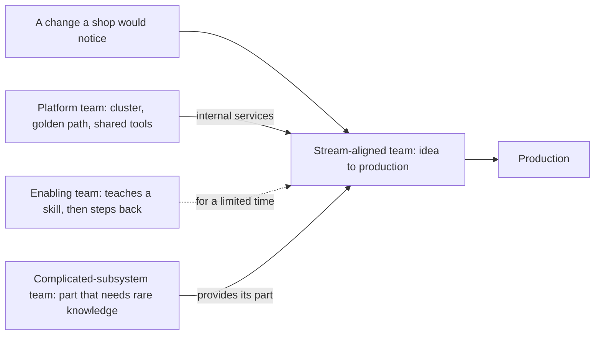

## Before you start

- [[management.l4.scaling-with-small-teams]] — you know Đơn Hàng grows by adding small teams that each own whole parts, sized by cognitive load.
- [[devops.l4.platform-engineering]] — you know `platform-capabilities.md` lists the shared tools every service runs on and marks which steps a team can do on its own.
- [[backend.l4.signing-key-custody]] — you know the invoice signing key stays in an HSM that only Payments may call.
- [[management.l3.proposing-an-adr]] — you know an ADR records the options, the decision and why the other options lost.

## The situation

The plan says Đơn Hàng will have three small teams. Now someone has to say what each team is for. One developer proposes a split: a front-end team for the Flutter app, a back-end team for the services, and an operations team for the cluster, CI and on-call, each deep in one skill. Then you trace one change a shop would notice, a new screen for shop opening hours. It needs a screen, an endpoint, and a deploy with its alert: three teams, two handoffs, points where the change waits for another team. What kind of job should each team have, so that most changes stay inside one team?

## Core concepts

- **Team Topologies** — a way of organising software teams, named after a canonical book, that gives every team one of four types so that its purpose and its relation to other teams are explicit.
- **stream-aligned team** — a team that owns one flow of change for a part of the business, from idea to production, without waiting for other teams.
- **platform team** — a team that provides internal services, such as the cluster and the golden path, that lower the cognitive load of stream-aligned teams.
- **enabling team** — a team that helps another team gain a skill for a limited time and then steps back, leaving the skill with that team.
- **complicated-subsystem team** — a team that owns one part of the system that needs rare specialist knowledge, which would add too much cognitive load to the stream-aligned teams.

## How it works



In the situation above, the new screen for opening hours is a change a shop would notice. With Team Topologies, one team carries it all the way: that is the stream-aligned team. It owns a part of the business, such as ordering or shops, and everything that change needs inside that part, from the screen to the endpoint to the deploy and its alert. Two of Đơn Hàng's three planned teams are of this type.

The other three types exist to keep the stream-aligned teams' cognitive load bearable. The platform team builds internal services the others use without learning them to the bottom, such as a cluster and a golden path for adding a service.
The enabling team does not take work from anyone. It sits with a team that lacks a skill, helps it learn, and leaves once the skill is there. The dotted arrow marks that the help is meant to end.

The complicated-subsystem team owns one part whose knowledge is rare, so rare that putting it in every stream-aligned team would overload them. The stream-aligned team uses that part instead of building it.

The four types do not follow technical layers. A layer team, such as front end only, owns a slice of every change, so each change crosses teams. A type names the kind of job a team does for the flow of change.

## In the Đơn Hàng system

ADR `0025` compares the options for the new teams. Its option B is the split from the situation; its option C is the one Đơn Hàng chose:

```markdown file=docs/adr/0025-to-chuc-doi-theo-luong-va-doi-platform.md tag=stage-4 lines=32-49
- Phương án B, đội theo tầng: một đội frontend (DonHang.App), một đội backend
  (api, Notifications, Payments), một đội vận hành (cluster, CI, trực). Mỗi đội
  sâu trong một kỹ năng, nhưng gần như mọi thay đổi một cửa hàng thấy được đi
  qua cả ba: một màn hình mới, endpoint của nó, rồi deploy và alert của nó.
- Phương án C, hai đội theo luồng cộng một đội platform:
  - Đội Đặt hàng: module Ordering (`DonHang.Domain`, `DonHang.Infrastructure`,
    controller đơn của api), Payments, Notifications, `DonHang.App/lib/features/ordering`.
  - Đội Cửa hàng: module Catalog (`DonHang.Catalog`), việc mở cửa hàng mới theo
    `docs/design/multi-shop-data-rollout.md`, `DonHang.App/lib/features/catalog`
    và `lib/features/auth`.
  - Đội platform: OpenTofu, Argo CD và repo cấu hình, Gateway, Sealed Secrets,
    Prometheus, admission policy, `templates/dotnet-service` và golden path,
    vận hành PostgreSQL, RabbitMQ và Keycloak.

  Mỗi đội theo luồng làm một thay đổi từ ý tưởng tới production mà không chờ
  đội khác; đội platform giữ phần chung để hai đội kia không phải hiểu cluster
  tới tận cùng. Cái giá: phải vẽ ranh giới, và phần nằm giữa hai đội cần chủ
  rõ ràng.
```

Lines 32–35 are the split by layer from the situation. Lines 36–41 are two stream-aligned teams ("đội theo luồng"): Đặt hàng for ordering, with Payments, Notifications and the app's ordering screens, and Cửa hàng for shops, with Catalog, opening new shops and the app's catalog and login screens. Each owns its screens and its services together.

Lines 42–44 are the platform team. It takes over most of the shared tools that `platform-capabilities.md` lists, such as Argo CD, Prometheus and the golden path, plus running PostgreSQL, RabbitMQ and Keycloak. Lines 46–49 give the reason and the price: stream-aligned teams finish a change without waiting, the platform team keeps the shared part so they need not know the cluster to the bottom, and someone must draw the lines.

The decision and its consequences:

```markdown file=docs/adr/0025-to-chuc-doi-theo-luong-va-doi-platform.md tag=stage-4 lines=53-75
Chọn phương án C. Ranh giới đội đi theo ranh giới module và service đã có, nên
mỗi đội sở hữu những phần hệ thống đổi cùng nhau; giữa hai đội theo luồng chỉ
có hợp đồng module `ICatalog`.

Từ chối A vì số cặp trao đổi và vì tải nhận thức của mỗi người không giảm. Từ
chối B vì gần như mọi thay đổi cửa hàng thấy được cần cả ba đội, nên mỗi thay
đổi chờ ở hai chỗ giao việc.

Phần dùng chung: `DonHang.App/lib/design/` và `lib/shared/` do đội Đặt hàng
giữ, đội Cửa hàng gửi pull request; `Program.cs` của api cũng vậy. Keycloak do
đội platform vận hành, còn phần đăng nhập trong app (`lib/features/auth`) thuộc
đội Cửa hàng.

### Hệ quả

- Đội platform được lập trước đội theo luồng thứ hai: đội hiện có trở thành
  đội Đặt hàng, rồi đội Cửa hàng lập sau. Lý do và chi phí ở
  `docs/team/leadership-brief-platform-team.md`.
- Vòng trực tách theo đội khi đội mới thành lập: mỗi đội theo luồng trực cho
  service của mình, đội platform trực cho cluster và công cụ chung. Tới lúc đó
  `on-call.md` giữ một vòng trực chung.
- Chưa có đội hệ con phức tạp: ký hóa đơn trong HSM của nhà cung cấp (ADR
  0023) chưa có code chạy với HSM đó, nên là ứng viên đầu tiên khi được xây.
```

Line 57 first rejects option A, adding people to the one existing team, for the reasons you met when sizing small teams: more pairs who may need to talk, and no lower load per person. Lines 57–59 then reject the split by layer: almost every change a shop would notice needs all three teams, so each change waits at two handoffs. Lines 61–64 name an owner for each part that sits between two teams, the price that line 48 warned about. Lines 68–70 set the order in which the teams form; lines 71–73 split on-call by team, and who runs what in production is a later lesson.

Lines 74–75 plan no complicated-subsystem team ("đội hệ con phức tạp") yet. Invoice signing in the provider's HSM, chosen in ADR `0023`, has no code that runs against that HSM yet, so it is named as the first candidate once it is built. Neither option in the ADR includes an enabling team.

## Trade-offs

| Way to give teams their job | Changes a shop would notice | Cognitive load per team | What it costs | Fits when |
|---|---|---|---|---|
| Split by layer: front end, back end, operations | cross all three teams, two handoffs each | one skill, but a slice of every change | every change waits for other teams | rarely for product work |
| Stream-aligned teams plus a platform team (ADR `0025`) | mostly inside one team | the team's own parts; the shared tools come as services | lines to draw, an owner for every shared part, a platform team to fund | parts of the business already have module and service lines |
| A team for each specialism, such as security or databases | wait for each specialist team they touch | low for specialists, but specialists sit outside every change | more handoffs and more teams to staff | the knowledge is rare and the part is large enough to own |
| Add an enabling team | stay with the stream-aligned team | rises for a while as the team learns, then the skill is its own | people taken from delivery for a limited time | several teams lack the same skill at the same time |

## What would you choose if…

…the invoice signing in the provider's HSM were built, and only one developer understood how Payments talks to it? Among its conditions to reopen, outside the excerpt, ADR `0025` lists this one: once invoice signing is built, review whether a complicated-subsystem team is needed. A sensible review asks whether the knowledge is truly rare and whether the part is large enough to keep a team busy. If it is one call to the HSM with a few rules around it, documenting it and teaching a second person in Đặt hàng may be enough. The ADR records the condition, not the answer.

…an auditor's findings made leadership ask for a separate security team? A sensible answer starts with the kind of job: if it would review every change, it becomes a handoff on every change, like the layer split. If the gap is a skill the stream-aligned teams lack, help for a limited time fits better, which is the enabling team's job. A dedicated team fits a part that needs rare knowledge, as invoice signing might once it is built and a review finds its knowledge truly rare.

## Seniors often assume…

- **"Teams are best split by technical layer, with front end, back end and operations each in their own team."** → Actually a change a shop would notice usually needs a screen, an endpoint and a deploy with its alert, so a layer split sends almost every change through all three teams. ADR `0025` rejects option B for that reason: each change waits at two handoffs. You notice this when a small feature's card turns into three cards on three teams' boards, and it ships at the pace of the slowest board.
- **"An enabling team is a permanent support team that does the hard work for others."** → Actually it helps a team gain a skill and then steps back; the skill stays with the team that learned it. A team that keeps doing the work for others becomes a handoff that never ends. You notice this when the same team still has to be asked for the same task months later.
- **"Every specialist area, such as security or databases, deserves a team of its own."** → Actually a separate team is meant for a part whose knowledge is rare, and even ADR `0025` names no such team yet. Running PostgreSQL goes to the platform team (line 44), not to a database team. You notice this when a specialist team's queue becomes the step every change waits on.

## Try it (3 minutes)

Use the two excerpts above.

1. Take one change a shop would notice: a new field on the product screen showing how many items are left, which the shop sets in Catalog.
2. Name the team that owns each part of the change under option B (lines 32–35) and under option C (lines 36–44).

Expected result: under option B, three teams; under option C, mostly Cửa hàng, with the platform team's services used but not waited on, and one part the ADR does not assign by name.

<details><summary>Suggested answer</summary>

Under option B, the app screen belongs to the front-end team, the Catalog change to the back-end team (Catalog is a module inside the api), and the deploy and its alert to the operations team: three teams, two handoffs.

Under option C, Cửa hàng owns Catalog and `lib/features/catalog` (lines 39–41), so it changes the screen and the module. The deploy uses tools the platform team keeps, such as Argo CD (line 42), with no handoff to an operations team. The product endpoint lives in the api's `ProductsController`, outside the excerpts, and the ADR does not assign it by name: it is the kind of part between teams that lines 61–64 must give an owner. The endpoint reads products from Catalog through `ICatalog`, so the new field changes what it returns. Đặt hàng's ordering code reads prices through the same contract (`CatalogProductPrices`, outside the excerpts), the only one between the two teams (lines 54–55), so here Cửa hàng may need Đặt hàng. How teams work across that contract is the next lesson.

</details>

## Connections

- [[management.l4.scaling-with-small-teams]] — the plan for small teams; this lesson gives each of them a type.
- [[devops.l4.platform-engineering]] — the shared work that the platform team now owns.
- [[backend.l4.signing-key-custody]] — the HSM decision behind the first candidate for a complicated-subsystem team.
- [[management.l3.proposing-an-adr]] — the form ADR `0025` follows, with rejected options and conditions to reopen.
- [[design.l4.conways-law]] — the reason team lines follow module and service lines.
- [[frontend.l4.feature-folders]] — the folders under `lib/features/` that ADR `0025` splits between the two stream-aligned teams.
- [[devops.l4.golden-path]] — the main service the platform team offers.
- [[k8s.l4.keys-stay-in-the-key-service]] — the key service the invoice signing would call.
- [[management.l4.team-interaction-modes]] — next: how two teams of these types work together.

## Five-line summary

1. Give each team one of four types, so its kind of job and its relation to other teams are explicit.
2. A stream-aligned team owns one flow of change, idea to production; Đơn Hàng plans two, Đặt hàng and Cửa hàng.
3. A platform team provides internal services, such as the golden path, that lower stream-aligned teams' cognitive load.
4. An enabling team teaches a skill and steps back; a complicated-subsystem team owns a part needing rare knowledge.
5. ADR `0025` rejects layer teams, since most changes would cross three teams, and names invoice signing as the first subsystem candidate.
