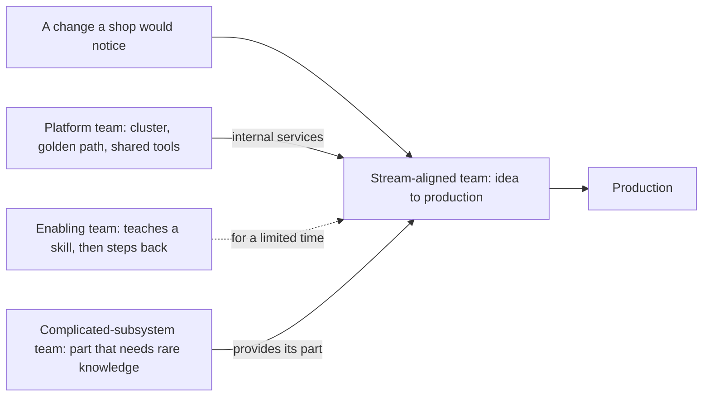

## Bạn cần biết trước

- [[management.l4.scaling-with-small-teams]] — bạn biết Đơn Hàng lớn lên bằng cách thêm các đội nhỏ, mỗi đội sở hữu trọn từng phần, với cỡ đội đặt theo tải nhận thức.
- [[devops.l4.platform-engineering]] — bạn biết `platform-capabilities.md` liệt kê các công cụ dùng chung mà mọi service chạy trên đó, và đánh dấu bước nào một đội tự làm được.
- [[backend.l4.signing-key-custody]] — bạn biết khóa ký hóa đơn nằm trong một HSM mà chỉ Payments được gọi tới.
- [[management.l3.proposing-an-adr]] — bạn biết một ADR ghi lại các phương án, quyết định, và lý do các phương án kia bị loại.

## Tình huống

Kế hoạch nói Đơn Hàng sẽ có ba đội nhỏ. Giờ phải có người nói rõ mỗi đội để làm gì. Một lập trình viên đề xuất cách chia: một đội front-end cho app Flutter, một đội back-end cho các service, một đội vận hành cho cluster, CI và trực sự cố, mỗi đội sâu trong một kỹ năng. Rồi bạn lần theo một thay đổi mà cửa hàng nhìn thấy được: một màn hình mới cho giờ mở cửa của cửa hàng. Nó cần một màn hình, một endpoint, và một lần deploy kèm cảnh báo của nó. Vậy là ba đội, hai chỗ giao việc, tức hai chỗ thay đổi phải chờ một đội khác. Mỗi đội nên mang loại việc gì để phần lớn thay đổi nằm gọn trong một đội?

## Khái niệm cốt lõi

- **Team Topologies** (cách tổ chức đội theo bốn kiểu đội và ba cách làm việc giữa các đội, giữ tải nhận thức vừa sức) — cách tổ chức các đội phần mềm, mang tên một cuốn sách kinh điển, gán cho mỗi đội một trong bốn kiểu để mục đích của đội và quan hệ của nó với các đội khác được nói rõ.
- **đội theo luồng** (stream-aligned team) — đội sở hữu một luồng thay đổi cho một phần nghiệp vụ, từ ý tưởng tới production, mà không phải chờ đội khác.
- **đội platform** (platform team) — đội cung cấp các dịch vụ nội bộ, như cluster và golden path, giúp giảm tải nhận thức cho các đội theo luồng.
- **đội nâng năng lực** (enabling team) — đội giúp một đội khác có thêm một kỹ năng trong một thời gian có hạn rồi rút ra, để lại kỹ năng đó cho đội kia.
- **đội hệ con phức tạp** (complicated-subsystem team) — đội sở hữu một phần của hệ thống cần kiến thức chuyên sâu hiếm có, thứ sẽ làm tải nhận thức của các đội theo luồng nặng quá mức.

## Cơ chế hoạt động



Trong tình huống trên, màn hình giờ mở cửa là một thay đổi cửa hàng nhìn thấy được. Với Team Topologies, một đội mang nó đi hết đường: đó là đội theo luồng. Đội này sở hữu một phần nghiệp vụ, như đặt hàng hay cửa hàng, và mọi thứ thay đổi đó cần trong phần ấy, từ màn hình tới endpoint tới lần deploy và cảnh báo của nó. Hai trong ba đội Đơn Hàng dự kiến lập thuộc kiểu này.

Ba kiểu còn lại có mặt để giữ tải nhận thức của các đội theo luồng ở mức gánh được. Đội platform xây các dịch vụ nội bộ mà các đội khác dùng mà không cần hiểu tới tận cùng, như một cluster và một golden path để thêm service.
Đội nâng năng lực không nhận việc của ai. Đội này ngồi cùng một đội đang thiếu một kỹ năng, giúp đội đó học, và rời đi khi kỹ năng đã có. Mũi tên nét đứt cho thấy sự giúp đỡ này được định sẵn là sẽ kết thúc.

Đội hệ con phức tạp sở hữu một phần mà kiến thức về nó hiếm, hiếm tới mức nhét nó vào mọi đội theo luồng sẽ làm các đội đó quá tải. Đội theo luồng dùng phần đó thay vì tự xây.

Bốn kiểu này không đi theo các tầng kỹ thuật. Một đội theo tầng, chẳng hạn chỉ làm front end, sở hữu một lát của mọi thay đổi, nên thay đổi nào cũng đi qua nhiều đội. Một kiểu đội gọi tên loại việc mà đội đó làm cho luồng thay đổi.

## Trong hệ thống Đơn Hàng

ADR `0025` so sánh các phương án cho những đội mới. Phương án B của nó là cách chia trong tình huống, còn phương án C là cách Đơn Hàng đã chọn:

```markdown file=docs/adr/0025-to-chuc-doi-theo-luong-va-doi-platform.md tag=stage-4 lines=32-49
- Phương án B, đội theo tầng: một đội frontend (DonHang.App), một đội backend
  (api, Notifications, Payments), một đội vận hành (cluster, CI, trực). Mỗi đội
  sâu trong một kỹ năng, nhưng gần như mọi thay đổi một cửa hàng thấy được đi
  qua cả ba: một màn hình mới, endpoint của nó, rồi deploy và alert của nó.
- Phương án C, hai đội theo luồng cộng một đội platform:
  - Đội Đặt hàng: module Ordering (`DonHang.Domain`, `DonHang.Infrastructure`,
    controller đơn của api), Payments, Notifications, `DonHang.App/lib/features/ordering`.
  - Đội Cửa hàng: module Catalog (`DonHang.Catalog`), việc mở cửa hàng mới theo
    `docs/design/multi-shop-data-rollout.md`, `DonHang.App/lib/features/catalog`
    và `lib/features/auth`.
  - Đội platform: OpenTofu, Argo CD và repo cấu hình, Gateway, Sealed Secrets,
    Prometheus, admission policy, `templates/dotnet-service` và golden path,
    vận hành PostgreSQL, RabbitMQ và Keycloak.

  Mỗi đội theo luồng làm một thay đổi từ ý tưởng tới production mà không chờ
  đội khác; đội platform giữ phần chung để hai đội kia không phải hiểu cluster
  tới tận cùng. Cái giá: phải vẽ ranh giới, và phần nằm giữa hai đội cần chủ
  rõ ràng.
```

Dòng 32–35 là cách chia theo tầng trong tình huống. Dòng 36–41 là hai đội theo luồng: Đặt hàng lo phần đặt hàng, gồm Payments, Notifications và các màn hình đặt hàng của app, còn Cửa hàng lo phần cửa hàng, gồm Catalog, việc mở cửa hàng mới, các màn hình danh mục và đăng nhập của app. Mỗi đội sở hữu cả màn hình lẫn service của mình.

Dòng 42–44 là đội platform. Đội này nhận phần lớn các công cụ dùng chung mà `platform-capabilities.md` liệt kê, như Argo CD, Prometheus và golden path, cộng thêm vận hành PostgreSQL, RabbitMQ và Keycloak. Dòng 46–49 nêu lý do và cái giá: đội theo luồng làm xong một thay đổi mà không phải chờ, đội platform giữ phần chung để các đội kia không phải hiểu cluster tới tận cùng, và phải có người vẽ ranh giới.

Quyết định và hệ quả của nó:

```markdown file=docs/adr/0025-to-chuc-doi-theo-luong-va-doi-platform.md tag=stage-4 lines=53-75
Chọn phương án C. Ranh giới đội đi theo ranh giới module và service đã có, nên
mỗi đội sở hữu những phần hệ thống đổi cùng nhau; giữa hai đội theo luồng chỉ
có hợp đồng module `ICatalog`.

Từ chối A vì số cặp trao đổi và vì tải nhận thức của mỗi người không giảm. Từ
chối B vì gần như mọi thay đổi cửa hàng thấy được cần cả ba đội, nên mỗi thay
đổi chờ ở hai chỗ giao việc.

Phần dùng chung: `DonHang.App/lib/design/` và `lib/shared/` do đội Đặt hàng
giữ, đội Cửa hàng gửi pull request; `Program.cs` của api cũng vậy. Keycloak do
đội platform vận hành, còn phần đăng nhập trong app (`lib/features/auth`) thuộc
đội Cửa hàng.

### Hệ quả

- Đội platform được lập trước đội theo luồng thứ hai: đội hiện có trở thành
  đội Đặt hàng, rồi đội Cửa hàng lập sau. Lý do và chi phí ở
  `docs/team/leadership-brief-platform-team.md`.
- Vòng trực tách theo đội khi đội mới thành lập: mỗi đội theo luồng trực cho
  service của mình, đội platform trực cho cluster và công cụ chung. Tới lúc đó
  `on-call.md` giữ một vòng trực chung.
- Chưa có đội hệ con phức tạp: ký hóa đơn trong HSM của nhà cung cấp (ADR
  0023) chưa có code chạy với HSM đó, nên là ứng viên đầu tiên khi được xây.
```

Dòng 57 trước hết loại phương án A, thêm người vào đội duy nhất đang có, vì những lý do bạn đã gặp khi tính cỡ đội nhỏ: nhiều cặp người hơn có thể cần trao đổi, và tải trên mỗi người không giảm. Dòng 57–59 tiếp đó loại cách chia theo tầng: gần như mọi thay đổi cửa hàng nhìn thấy được cần cả ba đội, nên mỗi thay đổi phải chờ ở hai chỗ giao việc. Dòng 61–64 chỉ định chủ cho từng phần nằm giữa hai đội, đúng cái giá mà dòng 48 đã báo trước. Dòng 68–70 đặt thứ tự lập các đội. Dòng 71–73 tách vòng trực sự cố theo đội, còn ai vận hành cái gì trên production là chuyện của một bài sau.

Dòng 74–75 cho biết chưa dự kiến đội hệ con phức tạp nào. Ký hóa đơn trong HSM của nhà cung cấp, chọn trong ADR `0023`, chưa có code nào chạy với HSM đó, nên nó được nêu tên là ứng viên đầu tiên khi được xây. Không phương án nào trong ADR có đội nâng năng lực.

## Đánh đổi

| Cách giao việc cho đội | Thay đổi cửa hàng nhìn thấy được | Tải nhận thức trên mỗi đội | Cái giá | Hợp khi |
|---|---|---|---|---|
| Chia theo tầng: front end, back end, vận hành | đi qua cả ba đội, mỗi thay đổi hai chỗ giao việc | một kỹ năng, nhưng dính một lát của mọi thay đổi | thay đổi nào cũng chờ đội khác | hiếm khi hợp với việc làm sản phẩm |
| Đội theo luồng cộng một đội platform (ADR `0025`) | phần lớn nằm gọn trong một đội | các phần của chính đội, còn công cụ dùng chung đến dưới dạng dịch vụ | ranh giới phải vẽ, phần dùng chung nào cũng cần chủ, một đội platform phải có nguồn trả | các phần nghiệp vụ đã có ranh giới module và service |
| Mỗi chuyên môn một đội, như bảo mật hay database | chờ từng đội chuyên môn mà nó chạm tới | thấp với người chuyên môn, nhưng họ đứng ngoài mọi thay đổi | thêm chỗ giao việc và thêm đội phải tuyển người | kiến thức hiếm và phần đó đủ lớn để một đội sở hữu |
| Thêm một đội nâng năng lực | ở lại với đội theo luồng | tăng một thời gian khi đội học, rồi kỹ năng thành của đội | người bị rút khỏi việc giao hàng trong một thời gian có hạn | nhiều đội cùng thiếu một kỹ năng vào cùng lúc |

## Bạn sẽ chọn gì nếu…

…phần ký hóa đơn trong HSM của nhà cung cấp đã được xây, và chỉ một lập trình viên hiểu Payments nói chuyện với nó ra sao? Trong các điều kiện để mở lại quyết định, nằm ngoài đoạn trích, ADR `0025` ghi điều này: khi ký hóa đơn đã được xây, xem lại có cần đội hệ con phức tạp không. Một lần xem lại hợp lý sẽ hỏi kiến thức đó có thật sự hiếm không, và phần đó có đủ lớn để một đội bận rộn không. Nếu nó chỉ là một lời gọi tới HSM kèm vài quy tắc xung quanh, viết tài liệu và dạy thêm một người trong Đặt hàng có thể là đủ. ADR ghi điều kiện, không ghi câu trả lời.

…kết quả của một đợt kiểm toán khiến ban lãnh đạo đòi lập một đội bảo mật riêng? Câu trả lời hợp lý bắt đầu từ loại việc: nếu đội đó review mọi thay đổi, nó thành một chỗ giao việc trên mọi thay đổi, giống cách chia theo tầng. Nếu khoảng trống là một kỹ năng các đội theo luồng còn thiếu, giúp đỡ trong một thời gian có hạn hợp hơn, và đó là việc của đội nâng năng lực. Một đội riêng hợp với một phần cần kiến thức hiếm, như phần ký hóa đơn có thể trở thành khi đã được xây và một lần xem lại thấy kiến thức về nó thật sự hiếm.

## Senior hay nhầm rằng…

- **"Chia đội theo tầng kỹ thuật là tốt nhất, front end, back end và vận hành mỗi phần một đội."** → Thực ra một thay đổi cửa hàng nhìn thấy được thường cần một màn hình, một endpoint và một lần deploy kèm cảnh báo, nên chia theo tầng đẩy gần như mọi thay đổi qua cả ba đội. ADR `0025` loại phương án B vì đúng lý do đó: mỗi thay đổi chờ ở hai chỗ giao việc. Bạn sẽ nhận ra khi thẻ của một tính năng nhỏ biến thành ba thẻ trên bảng của ba đội, và nó ra mắt theo tốc độ của bảng chậm nhất.
- **"Đội nâng năng lực là đội hỗ trợ cố định, làm những việc khó thay cho đội khác."** → Thực ra đội này giúp một đội có thêm một kỹ năng rồi rút ra, kỹ năng ở lại với đội đã học nó. Một đội cứ làm thay việc cho đội khác sẽ thành một chỗ giao việc không bao giờ hết. Bạn sẽ nhận ra khi nhiều tháng sau vẫn phải nhờ đúng đội đó làm đúng việc đó.
- **"Chuyên môn nào, như bảo mật hay database, cũng đáng có một đội riêng."** → Thực ra một đội riêng dành cho phần mà kiến thức về nó hiếm, và ngay cả ADR `0025` cũng chưa nêu tên đội nào như vậy. Vận hành PostgreSQL thuộc đội platform (dòng 44), không thuộc một đội database. Bạn sẽ nhận ra khi hàng đợi của một đội chuyên môn thành bước mà thay đổi nào cũng phải chờ.

## Thử ngay (3 phút)

Dùng hai đoạn trích ở trên.

1. Lấy một thay đổi cửa hàng nhìn thấy được: một trường mới trên màn hình sản phẩm cho biết còn bao nhiêu món, do cửa hàng đặt trong Catalog.
2. Gọi tên đội sở hữu từng phần của thay đổi theo phương án B (dòng 32–35) và theo phương án C (dòng 36–44).

Kết quả mong đợi: theo phương án B là ba đội. Theo phương án C, phần lớn thuộc Cửa hàng, dịch vụ của đội platform được dùng nhưng không phải chờ, và có một phần ADR không giao đích danh cho ai.

<details><summary>Gợi ý đáp án</summary>

Theo phương án B, màn hình trong app thuộc đội front-end, thay đổi ở Catalog thuộc đội back-end (Catalog là một module trong api), còn lần deploy và cảnh báo của nó thuộc đội vận hành: ba đội, hai chỗ giao việc.

Theo phương án C, Cửa hàng sở hữu Catalog và `lib/features/catalog` (dòng 39–41), nên tự sửa cả màn hình lẫn module. Lần deploy dùng công cụ đội platform giữ, như Argo CD (dòng 42), không phải giao cho đội vận hành nào. Endpoint sản phẩm nằm trong `ProductsController` của api, ngoài các đoạn trích, và ADR không giao đích danh nó cho ai: đó chính là loại phần nằm giữa các đội mà dòng 61–64 phải chỉ định chủ. Endpoint đọc sản phẩm từ Catalog qua `ICatalog`, nên trường mới làm thay đổi thứ nó trả về. Code đặt hàng của Đặt hàng đọc giá qua cùng hợp đồng đó (`CatalogProductPrices`, ngoài các đoạn trích), hợp đồng duy nhất giữa hai đội (dòng 54–55), nên ở đây Cửa hàng có thể cần tới Đặt hàng. Các đội làm việc với nhau qua hợp đồng đó thế nào là chủ đề của bài tiếp theo.

</details>

## Liên hệ

- [[management.l4.scaling-with-small-teams]] — kế hoạch các đội nhỏ, bài này gán cho mỗi đội một kiểu.
- [[devops.l4.platform-engineering]] — phần việc dùng chung mà đội platform giờ sở hữu.
- [[backend.l4.signing-key-custody]] — quyết định về HSM đứng sau ứng viên đầu tiên cho đội hệ con phức tạp.
- [[management.l3.proposing-an-adr]] — khuôn mà ADR `0025` theo, với các phương án bị loại và điều kiện để mở lại.
- [[design.l4.conways-law]] — lý do ranh giới đội đi theo ranh giới module và service.
- [[frontend.l4.feature-folders]] — các thư mục dưới `lib/features/` mà ADR `0025` chia cho hai đội theo luồng.
- [[devops.l4.golden-path]] — dịch vụ chính mà đội platform cung cấp.
- [[k8s.l4.keys-stay-in-the-key-service]] — key service mà phần ký hóa đơn sẽ gọi tới.
- [[management.l4.team-interaction-modes]] — tiếp theo: hai đội thuộc các kiểu này làm việc với nhau thế nào.

## Tóm tắt 5 dòng

1. Gán cho mỗi đội một trong bốn kiểu, để loại việc của đội và quan hệ với các đội khác được nói rõ.
2. Đội theo luồng sở hữu một luồng thay đổi, từ ý tưởng tới production. Đơn Hàng dự kiến hai đội như vậy là Đặt hàng và Cửa hàng.
3. Đội platform cung cấp dịch vụ nội bộ, như golden path, để giảm tải nhận thức cho các đội theo luồng.
4. Đội nâng năng lực dạy một kỹ năng rồi rút ra, còn đội hệ con phức tạp sở hữu một phần cần kiến thức hiếm.
5. ADR `0025` loại đội theo tầng vì phần lớn thay đổi sẽ đi qua ba đội, và nêu phần ký hóa đơn là ứng viên đầu tiên cho đội hệ con.
