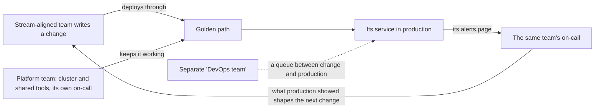

## Before you start

- [[management.l4.team-interaction-modes]] — you know the platform team offers the golden path to the stream-aligned teams as X-as-a-service.
- [[devops.l4.on-call]] — you know on-call names one person who must answer pages within an agreed time, and that `on-call.md` is not live yet.
- [[devops.l4.runbooks]] — you know a runbook gives one alert's meaning, how to confirm it and the first safe actions.
- [[backend.l4.service-level-objectives]] — you know Đơn Hàng's SLOs set targets below 100% for order and product requests.

## The situation

The platform team is about to form, and your team will become Đặt hàng. At a planning meeting a colleague proposes something that sounds tidy: a small "DevOps team" of two people takes every deploy, watches every dashboard and holds on-call for all services. The product developers could then focus on features, and nobody on your team would be paged again. Another colleague worries that Đặt hàng would wait for those two people before every release, and would hear about its own bugs second-hand. Who should deploy, watch and answer for each service once the teams split?

## Core concepts

- DevOps (a plain word, used in this sense here, as `team-structure.md` applies it) — a way of working in which the people who build a service also deploy it, watch it and answer for it in production, instead of handing it to a separate operations group.
- Hand-off (a plain word, used in this sense here) — passing finished work to another group that must act on it before it reaches production or before a problem gets fixed.
- Running a service (a plain phrase, used in this sense here) — holding its SLOs, alerts, runbooks and on-call, as `team-structure.md` lists for each stream-aligned team.
- Shared work (a plain phrase, used in this sense here) — the cluster and the tools every team uses; the platform team runs it and is on call for it.

## How it works



The solid loop is DevOps as a way of working. A stream-aligned team writes a change and deploys it, and its own alerts page its own on-call when customers are hurt. The people who wrote the code read the alert, open the runbook and choose the mitigation. What production shows them shapes the next change.

The colleague's proposal from the situation is the dotted node. Its arrow stands for two things: every change from A would queue at that group before reaching C, and C's pages would go to it instead of D. So the page goes to people who did not write the code, and the product team learns how its code behaves in production only second-hand. Calling that group a "DevOps team" does not change what it is: a separate operations group, with the very hand-off DevOps removes.

The loop would be heavy for a product team if each had to know the cluster, Argo CD and Prometheus in depth. This is where the platform team fits. It runs the cluster and the shared tools, and it is on call for them. The stream-aligned teams deploy through the golden path, so they use the platform without learning all of it.

The split follows what each team owns, not who is more skilled. The platform team does not run other teams' services. It runs the ground they stand on, and answers when that ground fails.

## In the Đơn Hàng system

`team-structure.md` writes down who runs what once the teams split:

```markdown file=docs/team/team-structure.md tag=stage-4 lines=85-96
### Ai vận hành gì

- Mỗi đội theo luồng giữ SLO, alert, runbook và trực cho service của mình
  (`docs/design/slo.md`, `docs/design/alerts.md`, `docs/runbooks/`). Người viết
  service cũng deploy, theo dõi và trả lời cho nó ở production; không có đội
  riêng nhận deploy và theo dõi service của đội khác.
- Đội platform vận hành và trực cho cluster và công cụ chung. Nhờ đội platform
  giữ phần chung, các đội theo luồng deploy qua golden path thay vì mỗi đội tự
  học cluster tới tận cùng.
- Tới khi đội mới thành lập, một đội vẫn làm và vận hành mọi thứ, nên
  `on-call.md` có một vòng trực chung. Tổ chức vòng trực cho bền ở
  `on-call-staffing.md`.
```

Lines 87–90 are the build-and-run rule. Each stream-aligned team keeps the SLOs, alerts, runbooks and on-call for its own services, and the person who writes a service also deploys it, watches it and answers for it in production. The end of line 89 and line 90 rule out the colleague's proposal in plain words: no separate team takes deploys and watching for other teams' services.

Lines 91–93 give the other half: the platform team runs and is on call for the cluster and shared tools, so the stream-aligned teams deploy through the golden path.

Lines 94–96 describe today: one team builds and runs everything, so `on-call.md` has one shared rotation; that file, outside the excerpt, fills it with the team's four developers, one week each. The ADR that chose the team split says when that changes:

```markdown file=docs/adr/0025-to-chuc-doi-theo-luong-va-doi-platform.md tag=stage-4 lines=66-73
### Hệ quả

- Đội platform được lập trước đội theo luồng thứ hai: đội hiện có trở thành
  đội Đặt hàng, rồi đội Cửa hàng lập sau. Lý do và chi phí ở
  `docs/team/leadership-brief-platform-team.md`.
- Vòng trực tách theo đội khi đội mới thành lập: mỗi đội theo luồng trực cho
  service của mình, đội platform trực cho cluster và công cụ chung. Tới lúc đó
  `on-call.md` giữ một vòng trực chung.
```

Lines 71–73 split on-call by team only when the new teams form; until then, the single rotation stays. Lines 68–70 give the order: the platform team first, then Cửa hàng, with today's team becoming Đặt hàng.

## Trade-offs

| Way of running services | Wait before production | Who is paged | Learning from production | Load on a product team | Fits when |
|---|---|---|---|---|---|
| Each team builds and runs, platform team holds shared work | none beyond the team's own CI and deploy steps | the team that wrote the code | stays with the builders | moderate, kept down by the golden path | several teams share one cluster, as Đơn Hàng plans |
| Separate operations group, even if named "DevOps team" | a queue for every deploy | people who did not write the code | lands in another group | low on paper | rarely; perhaps when nobody can change the code any more, only keep it running |
| Each team builds and runs, including its own cluster | none | the team that wrote the code | stays with the builders | high: every team learns the cluster in depth | there is one team, or teams are too few to justify a platform team |
| One team builds and runs everything | none | the one team | stays in the team | grows with everything the team owns | today's Đơn Hàng, before the split |

## What would you choose if…

…Đặt hàng's developers said on-call was too heavy because each page needed deep knowledge of the cluster? A sensible first step is to keep on-call with Đặt hàng and look at why a page reaches the cluster at all. The gap is more likely in a runbook or in the golden path than in who is paged. Ask the platform team through its published route, an issue with its label, rather than moving the pages to it.

…a manager proposed that the platform team also take night pages for every service, since it is on call anyway? That brings back the hand-off: the platform team would be paged for code it did not write, and lines 89–90 rule it out. If night pages are the real problem, `on-call.md`'s review after each shift, outside the excerpts, already lowers a page that needed no action to `ticket` or removes it.

…after the split, a Catalog change inside the api broke order placement? In the plan, Ordering goes to Đặt hàng and Catalog to Cửa hàng, yet both run inside `DonHang.Api`, where `slo.md` measures all four SLIs (orders and product requests). `team-structure.md` does not say which team's on-call takes the api's alerts. A sensible answer is to settle it in writing before paging goes live, for example SLI by SLI, matching each SLI's endpoints to the team whose module serves them.

## Seniors often assume…

- **"DevOps is the name of the team that handles deploys and servers."** → Actually DevOps is a way of working in which the builders also deploy, watch and answer for their service. A team with that name that deploys for everyone else is a separate operations group again. You notice this when product teams open requests to "DevOps" for each release and wait for a slot.
- **"Developers should not be on call, since running production is a separate job."** → Actually the developers who wrote a service are the ones who can read its alert and change its code, so line 87 gives each stream-aligned team the on-call for its own services. You notice the cost of the opposite when an on-call person not on the team can only restart a service and then wait for its team the next morning.
- **"A platform team is an operations team under a new name that takes tickets."** → Actually the platform team runs shared tools that teams use themselves, such as the golden path, and does not deploy or watch their services. You notice the confusion when the platform team's issue list fills with requests to deploy other teams' changes.

## Try it (3 minutes)

Use the two excerpts above and imagine both new teams have formed.

1. Take four tasks: (a) write a runbook for an alert on Notifications; (b) upgrade Argo CD; (c) deploy a new version of Payments; (d) answer a night page saying the cluster's Prometheus has stopped collecting metrics. In the plan, Notifications and Payments belong to Đặt hàng; Argo CD and Prometheus belong to the platform team.
2. For each, name the team that does it, using lines 87–93 of `team-structure.md`.

Expected result: two tasks go to Đặt hàng, two to the platform team, and none to a separate team that deploys or watches services for others.

<details><summary>Suggested answer</summary>

(a) Đặt hàng: line 87 gives each stream-aligned team the runbooks for its own services.

(b) Platform team: Argo CD is a shared tool the plan gives the platform team, and line 91 has the platform team run shared tools.

(c) Đặt hàng: line 89 has the person who writes a service also deploy it, and line 92 sends that deploy through the golden path.

(d) Platform team: Prometheus is a shared tool the plan gives the platform team, and line 91 has the platform team be on call for shared tools.

</details>

## Connections

- [[management.l4.team-interaction-modes]] — how the teams work together; this lesson says which of them runs each part in production.
- [[devops.l4.on-call]] — the rotation and escalation that each stream-aligned team holds for its own services.
- [[devops.l4.runbooks]] — the documents the team that wrote a service keeps for its alerts.
- [[backend.l4.service-level-objectives]] — the targets a team owns along with its service.
- [[devops.l4.platform-engineering]] — the shared work that makes running its own services bearable for a product team.
- [[devops.l4.golden-path]] — the route stream-aligned teams deploy through instead of learning the cluster in depth.
- [[devops.l4.delivery-metrics]] — the measures in which a deploy queue would show up as longer lead time.
- [[devops.l4.incident-command]] — what the person on-call does once a page becomes an incident.
- [[management.l4.sustainable-on-call]] — next: keeping each team's rotation bearable for the people in it.

## Five-line summary

1. The team that builds a service also deploys it, watches it and answers for it in production; that way of working is DevOps.
2. A separate "DevOps team" that deploys for everyone brings back the hand-off: teams wait in its queue and learn about production second-hand.
3. In `team-structure.md` each stream-aligned team owns its services' SLOs, alerts, runbooks and on-call.
4. The platform team runs and is on call for the cluster and shared tools, so teams deploy through the golden path.
5. Today one team runs everything with one rotation; ADR `0025` splits on-call by team when the new teams form.
