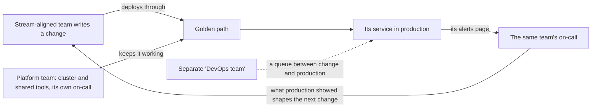

## Bạn cần biết trước

- [[management.l4.team-interaction-modes]] — bạn biết đội platform cung cấp golden path cho các đội theo luồng theo kiểu X-as-a-service.
- [[devops.l4.on-call]] — bạn biết trực sự cố chỉ định một người phải trả lời khi bị gọi trong thời hạn đã thỏa thuận, và `on-call.md` chưa áp dụng thật.
- [[devops.l4.runbooks]] — bạn biết một runbook ghi ý nghĩa của một cảnh báo, cách xác nhận nó và những bước an toàn đầu tiên.
- [[backend.l4.service-level-objectives]] — bạn biết các SLO của Đơn Hàng đặt mục tiêu dưới 100% cho request về đơn hàng và sản phẩm.

## Tình huống

Đội platform sắp được lập, và đội của bạn sẽ trở thành Đặt hàng. Trong một buổi họp kế hoạch, một đồng nghiệp đưa ra một đề nghị nghe rất gọn: lập một "đội DevOps" nhỏ gồm hai người, nhận mọi lần deploy, theo dõi mọi dashboard và trực sự cố cho tất cả service. Khi đó các developer sản phẩm chỉ cần tập trung vào tính năng, và không ai trong đội bạn bị gọi nữa. Một đồng nghiệp khác lo rằng Đặt hàng sẽ phải chờ hai người đó trước mỗi lần release, và chỉ nghe về lỗi của chính mình qua người khác. Khi các đội đã tách, ai nên deploy, theo dõi và chịu trách nhiệm cho từng service?

## Khái niệm cốt lõi

- DevOps (từ thường, ở đây dùng theo nghĩa này, đúng như cách `team-structure.md` áp dụng) — lối làm việc trong đó người xây service cũng là người deploy, theo dõi và chịu trách nhiệm cho nó trên production, thay vì giao nó cho một nhóm vận hành riêng.
- Chuyển giao (hand-off, từ thường, ở đây dùng theo nghĩa này) — đưa phần việc đã xong cho một nhóm khác, và nhóm đó phải xử lý thì việc mới lên được production hoặc lỗi mới được sửa.
- Vận hành một service (cụm từ thường, ở đây dùng theo nghĩa này) — giữ SLO, cảnh báo, runbook và trực sự cố cho nó, như `team-structure.md` liệt kê cho mỗi đội theo luồng.
- Phần chung (cụm từ thường, ở đây dùng theo nghĩa này) — cluster và các công cụ mà mọi đội cùng dùng. Đội platform vận hành phần này và trực sự cố cho nó.

## Cơ chế hoạt động



Vòng nét liền là DevOps theo nghĩa một lối làm việc. Một đội theo luồng viết thay đổi rồi tự deploy, và khi khách bị ảnh hưởng, cảnh báo của chính đội gọi người trực của chính đội. Những người đã viết code đọc cảnh báo, mở runbook và chọn cách giảm thiểu. Những gì production cho họ thấy sẽ định hình thay đổi tiếp theo.

Đề nghị của đồng nghiệp trong tình huống là nút nét đứt. Mũi tên của nó mang hai nghĩa: mọi thay đổi từ A phải xếp hàng ở nhóm đó trước khi tới C, và các lần gọi người trực của C sẽ tới nhóm đó thay vì D. Như vậy người bị gọi là người không viết code, còn đội sản phẩm chỉ biết code của mình chạy trên production ra sao qua người khác. Gọi nhóm đó là "đội DevOps" không đổi được bản chất của nó: đó vẫn là một nhóm vận hành riêng, kèm đúng bước chuyển giao mà DevOps muốn bỏ.

Vòng này sẽ nặng với một đội sản phẩm nếu đội nào cũng phải hiểu sâu cluster, Argo CD và Prometheus. Đây là chỗ của đội platform. Đội platform vận hành cluster và các công cụ chung, và trực sự cố cho chúng. Các đội theo luồng deploy qua golden path, nên họ dùng được platform mà không phải học hết nó.

Cách chia này dựa trên việc mỗi đội sở hữu gì, không dựa trên ai giỏi hơn. Đội platform không vận hành service của đội khác. Họ vận hành nền mà các service đó đứng lên, và trả lời khi nền đó hỏng.

## Trong hệ thống Đơn Hàng

`team-structure.md` ghi rõ ai vận hành gì sau khi các đội tách:

```markdown file=docs/team/team-structure.md tag=stage-4 lines=85-96
### Ai vận hành gì

- Mỗi đội theo luồng giữ SLO, alert, runbook và trực cho service của mình
  (`docs/design/slo.md`, `docs/design/alerts.md`, `docs/runbooks/`). Người viết
  service cũng deploy, theo dõi và trả lời cho nó ở production; không có đội
  riêng nhận deploy và theo dõi service của đội khác.
- Đội platform vận hành và trực cho cluster và công cụ chung. Nhờ đội platform
  giữ phần chung, các đội theo luồng deploy qua golden path thay vì mỗi đội tự
  học cluster tới tận cùng.
- Tới khi đội mới thành lập, một đội vẫn làm và vận hành mọi thứ, nên
  `on-call.md` có một vòng trực chung. Tổ chức vòng trực cho bền ở
  `on-call-staffing.md`.
```

Dòng 87–90 là quy tắc "ai xây thì người đó vận hành". Mỗi đội theo luồng giữ SLO, cảnh báo, runbook và trực sự cố cho service của mình, và người viết service cũng là người deploy, theo dõi và chịu trách nhiệm cho nó trên production. Cuối dòng 89 và dòng 90 nói thẳng là không chấp nhận đề nghị của đồng nghiệp: không có đội riêng nào nhận deploy và theo dõi service của đội khác.

Dòng 91–93 là nửa còn lại: đội platform vận hành và trực sự cố cho cluster và các công cụ chung, nhờ vậy các đội theo luồng deploy qua golden path.

Dòng 94–96 mô tả hiện tại: một đội xây và vận hành mọi thứ, nên `on-call.md` có một vòng trực chung. Ở ngoài đoạn trích, file đó xếp bốn developer của đội vào vòng trực, mỗi người một tuần. ADR chọn cách chia đội cho biết khi nào điều này thay đổi:

```markdown file=docs/adr/0025-to-chuc-doi-theo-luong-va-doi-platform.md tag=stage-4 lines=66-73
### Hệ quả

- Đội platform được lập trước đội theo luồng thứ hai: đội hiện có trở thành
  đội Đặt hàng, rồi đội Cửa hàng lập sau. Lý do và chi phí ở
  `docs/team/leadership-brief-platform-team.md`.
- Vòng trực tách theo đội khi đội mới thành lập: mỗi đội theo luồng trực cho
  service của mình, đội platform trực cho cluster và công cụ chung. Tới lúc đó
  `on-call.md` giữ một vòng trực chung.
```

Dòng 71–73 chỉ tách trực sự cố theo đội khi các đội mới đã thành lập. Trước đó, vẫn giữ một vòng trực chung. Dòng 68–70 cho biết thứ tự: đội platform lập trước, rồi tới Cửa hàng, còn đội hiện tại trở thành Đặt hàng.

## Đánh đổi

| Cách vận hành service | Chờ trước khi lên production | Ai bị gọi | Bài học từ production | Gánh nặng lên đội sản phẩm | Hợp khi |
|---|---|---|---|---|---|
| Mỗi đội xây và vận hành, đội platform giữ phần chung | không có, ngoài các bước CI và deploy của chính đội | đội đã viết code | ở lại với người xây | vừa phải, được golden path giữ ở mức thấp | nhiều đội dùng chung một cluster, như kế hoạch của Đơn Hàng |
| Một nhóm vận hành riêng, kể cả khi gọi là "đội DevOps" | một hàng đợi cho mỗi lần deploy | người không viết code | rơi vào một nhóm khác | thấp, trên giấy | hiếm khi, có lẽ khi không ai còn đổi được code nữa, chỉ giữ cho nó chạy |
| Mỗi đội xây và vận hành, kể cả cluster riêng của mình | không có | đội đã viết code | ở lại với người xây | cao: đội nào cũng phải hiểu sâu cluster | chỉ có một đội, hoặc quá ít đội để đáng lập đội platform |
| Một đội xây và vận hành mọi thứ | không có | chính đội đó | ở lại trong đội | tăng theo mọi thứ đội sở hữu | Đơn Hàng hiện tại, trước khi tách đội |

## Bạn sẽ chọn gì nếu…

…developer của Đặt hàng than trực sự cố quá nặng, vì lần gọi nào cũng cần hiểu sâu cluster? Bước đầu hợp lý là giữ trực sự cố ở Đặt hàng và xem vì sao một lần gọi lại đụng tới cluster. Chỗ hổng nhiều khả năng nằm ở một runbook hay ở golden path hơn là ở chuyện ai bị gọi. Hãy hỏi đội platform theo đường họ đã công bố, tức một issue có nhãn của đội, thay vì chuyển các lần gọi sang cho họ.

…một quản lý đề nghị đội platform nhận luôn các lần gọi ban đêm cho mọi service, vì đằng nào họ cũng đang trực? Như vậy là đưa bước chuyển giao quay lại: đội platform sẽ bị gọi vì code họ không viết, và dòng 89–90 không cho phép điều đó. Nếu các lần gọi ban đêm mới là vấn đề thật, buổi xem lại sau mỗi ca trực trong `on-call.md`, ở ngoài đoạn trích, đã hạ một lần gọi không cần hành động xuống `ticket` hoặc bỏ hẳn nó.

…sau khi tách đội, một thay đổi của Catalog bên trong api làm hỏng chức năng đặt hàng? Trong kế hoạch, Ordering thuộc Đặt hàng và Catalog thuộc Cửa hàng, nhưng cả hai cùng chạy trong `DonHang.Api`, nơi `slo.md` đo cả bốn SLI (đơn hàng và request về sản phẩm). `team-structure.md` không nói người trực của đội nào nhận cảnh báo của api. Một câu trả lời hợp lý là thống nhất bằng văn bản trước khi việc gọi người trực áp dụng thật, ví dụ theo từng SLI, ghép endpoint của mỗi SLI với đội có module phục vụ chúng.

## Senior hay nhầm rằng…

- **"DevOps là tên của đội lo deploy và server."** → Thực ra DevOps là lối làm việc trong đó người xây cũng deploy, theo dõi và chịu trách nhiệm cho service của mình. Một đội mang tên đó mà deploy hộ mọi đội khác thì lại là một nhóm vận hành riêng. Bạn sẽ nhận ra khi các đội sản phẩm mở yêu cầu gửi "DevOps" cho mỗi lần release rồi chờ tới lượt.
- **"Developer không nên trực sự cố, vì vận hành production là một việc riêng."** → Thực ra chính developer đã viết service mới đọc được cảnh báo của nó và sửa được code của nó, vì vậy dòng 87 giao cho mỗi đội theo luồng trực sự cố cho service của mình. Bạn sẽ thấy cái giá của cách ngược lại khi người trực không thuộc đội chỉ restart được service rồi chờ đội đó tới sáng hôm sau.
- **"Đội platform là đội vận hành đổi tên, chuyên nhận ticket."** → Thực ra đội platform vận hành các công cụ chung để các đội tự dùng, như golden path, và không deploy hay theo dõi service của họ. Bạn sẽ nhận ra sự nhầm lẫn này khi danh sách issue của đội platform đầy những yêu cầu deploy thay đổi của đội khác.

## Thử ngay (3 phút)

Dùng hai đoạn trích ở trên và hình dung cả hai đội mới đã được lập.

1. Lấy bốn việc: (a) viết runbook cho một cảnh báo của Notifications; (b) nâng cấp Argo CD; (c) deploy một phiên bản mới của Payments; (d) trả lời một lần gọi ban đêm báo Prometheus của cluster đã ngừng thu thập metric. Trong kế hoạch, Notifications và Payments thuộc Đặt hàng, còn Argo CD và Prometheus thuộc đội platform.
2. Với mỗi việc, gọi tên đội làm việc đó, dựa vào dòng 87–93 của `team-structure.md`.

Kết quả mong đợi: hai việc thuộc Đặt hàng, hai việc thuộc đội platform, và không việc nào thuộc một đội riêng chuyên deploy hay theo dõi service cho đội khác.

<details><summary>Gợi ý đáp án</summary>

(a) Đặt hàng: dòng 87 giao cho mỗi đội theo luồng các runbook của service của mình.

(b) Đội platform: Argo CD là công cụ chung mà kế hoạch giao cho đội platform, và dòng 91 để đội platform vận hành các công cụ chung.

(c) Đặt hàng: dòng 89 để người viết service cũng là người deploy nó, và dòng 92 cho lần deploy đó đi qua golden path.

(d) Đội platform: Prometheus là công cụ chung mà kế hoạch giao cho đội platform, và dòng 91 để đội platform trực sự cố cho các công cụ chung.

</details>

## Liên hệ

- [[management.l4.team-interaction-modes]] — các đội làm việc với nhau thế nào, còn bài này nói đội nào vận hành phần nào trên production.
- [[devops.l4.on-call]] — vòng trực và chuyển cấp mà mỗi đội theo luồng giữ cho service của mình.
- [[devops.l4.runbooks]] — tài liệu mà đội viết service giữ cho các cảnh báo của nó.
- [[backend.l4.service-level-objectives]] — các mục tiêu mà một đội sở hữu cùng với service của mình.
- [[devops.l4.platform-engineering]] — phần chung giúp một đội sản phẩm tự vận hành service mà không quá sức.
- [[devops.l4.golden-path]] — con đường các đội theo luồng deploy qua, thay vì phải hiểu sâu cluster.
- [[devops.l4.delivery-metrics]] — những số đo mà ở đó một hàng đợi deploy sẽ hiện ra thành lead time dài hơn.
- [[devops.l4.incident-command]] — người trực làm gì khi một lần gọi trở thành sự cố.
- [[management.l4.sustainable-on-call]] — tiếp theo: giữ vòng trực của mỗi đội ở mức chịu được với những người trong đó.

## Tóm tắt 5 dòng

1. Đội xây service cũng là đội deploy, theo dõi và chịu trách nhiệm cho nó trên production, và cách làm việc đó là DevOps.
2. Một "đội DevOps" riêng deploy hộ mọi đội sẽ đưa bước chuyển giao quay lại: các đội chờ trong hàng đợi của nó và chỉ biết về production qua người khác.
3. Trong `team-structure.md`, mỗi đội theo luồng sở hữu SLO, cảnh báo, runbook và trực sự cố cho service của mình.
4. Đội platform vận hành và trực sự cố cho cluster và các công cụ chung, nhờ vậy các đội deploy qua golden path.
5. Hiện tại một đội vận hành mọi thứ với một vòng trực, và ADR `0025` tách trực sự cố theo đội khi các đội mới thành lập.
