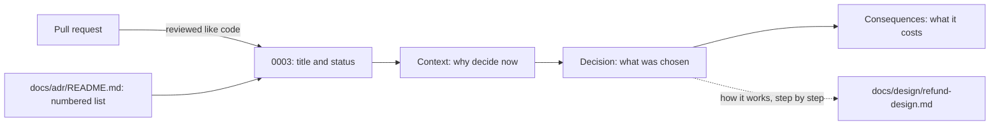

## Before you start

- [[management.l2.design-doc]] — you know a design doc says how the team plans to build something, names a rejected option, and is updated with the code when the plan changes.
- [[management.l2.docs-as-code]] — you know documents kept as plain files in the code's repository are changed and reviewed through pull requests.
- [[backend.l3.payments-service]] — you know that at stage-3 `DonHang.Payments` owns the `payments` table and the gateway's key, and talks to `DonHang.Api` over RabbitMQ.

## The situation

A developer joins the team in Sprint 16 and reads `DonHang.Payments`. In a code review they ask you why a refund now needs a second service, a second database and messages between them, when the stage-2 version did it in one transaction inside `DonHang.Api`. You remember there were reasons. They are spread across pull request descriptions, chat threads and a meeting with the team lead. `refund-design.md` explains how the refund flow works today, but it is edited whenever the plan changes. Where does a team keep a decision and its reasons, so that the answer to "why" can still be found, unchanged, long after the people who made it have moved on?

## Core concepts

- **architecture decision record** (ADR) — a short document about one decision: a title, a status, the context that called for it, the decision itself and its consequences.
- status — one line saying where the decision stands, such as accepted; Đơn Hàng writes it in Vietnamese, `Đã chấp nhận`.
- context — the needs and constraints that forced a decision at that moment, written so that someone outside the team can follow them.
- consequences — everything that changes because of the decision, what it costs as well as what it gains.

## How it works



Read the diagram from the left. Đơn Hàng keeps each architecture decision record as a numbered file in `docs/adr/`, and `docs/adr/README.md` lists them all with their status. The files sit beside the code, so a new record arrives in a pull request and is reviewed and versioned like the code it explains.

Inside one file, the parts come in a fixed order. The title states the decision in one short sentence. The status says where the decision stands, for example accepted. The context says what forced a decision then: for ADR `0003`, the refund requirements and a gateway key that every copy of `DonHang.Api` held. The decision names what was chosen and why the other choices lost. The consequences list what the team now pays, not only what it gains.

The dotted arrow is the line between two documents. ADR `0003` records the decision to make Payments a separate service and points to `refund-design.md` for how the refund flow works, instead of repeating the steps. The design doc describes how to build one thing and is edited whenever the plan changes; it is already at its second version. An accepted ADR keeps one decision's reasons as they were when it was made. When the decision itself changes, a new ADR records the new one, the subject of a later lesson.

Not every choice gets a file. An ADR is worth writing when a decision would be costly to reverse, or when people will later ask why it was made. A choice that is easy to undo, such as the name of a variable, needs no record.

## In the Đơn Hàng system

`docs/adr/0003-tach-payments-thanh-service.md` is the record of the decision from the situation. Its header and context:

```markdown file=docs/adr/0003-tach-payments-thanh-service.md tag=stage-3 lines=1-17
# 0003. Tách Payments thành service riêng, nối với API bằng saga

Trạng thái: Đã chấp nhận
Ngày: quyết định trước stage-3, viết lại thành ADR trong Sprint 16
Người quyết định: trưởng nhóm
Hạn góp ý: không có (viết sau khi đã làm)

ADR này viết sau khi đã làm, theo ADR 0001. Cách luồng hoàn tiền chạy từng
bước ở `docs/design/refund-design.md` (bản 2); ADR này chỉ ghi quyết định.

### Bối cảnh

Hoàn tiền phải đáp ứng `docs/team/refund-requirements.md`: nhận yêu cầu trong
2 giây kể cả khi cổng thanh toán lỗi (YC-7), không hoàn hai lần (YC-9), tự
gửi lại trong 24 giờ (YC-10). Khóa API của cổng và các dòng tiền là phần nhạy
cảm nhất của hệ thống. Ở thiết kế bản 1, mọi bản sao của `DonHang.Api` đều giữ
khóa đó và đọc ghi được bảng `payments`.
```

Line 1 is the title, the decision in one sentence: split Payments into its own service, linked to the API by a saga. Line 3 is the status, `Đã chấp nhận` (accepted). Lines 4–6 add when it was decided, who decided (the team lead) and the comment deadline (the date by which the team may comment on a proposed record), here none, because the record was written after the work was done. Lines 8–9 say so, as ADR `0001`, the decision to keep records in `docs/adr/`, allows for decisions made before it, and send the reader to `docs/design/refund-design.md`, version 2 (`bản 2`), for how the refund flow runs step by step; the ADR records only the decision.

Lines 11–17 are the context: requirements YC-7, YC-9 and YC-10, and the fact that in version 1 every copy of `DonHang.Api` held the gateway's key and could read and write `payments`.

The decision and its consequences, after the options in lines 19–28 that the next lesson reads:

```markdown file=docs/adr/0003-tach-payments-thanh-service.md tag=stage-3 lines=30-47
### Quyết định

Chọn service riêng nối bằng saga. Loại two-phase commit vì RabbitMQ và cổng
thanh toán không tham gia được một transaction như thế: API HTTP của cổng
không có bước chuẩn bị, RabbitMQ không tham gia transaction của PostgreSQL.
Loại phương án giữ trong API vì khóa của cổng và dòng tiền không nằm trong
một service của riêng chúng.

### Hệ quả

- Đơn và yêu cầu hoàn tiền chỉ khớp nhau sau một lúc: trong khoảng đó đơn ở
  `refunding` còn dòng bên Payments đang `pending`.
- Thêm một service phải chạy, với database, image và dashboard của nó.
- Mỗi bước phải lặp lại được an toàn, vì message có thể đến hai lần.
- Lỗi phải được bù bằng một bước ngược (đơn quay về `paid`), không rollback
  được.
- Bảng `payments` cũ còn lại trong `donhang` (nợ N2 trong
  `docs/team/tech-debt-register.md`, ADR 0008).
```

Lines 32–36 name the choice, a separate service linked by a saga, and say why two-phase commit and keeping refunds in the API lost. Lines 40–47 are the consequences, and every one is a cost: the order and the refund agree only after a while, one more service must run, each step must be safe to repeat because a message can arrive twice, a failure is undone by a reverse step rather than a rollback, and the old `payments` table stays in `donhang` as debt N2, with a pointer to ADR `0008`, the later decision to remove it.

`docs/adr/README.md` lists the ten records at stage-3, `0001` to `0010`, each with its title and status. Its opening lines give the reason they live in the repository: beside the code, an ADR is reviewed and versioned with the code it explains. Its last lines say that a design document describes how to do one thing, is edited as the plan changes, and is pointed to rather than copied.

## Seniors often assume…

- **"ADRs belong in a wiki, away from the code they explain."** → Actually a wiki page is not reviewed through pull requests the way code is, and it can be edited bit by bit until nobody knows what the decision first rested on. Đơn Hàng's own ADR `0001` weighed a shared wiki page and rejected it for those two reasons. In the repository, a record and the code it explains move together, at every tag. You notice the problem when the wiki describes a shape the code has left behind, and nobody can say which version of the code it matched.
- **"Every technical choice, down to a library setting, needs an ADR."** → Actually each record costs a writer and reviewers, and a list full of small choices hides the few that matter. The test is whether reversing the choice is costly, or whether people will later ask why it was made. A setting that one commit can change back belongs in the code or its design doc, if anywhere. You notice the overuse when `docs/adr/` grows faster than anyone reads it, and people stop opening it to find the big decisions.
- **"An ADR and a design doc are the same document under two names."** → Actually they answer different questions and live for different lengths of time. `refund-design.md` says how the refund flow works and was rewritten for version 2; ADR `0003` says why Payments became a service and stays as it was accepted. Merged into one document, each new version of the plan rewrites the reasons too. You notice this when someone asks why an earlier plan was dropped, and the only document describes just the current one.

## Try it (3 minutes)

Open `docs/adr/README.md` in the `don-hang` repository at tag `stage-3`.

1. Find the row for Payments and open the file it links to.
2. Find the line that sends you to another document, and the consequence that names a leftover table.

Expected result: row `0003`, status `Đã chấp nhận`. Lines 8–9 point to `docs/design/refund-design.md` (version 2) for how the refund flow runs. Lines 46–47 name the old `payments` table still in `donhang`, debt N2 in the team's debt register.

Three changes are planned for the next sprint. Which one deserves an ADR, and where do the other two go? (a) Rename a local variable in the Payments background job. (b) Replace RabbitMQ with a different message broker for every service that sends or receives messages. (c) Change the refund flow's first retry wait from 1 minute to 2.

<details><summary>Suggested answer</summary>

(b) deserves an ADR: every service that sends or receives messages depends on the broker, so going back would be costly, and someone will later ask why it was done. (a) needs no record; the pull request is enough. (c) is easy to undo but changes how the refund flow works, so it belongs in `refund-design.md`, edited in the same pull request as the code.

</details>

## Connections

- [[management.l2.design-doc]] — the companion document: an ADR points to a design doc for how, and keeps only the decision and why.
- [[management.l2.docs-as-code]] — the reason ADRs live in `docs/adr/`: reviewed through pull requests and versioned with the code they explain.
- [[backend.l3.payments-service]] — the decision ADR `0003` records, seen from the code.
- [[design.l3.when-to-extract-a-service]] — the reasoning behind splitting out a service, which ADR `0002` records for Notifications.
- [[management.l3.debt-as-a-portfolio]] — the debt register's numbered references point to ADRs, such as `0008`, which repays the old tables.
- [[management.l3.weighing-options-in-an-adr]] — the next step: the options section this lesson skipped.

## Five-line summary

1. An architecture decision record keeps one decision with its context and consequences, so the reasons can still be read later.
2. Each ADR has a title, a status, the context that called for it, the decision itself and its consequences.
3. Đơn Hàng keeps ADRs as numbered files in `docs/adr/`, listed in its `README.md`, reviewed and versioned with the code.
4. ADR `0003` records why Payments became a service and points to `refund-design.md` for how refunds work.
5. A design doc changes with the plan, an accepted ADR keeps its reasons, and an easy-to-undo choice needs no ADR.
