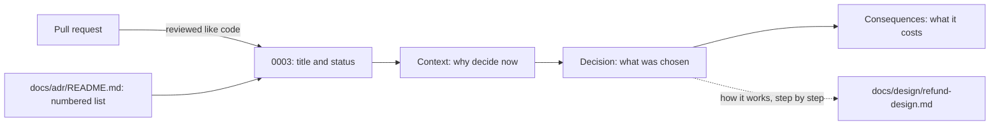

## Bạn cần biết trước

- [[management.l2.design-doc]] — bạn biết một design doc nói đội định xây một thứ như thế nào, nêu tên một phương án bị loại, và được sửa cùng code khi kế hoạch đổi.
- [[management.l2.docs-as-code]] — bạn biết tài liệu giữ dưới dạng file văn bản thường trong repository của code được sửa và review qua pull request.
- [[backend.l3.payments-service]] — bạn biết ở stage-3, `DonHang.Payments` sở hữu bảng `payments` và khóa của cổng thanh toán, và nói chuyện với `DonHang.Api` qua RabbitMQ.

## Tình huống

Một lập trình viên vào đội ở Sprint 16 và đọc `DonHang.Payments`. Trong một buổi code review, họ hỏi bạn vì sao giờ hoàn tiền cần thêm một service, thêm một database và các message qua lại giữa hai bên, trong khi bản stage-2 làm việc đó trong một giao dịch ngay trong `DonHang.Api`. Bạn nhớ là có lý do. Nhưng các lý do nằm rải rác trong mô tả pull request, các luồng chat và một buổi họp với trưởng nhóm. `refund-design.md` giải thích luồng hoàn tiền chạy thế nào hôm nay, nhưng file đó bị sửa mỗi khi kế hoạch đổi. Đội giữ một quyết định và lý do của nó ở đâu, để câu trả lời cho "vì sao" vẫn còn tìm được, nguyên như cũ, rất lâu sau khi những người đưa ra quyết định đã đi làm việc khác?

## Khái niệm cốt lõi

- **bản ghi quyết định kiến trúc** (architecture decision record, ADR) — một tài liệu ngắn về một quyết định: tiêu đề, trạng thái, bối cảnh dẫn tới nó, bản thân quyết định và các hệ quả.
- trạng thái — một dòng cho biết quyết định đang ở đâu, chẳng hạn đã được chấp nhận. Đơn Hàng viết dòng này bằng tiếng Việt, `Đã chấp nhận`.
- bối cảnh — những nhu cầu và ràng buộc buộc phải quyết định vào lúc đó, viết sao cho người ngoài đội cũng theo được.
- hệ quả — mọi thứ thay đổi vì quyết định, cả cái giá phải trả lẫn cái được.

## Cơ chế hoạt động



Đọc sơ đồ từ trái sang. Đơn Hàng giữ mỗi ADR thành một file đánh số trong `docs/adr/`, và `docs/adr/README.md` liệt kê tất cả cùng trạng thái của từng cái. Các file nằm cạnh code, nên một bản ghi mới đến bằng một pull request, được review và quản lý phiên bản giống như phần code nó giải thích.

Trong một file, các phần đi theo thứ tự cố định. Tiêu đề nêu quyết định trong một câu ngắn. Trạng thái cho biết quyết định đang ở đâu, ví dụ đã được chấp nhận. Bối cảnh nói điều gì buộc phải quyết định vào lúc đó: với ADR `0003`, đó là các yêu cầu về hoàn tiền và khóa của cổng thanh toán mà mọi bản sao của `DonHang.Api` đều giữ. Phần quyết định nêu cái được chọn và vì sao các lựa chọn khác bị loại. Phần hệ quả liệt kê những gì đội giờ phải trả, không chỉ những gì đội được.

Mũi tên chấm là ranh giới giữa hai tài liệu. ADR `0003` ghi quyết định tách Payments thành service riêng, và trỏ tới `refund-design.md` cho cách luồng hoàn tiền chạy, thay vì chép lại các bước. Design doc mô tả cách xây một thứ và bị sửa mỗi khi kế hoạch đổi. Nó đã sang bản thứ hai. Một ADR đã được chấp nhận giữ lý do của một quyết định đúng như lúc quyết định được đưa ra. Khi chính quyết định thay đổi, một ADR mới ghi quyết định mới, chuyện của một bài sau.

Không phải lựa chọn nào cũng cần một file. Một ADR đáng viết khi đảo ngược quyết định sẽ tốn kém, hoặc khi sau này người ta sẽ hỏi vì sao lại làm vậy. Một lựa chọn dễ hoàn tác, như tên một biến, không cần bản ghi.

## Trong hệ thống Đơn Hàng

`docs/adr/0003-tach-payments-thanh-service.md` là bản ghi của quyết định trong tình huống trên. Phần đầu và bối cảnh của nó:

```markdown file=docs/adr/0003-tach-payments-thanh-service.md tag=stage-3 lines=1-17
# 0003. Tách Payments thành service riêng, nối với API bằng saga

Trạng thái: Đã chấp nhận
Ngày: quyết định trước stage-3, viết lại thành ADR trong Sprint 16
Người quyết định: trưởng nhóm
Hạn góp ý: không có (viết sau khi đã làm)

ADR này viết sau khi đã làm, theo ADR 0001. Cách luồng hoàn tiền chạy từng
bước ở `docs/design/refund-design.md` (bản 2); ADR này chỉ ghi quyết định.

### Bối cảnh

Hoàn tiền phải đáp ứng `docs/team/refund-requirements.md`: nhận yêu cầu trong
2 giây kể cả khi cổng thanh toán lỗi (YC-7), không hoàn hai lần (YC-9), tự
gửi lại trong 24 giờ (YC-10). Khóa API của cổng và các dòng tiền là phần nhạy
cảm nhất của hệ thống. Ở thiết kế bản 1, mọi bản sao của `DonHang.Api` đều giữ
khóa đó và đọc ghi được bảng `payments`.
```

Dòng 1 là tiêu đề, quyết định gói trong một câu: tách Payments thành service riêng, nối với API bằng saga. Dòng 3 là trạng thái, `Đã chấp nhận`. Dòng 4–6 thêm thời điểm quyết định, ai quyết định (trưởng nhóm) và hạn góp ý (ngày cuối đội được góp ý cho một bản ghi đang đề xuất), ở đây là không có, vì bản ghi được viết sau khi việc đã làm xong. Dòng 8–9 nói rõ điều đó, vì ADR `0001`, quyết định giữ các bản ghi trong `docs/adr/`, cho phép ghi lại những quyết định có trước nó. Hai dòng này cũng gửi người đọc tới `docs/design/refund-design.md`, bản 2, để xem luồng hoàn tiền chạy từng bước ra sao. ADR chỉ ghi quyết định.

Dòng 11–17 là bối cảnh: các yêu cầu YC-7, YC-9 và YC-10, cùng sự thật là ở bản 1, mọi bản sao của `DonHang.Api` đều giữ khóa của cổng thanh toán và đọc ghi được `payments`.

Quyết định và các hệ quả, nằm sau phần phương án ở dòng 19–28 mà bài tiếp theo sẽ đọc:

```markdown file=docs/adr/0003-tach-payments-thanh-service.md tag=stage-3 lines=30-47
### Quyết định

Chọn service riêng nối bằng saga. Loại two-phase commit vì RabbitMQ và cổng
thanh toán không tham gia được một transaction như thế: API HTTP của cổng
không có bước chuẩn bị, RabbitMQ không tham gia transaction của PostgreSQL.
Loại phương án giữ trong API vì khóa của cổng và dòng tiền không nằm trong
một service của riêng chúng.

### Hệ quả

- Đơn và yêu cầu hoàn tiền chỉ khớp nhau sau một lúc: trong khoảng đó đơn ở
  `refunding` còn dòng bên Payments đang `pending`.
- Thêm một service phải chạy, với database, image và dashboard của nó.
- Mỗi bước phải lặp lại được an toàn, vì message có thể đến hai lần.
- Lỗi phải được bù bằng một bước ngược (đơn quay về `paid`), không rollback
  được.
- Bảng `payments` cũ còn lại trong `donhang` (nợ N2 trong
  `docs/team/tech-debt-register.md`, ADR 0008).
```

Dòng 32–36 nêu lựa chọn, một service riêng nối bằng saga, và nói vì sao two-phase commit và phương án giữ hoàn tiền trong API bị loại. Dòng 40–47 là các hệ quả, và cái nào cũng là một cái giá: đơn và yêu cầu hoàn tiền chỉ khớp nhau sau một lúc, phải chạy thêm một service, mỗi bước phải lặp lại được an toàn vì một message có thể đến hai lần, lỗi được bù bằng một bước ngược thay vì rollback, và bảng `payments` cũ còn lại trong `donhang` thành món nợ N2, kèm chỗ trỏ tới ADR `0008`, quyết định sau này xóa bảng đó.

`docs/adr/README.md` liệt kê mười bản ghi ở stage-3, từ `0001` tới `0010`, mỗi cái kèm tiêu đề và trạng thái. Mấy dòng mở đầu của nó nêu lý do các bản ghi nằm trong repository: đặt cạnh code, một ADR được review và quản lý phiên bản cùng phần code nó giải thích. Mấy dòng cuối nói rằng một design doc mô tả cách làm một thứ, bị sửa khi kế hoạch đổi, và được trỏ tới chứ không chép lại.

## Senior hay nhầm rằng…

- **"ADR nên nằm trên wiki, tách khỏi code mà nó giải thích."** → Thực ra một trang wiki không được review qua pull request như code, và có thể bị sửa dần từng chút cho tới khi không ai còn biết quyết định ban đầu dựa trên điều gì. Chính ADR `0001` của Đơn Hàng đã cân nhắc một trang wiki chung và loại nó vì hai lý do đó. Trong repository, bản ghi và phần code nó giải thích đi cùng nhau, ở mọi tag. Bạn sẽ nhận ra vấn đề khi wiki mô tả một hình dạng mà code đã bỏ lại từ lâu, và không ai nói được nó từng khớp với phiên bản code nào.
- **"Mọi lựa chọn kỹ thuật, tới cả một thiết lập của thư viện, đều cần một ADR."** → Thực ra mỗi bản ghi tốn một người viết và vài người review, và một danh sách đầy những lựa chọn nhỏ sẽ che mất vài cái thật sự quan trọng. Phép thử là đảo ngược lựa chọn đó có tốn kém không, hoặc sau này người ta có hỏi vì sao lại làm vậy không. Một thiết lập mà một commit đổi lại được thì thuộc về code hoặc design doc của nó, nếu cần ghi ở đâu đó. Bạn sẽ nhận ra mình lạm dụng khi `docs/adr/` dài ra nhanh hơn tốc độ có người đọc, và mọi người thôi mở nó để tìm các quyết định lớn.
- **"ADR và design doc là một tài liệu mang hai tên."** → Thực ra chúng trả lời hai câu hỏi khác nhau và sống lâu ngắn khác nhau. `refund-design.md` nói luồng hoàn tiền chạy thế nào và đã được viết lại cho bản 2. ADR `0003` nói vì sao Payments thành một service và giữ nguyên như lúc được chấp nhận. Gộp làm một thì mỗi bản kế hoạch mới cũng viết lại luôn các lý do. Bạn sẽ nhận ra khi có người hỏi vì sao một kế hoạch trước bị bỏ, mà tài liệu duy nhất chỉ mô tả kế hoạch hiện tại.

## Thử ngay (3 phút)

Mở `docs/adr/README.md` trong repository `don-hang` ở tag `stage-3`.

1. Tìm dòng của Payments và mở file mà dòng đó trỏ tới.
2. Tìm dòng gửi bạn sang một tài liệu khác, và hệ quả nêu tên một bảng còn sót lại.

Kết quả mong đợi: dòng `0003`, trạng thái `Đã chấp nhận`. Dòng 8–9 trỏ tới `docs/design/refund-design.md` (bản 2) cho cách luồng hoàn tiền chạy. Dòng 46–47 nêu tên bảng `payments` cũ vẫn còn trong `donhang`, món nợ N2 trong sổ nợ của đội.

Sprint tới có ba thay đổi được lên kế hoạch. Thay đổi nào đáng một ADR, và hai cái còn lại nên ghi ở đâu? (a) Đổi tên một biến cục bộ trong background job của Payments. (b) Thay RabbitMQ bằng một message broker khác cho mọi service gửi hoặc nhận message. (c) Đổi thời gian chờ trước lần thử lại đầu tiên của luồng hoàn tiền từ 1 phút thành 2 phút.

<details><summary>Gợi ý đáp án</summary>

(b) đáng một ADR: mọi service gửi hoặc nhận message đều phụ thuộc vào broker, nên quay lại sẽ tốn kém, và sau này sẽ có người hỏi vì sao lại làm vậy. (a) không cần bản ghi nào, pull request là đủ. (c) dễ hoàn tác nhưng thay đổi cách luồng hoàn tiền chạy, nên nó thuộc về `refund-design.md`, được sửa trong cùng pull request với code.

</details>

## Liên hệ

- [[management.l2.design-doc]] — tài liệu đi kèm: ADR trỏ tới design doc cho phần "làm thế nào", và chỉ giữ quyết định cùng lý do.
- [[management.l2.docs-as-code]] — lý do ADR nằm trong `docs/adr/`: được review qua pull request và quản lý phiên bản cùng phần code nó giải thích.
- [[backend.l3.payments-service]] — quyết định mà ADR `0003` ghi lại, nhìn từ phía code.
- [[design.l3.when-to-extract-a-service]] — lập luận đằng sau việc tách một service ra, điều mà ADR `0002` ghi lại cho Notifications.
- [[management.l3.debt-as-a-portfolio]] — các số tham chiếu trong sổ nợ trỏ tới ADR, như `0008`, bản ghi trả nợ các bảng cũ.
- [[management.l3.weighing-options-in-an-adr]] — bước tiếp theo: phần phương án mà bài này đã bỏ qua.

## Tóm tắt 5 dòng

1. Bản ghi quyết định kiến trúc giữ một quyết định cùng bối cảnh và hệ quả của nó, để sau này vẫn đọc được lý do.
2. Mỗi ADR có tiêu đề, trạng thái, bối cảnh dẫn tới nó, bản thân quyết định và các hệ quả.
3. Đơn Hàng giữ ADR thành các file đánh số trong `docs/adr/`, liệt kê trong `README.md`, được review và quản lý phiên bản cùng code.
4. ADR `0003` ghi vì sao Payments thành một service, và trỏ tới `refund-design.md` cho cách hoàn tiền chạy.
5. Design doc đổi theo kế hoạch, ADR đã chấp nhận giữ nguyên lý do, còn lựa chọn dễ hoàn tác thì không cần ADR.
