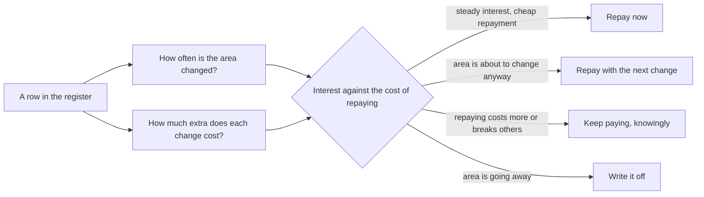

## Before you start

- [[management.l3.where-debt-comes-from]] — you know the register's rows N1–N4 and T1–T2, and that how a debt arrived says what to check next, not how much it costs.
- [[k8s.l2.config-repo-overlays]] — you know the config repository moved to a base and overlays in one commit, checked by Argo CD's list of differences.
- [[management.l2.schedule-buffer]] — you know that padding hidden in each task tends to be used by that task, while one visible line can be watched.

## The situation

It is sprint planning at stage-3, and the team has room for a few days of debt work beside the features. You open `docs/team/tech-debt-register.md`: four debts are still carried, N1 to N4. One teammate wants the days for the ugliest code they know of. Another wants to stop features for a sprint and rewrite that module from scratch. A third suggests adding a day to each feature estimate and repaying quietly, so nobody has to argue about it.

With room for only part of it, how do you choose what to repay first?

## Core concepts

- estimated interest — how often the team changes an area, combined with how much extra each change costs because of the debt; it is judged, not counted.
- **hotspot (code)** — a file changed in more commits than most in the repository's history, where any debt in it charges interest most often.
- the four decisions — each register row is repaid now, repaid with the next change to that area, kept knowingly with its interest still paid, or written off because the area is going away.
- a small verified step — one repayment change shipped beside feature work, with a check that shows exactly what it changed.
- visible repayment time — time for debt shown in the plan as a story of its own or a stated share of each sprint.

## How it works



Start from a row in the register, not from the code you dislike most. Its interest has two factors. The first is how often the team changes the area: debt in a file nobody opens charges almost nothing. The second is how much extra each change costs because of the debt, which the register already states in the team's own words, in the column `Lãi mỗi lần sửa` (interest per change).

In the situation above, the first factor has a rough measure: a hotspot. `change-hotspots.sh` counts the commits that changed each C# and Dart file under the `DonHang.*` projects, leaving out migrations. A commit count says nothing about the size of each change, so it points to where to look rather than measuring interest.

Weigh the two factors against what repaying would take, and every row gets one of four decisions. That is what makes the register a portfolio rather than a to-do list: each item is held for a stated reason, and the reasons are compared side by side.

Repay now when the interest is steady and the repayment is cheap. Repay with the next change when that change will touch the same lines anyway. Keep paying knowingly when repaying costs more than the interest or breaks someone else, and write down when to look again. Write it off when the area is going away: reshaping code you are about to delete buys nothing.

Whichever decision a row gets, the repayment goes in small steps beside feature work, each one checked, and its time sits in the plan where everyone can see it.

## In the Đơn Hàng system

The hotspot script:

```bash file=scripts/management/change-hotspots.sh tag=stage-3 lines=9-30
# A shallow clone (CI checks out one commit) would count almost nothing.
if [ "$(git rev-parse --is-shallow-repository)" = "true" ]; then
  echo "This clone has only part of the history: run git fetch --unshallow first." >&2
  exit 1
fi

# lesson: management.l3.debt-as-a-portfolio
# git log lists, for every commit, the files it changed; counting how often
# each file appears gives the number of commits that changed it. Migrations
# are left out: EF Core rewrites its model snapshot in every one of them, so
# that file would top the list without anyone choosing to change it.
echo "\$ git log --format= --name-only -- 'DonHang.*/**/*.cs' 'DonHang.*/**/*.dart' (without Migrations/)"
echo "commits  file"
git log --format= --name-only -- \
    ':(glob)DonHang.*/**/*.cs' ':(glob)DonHang.*/**/*.dart' ':(exclude,glob)**/Migrations/**' \
  | grep -v '^$' | sort | uniq -c | sort -k1,1nr -k2,2 | head -n "$top" \
  | awk '{ printf "%7d  %s\n", $1, $2 }'

echo
echo "Files counted: $(git log --format= --name-only -- \
    ':(glob)DonHang.*/**/*.cs' ':(glob)DonHang.*/**/*.dart' ':(exclude,glob)**/Migrations/**' \
  | grep -v '^$' | sort -u | wc -l | tr -d ' ')"
```

```text output=true
$ git log --format= --name-only -- 'DonHang.*/**/*.cs' 'DonHang.*/**/*.dart' (without Migrations/)
commits  file
     12  DonHang.Api/Program.cs
     11  DonHang.Api/Controllers/OrdersController.cs
     11  DonHang.Infrastructure/DonHangDbContext.cs
     10  DonHang.Domain/Entities.cs
      9  DonHang.Domain/OrderService.cs
      9  DonHang.Infrastructure/ServiceCollectionExtensions.cs
      8  DonHang.Api/Dtos.cs
      8  DonHang.Tests/Services/OrderServiceTests.cs
      5  DonHang.Api/Controllers/ProductsController.cs
      5  DonHang.Api/Controllers/V2/OrdersV2Controller.cs
      5  DonHang.Tests/FakeOrderRepository.cs
      4  DonHang.App/lib/screens/product_list_screen.dart
      4  DonHang.Infrastructure/EfOrderRepository.cs
      4  DonHang.Tests/Domain/OrderTests.cs
      3  DonHang.Api/Middleware/ExceptionHandlingMiddleware.cs

Files counted: 169
```

The `git log … | uniq -c` pipeline is the whole measurement: list the files each commit changed, count how often each file appears, sort, and keep the first 15 (`$top`, set above the excerpt). Migrations are left out, as the comment says, because one file there is rewritten on every migration, so its count reflects no one's choice. The check before it stops on a shallow clone, a copy holding only the latest commits rather than the whole history. One caveat: most commits in this example repository were made to build the course step by step, so the ranking shows how the example grew, not where a team struggled.

N3 lives in `Dtos.cs` and `OrdersController.cs`, changed in 8 and 11 commits. N4's files sit low: `api_client.dart` has 3 commits, as many as the 15th line, and misses the cut only because ties are sorted by name; `keycloak_sign_in.dart` has 1. N1's table is not a file, so it never appears; the file the register lists beside it, `PostgresFixture.cs`, is counted but changed in only 2 commits, and the migrations that pay N1's interest are left out on purpose. For debt in data or configuration the team judges how often it is paid.

The register:

```markdown file=docs/team/tech-debt-register.md tag=stage-3 lines=14-38
### Nợ đang mang

| Số | Món nợ | Ở đâu | Từ đâu ra | Lãi mỗi lần sửa | Trả bằng cách nào | Quyết định | Người theo dõi |
|---|---|---|---|---|---|---|---|
| N1 | Bảng `notifications` cũ còn trong database `donhang` | `donhang`, `PostgresFixture` | Phát hiện sau: còn lại khi Notifications có database riêng (ADR 0002) | Người đọc schema tưởng API còn gửi email; mỗi migration của `donhang` lại phải hỏi bảng này còn dùng không | Dump rồi xóa bằng một migration (ADR 0008), khoảng 1 ngày | Trả ngay | Lập trình viên backend |
| N2 | Bảng `payments` cũ còn trong database `donhang` | `donhang`, `PostgresFixture` | Phát hiện sau: còn lại khi Payments có database riêng (ADR 0003) | Người đọc tưởng API còn giữ dòng tiền; kế toán hỏi nên đối soát với bảng nào | Như N1, sau khi kế toán xác nhận (ADR 0008), khoảng 1 ngày | Trả ngay, sau N1 | Lập trình viên backend |
| N3 | `POST /api/v1/orders` vẫn nhận `unitPriceVnd` của từng dòng nhưng bỏ qua, giá lấy từ Catalog | `DonHang.Api/Dtos.cs`, `OrdersController.cs` | Có chủ ý: giữ để client cũ không hỏng | Người đọc API tưởng mình đặt được giá; mỗi lần sửa DTO phải nhớ field này không làm gì | Bỏ field ở một phiên bản API mới, sau khi client cũ ngừng gửi nó | Chấp nhận: còn client cũ dùng `/api/v1`, bỏ field là thay đổi phá vỡ; xem lại khi `/api/v1` có ngày ngừng | Lập trình viên backend |
| N4 | App ghi cứng `localhost` cho địa chỉ API và Keycloak | `DonHang.App/lib/api_client.dart`, `lib/auth/keycloak_sign_in.dart` | Có chủ ý: app chỉ chạy trên máy dev | Chạy app ở bất kỳ địa chỉ nào khác phải sửa code và build lại; app chưa đưa được lên cluster | Đọc địa chỉ từ cấu hình lúc build, khoảng 2–3 ngày | Trả cùng lần sửa tới: khi app được đưa lên cluster | Lập trình viên frontend |

### Nợ đã trả

| Số | Món nợ | Từ đâu ra | Trả bằng gì |
|---|---|---|---|
| T1 | Repo cấu hình chép đầy đủ manifest cho mỗi môi trường (`envs/staging`, `envs/production`), nên thay đổi chung phải sửa hai lần | Có chủ ý (ADR 0005) | Chuyển sang overlay Kustomize (ADR 0007) trong một commit, `scripts/k8s/kustomize-config-repo.sh`; kiểm bằng chỗ khác Argo CD báo: chỉ ConfigMap và Deployment của api |
| T2 | `QueuedNotifier` lưu job email cùng transaction với đơn qua chung một DbContext; hợp với một process, thành việc phải gỡ khi Notifications ra service riêng | Phát hiện sau | Outbox: API ghi message vào `outbox_messages` cùng transaction, relay gửi lên RabbitMQ, Notifications nhận qua inbox; `QueuedNotifier` và `INotifier` bị xóa |

### Cách đội dùng sổ này

- Sổ được xem lại cùng nhịp với sổ rủi ro, ở mỗi sprint planning: thêm món mới,
  xem lại quyết định của từng món.
- Món nào nằm trong file đội sửa thường xuyên thì lãi trả thường xuyên nhất:
  `scripts/management/change-hotspots.sh` đếm số commit đã sửa từng file.
- Thời gian trả nợ hiện trong kế hoạch, thành story riêng hoặc một phần sprint
  nói rõ, không giấu vào ước lượng của việc khác.
- Món đã trả chuyển sang bảng "Nợ đã trả", kèm việc trả đã tốn những gì.
```

The numbered references in brackets point to the team's written decision records; you need neither them nor row T2 here.

The column `Quyết định` (decision) takes one of four values, which the file lists just above this table: repay now, repay with the next change to that area, accept (keep paying, knowing why), and write off (the area is going away). N1 is `Trả ngay` (repay now): one migration, about a day, ends a question each `donhang` migration asks. N4 waits for the next change, the move of the app to the cluster.

N3 is the instructive row. It sits in two hotspot files and its interest is paid on every DTO change, yet it is `Chấp nhận` (accepted): removing the field would break clients still on `/api/v1`, and the row says when to look again. Frequency raises a debt's priority; it does not decide alone.

Row T1 shows a repayment as a small verified step: one commit moved the config repository to Kustomize overlays, checked by what Argo CD reported as different, only the api's ConfigMap and Deployment. The third bullet under `Cách đội dùng sổ này` puts repayment time in the plan, as its own story or a stated share of a sprint, never inside another estimate.

## Seniors often assume…

- **"The debt to repay first is the ugliest code, wherever it is."** → Actually ugliness is the extra cost of one change, and interest also needs frequency. Ugly code in a file nobody changes charges almost nothing, while a small oddity like N3's ignored field is paid on every DTO change. You notice this when a sprint goes into polishing one file and the next sprint's changes feel just as slow, because they landed somewhere else.
- **"The way out of heavy debt is to stop features and rewrite the module."** → Actually a rewrite holds back delivery for its whole length and ships nothing that can be checked in use until it ends. Small steps beside feature work keep the system shippable, and each step can be checked, as T1 was. A rewrite can be right when the area's shape no longer fits at all and no sequence of small steps reaches the new one; then it is a decision with its own visible time. You notice the problem when a rewrite's end date keeps moving while features wait.
- **"Debt work is best hidden inside feature estimates so nobody argues about it."** → Actually hidden time tends to be used by the feature it sits in, as hidden padding is, and nobody can see whether the debt was repaid. Shown in the plan, it can be weighed against features and checked at the review. You notice this when estimates keep growing, the register's rows never change, and nobody can say where the extra days went.

## Try it (3 minutes)

In the `don-hang` repository, check out tag `stage-3` with its full history.

1. Run `scripts/management/change-hotspots.sh`.
2. Look for the files the register lists under `Ở đâu` (where) for N3 and N4.

Expected result: `DonHang.Api/Dtos.cs` (8 commits) and `DonHang.Api/Controllers/OrdersController.cs` (11 commits) appear; neither `api_client.dart` nor `keycloak_sign_in.dart` does, though `api_client.dart` ties the 15th line at 3 commits.

A teammate proposes repaying N4 in the coming sprint: two to three days, and the app's code is easy to change. Using the output and the register, which decision would you argue for?

<details><summary>Suggested answer</summary>

Keep N4's decision: repay it with the next change to that area. Its files sit low in the count (`api_client.dart` 3 commits, `keycloak_sign_in.dart` 1), and its interest is paid only when someone needs the app at another address. The change that moves the app to the cluster has to deal with those addresses anyway, so the repayment can ride on that work. The days are better spent on N1, paid on every `donhang` migration and repaid in about a day.

</details>

## Connections

- [[management.l3.where-debt-comes-from]] — prerequisite: origins tell you what to check; this lesson decides which debt to repay and when.
- [[k8s.l2.config-repo-overlays]] — the T1 repayment in full, the small verified step this lesson points to.
- [[management.l2.schedule-buffer]] — the same reason hidden padding fails, applied to time for repaying debt.
- [[foundation.l1.code-smells-basic]] — a smell is the cost of one change; this lesson adds how often that cost is paid.
- [[management.l2.scope-change]] — the same trade made openly: a stated share for debt means less room for features, and the plan shows it.

## Five-line summary

1. Repay first the debt whose estimated interest is highest: how often its area changes, combined with the extra each change costs.
2. `change-hotspots.sh` counts the commits that changed each source file; debt in a hotspot charges interest most often.
3. Each register row gets a decision: repay now, repay with the next change, keep paying knowingly, or write off.
4. Repay in small verified steps beside features, as T1 was: one commit, checked by Argo CD.
5. Repayment time shows in the plan as its own story or a stated share of each sprint, not hidden in estimates.
