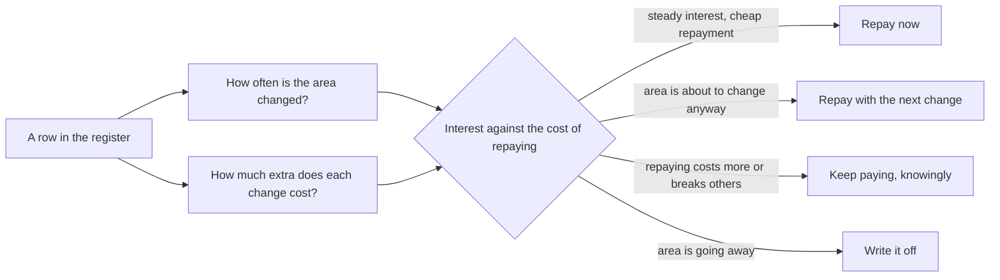

## Bạn cần biết trước

- [[management.l3.where-debt-comes-from]] — bạn biết các dòng N1–N4 và T1–T2 trong sổ, và biết rằng nợ đến bằng đường nào cho biết cần kiểm tra gì tiếp, chứ không cho biết nó tốn bao nhiêu.
- [[k8s.l2.config-repo-overlays]] — bạn biết repo cấu hình đã chuyển sang một base và các overlay trong một commit, được kiểm bằng danh sách chỗ khác mà Argo CD báo.
- [[management.l2.schedule-buffer]] — bạn biết phần dự phòng giấu trong từng task thường bị chính task đó tiêu hết, còn một dòng hiện rõ thì theo dõi được.

## Tình huống

Đang là buổi sprint planning ở stage-3, và đội còn chỗ cho vài ngày trả nợ bên cạnh các feature. Bạn mở `docs/team/tech-debt-register.md`: bốn món nợ vẫn đang mang, từ N1 đến N4. Một đồng đội muốn dành mấy ngày đó cho đoạn code xấu nhất họ biết. Người khác muốn dừng feature một sprint để viết lại module đó từ đầu. Người thứ ba đề nghị cộng thêm một ngày vào ước lượng của mỗi feature rồi lặng lẽ trả nợ, khỏi ai phải tranh cãi.

Khi chỉ đủ chỗ cho một phần, bạn chọn trả món nào trước?

## Khái niệm cốt lõi

- tiền lãi ước tính — đội sửa một vùng thường xuyên đến đâu, gộp với mỗi lần sửa tốn thêm bao nhiêu vì món nợ. Con số này do đội phán đoán, không đếm ra được.
- **hotspot (code)** (file được sửa nhiều lần nhất trong lịch sử repo, nơi nợ kỹ thuật đòi lãi thường xuyên nhất) — file được sửa trong nhiều commit hơn hầu hết các file khác trong lịch sử repo. Món nợ nào nằm ở đó cũng đòi lãi thường xuyên nhất.
- bốn quyết định — mỗi dòng trong sổ được trả ngay, trả cùng lần sửa tới vùng đó, giữ lại có chủ ý và tiếp tục trả lãi, hoặc xóa sổ vì vùng đó sắp bỏ.
- một bước nhỏ có kiểm chứng — một thay đổi trả nợ được giao cùng việc làm feature, kèm một phép kiểm cho thấy chính xác nó đã đổi gì.
- thời gian trả nợ hiện rõ — thời gian dành cho nợ được ghi trong kế hoạch, thành một story riêng hoặc một phần sprint nói rõ.

## Cơ chế hoạt động



Bắt đầu từ một dòng trong sổ, đừng bắt đầu từ đoạn code bạn ghét nhất. Tiền lãi của nó có hai thừa số. Thứ nhất là đội sửa vùng đó thường xuyên đến đâu: nợ trong một file không ai mở thì gần như không đòi gì. Thứ hai là mỗi lần sửa tốn thêm bao nhiêu vì món nợ. Sổ đã ghi điều này bằng lời của đội, trong cột `Lãi mỗi lần sửa`.

Trong tình huống trên, thừa số thứ nhất có một thước đo thô: hotspot. `change-hotspots.sh` đếm số commit đã sửa từng file C# và Dart trong các project `DonHang.*`, bỏ qua migration. Số commit không nói gì về độ lớn của mỗi lần sửa, nên nó chỉ ra chỗ cần nhìn chứ không đo được tiền lãi.

Đem hai thừa số cân với công trả nợ, và mỗi dòng nhận một trong bốn quyết định. Đó là điều khiến sổ thành một danh mục chứ không phải một danh sách việc cần làm: mỗi món được giữ vì một lý do nói rõ, và các lý do được đặt cạnh nhau để so.

Trả ngay khi tiền lãi đều đặn và trả nợ rẻ. Trả cùng lần sửa tới khi lần sửa đó đằng nào cũng chạm vào đúng những dòng code ấy. Tiếp tục trả lãi có chủ ý khi trả nợ tốn hơn tiền lãi hoặc làm hỏng phía người khác, và ghi lại khi nào xem lại. Xóa sổ khi vùng đó sắp bỏ: sửa lại hình dạng của code sắp xóa thì chẳng được gì.

Dù một dòng nhận quyết định nào, việc trả nợ đi theo từng bước nhỏ bên cạnh việc làm feature, bước nào cũng được kiểm, và thời gian của nó nằm trong kế hoạch, ai cũng thấy.

## Trong hệ thống Đơn Hàng

Script tìm hotspot:

```bash file=scripts/management/change-hotspots.sh tag=stage-3 lines=9-30
# A shallow clone (CI checks out one commit) would count almost nothing.
if [ "$(git rev-parse --is-shallow-repository)" = "true" ]; then
  echo "This clone has only part of the history: run git fetch --unshallow first." >&2
  exit 1
fi

# lesson: management.l3.debt-as-a-portfolio
# git log lists, for every commit, the files it changed; counting how often
# each file appears gives the number of commits that changed it. Migrations
# are left out: EF Core rewrites its model snapshot in every one of them, so
# that file would top the list without anyone choosing to change it.
echo "\$ git log --format= --name-only -- 'DonHang.*/**/*.cs' 'DonHang.*/**/*.dart' (without Migrations/)"
echo "commits  file"
git log --format= --name-only -- \
    ':(glob)DonHang.*/**/*.cs' ':(glob)DonHang.*/**/*.dart' ':(exclude,glob)**/Migrations/**' \
  | grep -v '^$' | sort | uniq -c | sort -k1,1nr -k2,2 | head -n "$top" \
  | awk '{ printf "%7d  %s\n", $1, $2 }'

echo
echo "Files counted: $(git log --format= --name-only -- \
    ':(glob)DonHang.*/**/*.cs' ':(glob)DonHang.*/**/*.dart' ':(exclude,glob)**/Migrations/**' \
  | grep -v '^$' | sort -u | wc -l | tr -d ' ')"
```

```text output=true
$ git log --format= --name-only -- 'DonHang.*/**/*.cs' 'DonHang.*/**/*.dart' (without Migrations/)
commits  file
     12  DonHang.Api/Program.cs
     11  DonHang.Api/Controllers/OrdersController.cs
     11  DonHang.Infrastructure/DonHangDbContext.cs
     10  DonHang.Domain/Entities.cs
      9  DonHang.Domain/OrderService.cs
      9  DonHang.Infrastructure/ServiceCollectionExtensions.cs
      8  DonHang.Api/Dtos.cs
      8  DonHang.Tests/Services/OrderServiceTests.cs
      5  DonHang.Api/Controllers/ProductsController.cs
      5  DonHang.Api/Controllers/V2/OrdersV2Controller.cs
      5  DonHang.Tests/FakeOrderRepository.cs
      4  DonHang.App/lib/screens/product_list_screen.dart
      4  DonHang.Infrastructure/EfOrderRepository.cs
      4  DonHang.Tests/Domain/OrderTests.cs
      3  DonHang.Api/Middleware/ExceptionHandlingMiddleware.cs

Files counted: 169
```

Chuỗi lệnh `git log … | uniq -c` là toàn bộ phép đo: liệt kê các file mỗi commit đã sửa, đếm mỗi file xuất hiện bao nhiêu lần, sắp xếp, rồi giữ 15 dòng đầu (`$top`, đặt ở phía trên đoạn trích). Migration bị bỏ qua, như comment đã nói, vì một file trong đó được viết lại ở mỗi migration, nên số đếm của nó không phản ánh lựa chọn của ai. Phần kiểm tra phía trước dừng lại nếu gặp shallow clone, tức bản sao chỉ giữ vài commit mới nhất chứ không có toàn bộ lịch sử. Một điều cần lưu ý: phần lớn commit trong repo ví dụ này được tạo ra để dựng khóa học từng bước, nên thứ hạng cho thấy ví dụ đã lớn lên thế nào, chứ không cho thấy đội từng vật lộn ở đâu.

N3 nằm trong `Dtos.cs` và `OrdersController.cs`, được sửa trong 8 và 11 commit. Các file của N4 nằm thấp: `api_client.dart` có 3 commit, bằng dòng thứ 15, và chỉ lọt khỏi danh sách vì các dòng bằng điểm được xếp theo tên. `keycloak_sign_in.dart` có 1 commit. Bảng của N1 không phải là file nên không bao giờ xuất hiện. File mà sổ ghi bên cạnh nó, `PostgresFixture.cs`, có được đếm nhưng chỉ được sửa trong 2 commit, còn các migration trả lãi cho N1 thì cố ý bị bỏ qua. Với nợ nằm trong dữ liệu hay cấu hình, đội tự phán đoán lãi được trả thường xuyên đến đâu.

Sổ nợ:

```markdown file=docs/team/tech-debt-register.md tag=stage-3 lines=14-38
### Nợ đang mang

| Số | Món nợ | Ở đâu | Từ đâu ra | Lãi mỗi lần sửa | Trả bằng cách nào | Quyết định | Người theo dõi |
|---|---|---|---|---|---|---|---|
| N1 | Bảng `notifications` cũ còn trong database `donhang` | `donhang`, `PostgresFixture` | Phát hiện sau: còn lại khi Notifications có database riêng (ADR 0002) | Người đọc schema tưởng API còn gửi email; mỗi migration của `donhang` lại phải hỏi bảng này còn dùng không | Dump rồi xóa bằng một migration (ADR 0008), khoảng 1 ngày | Trả ngay | Lập trình viên backend |
| N2 | Bảng `payments` cũ còn trong database `donhang` | `donhang`, `PostgresFixture` | Phát hiện sau: còn lại khi Payments có database riêng (ADR 0003) | Người đọc tưởng API còn giữ dòng tiền; kế toán hỏi nên đối soát với bảng nào | Như N1, sau khi kế toán xác nhận (ADR 0008), khoảng 1 ngày | Trả ngay, sau N1 | Lập trình viên backend |
| N3 | `POST /api/v1/orders` vẫn nhận `unitPriceVnd` của từng dòng nhưng bỏ qua, giá lấy từ Catalog | `DonHang.Api/Dtos.cs`, `OrdersController.cs` | Có chủ ý: giữ để client cũ không hỏng | Người đọc API tưởng mình đặt được giá; mỗi lần sửa DTO phải nhớ field này không làm gì | Bỏ field ở một phiên bản API mới, sau khi client cũ ngừng gửi nó | Chấp nhận: còn client cũ dùng `/api/v1`, bỏ field là thay đổi phá vỡ; xem lại khi `/api/v1` có ngày ngừng | Lập trình viên backend |
| N4 | App ghi cứng `localhost` cho địa chỉ API và Keycloak | `DonHang.App/lib/api_client.dart`, `lib/auth/keycloak_sign_in.dart` | Có chủ ý: app chỉ chạy trên máy dev | Chạy app ở bất kỳ địa chỉ nào khác phải sửa code và build lại; app chưa đưa được lên cluster | Đọc địa chỉ từ cấu hình lúc build, khoảng 2–3 ngày | Trả cùng lần sửa tới: khi app được đưa lên cluster | Lập trình viên frontend |

### Nợ đã trả

| Số | Món nợ | Từ đâu ra | Trả bằng gì |
|---|---|---|---|
| T1 | Repo cấu hình chép đầy đủ manifest cho mỗi môi trường (`envs/staging`, `envs/production`), nên thay đổi chung phải sửa hai lần | Có chủ ý (ADR 0005) | Chuyển sang overlay Kustomize (ADR 0007) trong một commit, `scripts/k8s/kustomize-config-repo.sh`; kiểm bằng chỗ khác Argo CD báo: chỉ ConfigMap và Deployment của api |
| T2 | `QueuedNotifier` lưu job email cùng transaction với đơn qua chung một DbContext; hợp với một process, thành việc phải gỡ khi Notifications ra service riêng | Phát hiện sau | Outbox: API ghi message vào `outbox_messages` cùng transaction, relay gửi lên RabbitMQ, Notifications nhận qua inbox; `QueuedNotifier` và `INotifier` bị xóa |

### Cách đội dùng sổ này

- Sổ được xem lại cùng nhịp với sổ rủi ro, ở mỗi sprint planning: thêm món mới,
  xem lại quyết định của từng món.
- Món nào nằm trong file đội sửa thường xuyên thì lãi trả thường xuyên nhất:
  `scripts/management/change-hotspots.sh` đếm số commit đã sửa từng file.
- Thời gian trả nợ hiện trong kế hoạch, thành story riêng hoặc một phần sprint
  nói rõ, không giấu vào ước lượng của việc khác.
- Món đã trả chuyển sang bảng "Nợ đã trả", kèm việc trả đã tốn những gì.
```

Những số đánh trong ngoặc trỏ tới các bản ghi quyết định đội đã viết ra. Ở đây bạn không cần đến chúng, cũng không cần dòng T2.

Cột `Quyết định` nhận một trong bốn giá trị, được file liệt kê ngay phía trên bảng này: trả ngay, trả cùng lần sửa tới vùng đó, chấp nhận (tiếp tục trả lãi, biết rõ vì sao), và xóa sổ (vùng đó sắp bỏ). N1 là `Trả ngay`: một migration, khoảng một ngày, chấm dứt câu hỏi mà mỗi migration của `donhang` lại phải hỏi. N4 chờ lần sửa tới, khi app được đưa lên cluster.

N3 là dòng đáng học nhất. Nó nằm trong hai file hotspot và lãi của nó được trả ở mỗi lần sửa DTO, vậy mà nó được ghi `Chấp nhận`: bỏ field sẽ làm hỏng các client còn dùng `/api/v1`, và dòng đó ghi rõ khi nào xem lại. Tần suất sửa đẩy một món nợ lên cao hơn trong thứ tự ưu tiên, nhưng một mình nó không quyết định.

Dòng T1 cho thấy một lần trả nợ là một bước nhỏ có kiểm chứng: một commit chuyển repo cấu hình sang overlay Kustomize, được kiểm bằng những chỗ khác Argo CD báo, chỉ có ConfigMap và Deployment của api. Gạch đầu dòng thứ ba trong `Cách đội dùng sổ này` đặt thời gian trả nợ vào kế hoạch, thành story riêng hoặc một phần sprint nói rõ, không bao giờ giấu vào ước lượng khác.

## Senior hay nhầm rằng…

- **"Món nợ cần trả trước là đoạn code xấu nhất, nằm ở đâu cũng vậy."** → Thực ra độ xấu chỉ là phần tốn thêm của một lần sửa, còn tiền lãi cần thêm tần suất. Code xấu trong một file không ai sửa gần như không đòi gì, trong khi một chỗ lạ nhỏ như field bị bỏ qua của N3 lại bị trả lãi ở mỗi lần sửa DTO. Bạn sẽ nhận ra khi cả một sprint dồn vào đánh bóng một file, rồi các thay đổi của sprint sau vẫn chậm như cũ, vì chúng rơi vào chỗ khác.
- **"Cách thoát khỏi nợ nặng là dừng feature rồi viết lại module."** → Thực ra viết lại giữ chân việc giao hàng suốt thời gian làm, và không giao ra được gì để kiểm trong thực tế cho tới khi xong. Những bước nhỏ bên cạnh việc làm feature giữ hệ thống luôn giao được, và bước nào cũng kiểm được, như T1. Viết lại có thể đúng khi hình dạng của vùng đó không còn vừa chút nào và không chuỗi bước nhỏ nào đi tới được hình dạng mới. Khi đó nó là một quyết định có thời gian riêng, hiện rõ. Bạn sẽ nhận ra vấn đề khi ngày xong của bản viết lại cứ lùi mãi trong lúc các feature phải chờ.
- **"Việc trả nợ nên giấu vào ước lượng của feature để khỏi ai tranh cãi."** → Thực ra thời gian giấu đi thường bị chính feature chứa nó tiêu hết, giống phần dự phòng giấu đi, và không ai thấy được nợ đã trả hay chưa. Khi hiện trong kế hoạch, nó được đem cân với feature và kiểm lại ở buổi review. Bạn sẽ nhận ra khi các ước lượng cứ phình ra, các dòng trong sổ không bao giờ đổi, và không ai nói được những ngày thêm đã đi đâu.

## Thử ngay (3 phút)

Trong repo `don-hang`, checkout tag `stage-3` với đầy đủ lịch sử.

1. Chạy `scripts/management/change-hotspots.sh`.
2. Tìm các file mà sổ ghi ở cột `Ở đâu` cho N3 và N4.

Kết quả mong đợi: `DonHang.Api/Dtos.cs` (8 commit) và `DonHang.Api/Controllers/OrdersController.cs` (11 commit) có xuất hiện. Cả `api_client.dart` lẫn `keycloak_sign_in.dart` đều không, dù `api_client.dart` bằng điểm với dòng thứ 15, 3 commit.

Một đồng đội đề nghị trả N4 ngay sprint tới: hai đến ba ngày, và code của app dễ sửa. Dựa vào kết quả và sổ nợ, bạn sẽ bảo vệ quyết định nào?

<details><summary>Gợi ý đáp án</summary>

Giữ quyết định của N4: trả cùng lần sửa tới vùng đó. Các file của nó nằm thấp trong bảng đếm (`api_client.dart` 3 commit, `keycloak_sign_in.dart` 1), và lãi của nó chỉ phải trả khi có ai cần chạy app ở một địa chỉ khác. Lần sửa đưa app lên cluster đằng nào cũng phải xử lý các địa chỉ đó, nên trả nợ có thể đi kèm luôn với việc ấy. Mấy ngày đó nên dành cho N1, món bị trả lãi ở mỗi migration của `donhang` và trả xong trong khoảng một ngày.

</details>

## Liên hệ

- [[management.l3.where-debt-comes-from]] — bài cần trước: nguồn gốc cho biết cần kiểm tra gì, còn bài này quyết định trả món nào và khi nào.
- [[k8s.l2.config-repo-overlays]] — toàn bộ lần trả T1, bước nhỏ có kiểm chứng mà bài này nhắc tới.
- [[management.l2.schedule-buffer]] — cùng lý do khiến phần dự phòng giấu đi thất bại, áp vào thời gian trả nợ.
- [[foundation.l1.code-smells-basic]] — một smell là cái giá của một lần sửa, bài này thêm vào chuyện cái giá đó bị trả thường xuyên đến đâu.
- [[management.l2.scope-change]] — cùng một sự đánh đổi được làm công khai: dành một phần nói rõ cho nợ nghĩa là bớt chỗ cho feature, và kế hoạch cho thấy điều đó.

## Tóm tắt 5 dòng

1. Trả trước món nợ có tiền lãi ước tính cao nhất: vùng của nó bị sửa thường xuyên đến đâu, gộp với phần tốn thêm của mỗi lần sửa.
2. `change-hotspots.sh` đếm số commit đã sửa từng file mã nguồn, và nợ nằm trong hotspot đòi lãi thường xuyên nhất.
3. Mỗi dòng trong sổ nhận một quyết định: trả ngay, trả cùng lần sửa tới, tiếp tục trả lãi có chủ ý, hoặc xóa sổ.
4. Trả nợ theo từng bước nhỏ có kiểm chứng bên cạnh feature, như T1: một commit, được Argo CD kiểm.
5. Thời gian trả nợ hiện trong kế hoạch thành story riêng hoặc một phần sprint nói rõ, không giấu trong ước lượng.
