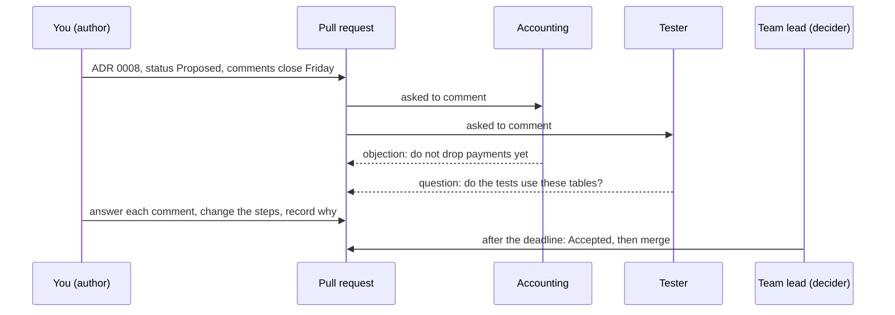

## Before you start

- [[management.l3.weighing-options-in-an-adr]] — you know an ADR lists the options the team seriously considered, keeping things as they are among them, and the costs of the one it chose.
- [[management.l3.debt-as-a-portfolio]] — you know each register row gets a decision, such as repay now, and that repayment is planned as visible work.
- [[management.l1.code-review-basics]] — you know a pull request holds a change open so others can read it and comment, and that the author answers every comment.

## The situation

Early in Sprint 17 you draft ADR `0008`: make a logical backup (`pg_dump`) of the old `notifications` and `payments` tables in the `donhang` database, then drop (delete) both tables together. They are debts N1 and N2 in the register, and no application code reads or writes them. You are sure the plan is right, and you could merge it today. But accounting checks old payments against its own records at the end of each quarter, and the integration tests empty both tables between tests. Neither group has seen your draft. How does a decision reach the people it affects, and who settles it when they do not all agree?

## Core concepts

- proposed ADR — an ADR with the status `Đề xuất` (Proposed), opened as a pull request so that others can comment before it becomes the decision.
- comment period — the time, with a stated end, during which the people a decision affects are asked to comment.
- decider — the one person, named by role in the ADR, who decides when the comment period ends.
- objection — a comment saying the decision would harm someone or something; it gets an answer, and it can change the decision.
- rejected ADR — a proposal whose status became `Bị từ chối` (Rejected); it is still merged and kept.
- RFC (request for comments) — what some teams call a written proposal kept apart from the decision record.

## How it works



In the situation above, the draft you could merge today becomes a proposed ADR. Đơn Hàng's `docs/adr/README.md` turns it into a pull request that holds only that ADR, with the status `Đề xuất`. The pull request description gives the end of the comment period, usually five working days, and mentions by name the people the decision affects, so they are notified. For `0008`, comments came from accounting and a tester.

The comments arrive in the pull request, and the author answers every one, as in any code review. A comment that changes the decision is also written into the ADR's own section "Ý kiến đã nhận" (comments received), objections included. The reason for the change then stays with the decision, not only in the pull request thread.

When the comment period ends, one person decides: in Đơn Hàng, the team lead. The aim is to hear every objection before deciding, not to wait until everyone agrees. An objection that was heard and answered can still lose; one that nobody asked for cannot be weighed at all.

Before merging, the status becomes `Đã chấp nhận` (Accepted) or `Bị từ chối` (Rejected). A rejected ADR is merged too. It stays in the list, so the same idea is not proposed again without new reasons.

Some teams call such a proposal an RFC and keep it in a file separate from the record. Đơn Hàng keeps no separate file: the ADR at `Đề xuất` plays both roles.

## In the Đơn Hàng system

The process, from `docs/adr/README.md`:

```markdown file=docs/adr/README.md tag=stage-3 lines=29-46
### Quy trình

1. Chép `template.md` thành file mới với số kế tiếp, trạng thái `Đề xuất`.
2. Mở pull request chỉ chứa ADR đó. Mô tả của pull request ghi hạn góp ý
   (thường là năm ngày làm việc) và gắn những người quyết định này ảnh hưởng
   tới.
3. Mọi ý kiến được trả lời trong pull request. Ý kiến làm quyết định thay đổi
   được ghi vào mục "Ý kiến đã nhận" của ADR, kể cả ý kiến phản đối.
4. Hết hạn góp ý, trưởng nhóm quyết định. Mục tiêu là nghe hết các phản đối
   trước khi quyết, không phải để mọi người cùng đồng ý.
5. Trước khi merge, trạng thái thành `Đã chấp nhận` hoặc `Bị từ chối`. ADR bị
   từ chối vẫn được merge và giữ lại, để cùng ý tưởng đó không được đề xuất lại
   mà không có lý do mới.

ADR đã chấp nhận không được viết lại. Khi quyết định đổi, một ADR mới ghi
quyết định mới; ADR cũ chỉ được sửa trạng thái thành `Bị thay thế bởi NNNN`
kèm đường dẫn. Đội không dùng file riêng cho bản đề xuất (có đội gọi đó là
RFC): ADR ở trạng thái `Đề xuất` đóng cả hai vai.
```

Line 31 starts every ADR from `template.md` with the status `Đề xuất`. Lines 32–34 put the deadline and the people to notify into the pull request description. Lines 35–36 ask for every comment to be answered.

Lines 37–38 give the decision to the team lead and state the aim: hear every objection, not reach agreement. Lines 39–41 keep a rejected ADR. Lines 45–46 say the team keeps no separate RFC file: the ADR at `Đề xuất` plays both roles. Lines 43–45, about changing an accepted ADR, belong to the next lesson.

ADR `0008` repays N1 and N2. Besides the pull request description, the ADR's own header states the decider and the deadline, as `template.md` asks. In `0008`, lines 3–6 above this excerpt, these are the team lead and the end of Friday in the first week of Sprint 17. Its decision steps, consequences and comments:

```markdown file=docs/adr/0008-xoa-bang-cu-trong-donhang.md tag=stage-3 lines=29-53
1. Dump hai bảng bằng `pg_dump -Fc --table`, lưu cùng các bản sao lưu khác.
2. Migration xóa `notifications` trước, cùng pull request bỏ bảng đó khỏi
   lệnh `TRUNCATE` của `PostgresFixture`.
3. Migration xóa `payments` sau khi kế toán xác nhận đã đối chiếu xong với
   `donhang_payments`, cũng sửa `PostgresFixture` như bước 2.

Ở tag stage-3 hai bảng vẫn còn; các bước trên làm trong sprint sau.

### Hệ quả

- Schema của `donhang` chỉ còn bảng API thật sự dùng.
- Dữ liệu cũ chỉ còn trong file dump; đọc lại cần khôi phục vào một database
  tạm.
- Không xóa cùng lúc nên có một khoảng chỉ còn bảng `payments` cũ.

### Ý kiến đã nhận

- Kế toán phản đối việc xóa `payments` ngay: các khoản thanh toán cũ là thứ họ
  đối soát cuối quý, và họ chưa kiểm bản chép sang `donhang_payments`. Quyết
  định đổi vì phản đối này: bảng `payments` chỉ bị xóa sau khi kế toán xác
  nhận (bước 3), không cùng lúc với `notifications` như bản đề xuất ban đầu.
- Tester hỏi test tích hợp có dựa vào hai bảng không. Không test nào đọc
  chúng, nhưng `PostgresFixture` xóa sạch dữ liệu của cả hai giữa các test
  (lệnh `TRUNCATE`). Mỗi migration xóa bảng vì thế sửa lệnh đó trong cùng
  pull request; điều này được thêm vào bước 2 và 3.
```

Step 1, line 29, is the logical backup made with `pg_dump`. Lines 46–49 are the objection. `donhang_payments` is the Payments service's own database, and the existing payments were copied into it from the old table. Accounting checks old payments at the end of each quarter and had not yet checked that copy. The decision changed: `payments` is dropped only after accounting confirms, in step 3 (lines 32–33), not together with `notifications` as first proposed. Line 42 names the cost of that change: for a while only the old `payments` table remains.

Lines 50–53 record a tester's question. No test reads the tables, but `PostgresFixture` empties both between tests with `TRUNCATE`, so each migration that drops a table also edits that command in the same pull request, now part of steps 2 and 3. Line 35 adds that at stage-3 both tables still exist; the steps run the sprint after.

## Seniors often assume…

- **"A decision needs everyone's agreement before it can be accepted."** → Actually the aim is to hear every objection before deciding; then one person decides, even if some still disagree. Waiting for full agreement lets any single objection hold a decision back with no end date. You notice this when a proposal stays open for weeks because one comment is still unresolved.
- **"A rejected proposal should be deleted so the list shows only real decisions."** → Actually a rejection is a decision too, and its record of why keeps the same idea from returning without new reasons. Đơn Hàng's README merges and keeps rejected ADRs for that reason. You notice a deletion when someone proposes the idea again and the team repeats the whole discussion.
- **"Asking for comments is a formality once the most senior engineer has decided."** → Actually the people a decision affects can know costs the author does not. The first proposal of `0008` dropped `payments` together with `notifications`; accounting's objection and a tester's question changed its steps. You notice the formality when comment periods end with no comments, or when a cost comes up only after the merge.

## Try it (3 minutes)

Open `docs/adr/README.md` and `docs/adr/0008-xoa-bang-cu-trong-donhang.md` in the `don-hang` repository at tag `stage-3`.

1. In `0008`, find who decides and when comments close.
2. Find the comment that changed the decision, and the step it changed.

Expected result: lines 5–6 name the team lead as the decider and the end of Friday in the first week of Sprint 17 as the deadline. Lines 46–49 are accounting's objection; it changed step 3, lines 32–33, so `payments` is dropped only after accounting confirms.

On Thursday a developer comments on a new proposed ADR that they prefer another option, but names no need it meets better. On Friday the comment period ends, and the team lead accepts the ADR unchanged. Was the process in the README followed?

<details><summary>Suggested answer</summary>

Yes, if the comment was answered in the pull request (step 3). The comment was heard; step 4 asks for that, not for agreement, and gives the decision to the team lead once the period ends. Before the merge the status must become `Đã chấp nhận` (step 5).

</details>

## Connections

- [[management.l3.weighing-options-in-an-adr]] — what is put up for comment: options and costs that commenters can check.
- [[management.l3.debt-as-a-portfolio]] — where N1 and N2 got "repay now"; ADR `0008` is the decision for that repayment.
- [[management.l1.code-review-basics]] — the same pull request habits, applied to a decision instead of code.
- [[management.l2.stakeholder-communication]] — the same people, such as accounting, who need to hear about a change before it lands.
- [[management.l2.design-doc]] — also reviewed in a pull request, but it keeps changing with the plan.
- [[management.l3.superseding-an-adr]] — the next step: what happens when an accepted decision later changes.

## Five-line summary

1. A new ADR is proposed as a pull request with a comment deadline, so the people it affects can object before one person decides.
2. When the comment period ends, the decider named in the ADR decides; the aim is hearing every objection, not full agreement.
3. ADR `0008` records accounting's objection, which moved dropping `payments` after their check, and a tester's question about `PostgresFixture`.
4. Some teams call the proposal an RFC and keep it apart; Đơn Hàng's proposed ADR does both jobs.
5. Before merging, the status becomes Accepted or Rejected, and a rejected ADR is kept so the idea needs new reasons to return.
