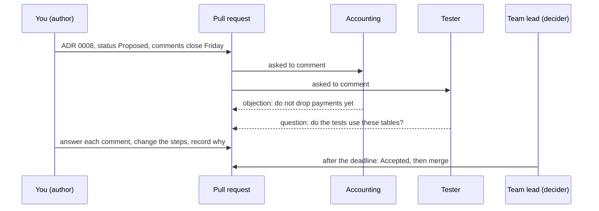

## Bạn cần biết trước

- [[management.l3.weighing-options-in-an-adr]] — bạn biết một ADR liệt kê các phương án đội đã xét nghiêm túc, trong đó có giữ nguyên hiện trạng, cùng cái giá của phương án được chọn.
- [[management.l3.debt-as-a-portfolio]] — bạn biết mỗi dòng trong sổ nợ nhận một quyết định, chẳng hạn trả ngay, và lần trả nợ được lên kế hoạch thành công việc ai cũng thấy.
- [[management.l1.code-review-basics]] — bạn biết một pull request giữ một thay đổi ở trạng thái mở để người khác đọc và comment, và tác giả trả lời mọi comment.

## Tình huống

Đầu Sprint 17, bạn viết nháp ADR `0008`: tạo bản sao lưu logic (`pg_dump`) cho hai bảng cũ `notifications` và `payments` trong database `donhang`, rồi drop (xóa hẳn) cả hai bảng cùng lúc. Chúng là món nợ N1 và N2 trong sổ nợ, và không đoạn code nào của ứng dụng còn đọc hay ghi chúng. Bạn chắc kế hoạch này đúng, và có thể merge ngay hôm nay. Nhưng cuối mỗi quý, kế toán đối soát các khoản thanh toán cũ với sổ sách của họ, còn integration test xóa sạch dữ liệu của cả hai bảng giữa các test. Chưa nhóm nào thấy bản nháp này. Một quyết định đến tay những người nó ảnh hưởng bằng cách nào, và ai chốt khi họ không cùng ý?

## Khái niệm cốt lõi

- ADR đề xuất — một ADR có trạng thái `Đề xuất` (Proposed), được mở thành pull request để người khác góp ý trước khi nó thành quyết định.
- hạn góp ý — khoảng thời gian, với ngày kết thúc ghi rõ, mà những người chịu ảnh hưởng của quyết định được mời góp ý.
- người quyết định — một người duy nhất, ghi trong ADR theo vai trò, sẽ chốt khi hết hạn góp ý.
- phản đối — một ý kiến nói rằng quyết định sẽ gây hại cho ai đó hoặc thứ gì đó. Nó phải được trả lời, và có thể làm quyết định thay đổi.
- ADR bị từ chối — một đề xuất mà trạng thái đã thành `Bị từ chối` (Rejected). Nó vẫn được merge và giữ lại.
- RFC (request for comments) — tên một số đội dùng cho bản đề xuất viết ra, giữ tách khỏi bản ghi quyết định.

## Cơ chế hoạt động



Trong tình huống trên, bản nháp bạn định merge ngay hôm nay trở thành một ADR đề xuất. Theo `docs/adr/README.md` của Đơn Hàng, nó thành một pull request chỉ chứa ADR đó, với trạng thái `Đề xuất`. Mô tả của pull request ghi ngày hết hạn góp ý, thường là năm ngày làm việc, và gắn tên những người quyết định ảnh hưởng tới để họ nhận được thông báo. Với `0008`, góp ý đến từ kế toán và một tester.

Các ý kiến về trong pull request, và tác giả trả lời từng cái, như trong mọi lần code review. Ý kiến nào làm quyết định thay đổi thì được ghi thêm vào chính mục "Ý kiến đã nhận" của ADR, kể cả ý kiến phản đối. Nhờ vậy lý do thay đổi nằm cùng quyết định, chứ không chỉ trong luồng thảo luận của pull request.

Hết hạn góp ý, một người quyết định: ở Đơn Hàng là trưởng nhóm. Mục tiêu là nghe hết các phản đối trước khi quyết, không phải chờ tới khi mọi người cùng đồng ý. Một phản đối đã được nghe và được trả lời vẫn có thể thua. Còn phản đối mà không ai hỏi tới thì không có cách nào đem ra cân.

Trước khi merge, trạng thái thành `Đã chấp nhận` (Accepted) hoặc `Bị từ chối` (Rejected). ADR bị từ chối cũng được merge. Nó nằm lại trong danh sách, để cùng ý tưởng đó không bị đề xuất lại khi chưa có lý do mới.

Một số đội gọi bản đề xuất như vậy là RFC và giữ nó trong một file tách khỏi bản ghi. Đơn Hàng không có file riêng: ADR ở trạng thái `Đề xuất` đóng cả hai vai.

## Trong hệ thống Đơn Hàng

Quy trình, trích từ `docs/adr/README.md`:

```markdown file=docs/adr/README.md tag=stage-3 lines=29-46
### Quy trình

1. Chép `template.md` thành file mới với số kế tiếp, trạng thái `Đề xuất`.
2. Mở pull request chỉ chứa ADR đó. Mô tả của pull request ghi hạn góp ý
   (thường là năm ngày làm việc) và gắn những người quyết định này ảnh hưởng
   tới.
3. Mọi ý kiến được trả lời trong pull request. Ý kiến làm quyết định thay đổi
   được ghi vào mục "Ý kiến đã nhận" của ADR, kể cả ý kiến phản đối.
4. Hết hạn góp ý, trưởng nhóm quyết định. Mục tiêu là nghe hết các phản đối
   trước khi quyết, không phải để mọi người cùng đồng ý.
5. Trước khi merge, trạng thái thành `Đã chấp nhận` hoặc `Bị từ chối`. ADR bị
   từ chối vẫn được merge và giữ lại, để cùng ý tưởng đó không được đề xuất lại
   mà không có lý do mới.

ADR đã chấp nhận không được viết lại. Khi quyết định đổi, một ADR mới ghi
quyết định mới; ADR cũ chỉ được sửa trạng thái thành `Bị thay thế bởi NNNN`
kèm đường dẫn. Đội không dùng file riêng cho bản đề xuất (có đội gọi đó là
RFC): ADR ở trạng thái `Đề xuất` đóng cả hai vai.
```

Dòng 31 cho mọi ADR bắt đầu từ `template.md` với trạng thái `Đề xuất`. Dòng 32–34 đưa hạn góp ý và những người cần được báo vào mô tả của pull request. Dòng 35–36 yêu cầu trả lời mọi ý kiến.

Dòng 37–38 giao quyền quyết cho trưởng nhóm và nêu mục tiêu: nghe hết các phản đối, không phải để mọi người cùng đồng ý. Dòng 39–41 giữ lại ADR bị từ chối. Dòng 45–46 nói đội không có file RFC riêng: ADR ở trạng thái `Đề xuất` đóng cả hai vai. Dòng 43–45, về chuyện đổi một ADR đã chấp nhận, thuộc về bài sau.

ADR `0008` trả món nợ N1 và N2. Ngoài mô tả của pull request, chính phần đầu của ADR cũng ghi người quyết định và hạn góp ý, như `template.md` yêu cầu. Trong `0008`, dòng 3–6, phía trên đoạn trích này, ghi đó là trưởng nhóm và hạn là hết ngày thứ Sáu của tuần đầu Sprint 17. Các bước của quyết định, hệ quả và các ý kiến đã nhận:

```markdown file=docs/adr/0008-xoa-bang-cu-trong-donhang.md tag=stage-3 lines=29-53
1. Dump hai bảng bằng `pg_dump -Fc --table`, lưu cùng các bản sao lưu khác.
2. Migration xóa `notifications` trước, cùng pull request bỏ bảng đó khỏi
   lệnh `TRUNCATE` của `PostgresFixture`.
3. Migration xóa `payments` sau khi kế toán xác nhận đã đối chiếu xong với
   `donhang_payments`, cũng sửa `PostgresFixture` như bước 2.

Ở tag stage-3 hai bảng vẫn còn; các bước trên làm trong sprint sau.

### Hệ quả

- Schema của `donhang` chỉ còn bảng API thật sự dùng.
- Dữ liệu cũ chỉ còn trong file dump; đọc lại cần khôi phục vào một database
  tạm.
- Không xóa cùng lúc nên có một khoảng chỉ còn bảng `payments` cũ.

### Ý kiến đã nhận

- Kế toán phản đối việc xóa `payments` ngay: các khoản thanh toán cũ là thứ họ
  đối soát cuối quý, và họ chưa kiểm bản chép sang `donhang_payments`. Quyết
  định đổi vì phản đối này: bảng `payments` chỉ bị xóa sau khi kế toán xác
  nhận (bước 3), không cùng lúc với `notifications` như bản đề xuất ban đầu.
- Tester hỏi test tích hợp có dựa vào hai bảng không. Không test nào đọc
  chúng, nhưng `PostgresFixture` xóa sạch dữ liệu của cả hai giữa các test
  (lệnh `TRUNCATE`). Mỗi migration xóa bảng vì thế sửa lệnh đó trong cùng
  pull request; điều này được thêm vào bước 2 và 3.
```

Bước 1, dòng 29, là bản sao lưu logic tạo bằng `pg_dump`. Dòng 46–49 là ý kiến phản đối. `donhang_payments` là database riêng của service Payments, và các khoản thanh toán đang có đã được chép sang đó từ bảng cũ. Kế toán đối soát các khoản thanh toán cũ vào cuối mỗi quý, và chưa kiểm bản chép đó. Quyết định đã đổi: `payments` chỉ bị drop sau khi kế toán xác nhận, ở bước 3 (dòng 32–33), không cùng lúc với `notifications` như bản đề xuất ban đầu. Dòng 42 nêu cái giá của thay đổi này: trong một khoảng thời gian, chỉ còn lại bảng `payments` cũ.

Dòng 50–53 ghi câu hỏi của một tester. Không test nào đọc hai bảng, nhưng `PostgresFixture` xóa sạch dữ liệu của cả hai giữa các test bằng `TRUNCATE`. Vì thế mỗi migration drop một bảng cũng sửa lệnh đó trong cùng pull request, giờ đã thành một phần của bước 2 và 3. Dòng 35 nói thêm rằng ở stage-3 cả hai bảng vẫn còn, các bước sẽ chạy ở sprint sau.

## Senior hay nhầm rằng…

- **"Một quyết định cần mọi người đồng ý thì mới được chấp nhận."** → Thực ra mục tiêu là nghe hết các phản đối trước khi quyết, rồi một người quyết, kể cả khi vẫn còn người không đồng ý. Chờ mọi người cùng đồng ý nghĩa là chỉ một phản đối cũng giữ chân quyết định mãi không có ngày kết thúc. Bạn sẽ nhận ra khi một đề xuất nằm mở hàng tuần chỉ vì một comment chưa được giải quyết.
- **"Đề xuất bị từ chối nên xóa đi để danh sách chỉ còn quyết định thật."** → Thực ra từ chối cũng là một quyết định, và phần ghi lý do giữ cho cùng ý tưởng đó không quay lại khi chưa có lý do mới. README của Đơn Hàng merge và giữ lại ADR bị từ chối vì đúng lý do này. Bạn sẽ nhận ra một lần xóa như thế khi có người đề xuất lại ý tưởng cũ và cả đội lặp lại toàn bộ cuộc thảo luận.
- **"Khi kỹ sư giỏi nhất đã quyết thì xin góp ý chỉ là thủ tục."** → Thực ra những người chịu ảnh hưởng của quyết định có thể biết những cái giá mà tác giả không biết. Bản đề xuất đầu tiên của `0008` drop `payments` cùng lúc với `notifications`. Phản đối của kế toán và câu hỏi của một tester đã đổi các bước của nó. Bạn sẽ nhận ra cái thủ tục đó khi các đợt góp ý kết thúc mà không có ý kiến nào, hoặc khi một cái giá chỉ lộ ra sau khi đã merge.

## Thử ngay (3 phút)

Mở `docs/adr/README.md` và `docs/adr/0008-xoa-bang-cu-trong-donhang.md` trong repository `don-hang` ở tag `stage-3`.

1. Trong `0008`, tìm ai là người quyết định và khi nào hết hạn góp ý.
2. Tìm ý kiến đã làm quyết định thay đổi, và bước mà nó đã đổi.

Kết quả mong đợi: dòng 5–6 ghi trưởng nhóm là người quyết định, và hạn góp ý là hết ngày thứ Sáu của tuần đầu Sprint 17. Dòng 46–49 là phản đối của kế toán. Nó đã đổi bước 3, dòng 32–33, nên `payments` chỉ bị drop sau khi kế toán xác nhận.

Thứ Năm, một lập trình viên comment trên một ADR đề xuất mới rằng họ thích một phương án khác, nhưng không nêu nhu cầu nào phương án đó đáp ứng tốt hơn. Thứ Sáu hết hạn góp ý, và trưởng nhóm chấp nhận ADR mà không sửa gì. Quy trình trong README có được làm đúng không?

<details><summary>Gợi ý đáp án</summary>

Có, nếu comment đó đã được trả lời trong pull request (bước 3). Ý kiến đã được nghe. Bước 4 đòi điều đó, chứ không đòi mọi người đồng ý, và giao quyền quyết cho trưởng nhóm khi hết hạn. Trước khi merge, trạng thái phải thành `Đã chấp nhận` (bước 5).

</details>

## Liên hệ

- [[management.l3.weighing-options-in-an-adr]] — thứ được đưa ra để góp ý: các phương án và cái giá mà người góp ý kiểm tra được.
- [[management.l3.debt-as-a-portfolio]] — nơi N1 và N2 nhận quyết định "trả ngay". ADR `0008` là quyết định cho lần trả nợ đó.
- [[management.l1.code-review-basics]] — cùng những thói quen với pull request, áp vào một quyết định thay vì code.
- [[management.l2.stakeholder-communication]] — cũng những người đó, như kế toán, cần được biết về một thay đổi trước khi nó xảy ra.
- [[management.l2.design-doc]] — cũng được review trong pull request, nhưng nó tiếp tục thay đổi theo kế hoạch.
- [[management.l3.superseding-an-adr]] — bước tiếp theo: chuyện gì xảy ra khi một quyết định đã chấp nhận về sau thay đổi.

## Tóm tắt 5 dòng

1. Một ADR mới được đề xuất bằng pull request có hạn góp ý, để những người chịu ảnh hưởng phản đối được trước khi một người quyết.
2. Hết hạn góp ý, người quyết định ghi trong ADR sẽ chốt. Mục tiêu là nghe hết các phản đối, không phải mọi người cùng đồng ý.
3. ADR `0008` ghi lại phản đối của kế toán, khiến `payments` chỉ bị drop sau khi họ kiểm xong, và câu hỏi của một tester về `PostgresFixture`.
4. Một số đội gọi bản đề xuất là RFC và giữ nó riêng. Ở Đơn Hàng, ADR đề xuất làm cả hai việc.
5. Trước khi merge, trạng thái thành Đã chấp nhận hoặc Bị từ chối, và ADR bị từ chối được giữ lại để ý tưởng đó cần lý do mới mới quay lại được.
