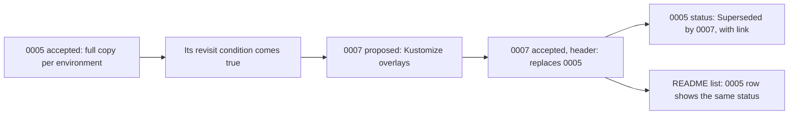

## Before you start

- [[management.l3.proposing-an-adr]] — you know a new ADR is proposed in a pull request, decided by one person when comments close, and merged as `Đã chấp nhận` (Accepted) or `Bị từ chối` (Rejected).
- [[k8s.l2.config-repo-overlays]] — you know the config repository moved from a full copy of manifests per environment to a base and per-environment overlays.

## The situation

In Sprint 17 the team lead has just accepted ADR `0007`, which moves the config repository to Kustomize overlays. ADR `0005` in `docs/adr/` still says each environment keeps a full copy of every manifest, and its status still reads `Đã chấp nhận` (Accepted). A teammate offers to rewrite `0005` so it describes overlays, because a new hire reading it would be misled. Another teammate says the cleaner fix is to delete `0005`: the decision was reversed, so the record only shows a mistake. Both want the folder to tell the truth about the system. What should happen to an accepted ADR when its decision changes?

## Core concepts

- superseding ADR — a new ADR that records the new decision and names, in its header, the ADR it replaces.
- superseded ADR — an accepted ADR whose decision a later one replaced; its status becomes `Bị thay thế bởi NNNN` (Superseded by NNNN), with a link to the replacement.
- revisit condition — the sentence in an ADR that says what would make the team look at the decision again.

## How it works



`0005` had written its own revisit condition, look again when changes made twice become frequent, and it came true. In the situation above, `0007` is the superseding ADR. It is a new file with its own number, proposed and decided like any other ADR. Its header line `Thay thế:` (Replaces) links to `0005`, and its context section starts from `0005`: which of the old reasons stopped holding, and what changed since.

`0005` becomes the superseded ADR. Nobody rewrites its context, options, decision or consequences; it only gains pointers to `0007`. Its status line changes to `Bị thay thế bởi` (Superseded by) with a link to `0007`, and its row in `docs/adr/README.md` shows the same status. So each file names the other: a reader who lands on either one reaches the current decision in one step.

`docs/adr/README.md`, which holds both the list of ADRs and the rules for writing them, states the rule. An accepted ADR is not rewritten. When a decision changes, a new ADR records the new decision, and the old one only gets its status and a pointer to the replacement changed: `Bị thay thế bởi NNNN` with the link. A design doc works the other way: it describes how to build something and is edited as the plan changes. Because it keeps being edited, the design doc answers "how does it work now"; the ADR answers "why did we decide this, back then".

Keeping `0005` as it was lets a reader see why the system once kept full copies, and tell a decision that fit its time from one that was wrong when it was made.

## In the Đơn Hàng system

The end of `0005`, as it is kept at `stage-3`:

```markdown file=docs/adr/0005-moi-moi-truong-mot-ban-manifest.md tag=stage-3 lines=26-38
### Quyết định

Chép đầy đủ mỗi môi trường. Đội nhận nợ này có chủ ý: biết cách tốt hơn,
chọn cách nhanh hơn vì chưa có thời gian học công cụ, và biết giá phải trả.

### Hệ quả

- Thay đổi dành cho cả hai môi trường, như một probe mới, phải sửa hai lần;
  quên một bản thì hai môi trường lệch nhau mà không ai thấy.
- Promote là một commit đổi tag trong `envs/production`, diff dễ đọc.

Xem lại khi các thay đổi sửa hai lần bắt đầu thường xuyên. Điều đó đã xảy ra:
ADR 0007 thay thế quyết định này.
```

Lines 13–16, above this excerpt, give the context when it was written: two environments, staging and production, differing in a few values such as the api's replica count and image tag; line 12 of `0007` shows the api was then the only service. Lines 28–29 record the decision as technical debt taken on knowingly, with a better way known and its cost accepted. Lines 33–34 name that cost: a change meant for both environments is made twice, and a forgotten copy lets them drift apart unnoticed; line 35 names the gain: promotion is one commit changing a tag in `envs/production`, with an easy diff. Line 37 is the revisit condition. Line 38 says it happened and points to `0007`; like the status `Bị thay thế bởi` on line 3, above this excerpt, it could only be written once `0007` existed: a pointer to the replacement, not a change to the reasons.

The start of `0007`:

```markdown file=docs/adr/0007-overlay-kustomize-cho-repo-cau-hinh.md tag=stage-3 lines=1-14
# 0007. Overlay Kustomize cho repo cấu hình

Trạng thái: Đã chấp nhận
Thay thế: [0005](0005-moi-moi-truong-mot-ban-manifest.md)
Ngày: đề xuất và quyết định trong Sprint 17
Người quyết định: trưởng nhóm
Hạn góp ý: hết tuần đầu Sprint 17

### Bối cảnh

ADR 0005 chọn mỗi môi trường một bản manifest đầy đủ. Lý do của nó không còn
đúng: số service tăng từ api lên thêm Notifications, Payments, RabbitMQ, và
nhiều thay đổi dành cho mọi môi trường (probe, securityContext, NetworkPolicy)
phải sửa hai lần. Đội đã quên một bản ít nhất một lần.
```

Line 4, `Thay thế:` (Replaces), is the link back to `0005`. Lines 5–7 show that `0007` went through the usual process, with a decider and a comment deadline. Lines 11–14 name the reasons of `0005` that stopped holding: the services grew from the api to Notifications, Payments and RabbitMQ, changes for every environment had to be made twice, and the team forgot a copy at least once.

Lines 27–29 of `0007`, below this excerpt, keep one thing on purpose. Software that others maintain, such as the ingress controller, is still installed from the Helm chart its own project publishes, because that project keeps the chart correct. So Helm in the cluster is part of the current decision, not something the move to overlays forgot.

## Seniors often assume…

- **"An outdated ADR should be edited to match the current system."** → Actually an ADR keeps why a decision was made, as it was when it was made; editing it to describe today's system erases those reasons and turns it into a second, weaker design doc. You notice an edited ADR when its context no longer explains its decision.
- **"An ADR that was later reversed was a mistake."** → Actually a decision is judged against the context it had. `0005` fit two environments when the config repository held only the api, named its own cost and said when to look again; `0007` replaced it when that condition came true. You notice this belief when a team stops writing revisit conditions, or avoids recording decisions it expects to change.
- **"Superseded ADRs should be deleted so they do not confuse readers."** → Actually the status line and its link already tell a reader the decision is no longer in force and where its replacement is. Deleting the file loses why the system once worked differently and breaks the `Thay thế:` link in the new ADR. You notice a deletion when someone proposes full copies per environment again and nobody can show why the team left them.

## Try it (3 minutes)

Open `docs/adr/README.md`, `docs/adr/0005-moi-moi-truong-mot-ban-manifest.md` and `docs/adr/0007-overlay-kustomize-cho-repo-cau-hinh.md` in the `don-hang` repository at tag `stage-3`.

1. In `0005` and in `0007`, find the line that names the other ADR.
2. In `0007`, find why a Helm chart still installs part of the cluster.

Expected result: line 3 of `0005` reads `Trạng thái: Bị thay thế bởi` with a link to `0007`, and line 4 of `0007` reads `Thay thế:` with a link to `0005`. The README's row for `0005` shows `Bị thay thế bởi 0007`. Lines 27–29 of `0007` keep charts for software others maintain, such as the ingress controller.

Suppose the team later decides to package Đơn Hàng's own manifests as a Helm chart after all. Which files in `docs/adr/` change, and how?

<details><summary>Suggested answer</summary>

A new ADR with the next free number is proposed, and its header names `0007` in `Thay thế:`. Once it is accepted, only the status line of `0007` changes, to `Bị thay thế bởi` the new number with a link, and, as with `0005`, it may get one line pointing to the replacement. The README list gets the new row and the new status for `0007`. `0005` stays as it is: it is already superseded by `0007`, and its reasons still explain the first config repository.

</details>

## Connections

- [[management.l3.proposing-an-adr]] — prerequisite: a superseding ADR goes through the same proposal and comment period as any other.
- [[k8s.l2.config-repo-overlays]] — the change that `0007` records, seen from the config repository and the cluster.
- [[management.l2.design-doc]] — the opposite rule: a design doc is edited as the plan changes.
- [[management.l3.technical-debt]] — `0005` is deliberate debt written down; `0007` is the decision that repaid it.
- [[devops.l3.promoting-between-environments]] — promotion changed shape with this decision, from a tag edit in `envs/production` to an `images` edit in the production overlay.

## Five-line summary

1. When a decision changes, a new ADR records it, and the old one is kept, changed only to point to the replacement.
2. ADR `0007` replaces `0005`'s full copy per environment with Kustomize overlays, and each file's header names the other.
3. The kept `0005` shows why full copies once fit; `0007` names which of its reasons stopped holding as services grew.
4. An accepted ADR keeps its reasons as they were; a design doc, by contrast, is edited as the plan changes.
5. `0007` keeps Helm charts for software others maintain, so Helm in the cluster belongs to the current decision.
