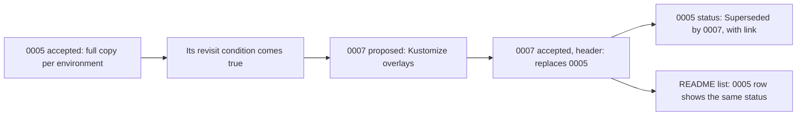

## Bạn cần biết trước

- [[management.l3.proposing-an-adr]] — bạn biết một ADR mới được đề xuất bằng pull request, một người chốt khi hết hạn góp ý, rồi được merge với trạng thái `Đã chấp nhận` (Accepted) hoặc `Bị từ chối` (Rejected).
- [[k8s.l2.config-repo-overlays]] — bạn biết repo cấu hình đã chuyển từ mỗi môi trường một bản manifest đầy đủ sang một base chung và overlay cho từng môi trường.

## Tình huống

Sprint 17, trưởng nhóm vừa chấp nhận ADR `0007`, chuyển repo cấu hình sang overlay Kustomize. Trong `docs/adr/`, ADR `0005` vẫn nói mỗi môi trường giữ một bản đầy đủ của mọi manifest, và trạng thái của nó vẫn là `Đã chấp nhận`. Một đồng đội muốn viết lại `0005` cho khớp với overlay, vì người mới vào đọc nó sẽ hiểu sai. Một người khác cho rằng sạch nhất là xóa `0005`: quyết định đã bị đảo ngược, nên bản ghi chỉ còn cho thấy một sai lầm. Cả hai đều muốn thư mục nói đúng về hệ thống. Khi quyết định thay đổi, một ADR đã chấp nhận nên được xử lý thế nào?

## Khái niệm cốt lõi

- ADR thay thế — một ADR mới ghi quyết định mới, và phần đầu của nó ghi tên ADR mà nó thay thế.
- ADR bị thay thế — một ADR đã chấp nhận mà quyết định của nó bị một ADR sau thay thế. Trạng thái của nó thành `Bị thay thế bởi NNNN` (Superseded by NNNN), kèm đường dẫn tới ADR mới.
- điều kiện xem lại — câu trong ADR nói điều gì sẽ khiến đội xem lại quyết định đó.

## Cơ chế hoạt động



`0005` đã tự ghi điều kiện xem lại của mình: xem lại khi các thay đổi phải sửa hai lần bắt đầu thường xuyên. Điều đó đã xảy ra. Trong tình huống trên, `0007` là ADR thay thế. Nó là một file mới với số riêng, được đề xuất và chốt như mọi ADR khác. Dòng `Thay thế:` (Replaces) ở phần đầu dẫn tới `0005`, và mục bối cảnh bắt đầu từ `0005`: những lý do cũ nào không còn đúng, và điều gì đã thay đổi từ đó.

`0005` trở thành ADR bị thay thế. Không ai viết lại bối cảnh, phương án, quyết định hay hệ quả của nó. Nó chỉ được thêm chỉ dẫn tới `0007`. Dòng trạng thái đổi thành `Bị thay thế bởi` (Superseded by) kèm đường dẫn tới `0007`, và dòng của nó trong `docs/adr/README.md` cũng ghi trạng thái đó. Như vậy file nào cũng ghi tên file kia: người đọc mở file nào trước cũng chỉ cần một bước để tới quyết định hiện hành.

`docs/adr/README.md`, nơi chứa cả danh sách ADR lẫn quy tắc viết ADR, nêu rõ quy tắc này. ADR đã chấp nhận không được viết lại. Khi quyết định đổi, một ADR mới ghi quyết định mới, còn ADR cũ chỉ được sửa trạng thái và chỉ dẫn tới bản thay thế: `Bị thay thế bởi NNNN` kèm đường dẫn. Design doc thì ngược lại: nó mô tả cách xây một thứ, và được sửa khi kế hoạch thay đổi. Vì liên tục được sửa, design doc trả lời "bây giờ nó chạy thế nào". ADR trả lời "hồi đó vì sao đội quyết định như vậy".

Giữ nguyên `0005` giúp người đọc thấy vì sao hệ thống từng giữ các bản đầy đủ, và phân biệt một quyết định hợp với thời điểm của nó với một quyết định đã sai ngay từ lúc đưa ra.

## Trong hệ thống Đơn Hàng

Phần cuối của `0005`, như được giữ ở `stage-3`:

```markdown file=docs/adr/0005-moi-moi-truong-mot-ban-manifest.md tag=stage-3 lines=26-38
### Quyết định

Chép đầy đủ mỗi môi trường. Đội nhận nợ này có chủ ý: biết cách tốt hơn,
chọn cách nhanh hơn vì chưa có thời gian học công cụ, và biết giá phải trả.

### Hệ quả

- Thay đổi dành cho cả hai môi trường, như một probe mới, phải sửa hai lần;
  quên một bản thì hai môi trường lệch nhau mà không ai thấy.
- Promote là một commit đổi tag trong `envs/production`, diff dễ đọc.

Xem lại khi các thay đổi sửa hai lần bắt đầu thường xuyên. Điều đó đã xảy ra:
ADR 0007 thay thế quyết định này.
```

Dòng 13–16, phía trên đoạn trích, ghi bối cảnh lúc viết: hai môi trường, staging và production, chỉ khác nhau vài giá trị như số replica của api và tag của image. Dòng 12 của `0007` cho thấy lúc đó api là service duy nhất. Dòng 28–29 ghi quyết định là nợ kỹ thuật nhận có chủ ý: biết có cách tốt hơn và chấp nhận cái giá. Dòng 33–34 nêu cái giá đó: thay đổi dành cho cả hai môi trường phải sửa hai lần, và quên một bản thì hai môi trường lệch nhau mà không ai thấy. Dòng 35 nêu cái được: promotion là một commit đổi tag trong `envs/production`, diff dễ đọc. Dòng 37 là điều kiện xem lại. Dòng 38 nói điều kiện đó đã xảy ra và chỉ tới `0007`. Cũng như trạng thái `Bị thay thế bởi` ở dòng 3, phía trên đoạn trích, dòng này chỉ viết được khi `0007` đã có: nó là chỉ dẫn tới bản thay thế, không phải sửa lại lý do.

Phần đầu của `0007`:

```markdown file=docs/adr/0007-overlay-kustomize-cho-repo-cau-hinh.md tag=stage-3 lines=1-14
# 0007. Overlay Kustomize cho repo cấu hình

Trạng thái: Đã chấp nhận
Thay thế: [0005](0005-moi-moi-truong-mot-ban-manifest.md)
Ngày: đề xuất và quyết định trong Sprint 17
Người quyết định: trưởng nhóm
Hạn góp ý: hết tuần đầu Sprint 17

### Bối cảnh

ADR 0005 chọn mỗi môi trường một bản manifest đầy đủ. Lý do của nó không còn
đúng: số service tăng từ api lên thêm Notifications, Payments, RabbitMQ, và
nhiều thay đổi dành cho mọi môi trường (probe, securityContext, NetworkPolicy)
phải sửa hai lần. Đội đã quên một bản ít nhất một lần.
```

Dòng 4, `Thay thế:`, là đường dẫn ngược về `0005`. Dòng 5–7 cho thấy `0007` đi qua quy trình bình thường, có người quyết định và hạn góp ý. Dòng 11–14 nêu những lý do của `0005` không còn đúng: số service tăng từ api lên thêm Notifications, Payments và RabbitMQ, các thay đổi cho mọi môi trường phải sửa hai lần, và đội đã quên một bản ít nhất một lần.

Dòng 27–29 của `0007`, phía dưới đoạn trích, cố ý giữ lại một thứ. Phần mềm do người khác bảo trì, như Ingress controller, vẫn được cài từ Helm chart mà chính dự án đó phát hành, vì dự án đó giữ chart luôn đúng. Vậy Helm trong cluster là một phần của quyết định hiện hành, không phải thứ bị bỏ sót khi chuyển sang overlay.

## Senior hay nhầm rằng…

- **"ADR đã lỗi thời thì nên sửa cho khớp với hệ thống hiện tại."** → Thực ra ADR giữ lý do của một quyết định, đúng như lúc quyết định được đưa ra. Sửa nó để mô tả hệ thống hôm nay sẽ xóa mất những lý do đó, và biến nó thành một design doc thứ hai, kém hơn. Bạn sẽ nhận ra một ADR đã bị sửa khi phần bối cảnh của nó không còn giải thích được quyết định.
- **"ADR về sau bị đảo ngược là một sai lầm."** → Thực ra một quyết định được đánh giá theo bối cảnh của nó lúc đó. `0005` hợp với hai môi trường khi repo cấu hình chỉ có api, tự nêu cái giá của mình và nói khi nào cần xem lại. `0007` thay thế nó khi điều kiện đó xảy ra. Bạn sẽ nhận ra niềm tin này khi một đội thôi viết điều kiện xem lại, hoặc né ghi lại những quyết định họ đoán sẽ còn đổi.
- **"ADR đã bị thay thế nên xóa đi cho người đọc khỏi rối."** → Thực ra dòng trạng thái và đường dẫn đã cho người đọc biết quyết định không còn hiệu lực và bản thay thế nằm ở đâu. Xóa file làm mất lý do vì sao hệ thống từng chạy khác, và làm gãy đường dẫn `Thay thế:` trong ADR mới. Bạn sẽ nhận ra một lần xóa như thế khi có người lại đề xuất mỗi môi trường một bản đầy đủ, và không ai chỉ ra được vì sao đội đã bỏ cách đó.

## Thử ngay (3 phút)

Mở `docs/adr/README.md`, `docs/adr/0005-moi-moi-truong-mot-ban-manifest.md` và `docs/adr/0007-overlay-kustomize-cho-repo-cau-hinh.md` trong repository `don-hang` ở tag `stage-3`.

1. Trong `0005` và trong `0007`, tìm dòng ghi tên ADR kia.
2. Trong `0007`, tìm lý do một Helm chart vẫn cài một phần của cluster.

Kết quả mong đợi: dòng 3 của `0005` là `Trạng thái: Bị thay thế bởi` kèm đường dẫn tới `0007`, và dòng 4 của `0007` là `Thay thế:` kèm đường dẫn tới `0005`. Dòng của `0005` trong README ghi `Bị thay thế bởi 0007`. Dòng 27–29 của `0007` giữ chart cho phần mềm do người khác bảo trì, như Ingress controller.

Giả sử sau này đội quyết định đóng gói chính manifest của Đơn Hàng thành một Helm chart. Những file nào trong `docs/adr/` thay đổi, và thay đổi thế nào?

<details><summary>Gợi ý đáp án</summary>

Một ADR mới với số kế tiếp còn trống được đề xuất, và phần đầu của nó ghi `0007` ở dòng `Thay thế:`. Khi ADR mới được chấp nhận, chỉ dòng trạng thái của `0007` thay đổi, thành `Bị thay thế bởi` số mới kèm đường dẫn, và giống `0005`, nó có thể được thêm một dòng chỉ tới bản thay thế. Danh sách trong README có thêm dòng mới và trạng thái mới cho `0007`. `0005` giữ nguyên: nó đã bị `0007` thay thế, và lý do của nó vẫn giải thích repo cấu hình đầu tiên.

</details>

## Liên hệ

- [[management.l3.proposing-an-adr]] — bài cần trước: ADR thay thế đi qua cùng quy trình đề xuất và hạn góp ý như mọi ADR khác.
- [[k8s.l2.config-repo-overlays]] — thay đổi mà `0007` ghi lại, nhìn từ phía repo cấu hình và cluster.
- [[management.l2.design-doc]] — quy tắc ngược lại: design doc được sửa khi kế hoạch thay đổi.
- [[management.l3.technical-debt]] — `0005` là món nợ có chủ ý được ghi ra giấy. `0007` là quyết định trả món nợ đó.
- [[devops.l3.promoting-between-environments]] — promotion đổi hình dạng theo quyết định này, từ sửa tag trong `envs/production` sang sửa `images` trong overlay production.

## Tóm tắt 5 dòng

1. Khi quyết định đổi, một ADR mới ghi lại quyết định đó, còn ADR cũ được giữ, chỉ sửa để chỉ tới bản thay thế.
2. ADR `0007` thay cách mỗi môi trường một bản đầy đủ của `0005` bằng overlay Kustomize, và phần đầu của mỗi file ghi tên file kia.
3. `0005` được giữ lại cho thấy vì sao các bản đầy đủ từng hợp lý. `0007` nêu những lý do nào của nó không còn đúng khi số service tăng.
4. ADR đã chấp nhận giữ nguyên lý do như lúc viết. Design doc thì ngược lại, được sửa khi kế hoạch thay đổi.
5. `0007` giữ Helm chart cho phần mềm do người khác bảo trì, nên Helm trong cluster thuộc về quyết định hiện hành.
