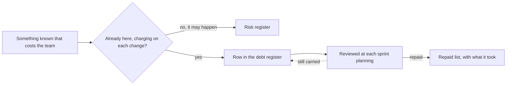

## Before you start

- [[management.l3.technical-debt]] — you know technical debt as a shape that makes later changes cost more, with a principal to repay it and interest paid on each change.
- [[management.l2.risk-register]] — you know a risk register lists what may go wrong with a plan, rated by likelihood and impact and reviewed at each sprint planning.

## The situation

You open `DonHang.Api/Dtos.cs` to add a field to `CreateOrderItemRequest` and find `UnitPriceVnd` already there. One integration test in `OrdersApiTests.cs` sends `UnitPriceVnd: 1`, and the API answers with the price from Catalog, the part of Đơn Hàng that owns product prices. A comment in `OrdersController.cs` explains: the field is still accepted so clients written before prices moved to Catalog keep working, but it is ignored. Your lead adds that the `donhang` database still holds an old `notifications` table that nothing reads. Both shapes are known, both make changes cost more, and each is written down in one file or one person's memory. Where does a team keep the debt it knows it carries, and what should each entry say?

## Core concepts

- **technical debt register** — a team's list of the technical debt it knows it carries: for each item, what it is, where it is, how it arose, what it costs each change, what repaying it would take, and who watches it.
- interest in words — an item's cost written as what a reader is misled into, or what extra step each change takes, instead of a score.
- repaid list — a second list where an item moves once it is repaid, together with what the repayment took.

## How it works



Start from the question in the diagram: is this thing already here, charging something on each change? The old `notifications` table is; each migration of `donhang` makes someone ask whether the table is still used. A worry that the payment gateway may change its refund API is not; it may never happen, so it goes in the risk register, with its likelihood and impact.

Debt gets a list of its own because the questions differ. Rating the likelihood of something that already exists tells nobody anything. What a team needs to know about a debt is what it charges, what it would take to stop the charge, and who keeps an eye on it.

So each row of the technical debt register answers six questions: what the debt is, where it is, how it arose, its interest, how it would be repaid and roughly what that takes, and who watches it. In the situation above, the `unitPriceVnd` field (`UnitPriceVnd` in `Dtos.cs`) becomes one row and the old table another.

The interest is written in the team's own words: what a reader is misled into, or what extra step each change takes. A score such as 7 out of 10 is quicker to write, but nobody can check it against what happens in a real change, so nobody can tell when it has become wrong.

The register is reviewed at the same rhythm as the risk register: new rows are added and each row's plan is looked at again; a row still carried stays until the next review (the dotted arrow). A repaid row does not vanish; it moves to the repaid list with what the repayment took, which the team can look at when it estimates a similar repayment.

## In the Đơn Hàng system

`docs/team/tech-debt-register.md` is the team's register. Its opening and the table of debt it carries:

```markdown file=docs/team/tech-debt-register.md tag=stage-3 lines=1-21
# Sổ nợ kỹ thuật của Đơn Hàng

Sổ này ghi những món nợ kỹ thuật đội biết mình đang mang: hình dạng của code
hay cấu hình làm mỗi lần sửa vùng đó tốn công hơn. Khác sổ rủi ro
(`risk-register-example.md`): rủi ro có thể không bao giờ xảy ra, còn món nợ
ở đây đã có sẵn và đang tính lãi mỗi lần sửa. Lỗi (code chạy sai) không ghi
vào đây; lỗi được sửa như lỗi.

Lãi ghi bằng lời của đội, như người đọc bị hiểu nhầm điều gì hay mỗi lần sửa
phải làm thêm việc gì, không bằng điểm số. Cột "Quyết định" là một trong bốn:
trả ngay, trả cùng lần sửa tới vùng đó, chấp nhận (tiếp tục trả lãi, biết rõ
vì sao), xóa sổ (vùng đó sắp bỏ).

### Nợ đang mang

| Số | Món nợ | Ở đâu | Từ đâu ra | Lãi mỗi lần sửa | Trả bằng cách nào | Quyết định | Người theo dõi |
|---|---|---|---|---|---|---|---|
| N1 | Bảng `notifications` cũ còn trong database `donhang` | `donhang`, `PostgresFixture` | Phát hiện sau: còn lại khi Notifications có database riêng (ADR 0002) | Người đọc schema tưởng API còn gửi email; mỗi migration của `donhang` lại phải hỏi bảng này còn dùng không | Dump rồi xóa bằng một migration (ADR 0008), khoảng 1 ngày | Trả ngay | Lập trình viên backend |
| N2 | Bảng `payments` cũ còn trong database `donhang` | `donhang`, `PostgresFixture` | Phát hiện sau: còn lại khi Payments có database riêng (ADR 0003) | Người đọc tưởng API còn giữ dòng tiền; kế toán hỏi nên đối soát với bảng nào | Như N1, sau khi kế toán xác nhận (ADR 0008), khoảng 1 ngày | Trả ngay, sau N1 | Lập trình viên backend |
| N3 | `POST /api/v1/orders` vẫn nhận `unitPriceVnd` của từng dòng nhưng bỏ qua, giá lấy từ Catalog | `DonHang.Api/Dtos.cs`, `OrdersController.cs` | Có chủ ý: giữ để client cũ không hỏng | Người đọc API tưởng mình đặt được giá; mỗi lần sửa DTO phải nhớ field này không làm gì | Bỏ field ở một phiên bản API mới, sau khi client cũ ngừng gửi nó | Chấp nhận: còn client cũ dùng `/api/v1`, bỏ field là thay đổi phá vỡ; xem lại khi `/api/v1` có ngày ngừng | Lập trình viên backend |
| N4 | App ghi cứng `localhost` cho địa chỉ API và Keycloak | `DonHang.App/lib/api_client.dart`, `lib/auth/keycloak_sign_in.dart` | Có chủ ý: app chỉ chạy trên máy dev | Chạy app ở bất kỳ địa chỉ nào khác phải sửa code và build lại; app chưa đưa được lên cluster | Đọc địa chỉ từ cấu hình lúc build, khoảng 2–3 ngày | Trả cùng lần sửa tới: khi app được đưa lên cluster | Lập trình viên frontend |
```

Lines 3–7 draw the line from the diagram: unlike the risk register, where a risk may never happen, a debt here already exists and charges interest on every change. Line 16 is the header: number, debt (`Món nợ`), where (`Ở đâu`), how it arose (`Từ đâu ra`), interest per change (`Lãi mỗi lần sửa`), how to repay (`Trả bằng cách nào`), decision (`Quyết định`) and who watches it (`Người theo dõi`). Row N3 is the field from the situation, kept on purpose so older clients do not break; its interest column says what a reader of the API is misled into. Row N1 is the old `notifications` table; its `Ở đâu` column also names `PostgresFixture`, the integration-test setup, which still names the table in code outside this excerpt. Lines 9–10 ask for interest in words rather than a score, and lines 10–12 list the four values of the decision column, the subject of [[management.l3.debt-as-a-portfolio]]. The numbered references in parentheses point to other team documents that record decisions; this lesson does not need them.

What happens to an item once it is repaid, and how often the register is opened:

```markdown file=docs/team/tech-debt-register.md tag=stage-3 lines=23-33
### Nợ đã trả

| Số | Món nợ | Từ đâu ra | Trả bằng gì |
|---|---|---|---|
| T1 | Repo cấu hình chép đầy đủ manifest cho mỗi môi trường (`envs/staging`, `envs/production`), nên thay đổi chung phải sửa hai lần | Có chủ ý (ADR 0005) | Chuyển sang overlay Kustomize (ADR 0007) trong một commit, `scripts/k8s/kustomize-config-repo.sh`; kiểm bằng chỗ khác Argo CD báo: chỉ ConfigMap và Deployment của api |
| T2 | `QueuedNotifier` lưu job email cùng transaction với đơn qua chung một DbContext; hợp với một process, thành việc phải gỡ khi Notifications ra service riêng | Phát hiện sau | Outbox: API ghi message vào `outbox_messages` cùng transaction, relay gửi lên RabbitMQ, Notifications nhận qua inbox; `QueuedNotifier` và `INotifier` bị xóa |

### Cách đội dùng sổ này

- Sổ được xem lại cùng nhịp với sổ rủi ro, ở mỗi sprint planning: thêm món mới,
  xem lại quyết định của từng món.
```

T1 is the full copy of manifests per environment from [[management.l3.technical-debt]], and its last column keeps what the repayment took: one commit, checked against the difference Argo CD reported. T2 is a second repaid item from the messaging work; for this lesson, notice only that its last column also records what the repayment took. Lines 32–33 set the rhythm described above. The bullets after line 33 belong to a later lesson.

## Seniors often assume…

- **"TODO comments in the code track debt well enough."** → Actually a comment sits in one file and is read only by whoever opens that file. It cannot be reviewed with the rest at sprint planning, it rarely names a cost or a watcher, and debt in data, like the old `notifications` table, has no one file that whoever changes the schema is sure to open. You notice this when the same debt is rediscovered by each new person who opens the file, and nobody can say how many such items the team has.
- **"Known debt belongs in the risk register, since both are bad news."** → Actually a risk is rated by how likely it is, and a debt is already there, so its likelihood is always certain and the rating says nothing. What a debt needs instead is its interest and its repayment. You notice this when a risk register fills with rows rated high likelihood that never change, and the real risks are hard to find among them.
- **"A debt register is a list of complaints about other people's code."** → Actually each row states a concrete cost on changes, how to repay it and who watches it, and several rows record shortcuts the team took on purpose, such as N3 and N4. A line with no cost to changes is not debt. You notice this when rows read "this module is messy" with no interest and no plan, and no review ever decides anything about them.

## Try it (3 minutes)

Open `docs/team/tech-debt-register.md` in the `don-hang` repository at tag `stage-3`.

1. Find the row whose `Ở đâu` column names `Dtos.cs`.
2. Read its `Lãi mỗi lần sửa` and `Người theo dõi` columns.

Expected result: row N3. Its interest is that a reader of the API thinks they can set the price, and each change to the DTO must remember that `unitPriceVnd` does nothing. A backend developer (`Lập trình viên backend`) watches it.

At sprint planning a teammate asks to add a row reading "the Notifications code is a mess". What would the row need before it belongs in the register?

<details><summary>Suggested answer</summary>

It needs the six answers every row gives: what the debt is, where exactly it is, how it arose, what extra step or misunderstanding each change pays because of it, how it would be repaid and roughly what that takes, and who watches it. If nobody can name a cost that changes in that part actually pay, it is a complaint, not debt, and it stays out of the register.

</details>

## Connections

- [[management.l3.technical-debt]] — prerequisite: the principal and interest that each row of the register writes down.
- [[management.l2.risk-register]] — the sibling list: risks that may happen, reviewed at the same sprint planning as the debt that already charges.
- [[management.l2.risk-responses]] — the same idea for risks: a stated response and one watcher per row, as each debt row has a repayment and a watcher.
- [[design.l3.one-way-module-dependencies]] — where prices moved to Catalog, which left the ignored `unitPriceVnd` field recorded as N3.
- [[management.l3.where-debt-comes-from]] — the next step: the "how it arose" column, chosen shortcut or design outgrown.
- [[management.l3.debt-as-a-portfolio]] — what to do with the rows: which debt to repay first, and the decision column.

## Five-line summary

1. A technical debt register lists the debt a team knows it carries, so it is weighed and watched instead of rediscovered.
2. Each row says what and where the debt is, how it arose, its interest, how to repay it and who watches it.
3. A risk may never happen; a debt is already here and charging each change, so it gets a list of its own.
4. Đơn Hàng's register lists the ignored `unitPriceVnd` field as N3, with its interest written in the team's own words, not a score.
5. The register is reviewed with the risk register at each sprint planning; repaid items move to a separate list with what repayment took.
