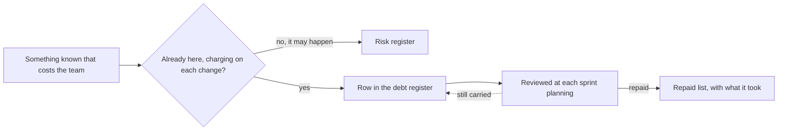

## Bạn cần biết trước

- [[management.l3.technical-debt]] — bạn biết nợ kỹ thuật là một hình dạng khiến các lần sửa sau tốn hơn, có tiền gốc để trả dứt nó và tiền lãi phải trả ở mỗi lần sửa.
- [[management.l2.risk-register]] — bạn biết sổ rủi ro liệt kê những gì có thể hỏng trong một kế hoạch, mỗi dòng được đánh giá theo khả năng xảy ra và mức ảnh hưởng, và được xem lại ở mỗi sprint planning.

## Tình huống

Bạn mở `DonHang.Api/Dtos.cs` để thêm một field vào `CreateOrderItemRequest` và thấy `UnitPriceVnd` đã nằm sẵn ở đó. Một integration test trong `OrdersApiTests.cs` gửi `UnitPriceVnd: 1`, và API trả về giá lấy từ Catalog, phần của Đơn Hàng giữ giá sản phẩm. Một comment trong `OrdersController.cs` giải thích: field này vẫn được nhận để các client viết trước khi giá chuyển sang Catalog không bị hỏng, nhưng giá trị của nó bị bỏ qua. Trưởng nhóm kể thêm: database `donhang` vẫn còn một bảng `notifications` cũ mà không ai đọc tới. Cả hai hình dạng đều đã biết, cả hai đều làm các lần sửa tốn hơn, và mỗi cái chỉ được ghi ở một file hoặc trong trí nhớ của một người. Đội nên giữ những món nợ mình biết đang mang ở đâu, và mỗi dòng ghi chúng nên nói gì?

## Khái niệm cốt lõi

- **sổ nợ kỹ thuật** (technical debt register) — danh sách những món nợ kỹ thuật đội biết mình đang mang: với mỗi món, nó là gì, nằm ở đâu, từ đâu ra, mỗi lần sửa tốn thêm gì, trả dứt nó cần làm gì, và ai theo dõi.
- lãi ghi bằng lời — chi phí của một món nợ được viết thành điều người đọc bị hiểu nhầm, hoặc bước thêm mà mỗi lần sửa phải làm, thay cho một con số điểm.
- danh sách đã trả — danh sách thứ hai, nơi một món được chuyển sang khi đã trả xong, kèm theo những gì lần trả đó đã tốn.

## Cơ chế hoạt động



Bắt đầu từ câu hỏi trong sơ đồ: thứ này đã có sẵn ở đây và đang đòi một khoản ở mỗi lần sửa chưa? Bảng `notifications` cũ thì có: mỗi migration của `donhang` lại khiến ai đó phải hỏi bảng này còn dùng không. Nỗi lo cổng thanh toán có thể đổi API hoàn tiền thì không: chuyện đó có thể không bao giờ xảy ra, nên nó vào sổ rủi ro, kèm khả năng xảy ra và mức ảnh hưởng.

Nợ có danh sách riêng vì câu hỏi cần trả lời khác nhau. Đánh giá khả năng xảy ra của một thứ đã có sẵn thì chẳng cho ai biết gì. Điều đội cần biết về một món nợ là nó đang đòi gì, cần làm gì để hết bị đòi, và ai để mắt tới nó.

Vì vậy mỗi dòng của sổ nợ kỹ thuật trả lời sáu câu hỏi: món nợ là gì, nằm ở đâu, từ đâu ra, tiền lãi của nó, trả dứt bằng cách nào và tốn khoảng bao nhiêu, ai theo dõi. Trong tình huống ở trên, field `unitPriceVnd` (`UnitPriceVnd` trong `Dtos.cs`) thành một dòng, bảng cũ thành một dòng khác.

Tiền lãi được viết bằng lời của chính đội: người đọc bị hiểu nhầm điều gì, hoặc mỗi lần sửa phải làm thêm bước nào. Một con số như 7 trên 10 thì viết nhanh hơn, nhưng không ai đối chiếu được nó với những gì xảy ra trong một lần sửa thật, nên cũng không ai biết lúc nào nó đã sai.

Sổ được xem lại cùng nhịp với sổ rủi ro: thêm dòng mới, xem lại kế hoạch của từng dòng. Dòng nào vẫn còn mang thì nằm lại tới lần xem sau (mũi tên nét đứt). Dòng đã trả không biến mất, nó chuyển sang danh sách đã trả cùng những gì lần trả đã tốn, để đội nhìn lại khi ước lượng một lần trả tương tự.

## Trong hệ thống Đơn Hàng

`docs/team/tech-debt-register.md` là sổ của đội. Phần mở đầu và bảng nợ đang mang:

```markdown file=docs/team/tech-debt-register.md tag=stage-3 lines=1-21
# Sổ nợ kỹ thuật của Đơn Hàng

Sổ này ghi những món nợ kỹ thuật đội biết mình đang mang: hình dạng của code
hay cấu hình làm mỗi lần sửa vùng đó tốn công hơn. Khác sổ rủi ro
(`risk-register-example.md`): rủi ro có thể không bao giờ xảy ra, còn món nợ
ở đây đã có sẵn và đang tính lãi mỗi lần sửa. Lỗi (code chạy sai) không ghi
vào đây; lỗi được sửa như lỗi.

Lãi ghi bằng lời của đội, như người đọc bị hiểu nhầm điều gì hay mỗi lần sửa
phải làm thêm việc gì, không bằng điểm số. Cột "Quyết định" là một trong bốn:
trả ngay, trả cùng lần sửa tới vùng đó, chấp nhận (tiếp tục trả lãi, biết rõ
vì sao), xóa sổ (vùng đó sắp bỏ).

### Nợ đang mang

| Số | Món nợ | Ở đâu | Từ đâu ra | Lãi mỗi lần sửa | Trả bằng cách nào | Quyết định | Người theo dõi |
|---|---|---|---|---|---|---|---|
| N1 | Bảng `notifications` cũ còn trong database `donhang` | `donhang`, `PostgresFixture` | Phát hiện sau: còn lại khi Notifications có database riêng (ADR 0002) | Người đọc schema tưởng API còn gửi email; mỗi migration của `donhang` lại phải hỏi bảng này còn dùng không | Dump rồi xóa bằng một migration (ADR 0008), khoảng 1 ngày | Trả ngay | Lập trình viên backend |
| N2 | Bảng `payments` cũ còn trong database `donhang` | `donhang`, `PostgresFixture` | Phát hiện sau: còn lại khi Payments có database riêng (ADR 0003) | Người đọc tưởng API còn giữ dòng tiền; kế toán hỏi nên đối soát với bảng nào | Như N1, sau khi kế toán xác nhận (ADR 0008), khoảng 1 ngày | Trả ngay, sau N1 | Lập trình viên backend |
| N3 | `POST /api/v1/orders` vẫn nhận `unitPriceVnd` của từng dòng nhưng bỏ qua, giá lấy từ Catalog | `DonHang.Api/Dtos.cs`, `OrdersController.cs` | Có chủ ý: giữ để client cũ không hỏng | Người đọc API tưởng mình đặt được giá; mỗi lần sửa DTO phải nhớ field này không làm gì | Bỏ field ở một phiên bản API mới, sau khi client cũ ngừng gửi nó | Chấp nhận: còn client cũ dùng `/api/v1`, bỏ field là thay đổi phá vỡ; xem lại khi `/api/v1` có ngày ngừng | Lập trình viên backend |
| N4 | App ghi cứng `localhost` cho địa chỉ API và Keycloak | `DonHang.App/lib/api_client.dart`, `lib/auth/keycloak_sign_in.dart` | Có chủ ý: app chỉ chạy trên máy dev | Chạy app ở bất kỳ địa chỉ nào khác phải sửa code và build lại; app chưa đưa được lên cluster | Đọc địa chỉ từ cấu hình lúc build, khoảng 2–3 ngày | Trả cùng lần sửa tới: khi app được đưa lên cluster | Lập trình viên frontend |
```

Dòng 3–7 vạch đúng ranh giới trong sơ đồ: khác với sổ rủi ro, nơi một rủi ro có thể không bao giờ xảy ra, món nợ ở đây đã có sẵn và tính lãi ở mỗi lần sửa. Dòng 16 là hàng tiêu đề: số, món nợ, ở đâu, từ đâu ra, lãi mỗi lần sửa, trả bằng cách nào, quyết định và người theo dõi. Dòng N3 chính là field trong tình huống, được giữ có chủ ý để client cũ không hỏng. Cột lãi của nó nói người đọc API bị hiểu nhầm điều gì. Dòng N1 là bảng `notifications` cũ. Cột `Ở đâu` của nó còn ghi `PostgresFixture`, phần dựng môi trường cho integration test, nơi vẫn nhắc tới bảng này trong code nằm ngoài đoạn trích. Dòng 9–10 yêu cầu ghi lãi bằng lời thay vì bằng điểm, còn dòng 10–12 liệt kê bốn giá trị của cột quyết định, chủ đề của [[management.l3.debt-as-a-portfolio]]. Các số tham chiếu trong ngoặc trỏ tới những tài liệu khác của đội, nơi ghi các quyết định. Bài này không cần tới chúng.

Chuyện gì xảy ra với một món khi đã trả xong, và bao lâu sổ được mở ra một lần:

```markdown file=docs/team/tech-debt-register.md tag=stage-3 lines=23-33
### Nợ đã trả

| Số | Món nợ | Từ đâu ra | Trả bằng gì |
|---|---|---|---|
| T1 | Repo cấu hình chép đầy đủ manifest cho mỗi môi trường (`envs/staging`, `envs/production`), nên thay đổi chung phải sửa hai lần | Có chủ ý (ADR 0005) | Chuyển sang overlay Kustomize (ADR 0007) trong một commit, `scripts/k8s/kustomize-config-repo.sh`; kiểm bằng chỗ khác Argo CD báo: chỉ ConfigMap và Deployment của api |
| T2 | `QueuedNotifier` lưu job email cùng transaction với đơn qua chung một DbContext; hợp với một process, thành việc phải gỡ khi Notifications ra service riêng | Phát hiện sau | Outbox: API ghi message vào `outbox_messages` cùng transaction, relay gửi lên RabbitMQ, Notifications nhận qua inbox; `QueuedNotifier` và `INotifier` bị xóa |

### Cách đội dùng sổ này

- Sổ được xem lại cùng nhịp với sổ rủi ro, ở mỗi sprint planning: thêm món mới,
  xem lại quyết định của từng món.
```

T1 là món chép đầy đủ manifest cho mỗi môi trường trong [[management.l3.technical-debt]], và cột cuối của nó giữ lại những gì lần trả đã tốn: một commit, kiểm bằng chỗ khác mà Argo CD báo. T2 là một món đã trả khác, từ phần việc về messaging. Với bài này, chỉ cần để ý cột cuối của nó cũng ghi lần trả đã tốn những gì. Dòng 32–33 đặt nhịp xem lại đã nói ở trên. Các gạch đầu dòng sau dòng 33 thuộc về một bài sau.

## Senior hay nhầm rằng…

- **"Comment TODO trong code là đủ để theo dõi nợ."** → Thực ra một comment chỉ nằm trong một file và chỉ người mở file đó mới đọc. Nó không được xem lại cùng các món khác ở sprint planning, hiếm khi ghi chi phí hay người theo dõi, còn nợ nằm trong dữ liệu, như bảng `notifications` cũ, thì không có file nào mà người sửa schema chắc chắn sẽ mở. Bạn sẽ nhận ra khi mỗi người mới mở file lại phát hiện lại đúng món nợ đó, và không ai nói được đội đang có bao nhiêu món như vậy.
- **"Nợ đã biết thì ghi vào sổ rủi ro, vì cả hai đều là tin xấu."** → Thực ra rủi ro được đánh giá theo khả năng xảy ra, còn món nợ thì đã có sẵn, nên khả năng xảy ra luôn là chắc chắn và phần đánh giá chẳng nói lên điều gì. Thứ một món nợ cần là tiền lãi và cách trả. Bạn sẽ nhận ra khi sổ rủi ro đầy những dòng khả năng xảy ra cao mà không bao giờ đổi, và những rủi ro thật bị lẫn khó tìm giữa chúng.
- **"Sổ nợ kỹ thuật là danh sách than phiền về code của người khác."** → Thực ra mỗi dòng nêu một chi phí cụ thể lên các lần sửa, cách trả và người theo dõi, và nhiều dòng ghi lại lối tắt chính đội chọn có chủ ý, như N3 và N4. Một dòng không gây chi phí gì cho các lần sửa thì không phải nợ. Bạn sẽ nhận ra khi các dòng chỉ ghi "module này lộn xộn", không có lãi, không có kế hoạch, và chẳng lần xem lại nào quyết định được gì về chúng.

## Thử ngay (3 phút)

Mở `docs/team/tech-debt-register.md` trong repo `don-hang` ở tag `stage-3`.

1. Tìm dòng có cột `Ở đâu` ghi `Dtos.cs`.
2. Đọc cột `Lãi mỗi lần sửa` và `Người theo dõi` của dòng đó.

Kết quả mong đợi: dòng N3. Lãi của nó là người đọc API tưởng mình đặt được giá, và mỗi lần sửa DTO phải nhớ rằng `unitPriceVnd` không làm gì. Người theo dõi là một lập trình viên backend (`Lập trình viên backend`).

Ở sprint planning, một đồng đội muốn thêm dòng "code Notifications lộn xộn quá". Dòng đó cần có gì thì mới được vào sổ?

<details><summary>Gợi ý đáp án</summary>

Nó cần đủ sáu câu trả lời mà dòng nào cũng có: món nợ là gì, nằm chính xác ở đâu, từ đâu ra, mỗi lần sửa phải làm thêm bước gì hay bị hiểu nhầm điều gì vì nó, trả dứt bằng cách nào và tốn khoảng bao nhiêu, ai theo dõi. Nếu không ai chỉ ra được một chi phí mà các lần sửa ở phần đó thật sự đang trả, thì đó là lời than phiền chứ không phải nợ, và nó không vào sổ.

</details>

## Liên hệ

- [[management.l3.technical-debt]] — bài cần trước: tiền gốc và tiền lãi mà mỗi dòng trong sổ ghi lại.
- [[management.l2.risk-register]] — danh sách anh em: những rủi ro có thể xảy ra, được xem lại ở cùng buổi sprint planning với những món nợ đang đòi lãi.
- [[management.l2.risk-responses]] — cùng ý tưởng cho rủi ro: mỗi dòng nêu rõ cách xử lý và có một người theo dõi, như mỗi dòng nợ có cách trả và người theo dõi.
- [[design.l3.one-way-module-dependencies]] — nơi giá chuyển sang Catalog, để lại field `unitPriceVnd` bị bỏ qua, được ghi thành N3.
- [[management.l3.where-debt-comes-from]] — bước tiếp theo: cột "từ đâu ra", lối tắt chọn có chủ ý hay thiết kế đã không còn vừa.
- [[management.l3.debt-as-a-portfolio]] — làm gì với các dòng: món nợ nào trả trước, và cột quyết định.

## Tóm tắt 5 dòng

1. Sổ nợ kỹ thuật liệt kê những món nợ đội biết mình đang mang, để chúng được cân nhắc và theo dõi thay vì bị phát hiện lại.
2. Mỗi dòng nói món nợ là gì, ở đâu, từ đâu ra, tiền lãi, cách trả và ai theo dõi.
3. Rủi ro có thể không bao giờ xảy ra, còn món nợ đã ở đây và đang đòi lãi mỗi lần sửa, nên nó có danh sách riêng.
4. Sổ của Đơn Hàng ghi field `unitPriceVnd` bị bỏ qua thành N3, với tiền lãi viết bằng lời của đội, không bằng điểm số.
5. Sổ được xem lại cùng sổ rủi ro ở mỗi sprint planning, món đã trả chuyển sang danh sách riêng kèm những gì lần trả đã tốn.
